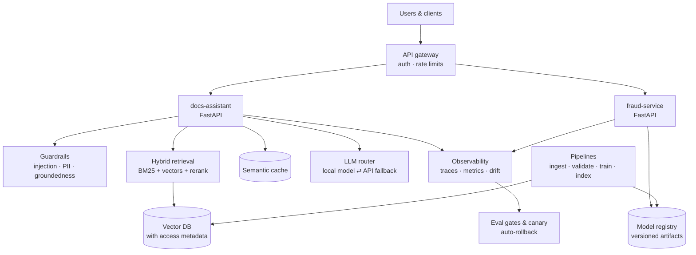

<div align="center">

# 🏭 Build Production-Grade AI Systems

**A free, hands-on course that takes you from a notebook that "works on my machine" to an AI platform you can deploy, measure, secure, scale and defend.**

Learn by doing: you join a fictional fintech as its new AI engineer and take two prototypes to production, one classic ML model and one LLM application.

[Start here](#-start-here) · [Course map](#-course-map) · [Full index](#-full-index) · [How to study](docs/how-to-study.md) · [Glossary](docs/glossary.md) · [Free resources](docs/resources.md)

</div>

---

## 👋 Who this is for

| You are… | You'll get… |
|---|---|
| A **data scientist** whose models never leave the notebook | The engineering to ship, monitor and own them |
| A **backend engineer** asked to "add AI" | The ML/LLM-specific parts: evals, drift, retrieval, inference cost |
| An **AI/LLM builder** with demos that break in production | Reliability, security, release engineering, observability |
| Preparing for **ML/AI system design interviews** | An "Interview corner" in every module, plus a defendable capstone |

**Prerequisites:** basic Python (functions, classes, `pip`, virtual environments) and Git. No ML background is needed: [Module 0](modules/00-foundations/README.md) gives you the minimum.

**Cost:** €0. Everything runs on a laptop CPU, offline. Local LLMs run through [Ollama](https://ollama.com); a deterministic fake LLM means tests and CI never need an API key.

**Time:** about **60–80 hours** in total. At 6–8 h/week that is **10–12 weeks**. Each lesson takes 30–60 minutes and each lab 2–4 hours.

---

## 🎬 The story: you are the new AI engineer at Kestrel Pay

> **From: Maya (Engineering Manager)**
> Welcome aboard! Sam, our data scientist, built two prototypes that leadership loves:
> a **fraud model** in a notebook and an **internal docs assistant** running on Sam's laptop.
> Your job over the next quarter: make both of them *real*, meaning reliable, fast, measurable, secure and cheap enough to run.
> Diego (SRE), Priya (Security), Lena (Support) and Omar (Risk) will all have opinions. Good luck!

You will build two systems side by side, because production AI work comes in both flavours:

| | Track A: `fraud-service` | Track B: `docs-assistant` |
|---|---|---|
| Type | Classic ML (tabular classifier) | LLM application (RAG) |
| Data | [Synthetic card transactions](datasets/fraud/README.md) | [Fictional company handbook](datasets/handbook/README.md) |
| Hard parts | Imbalanced labels, thresholds, calibration, drift | Retrieval quality, hallucinations, prompt injection, cost |
| Business owner | Omar (Risk) | Lena (Customer Support) |

Every lesson starts with a message from a teammate, so you always know **why** a concept matters before you learn **what** it is.

---

## 🚀 Start here

1. **Fork** this repo (top right) so you can tick your progress and commit your lab work.
2. Read **[How to study this course](docs/how-to-study.md)** (10 min). It explains the learning loop each lesson uses.
3. Complete **[Lesson 0.1: Set up your workbench](modules/00-foundations/01-setup-your-workbench.md)** and run:
   ```bash
   python3 tools/check_setup.py
   ```
4. Go through the modules **in order**. Each lab is self-contained, so if you already know a topic you can skip ahead, take the module quiz, and jump in.

---

## 🗺 Course map

```mermaid
flowchart LR
    M0["0 · Foundations<br/>setup, Python, HTTP,<br/>ML & LLMs in 1 hour"]
    M1["1 · Prototype → Production<br/>architecture, reliability,<br/>services, containers"]
    M2["2 · Data & Model Pipelines<br/>validation, RAG retrieval,<br/>experiment tracking"]
    M3["3 · Serving & Optimization<br/>inference, latency, cost,<br/>quantization, batching"]
    M4["4 · Evaluation & Monitoring<br/>metrics, LLM evals,<br/>observability, drift"]
    M5["5 · Security & Governance<br/>auth, PII, prompt injection,<br/>guardrails, regulation"]
    M6["6 · Scaling & Operations<br/>Kubernetes, releases,<br/>SLOs, agents, case studies"]
    C["🏆 Capstone<br/>deploy, cost out<br/>and defend your platform"]
    M0 --> M1 --> M2 --> M3 --> M4 --> M5 --> M6 --> C
```



And this is the system you'll have built by the end ([full architecture walkthrough](docs/architecture.md)):



---

## 📖 Full index

Legend: ⏱ estimated time · 🛠 hands-on lab · ✅ quiz · 📄 cheat sheet

### Module 0: [Foundations](modules/00-foundations/README.md) · ⏱ ~6 h
*Get your workbench ready and learn the minimum ML, LLM and API background the rest of the course builds on.*

| # | Lesson | You'll learn |
|---|---|---|
| 0.1 | [Set up your workbench](modules/00-foundations/01-setup-your-workbench.md) | uv, Git, Docker, Ollama; verify everything works |
| 0.2 | [Python for production](modules/00-foundations/02-python-for-production.md) | Packaging, type hints, Pydantic, pytest, async in one page |
| 0.3 | [HTTP and APIs](modules/00-foundations/03-http-and-apis.md) | Requests, status codes, JSON, idempotency, curl |
| 0.4 | [Machine learning in one hour](modules/00-foundations/04-ml-in-one-hour.md) | Features, labels, train/test, overfitting, why accuracy lies |
| 0.5 | [LLMs in one hour](modules/00-foundations/05-llms-in-one-hour.md) | Tokens, embeddings, context windows, sampling, RAG in one picture |
| 🛠 | [Lab 0: your first model and your first LLM call](modules/00-foundations/lab/README.md) | |
| ✅ 📄 | [Quiz](modules/00-foundations/quiz.md) · [Cheat sheet](modules/00-foundations/cheatsheet.md) | |

### Module 1: [From Prototype to Production](modules/01-prototype-to-production/README.md) · ⏱ ~10 h
*Sam's notebook becomes a layered, versioned, containerised service with retries, health checks and structured logs.*

| # | Lesson | You'll learn |
|---|---|---|
| 1.1 | [Prototype vs production and the AI lifecycle](modules/01-prototype-to-production/01-prototype-vs-production.md) | What changes in production, training/serving skew, handoff artifacts |
| 1.2 | [Architecture patterns for AI systems](modules/01-prototype-to-production/02-architecture-patterns.md) | Batch vs online, monolith vs microservices vs event-driven, building blocks |
| 1.3 | [Reliability primitives](modules/01-prototype-to-production/03-reliability-primitives.md) | Timeouts, retries with backoff and jitter, queues, graceful degradation, REST vs gRPC, streaming |
| 1.4 | [Building production services](modules/01-prototype-to-production/04-production-services.md) | Layered architecture, config and secrets, async I/O, request IDs, structured logs, health and readiness |
| 1.5 | [Artifacts, Docker and Kubernetes](modules/01-prototype-to-production/05-artifacts-and-containers.md) | Versioned artifacts with sha256, notebook → artifact → API → image, a first look at Kubernetes |
| 🛠 | [Lab 1: ship the fraud model as a containerised service](modules/01-prototype-to-production/lab/README.md) | |
| ✅ 📄 | [Quiz](modules/01-prototype-to-production/quiz.md) · [Cheat sheet](modules/01-prototype-to-production/cheatsheet.md) | |

### Module 2: [Data and Model Pipelines](modules/02-data-and-model-pipelines/README.md) · ⏱ ~14 h
*Bad data stops at the gate, retrieval finds the right document, and every model can be rebuilt from scratch.*

| # | Lesson | You'll learn |
|---|---|---|
| 2.1 | [Data pipelines and validation gates](modules/02-data-and-model-pipelines/01-data-pipelines-and-validation.md) | Batch vs streaming, ETL vs ELT, schemas, validation gates |
| 2.2 | [Lineage, versioning and leakage](modules/02-data-and-model-pipelines/02-lineage-versioning-and-leakage.md) | Data versioning, training/serving parity, catching leakage |
| 2.3 | [Deep-learning data paths](modules/02-data-and-model-pipelines/03-deep-learning-data-paths.md) | Loaders, batching, augmentation, distributed training |
| 2.4 | [Document parsing and chunking](modules/02-data-and-model-pipelines/04-document-parsing-and-chunking.md) | PDF, HTML and OCR parsing, chunking strategies, metadata |
| 2.5 | [Vector search and hybrid retrieval](modules/02-data-and-model-pipelines/05-vector-search-and-hybrid-retrieval.md) | Vector DB operations, BM25 + dense + reranking, context packaging, GraphRAG |
| 2.6 | [Experiment tracking and reproducibility](modules/02-data-and-model-pipelines/06-experiment-tracking-and-reproducibility.md) | MLflow, model registry, hyperparameter tuning, the reproducibility checklist |
| 2.7 | [Prompt, RAG or fine-tune?](modules/02-data-and-model-pipelines/07-prompt-rag-or-fine-tune.md) | A decision framework: prompting vs RAG vs LoRA vs full fine-tuning |
| 🛠 | [Lab 2: an enterprise RAG pipeline with citations + a reproducible training run](modules/02-data-and-model-pipelines/lab/README.md) | |
| ✅ 📄 | [Quiz](modules/02-data-and-model-pipelines/quiz.md) · [Cheat sheet](modules/02-data-and-model-pipelines/cheatsheet.md) | |

### Module 3: [Serving, Inference and Optimization](modules/03-serving-and-optimization/README.md) · ⏱ ~12 h
*Make the assistant faster and cheaper, and prove it with benchmarks.*

| # | Lesson | You'll learn |
|---|---|---|
| 3.1 | [Serving architecture](modules/03-serving-and-optimization/01-serving-architecture.md) | Dedicated inference services; vLLM, SGLang, Triton, Ray Serve |
| 3.2 | [How LLM inference really works](modules/03-serving-and-optimization/02-how-llm-inference-works.md) | Prefill vs decode, memory-bound vs compute-bound, KV cache |
| 3.3 | [Topologies and unit economics](modules/03-serving-and-optimization/03-topologies-and-unit-economics.md) | Routers, cascades, fallbacks; self-hosted vs API cost |
| 3.4 | [Measure first: profiling and load testing](modules/03-serving-and-optimization/04-measure-first-profiling-and-load-testing.md) | p50/p95/p99, TTFT, throughput, baselines |
| 3.5 | [Caching, batching and autoscaling](modules/03-serving-and-optimization/05-caching-batching-and-autoscaling.md) | Semantic caching, dynamic vs continuous batching, scaling signals |
| 3.6 | [Model compression](modules/03-serving-and-optimization/06-model-compression.md) | Quantization, mixed precision, pruning, distillation |
| 3.7 | [Runtimes, kernels and decoding tricks](modules/03-serving-and-optimization/07-runtimes-kernels-and-decoding-tricks.md) | ONNX Runtime, TensorRT, OpenVINO, FlashAttention, speculative decoding, gRPC contracts |
| 🛠 | [Lab 3: benchmark, cache, quantize and cost out](modules/03-serving-and-optimization/lab/README.md) | |
| ✅ 📄 | [Quiz](modules/03-serving-and-optimization/quiz.md) · [Cheat sheet](modules/03-serving-and-optimization/cheatsheet.md) | |

### Module 4: [Evaluation and Monitoring](modules/04-evaluation-and-monitoring/README.md) · ⏱ ~12 h
*Gate releases on automated quality checks and spot quality slipping before users complain.*

| # | Lesson | You'll learn |
|---|---|---|
| 4.1 | [Offline vs online evaluation and classification metrics](modules/04-evaluation-and-monitoring/01-offline-vs-online-and-classification-metrics.md) | Precision, recall, F1, ROC-AUC vs PR-AUC |
| 4.2 | [Thresholds and calibration](modules/04-evaluation-and-monitoring/02-thresholds-and-calibration.md) | Cost-based threshold sweeps, reliability diagrams, Brier score, Platt, isotonic |
| 4.3 | [Evaluating LLM systems](modules/04-evaluation-and-monitoring/03-evaluating-llm-systems.md) | Golden sets, RAGAS, DeepEval, LLM-as-judge calibration, multi-turn, red-team packs |
| 4.4 | [Observability: tracing and metrics](modules/04-evaluation-and-monitoring/04-observability-tracing-and-metrics.md) | OpenTelemetry, Prometheus, Grafana, what to trace in LLM apps |
| 4.5 | [Drift and alerting](modules/04-evaluation-and-monitoring/05-drift-and-alerting.md) | Data, concept, embedding and prompt drift; outcome-based alerts |
| 4.6 | [Progressive delivery and prompt registries](modules/04-evaluation-and-monitoring/06-progressive-delivery-and-prompt-registries.md) | CT vs CI/CD, shadow → canary → full, rollback gates, prompt versioning |
| 🛠 | [Lab 4: eval gate in CI, dashboards and drift detection](modules/04-evaluation-and-monitoring/lab/README.md) | |
| ✅ 📄 | [Quiz](modules/04-evaluation-and-monitoring/quiz.md) · [Cheat sheet](modules/04-evaluation-and-monitoring/cheatsheet.md) | |

### Module 5: [Security and Governance](modules/05-security-and-governance/README.md) · ⏱ ~12 h
*The assistant only answers from documents each user may see, and blocks prompt injection with layered defences.*

| # | Lesson | You'll learn |
|---|---|---|
| 5.1 | [Threat landscape and the OWASP LLM Top 10](modules/05-security-and-governance/01-threat-landscape-and-owasp-llm-top-10.md) | Threat modelling AI systems |
| 5.2 | [Prompt injection and jailbreaks](modules/05-security-and-governance/02-prompt-injection-and-jailbreaks.md) | Direct and indirect injection, why there is no single fix |
| 5.3 | [Authentication and authorization](modules/05-security-and-governance/03-authentication-and-authorization.md) | Tokens, JWT, RBAC, permission-aware retrieval, vector store protection |
| 5.4 | [Privacy: PII and encryption](modules/05-security-and-governance/04-privacy-pii-and-encryption.md) | PII detection and redaction in prompts, logs and responses; encryption |
| 5.5 | [Guardrails and groundedness](modules/05-security-and-governance/05-guardrails-and-groundedness.md) | Input/output filters, structured-output contracts, groundedness checks, audit logs |
| 5.6 | [Governance, documentation and regulation](modules/05-security-and-governance/06-governance-documentation-and-regulation.md) | Model cards, datasheets, fairness, explainability, EU AI Act, NIST AI RMF |
| 5.7 | [Prompt and policy registry](modules/05-security-and-governance/07-prompt-and-policy-registry.md) | Versioning, review, offline checks, release, rollback |
| 🛠 | [Lab 5: lock down the assistant](modules/05-security-and-governance/lab/README.md) | |
| ✅ 📄 | [Quiz](modules/05-security-and-governance/quiz.md) · [Cheat sheet](modules/05-security-and-governance/cheatsheet.md) | |

### Module 6: [Scaling and Operations](modules/06-scaling-and-operations/README.md) · ⏱ ~12 h
*Release to a slice of traffic, roll back automatically, keep humans in the loop, and cost it all out.*

| # | Lesson | You'll learn |
|---|---|---|
| 6.1 | [Kubernetes and managed ML platforms](modules/06-scaling-and-operations/01-kubernetes-and-managed-platforms.md) | EKS/GKE/AKS, ECS, Vertex AI, SageMaker, Azure ML |
| 6.2 | [Workflow orchestration](modules/06-scaling-and-operations/02-workflow-orchestration.md) | Airflow, Prefect, Dagster, Kubeflow, Ray, and how to choose |
| 6.3 | [GPUs, autoscaling and capacity planning](modules/06-scaling-and-operations/03-gpus-autoscaling-and-capacity.md) | GPU scheduling, node pools, capacity maths |
| 6.4 | [Release engineering and SLOs](modules/06-scaling-and-operations/04-release-engineering-and-slos.md) | Canary, blue-green, auto-rollback, SLOs and error budgets |
| 6.5 | [Incident response and on-call](modules/06-scaling-and-operations/05-incident-response-and-on-call.md) | Severity, roles, runbooks, blameless postmortems |
| 6.6 | [Agents in production](modules/06-scaling-and-operations/06-agents-in-production.md) | Planner/worker, human approval gates, agent tracing, when *not* to use agents |
| 6.7 | [Case studies](modules/06-scaling-and-operations/07-case-studies.md) | Recommendation and search, fintech risk scoring, consumer assistants |
| 🛠 | [Lab 6: deploy the platform with a canary, a cost report and a supervised agent](modules/06-scaling-and-operations/lab/README.md) | |
| ✅ 📄 | [Quiz](modules/06-scaling-and-operations/quiz.md) · [Cheat sheet](modules/06-scaling-and-operations/cheatsheet.md) | |

### 🏆 [Capstone: present a system you can explain, cost out and defend](capstone/README.md) · ⏱ ~10 h

---

## ✅ Track your progress

Tick the boxes in **your fork** as you go. GitHub renders them as a progress bar on your fork's page.

- [ ] Module 0: Foundations
- [ ] Module 1: From Prototype to Production
- [ ] Module 2: Data and Model Pipelines
- [ ] Module 3: Serving, Inference and Optimization
- [ ] Module 4: Evaluation and Monitoring
- [ ] Module 5: Security and Governance
- [ ] Module 6: Scaling and Operations
- [ ] 🏆 Capstone

Want more detail? Copy [`docs/progress-journal.md`](docs/progress-journal.md) into your fork and fill it in after every lesson.

---

## 🧰 What's in the repo

```
modules/            7 modules: lessons, labs, quizzes, cheat sheets
capstone/           final project brief, rubric, presentation guide
datasets/           synthetic fraud data generator, fictional handbook, golden eval set
templates/          design doc, ADR, model card, runbook, postmortem
docs/               how to study, architecture, glossary, curated free resources
tools/              setup checker
```

## 🤝 Contributing

Found a mistake or a broken link, or have a better free resource? Issues and PRs are welcome. Please read [docs/course-conventions.md](docs/course-conventions.md) first; it describes the lesson template and code rules every module follows.

## 📜 License

[MIT](LICENSE): free to use, copy, modify and share, including commercially, as long as you keep the copyright notice. External resources linked from the lessons keep their own licences.

## 🙏 Acknowledgements

The syllabus scope was inspired by the public outline of industry production-AI courses. All explanations, code, data and exercises here are original, and every external resource linked is free and credited to its authors.
