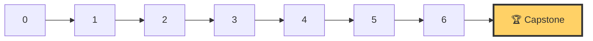

# 🏆 Capstone: present a system you can explain, cost out and defend

> ⏱ ~10 hours · 🧰 Needs: Modules 1–6 (or equivalent experience)

[Course home](../README.md) › Capstone

## 📨 The situation

> **From: Maya (Engineering Manager)**
> Quarter's over. Next Thursday you present the AI platform to the architecture review board: Diego, Priya, Lena, Omar and our CTO.
> They'll want to know three things: **does it work, what does it cost, and what happens when it breaks?**
> Bring a design doc, a live demo and numbers you measured yourself. Expect hard questions.

The capstone is not a new lab. It's where you **integrate, measure and communicate** what you built. That last skill, defending a design with evidence, is what gets engineers promoted and gets candidates through senior system-design interviews.

## 🎯 By the end you can

- Run both services end to end with evals, observability, security and a canary release
- Write a design doc that a senior reviewer would approve
- Present the cost of the system per request and per month, with assumptions
- Answer "what happens when X fails?" for every component, from evidence

## 📦 Deliverables

Put everything under `capstone/my-submission/` in your fork.

| # | Deliverable | Template / source |
|---|---|---|
| 1 | **Integrated system**: `docker compose up` (or kind + manifests) brings up `docs-assistant`, `fraud-service`, observability | Labs 1–6 |
| 2 | **Design doc** (5–10 pages) | [templates/design-doc.md](../templates/design-doc.md) |
| 3 | **3 ADRs** for your most important decisions | [templates/adr.md](../templates/adr.md) |
| 4 | **Eval report**: golden-set results, red-team results, fraud metrics at your chosen threshold | Lab 4 |
| 5 | **Cost report**: per-request and monthly cost, API vs self-hosted, top 3 cost levers | Labs 3 and 6 |
| 6 | **Model card** for `fraud-service` and a **datasheet** for the handbook corpus | [templates/model-card.md](../templates/model-card.md), Lab 5 |
| 7 | **Runbook** for your top alert and a **postmortem** of one failure you caused on purpose | [templates/runbook.md](../templates/runbook.md), [templates/postmortem.md](../templates/postmortem.md) |
| 8 | **10-minute recorded demo** (or a written walkthrough with screenshots) | See script below |

## 🧭 Suggested plan

| Step | Time | What to do |
|---|---|---|
| 1. Integrate | 3 h | Start from your Lab 5 `docs-assistant` and Lab 1/4 `fraud-service`. Add a single `docker-compose.yml` (or kustomize overlay) that runs both plus Prometheus and Grafana. |
| 2. Measure | 2 h | Run the Lab 3 load test, the Lab 4 eval suite and the Lab 4 drift report against the integrated system. Save raw outputs. |
| 3. Break it on purpose | 1 h | Pick one failure: dependency timeout, bad prompt release, drifted data. Trigger it, watch your alerts, roll back, and write the postmortem. |
| 4. Write | 3 h | Design doc, ADRs, cost report, model card. Use **your measured numbers**. |
| 5. Rehearse | 1 h | Record the demo. Then answer the review-board questions below out loud, 2 minutes each. |

## 🎬 Demo script (10 minutes)

1. **The problem** (1 min): who uses each service and why it matters.
2. **Architecture** (2 min): one diagram; follow a single request through it.
3. **Live** (3 min): a customer question with citations; an access-denied question; an injection attempt being blocked; a fraud score with its explanation.
4. **Evidence** (2 min): eval gate output, Grafana dashboard, p95 latency, cost per 1,000 requests.
5. **Failure** (2 min): the failure you caused, how it was detected, how it was rolled back.

## 🎤 The review board will ask

Prepare a 2-minute answer with evidence for each:

1. **Diego (SRE):** What's your p95 latency, and what dominates it? What happens when the LLM provider is down?
2. **Priya (Security):** How do you guarantee a customer can never see HR documents? What stops indirect prompt injection?
3. **Lena (Support):** How do you know answers are correct, and how will you know if they get worse next month?
4. **Omar (Risk):** Why this fraud threshold? What does a false negative cost us vs a false positive?
5. **CTO:** What does this cost per month at 10× today's traffic? Would you self-host? What would you build next, and what would you *not* build?

## 📊 Rubric (self-assess, or ask a peer to review)

| Criterion | 1 · Missing | 2 · Basic | 3 · Solid | 4 · Excellent |
|---|---|---|---|---|
| **Works end to end** | Services don't run together | Run, manual steps needed | One command, documented | One command, health-checked, reproducible from a clean clone |
| **Evidence** | No numbers | Some numbers, unclear provenance | Measured latency, quality and cost with methods | Before/after comparisons, confidence and caveats stated |
| **Reliability** | No failure handling | Timeouts/retries only | Fallbacks, alerts, rollback demonstrated | Failure injected, detected, rolled back, postmortem written |
| **Quality & evals** | No evals | Manual spot checks | Golden set + eval gate in CI | + LLM-judge validated against human labels, red-team pack, drift checks |
| **Security** | None | Auth only | Auth + RBAC retrieval + PII redaction | + layered injection defence, audit log, threat model mapped to OWASP |
| **Cost** | Not considered | Rough guess | Per-request and monthly with assumptions | + API vs self-hosted break-even and ranked cost levers |
| **Communication** | No design doc | Doc lists components | Doc explains trade-offs and alternatives | A reviewer could approve it as-is; ADRs capture key decisions |

**Passing bar:** at least 3 in every row. **Portfolio-ready:** at least 3 everywhere and 4 in three rows or more.

## 🚀 Stretch goals

- Put a real OpenAI-compatible server (vLLM on a free cloud GPU notebook, or Ollama) behind the LLM router with automatic fallback to the API.
- Add a GitHub Actions workflow that runs unit tests, the eval gate and a container build on every PR.
- Run shadow mode for a new prompt version for a day of synthetic traffic and compare the results.
- Write a one-page "what I would do with €50k and 3 engineers next quarter" roadmap.

## 🎉 When you're done

1. Tick the Capstone box in the course README in your fork.
2. Pin your fork on your GitHub profile and link the design doc from your CV or LinkedIn.
3. Consider opening a PR to this repo with improvements you wish the course had: that's how it gets better for the next learner.
