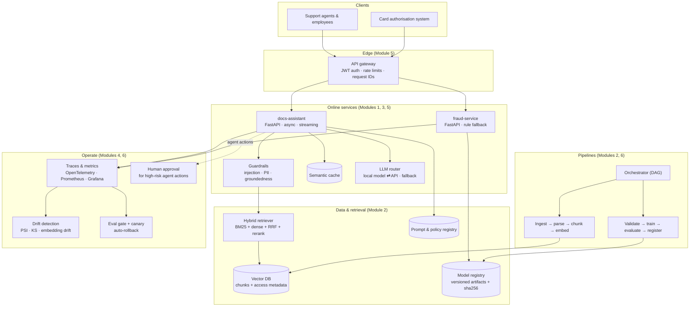

# Reference architecture: the Kestrel Pay AI platform

This page shows the system you build across the course and **which module adds which piece**. Come back to it at the start of every module to see where the new piece fits: knowing the whole picture is what separates an AI *engineer* from someone who can call a model.

---

## The end state



## How the system grows, module by module

| Module | `fraud-service` (Track A) | `docs-assistant` (Track B) | Platform |
|---|---|---|---|
| **0** | Logistic regression in a script | First LLM call, embeddings | Your laptop toolchain |
| **1** | Versioned artifact → layered FastAPI → Docker image, retries, rule fallback | Streaming responses, async LLM adapter | Health/readiness, structured logs, request IDs |
| **2** | Validation gate, leakage check, MLflow tracking, registry | Parsing, chunking, hybrid retrieval, citations | Reproducibility checklist |
| **3** | ONNX export and runtime benchmark | Semantic cache, batching, quantization, cost model | Load testing, p95 baselines |
| **4** | Cost-based threshold, calibration, drift | Golden-set evals, LLM-as-judge, red-team pack | Eval gate in CI, Prometheus + Grafana, prompt registry |
| **5** | Model card, fairness notes | JWT, role-based retrieval, PII redaction, guardrails | Audit log, policy registry, regulatory mapping |
| **6** | Canary rollout, SLOs | Supervised refund agent with human approval | Kubernetes, orchestration, capacity and cost report |

## Design principles used throughout

1. **Layers, not scripts.** HTTP concerns (`api/`), business rules (`domain/`) and external systems (`adapters/`) live apart, so you can swap a model, a vector DB or an LLM provider without touching business logic.
2. **Everything is versioned.** Code (Git), data (digest), models (sha256 artifacts), prompts and policies (registry). If you can't name the version, you can't roll it back.
3. **Fail safe, not silent.** Timeouts on every call, bounded retries, a rule-based fallback for fraud, an honest "I don't know" for the assistant.
4. **Measure before you optimise.** Baseline p50/p95 latency and cost first, then change one thing at a time.
5. **Gates, not hopes.** Data validation gates, eval gates and canary gates stop bad changes automatically.
6. **Least privilege for models too.** The LLM only sees documents the user may see, and agents need approval for risky actions.
7. **Free and local by default.** The fake LLM and hash embeddings keep tests deterministic; Ollama and sentence-transformers make it real; any OpenAI-compatible API makes it production-like.

## Swappable providers

| Concern | Default (tests, CI) | Local, realistic | Production-like |
|---|---|---|---|
| LLM | `fake` (deterministic) | `ollama` (`qwen2.5:1.5b-instruct`) | `openai` (any OpenAI-compatible endpoint, e.g. a vLLM server) |
| Embeddings | `hash` (no download) | `sentence-transformers` (`all-MiniLM-L6-v2`) | Hosted embedding API |
| Vector DB | Qdrant in-memory | Qdrant in Docker | Managed Qdrant / pgvector |
| Tracking | MLflow local files | MLflow server in Docker | Managed MLflow / W&B |

Select providers with environment variables, for example:

```bash
export KESTREL_LLM_PROVIDER=ollama
export KESTREL_EMBEDDINGS_PROVIDER=sentence-transformers
```
