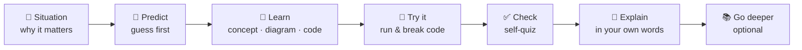

# How to study this course

> ⏱ 10 minutes. Read this once before Module 0; it will save you hours later.

Most people who start a free course don't finish it. The usual reasons are reading without doing, no feedback, and no schedule. This course is built to fight all three. Here is how to get the most out of it.

---

## 1. The learning loop in every lesson

Every lesson follows the same structure, so you always know where you are:

| Section | What to actually do | Why |
|---|---|---|
| 📨 **The situation** | Read it and picture yourself at Kestrel Pay. What would you say to that teammate? | Knowing *why* you need something makes it stick. |
| 🤔 **Predict first** | **Write down** an answer before reading, even a wild guess. | Being wrong first and then corrected is one of the strongest memory boosters known ("pretesting effect"). |
| 📖 **Concepts** | Read actively. Redraw the diagrams on paper. | Drawing forces you to understand the structure. |
| 🧪 **Try it** | Type the commands; don't just read them. Change one parameter and predict the result. | Skills come from doing, not watching. |
| ✅ **Check yourself** | Answer **before** opening the `
` block. | Retrieval practice beats re-reading by a wide margin. |
| 💬 **Explain it back** | Say it out loud, or write 3–5 sentences in your [progress journal](progress-journal.md). | If you can't explain it simply, you've found your gap (the Feynman technique). |
| 📚 **Go deeper** | Read the ⭐ resource. Leave the 🔍 ones for when you need them. | Depth on demand avoids drowning in links. |

---

## 2. Labs: run it, break it, extend it

Each module ends with a lab: a small but real codebase with tests.

1. **Run it.** Follow the steps and compare your output to the "expected output" blocks.
2. **Break it 💥.** Each lab has deliberate experiments: kill a dependency, corrupt an artifact, inject bad data. Production engineering is mostly about failure; you learn it by causing failures safely.
3. **Extend it 🚀.** Exercises with hints and hidden solutions. Try for at least 20 minutes before opening a solution.

> 💡 Commit your lab work to your fork after every session. A green commit history is a portfolio and a motivation tool.

---

## 3. A realistic schedule

The course takes about 60–80 hours. Pick a pace you can sustain and keep to it:

| Pace | Hours/week | Duration | Suggested rhythm |
|---|---|---|---|
| 🐢 Steady | 4–5 | ~16 weeks | 2 lessons on weekday evenings + lab on the weekend |
| 🚶 Standard | 6–8 | ~10–12 weeks | 1 lesson per weekday + lab on the weekend |
| 🏃 Intensive | 15–20 | ~4–5 weeks | Full-time study or a bootcamp-style sprint |

**Rule of thumb:** never let more than 3 days pass without touching the course. Short and regular beats long and rare.

---

## 4. Spaced review: don't forget Module 1 by Module 5

- Every **module quiz** includes 2–3 questions from earlier modules. Don't skip them.
- Every **module has a one-page cheat sheet.** Re-read the previous module's cheat sheet before you start a new module (5 minutes).
- At the end of each module, fill in the **self-assessment rubric** in the module README. Anything you rate 1 or 2 goes on your review list.

---

## 5. When you get stuck

1. Re-read the error message slowly. Most errors say exactly what's wrong.
2. Check the lab's **Troubleshooting** section.
3. Run the tests: `uv run pytest -x -q` shows you the first failure.
4. Explain the problem out loud, step by step ("rubber duck debugging"). This solves a surprising share of problems.
5. Search the official docs (linked in every lesson's 📚 section).
6. Still stuck? Open an issue on this repo with: what you ran, what you expected, what you got, and your OS.

---

## 6. Making it count for your career

- **Your fork is your portfolio.** By the end it contains two production-style services, eval gates, dashboards, Kubernetes manifests and a design doc.
- **Interview corner** sections list the system-design questions each module prepares you for. Practise answering them out loud in 10 minutes.
- **The capstone** asks you to present and defend your system, which is exactly what senior interviews and design reviews look like.

Ready? → [Module 0: Foundations](../modules/00-foundations/README.md)
