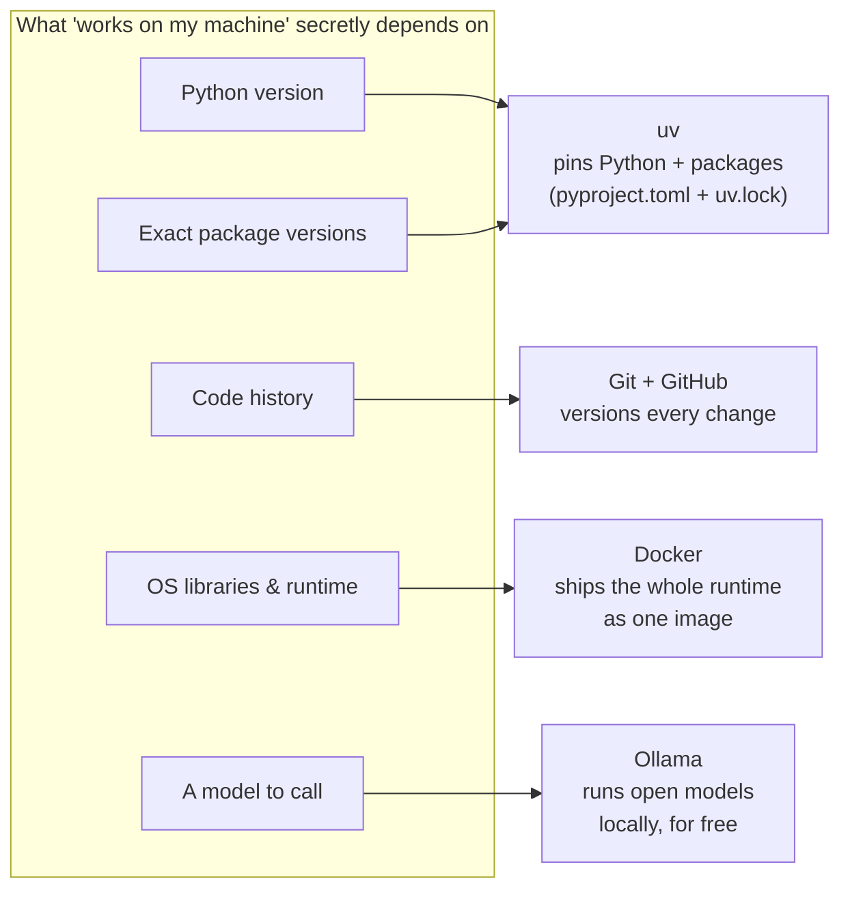
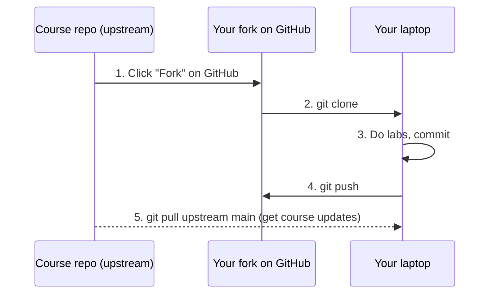

# Lección 0.1: Prepara tu entorno de trabajo
<!-- id: l-0-1 -->

> ⏱ ~60 min (casi todo esperando descargas) · 🎚 Nivel: Core · 🧰 Requisitos: un portátil con ~10 GB libres en disco y permisos de administrador

[Inicio del curso](../../README.md) › [Módulo 0](README.md) › Lección 0.1

## 📨 La situación

> **De: Diego (SRE / platform lead)**
> ¡Hola! Antes de que escribas una sola línea de código: los prototipos de Sam solo funcionan en el portátil de Sam, con versiones de Python y paquetes que nadie apuntó.
> No vamos a repetirlo. Tu máquina tiene que construir **exactamente** lo que construye CI y lo que se ejecuta en producción.
> Instala las herramientas estándar, ejecuta el comprobador y avísame cuando esté todo en verde. 🟢

## 🎯 Al terminar podrás

- **Instalar** las cinco herramientas que usa este curso (uv, Git, Docker, Ollama y un editor) en macOS, Linux o Windows (WSL2).
- **Explicar** qué problema resuelve cada herramienta en un flujo de trabajo de IA en producción.
- **Verificar** tu entorno con `python3 tools/check_setup.py` y arreglar los fallos más comunes.
- **Hacer un fork** del curso y seguir tu progreso en tu propia copia.

## 🤔 Predice primero

Responde mentalmente antes de seguir leyendo:

1. Dos personas ejecutan `pip install fastapi` con un mes de diferencia. ¿Obtendrán el mismo código? ¿Por qué podría importar? <!-- id: p-0-1-1 -->
2. ¿Por qué ejecutarías una aplicación dentro de un *contenedor* si ya funciona bien en tu portátil? <!-- id: p-0-1-2 -->
3. ¿Por qué querría un curso que ejecutes un LLM **en local** en lugar de usar simplemente una clave de API? <!-- id: p-0-1-3 -->

---

## 1. Por qué las herramientas son el primer problema de producción

«Funciona en mi máquina» es la frase más cara del software. Un notebook que funcionaba en el portátil de Sam depende de cientos de cosas invisibles: la versión de Python, la versión exacta de cada paquete (y de *sus* dependencias), las variables de entorno, archivos en una carpeta del escritorio de Sam e incluso la arquitectura de la CPU.

La ingeniería de producción empieza por hacer que cada una de esas cosas invisibles sea **explícita y reproducible**. Esto es lo que fija cada herramienta del curso:



| Herramienta | Problema que resuelve | Dónde la usarás |
|---|---|---|
| **uv** | Instala el Python correcto y las versiones *exactas* de los paquetes, muy rápido | En todos los labs |
| **Git** | Registra cada cambio para que puedas revisarlo, revertirlo y colaborar | En todos los labs; CI en el módulo 4 |
| **Docker** | Empaqueta código, dependencias y bibliotecas del sistema operativo en una sola imagen portable | Del módulo 1 en adelante |
| **Ollama** | Ejecuta LLMs de pesos abiertos en tu portátil con una API HTTP | Opcional en todos los labs con LLM |
| **Editor** (VS Code o PyCharm) | Comprobación de tipos, depuración, ejecución de tests | En todas partes |

> 💡 **Consejo de producción:** tu portátil, CI y producción solo deberían diferir en la **configuración** (URLs, secretos, tamaños), nunca en el **código ni en las versiones de las dependencias**. Es una de las ideas centrales de [The Twelve-Factor App](https://12factor.net/), que estudiarás en el módulo 1.

---

## 2. Instala las herramientas

Elige tu sistema operativo. Instala **en este orden**.

### 2.1 Si usas Windows: empieza por WSL2

Los sistemas de IA en producción se ejecutan en Linux. En Windows, instala el **Subsistema de Windows para Linux (WSL2)** y haz todo el curso dentro de él. Te da un entorno Ubuntu real, y todos los comandos del curso funcionarán sin cambios.

```powershell
# PowerShell as Administrator
wsl --install
```

Reinicia, abre la aplicación «Ubuntu», crea un usuario de Linux y, a partir de ahí, sigue las instrucciones de **Linux** *dentro* de Ubuntu. Guía oficial: [Install WSL](https://learn.microsoft.com/en-us/windows/wsl/install).

> ⚠️ **Error común:** clonar el repositorio en `C:\Users\...` y trabajar en él desde WSL. El acceso a archivos a través de la frontera entre Windows y Linux es muy lento y provoca rarezas con los permisos. Clónalo **dentro** de tu carpeta personal de Linux (`~/code/...`).

### 2.2 Git

| Sistema | Comando |
|---|---|
| macOS | `xcode-select --install` (o `brew install git`) |
| Ubuntu / WSL2 | `sudo apt update && sudo apt install -y git` |

Después, dile a Git quién eres (lo estampa en cada commit):

```bash
git config --global user.name "Your Name"
git config --global user.email "you@example.com"
git config --global init.defaultBranch main
```

### 2.3 uv (Python y paquetes)

[uv](https://docs.astral.sh/uv/) es un gestor de paquetes y proyectos de Python. Sustituye a `pip`, `venv`, `pyenv` y `pip-tools` con una sola herramienta rápida, y puede **descargar por ti la versión correcta de Python**.

```bash
# macOS / Linux / WSL2
curl -LsSf https://astral.sh/uv/install.sh | sh
# restart your terminal, then:
uv --version
```

**No** necesitas instalar Python por separado para los labs: cada lab tiene un archivo `.python-version` (3.12), y `uv sync` descarga esa versión automáticamente. Sí necesitas *algún* `python3` en tu PATH (3.11 o superior) para ejecutar el comprobador de la raíz del repositorio; macOS y Ubuntu suelen traer uno, y si no, `uv python install 3.12` te lo da.

> 🔎 **Por dentro:** `uv sync` lee `pyproject.toml` (lo que *pediste*, p. ej. `fastapi>=0.115`) y `uv.lock` (lo que *realmente se resolvió*, p. ej. `fastapi==0.118.0` más cada dependencia transitiva con sus hashes). El lock file es lo que hace que dos instalaciones con un mes de diferencia sean idénticas. La lección 0.2 lo explica en detalle.

### 2.4 Docker

Docker construye y ejecuta **contenedores**: procesos aislados que llevan su propio sistema de archivos, sus bibliotecas y su runtime. En el módulo 1 empaquetarás el modelo de fraude como una imagen de Docker; los módulos 4–6 usan Docker Compose para ejecutar Prometheus, Grafana y compañía.

| Sistema | Instalación |
|---|---|
| macOS | [Docker Desktop](https://docs.docker.com/desktop/) (gratis para uso personal, educación y pequeñas empresas; revisa las condiciones de la licencia para tu empresa) o la alternativa de código abierto [Colima](https://github.com/abiosoft/colima) |
| Ubuntu / WSL2 | [Docker Engine](https://docs.docker.com/engine/install/ubuntu/), o Docker Desktop con la integración con WSL2 activada |

Compruébalo:

```bash
docker run --rm hello-world
```

Deberías ver `Hello from Docker!`. Si en Linux recibes `permission denied`, añade tu usuario al grupo `docker` (`sudo usermod -aG docker $USER`, y luego cierra la sesión y vuelve a entrar).

### 2.5 Ollama (opcional, recomendado)

[Ollama](https://ollama.com) ejecuta LLMs de pesos abiertos en local y los expone mediante una API HTTP en `http://localhost:11434`. Así puedes aprender todo sobre servir LLMs, streaming, latencia y coste **sin clave de API ni tarjeta de crédito**.

```bash
# macOS: download the app from https://ollama.com/download
# Linux / WSL2:
curl -fsSL https://ollama.com/install.sh | sh

ollama pull qwen2.5:1.5b-instruct   # ~1 GB download, runs on CPU
ollama run qwen2.5:1.5b-instruct "Say hello in five words."
```

¿Por qué este modelo? Es lo bastante pequeño para ejecutarse en un portátil solo con CPU y 8 GB de RAM, y aun así sigue las instrucciones lo bastante bien como para demostrar RAG, llamadas a herramientas y guardrails. Si tienes 16 GB de RAM o más y quieres mejores respuestas, prueba más adelante un modelo de 3B–8B; el código del curso lee el nombre del modelo de `KESTREL_OLLAMA_MODEL`, así que no cambia nada más.

> 💡 **Consejo de producción:** todos los labs usan por defecto un **LLM falso y determinista**, así que los tests nunca dependen de Ollama, de una GPU ni de internet. Los modelos reales son *opcionales*, para experimentar. Esa separación (tests deterministas, modelos reales en las evaluaciones) es exactamente cómo los equipos de LLM en producción mantienen CI rápida y fiable.

### 2.6 Un editor

Sirve cualquier editor. Dos buenas opciones gratuitas:

- **VS Code** con las extensiones *Python* y *Pylance*. Abre la carpeta de un lab y elige el intérprete en `.venv/bin/python` (paleta de comandos → *Python: Select Interpreter*). Para WSL, instala la extensión *WSL* y abre la carpeta desde dentro de Ubuntu con `code .`.
- **PyCharm Community Edition**. Apunta el intérprete del proyecto al `.venv` del lab.

Activa **formatear al guardar** y la **comprobación de tipos (basic)**. En este curso leerás mucho código con type hints, y tu editor detectará errores antes de que ejecutes nada.

---

## 3. Consigue el curso y sigue tu progreso

### 3.1 Haz un fork y clona tu fork

Un **fork** es tu propia copia del repositorio en GitHub. Ahí haces commit de tus soluciones de los labs y marcas las casillas de progreso, sin afectar a nadie más.



```bash
# 1. On GitHub, click "Fork" on the course page.
# 2. Clone YOUR fork (replace <you>):
git clone https://github.com/<you>/Build-Production-Grade-AI-Systems.git
cd Build-Production-Grade-AI-Systems

# 5. Later, to receive course updates:
git remote add upstream https://github.com/elrincondeldev/Build-Production-Grade-AI-Systems.git
git pull upstream main
```

Guía de GitHub: [Fork a repository](https://docs.github.com/en/pull-requests/collaborating-with-pull-requests/working-with-forks/fork-a-repo).

### 3.2 Sigue tu progreso

- Marca las casillas de los módulos en el `README.md` de la raíz de tu fork. GitHub muestra las tareas marcadas como un indicador de progreso.
- Después de cada lección, escribe tres líneas en tu copia de [`docs/progress-journal.md`](../../../../docs/progress-journal.md): *qué he aprendido, qué me ha confundido, una pregunta*. Ponerlo por escrito es práctica de recuperación, y te da material para entrevistas más adelante.
- Haz commit al final de cada lab: `git add -A && git commit -m "lab N: <what you did>"`. El historial de tu fork se convierte en un portfolio visible.

---

## 4. Comprueba todo

Desde la raíz del repositorio:

```bash
python3 tools/check_setup.py
```

El comprobador tiene dos grupos. **Obligatorio** (debe mostrar un ✔ verde): Python ≥ 3.11, uv, Git y el generador de datos compartido. **Opcional** (por ahora vale con un • amarillo): el daemon de Docker (módulos 1, 4 y 6), Ollama con un modelo descargado (respuestas de un LLM real), kubectl y kind (módulo 6). Solo termina con código 1 si falla una comprobación obligatoria.

Después ejecuta la batería de tests del Lab 0. Es la prueba real de que tu entorno puede construir un lab desde cero:

```bash
cd modules/00-foundations/lab
uv sync
uv run pytest
```

**Salida esperada:**

```
.................................                                        [100%]
33 passed in 3.8s
```

### 🩺 Solución a los problemas habituales

| Síntoma | Causa probable | Solución |
|---|---|---|
| `uv: command not found` | No has reiniciado la shell después de instalar | Abre una terminal nueva, o `source ~/.zshrc` / `~/.bashrc` |
| `uv sync` falla con errores de SSL o de proxy | Red corporativa | Define `HTTPS_PROXY` o prueba otra red; consulta la documentación de uv sobre proxies |
| `Cannot connect to the Docker daemon` | Docker Desktop / Colima no está en marcha | Arráncalo; en Linux, `sudo systemctl start docker` |
| `permission denied ... docker.sock` (Linux) | Tu usuario no está en el grupo `docker` | `sudo usermod -aG docker $USER`, y luego cierra la sesión y vuelve a entrar |
| Comprobación de Ollama ⚠️ | La aplicación no está en marcha o el modelo no está descargado | Arranca Ollama; `ollama pull qwen2.5:1.5b-instruct` |
| Los tests fallan con `Could not find the course repo root` | Ejecutas el lab desde una carpeta copiada | Ejecútalo desde dentro del repositorio clonado, o define `KESTREL_DATA_DIR=/path/to/repo/datasets` |
| Todo va lento en Windows | Repositorio clonado bajo `C:\` | Vuelve a clonarlo dentro de la carpeta personal de WSL |

> ⚠️ **Error común:** «arreglar» una instalación que falla con `sudo pip install ...`. Eso escribe en el Python del sistema, puede romper herramientas del sistema operativo y hace que tu entorno sea *menos* reproducible. Con uv nunca necesitas `sudo` para paquetes de Python.

---

## 🧪 Pruébalo

1. Ejecuta el comprobador y los tests del Lab 0 (arriba) hasta que todo pase.
2. Demuestra que `uv.lock` fija las versiones:
   ```bash
   cd modules/00-foundations/lab
   grep -A2 '^name = "fastapi"' uv.lock
   ```
   **Resultado esperado:** una línea `version = "..."` con una única versión exacta. Eso es lo que obtiene *cualquiera* que ejecute `uv sync` en este commit.
3. Demuestra el aislamiento de Docker:
   ```bash
   docker run --rm python:3.12-slim python -c "import sys; print(sys.version)"
   python3 -c "import sys; print(sys.version)"
   ```
   **Resultado esperado:** el contenedor imprime Python 3.12.x aunque tu portátil tenga otra versión. El contenedor lleva su propio runtime.
4. *(Opcional)* Pregunta algo a tu modelo local y mide el tiempo:
   ```bash
   time ollama run qwen2.5:1.5b-instruct "What is a chargeback? One sentence."
   ```
   Ejecútalo dos veces. La primera ejecución incluye **cargar el modelo en memoria**, así que es bastante más lenta. Recuerda este efecto de «arranque en frío» (cold start): importa mucho cuando escales automáticamente servidores de modelos en el módulo 6.

## 🏭 En el mundo real

Los equipos que ponen ML en producción de forma fiable tratan el entorno de desarrollo como código. El repositorio fija la versión de Python y las dependencias, CI reconstruye el entorno desde cero en cada cambio, y la misma imagen de contenedor pasa de staging a producción. Los entornos reproducibles también son un requisito básico de las listas de comprobación de reproducibilidad de ML que usan congresos de investigación como NeurIPS: si un resultado no se puede reconstruir, nadie puede fiarse de él ni depurarlo. En la lección 2.6 escribirás tu propia lista de comprobación de reproducibilidad.

## ✅ Comprueba lo aprendido

<details><summary>P1. ¿Qué diferencia hay entre <code>pyproject.toml</code> y <code>uv.lock</code>? <!-- id: c-0-1-1 --></summary>

`pyproject.toml` declara lo que **quieres** (a menudo rangos, como `fastapi>=0.115`). `uv.lock` registra lo que **realmente se resolvió**: versiones exactas y hashes de cada paquete, incluidas las dependencias transitivas. Haz commit de los dos. El lock file hace que las instalaciones sean reproducibles entre máquinas y a lo largo del tiempo.

</details>

<details><summary>P2. ¿Por qué todos los labs usan por defecto un LLM falso en lugar de Ollama? <!-- id: c-0-1-2 --></summary>

Los tests tienen que ser **deterministas, rápidos, gratuitos y funcionar sin conexión**. La salida de un modelo real puede variar, necesita memoria y tiempo, y una API necesita claves y cuesta dinero. El modelo falso prueba la *fontanería* (formato de las peticiones, parseo, manejo de errores); los modelos reales se usan de forma deliberada en experimentos y evaluaciones (módulo 4).

</details>

<details><summary>P3. Alguien de tu equipo dice: «Docker no es más que una VM ligera». ¿Cuál es la diferencia importante? <!-- id: c-0-1-3 --></summary>

Una VM emula hardware y ejecuta el kernel completo de un sistema operativo invitado. Un contenedor es un **proceso aislado que comparte el kernel del host**, con su propio sistema de archivos y sus bibliotecas. Por eso los contenedores arrancan en milisegundos o segundos y son mucho más pequeños, y por eso son la unidad estándar de despliegue. (En macOS y Windows, Docker ejecuta por debajo una pequeña VM de Linux, porque los contenedores necesitan un kernel de Linux.)

</details>

<details><summary>P4. ¿Por qué quien usa Windows debería clonar el repositorio dentro del sistema de archivos de WSL? <!-- id: c-0-1-4 --></summary>

Acceder a archivos de Windows desde Linux (y al revés) pasa por una capa de traducción mucho más lenta y que puede causar problemas de permisos y de finales de línea. Mantener el código dentro del propio sistema de archivos de WSL da el rendimiento y el comportamiento nativos de Linux, que es lo que hay en producción.

</details>

<details><summary>P5. ¿Por qué el primer <code>ollama run</code> es más lento que el segundo? <!-- id: c-0-1-5 --></summary>

La primera llamada tiene que **cargar los pesos del modelo del disco a la memoria** (arranque en frío). Las llamadas siguientes reutilizan el modelo cargado hasta que Ollama lo descarga tras un rato inactivo. En producción, los arranques en frío son la razón de mantener réplicas en caliente y de que escalar servidores de modelos desde cero sea lento.

</details>

## 💬 Explícalo con tus palabras
<!-- id: e-0-1 -->

Explícale a Sam, en cuatro frases como máximo, por qué «mándame tu notebook y un `requirements.txt` sin versiones» no basta para poner el modelo de fraude en producción, y qué dos herramientas de esta lección lo solucionan.

## 🔑 Ideas clave

- La producción empieza por la **reproducibilidad**: el mismo Python, los mismos paquetes, el mismo runtime, en todas partes.
- **uv** fija Python y las dependencias (`pyproject.toml` + `uv.lock`); **Git** versiona los cambios; **Docker** distribuye el runtime; **Ollama** te da LLMs locales gratis.
- Los tests usan por defecto un **LLM falso** para ser deterministas, gratuitos y funcionar sin conexión.
- En Windows, trabaja **dentro de WSL2**.
- Haz un fork del repositorio, haz commit después de cada lab y lleva un diario de aprendizaje breve.

## 📚 Para profundizar (gratis)

| | Recurso | Por qué leerlo | Tiempo |
|---|---|---|---|
| ⭐ | [The Missing Semester of Your CS Education (MIT)](https://missing.csail.mit.edu/) | Soltura con la shell, Git y las herramientas, que todos los módulos posteriores dan por supuesta | 2–6 h (elige las clases) |
| 🔍 | [Documentación de uv](https://docs.astral.sh/uv/) | Proyectos, lock files, versiones de Python, herramientas | 30 min |
| 🔍 | [Libro Pro Git](https://git-scm.com/book/en/v2) | Los capítulos 1–3 cubren todo lo que necesitas para este curso | 2 h |
| 🔍 | [Docker «Get started»](https://docs.docker.com/get-started/) | Imágenes, contenedores y Dockerfiles, con práctica | 1–2 h |
| 🔍 | [Ollama en GitHub](https://github.com/ollama/ollama) | Biblioteca de modelos, referencia de la API, configuración | 20 min |
| 🔍 | [Install WSL (Microsoft)](https://learn.microsoft.com/en-us/windows/wsl/install) | Guía oficial de instalación en Windows | 15 min |

---
⬅️ [Presentación del módulo 0](README.md) · ➡️ [Lección 0.2: Python para producción](02-python-for-production.md)
