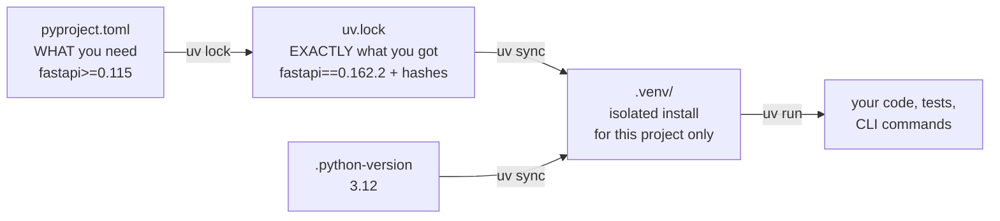
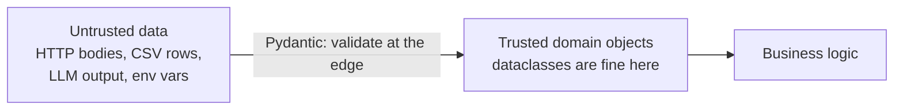
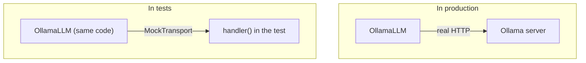
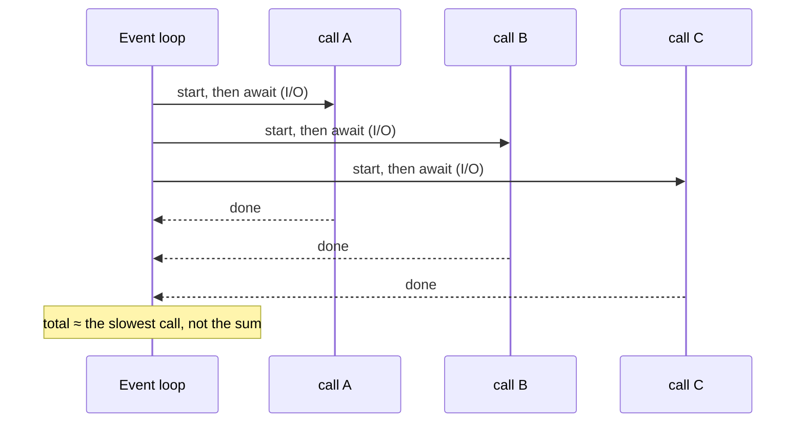

# Lección 0.2: Python para producción
<!-- id: l-0-2 -->

> ⏱ ~60 min · 🎚 Nivel: Core · 🧰 Requisitos: [Lección 0.1](01-setup-your-workbench.md)

[Inicio del curso](../../README.md) › [Módulo 0](README.md) › Lección 0.2

## 📨 La situación

> **De: Sam (Data Scientist)**
> ¡Hola! Un aviso antes de que abras mis notebooks 😅 Son… exploratorios. Variables globales, `print` por todas partes, una ruta a un CSV que apunta a mi escritorio y la clave de la API pegada en la celda 3.
> ¡Pero todo *funciona*! ¿Qué tengo que cambiar para que puedas ejecutarlo de verdad?

## 🎯 Al terminar podrás

- **Explicar** cómo funcionan juntos `pyproject.toml`, `uv.lock` y un entorno virtual.
- **Usar** type hints, dataclasses y modelos de Pydantic, y **elegir** entre ellos.
- **Cargar** la configuración y los secretos desde variables de entorno con `pydantic-settings`.
- **Escribir** tests con pytest usando fixtures y `monkeypatch`, sin acceso a la red.
- **Sustituir** `print` por logging, y explicar por qué importa.
- **Describir** el modelo mental de async/await y **decidir** cuándo ayuda async (I/O-bound) y cuándo no (CPU-bound).

## 🤔 Predice primero

1. Una función está declarada como `def score(amount: float) -> float`. ¿Qué pasa si llamas a `score("12.5")`? <!-- id: p-0-2-1 -->
2. Llamas a cinco APIs web lentas que tardan 0,5 s cada una. En secuencia son 2,5 s. Con `async`, ¿cuánto podría tardar más o menos? <!-- id: p-0-2-2 -->
3. ¿Por qué `print(f"user {email} paid {amount}")` es un problema en un servicio en producción, más allá del estilo? <!-- id: p-0-2-3 -->

---

## 1. Proyectos, no scripts: `pyproject.toml`, lock files y entornos

Un notebook es un *documento*. Un servicio en producción es un *proyecto*: algo que cualquiera puede instalar, probar y ejecutar de forma idéntica.



Abre `modules/00-foundations/lab/pyproject.toml`. Las partes importantes:

```toml
[project]
name = "kestrel-foundations"
requires-python = ">=3.11"
dependencies = [
    "fastapi>=0.115",        # a *range*: what the code is compatible with
    "pydantic>=2.7",
    "scikit-learn>=1.5",
    # ...
]

[project.optional-dependencies]
semantic = ["sentence-transformers>=3.0"]   # heavy, opt-in: uv sync --extra semantic

[project.scripts]
train-first-model = "kestrel_foundations.train_first_model:main"   # → `uv run train-first-model`

[dependency-groups]
dev = ["pytest>=8.2"]                        # needed to develop, not to run
```

Y en `uv.lock`, la verdad **resuelta**:

```toml
name = "fastapi"
version = "0.162.2"
source = { registry = "https://pypi.org/simple" }
```

| Concepto | Analogía | Por qué importa en producción |
|---|---|---|
| `pyproject.toml` | Una receta («2–3 huevos») | Declara la compatibilidad; lo leen personas y herramientas |
| `uv.lock` | El recibo exacto de la compra | Instalaciones idénticas en el portátil, en CI y en la imagen de Docker |
| `.venv/` | Tu propia cocina | Los proyectos no pueden romper las dependencias de otros |
| `[project.scripts]` | Botones con nombre | `uv run train-first-model` en lugar de «ejecuta la celda 1, luego la 4, luego la 7» |

> ⚠️ **Error común:** hacer commit de `.venv/` en Git, o *no* hacer commit del lock file. Haz commit de `pyproject.toml` y `uv.lock`; ignora `.venv/`. El entorno se reconstruye a partir del lock file, nunca se copia.

### La estructura `src/`

```
lab/
  pyproject.toml
  src/kestrel_foundations/   ← the importable package
    __init__.py
    config.py
    llm.py
  tests/                     ← tests import the *installed* package
```

Poner el código bajo `src/` obliga a los tests a importar el paquete igual que lo hace producción, así que un test no puede pasar por casualidad solo porque se ejecutó desde la carpeta adecuada. Es un hábito pequeño que evita los fallos de tipo «funciona en los tests, falla al instalarlo».

---

## 2. Type hints: documentación que las herramientas pueden comprobar

Los type hints (anotaciones de tipo) dicen qué espera y qué devuelve una función:

```python
def estimate_cost_usd(
    prompt_tokens: int, completion_tokens: int, input_price_per_m: float, output_price_per_m: float
) -> float:
    return prompt_tokens / 1e6 * input_price_per_m + completion_tokens / 1e6 * output_price_per_m
```

**Python no los hace cumplir en tiempo de ejecución.** `estimate_cost_usd("10", ...)` se ejecutará hasta que falle la aritmética, quizá muy lejos de donde salió el valor incorrecto. Los type hints los comprueban tu **editor** y los comprobadores de tipos como mypy o Pyright, *antes* de que el código se ejecute. Piensa en ellos como un corrector ortográfico para la forma de los datos.

Tipos que verás constantemente en este curso:

```python
from collections.abc import AsyncIterator
from typing import Literal, Protocol

Role = Literal["system", "user", "assistant"]   # only these three strings are valid

class LLMClient(Protocol):                       # "anything with these methods"
    async def complete(self, messages: list[Message], *, temperature: float = 0.0,
                       max_tokens: int = 512) -> Completion: ...
    def stream(self, messages: list[Message], *, temperature: float = 0.0,
               max_tokens: int = 512) -> AsyncIterator[str]: ...

def find(path: Path | None = None) -> Path: ...  # Optional value: Path or None
```

Merece la pena detenerse en `Protocol`. `FakeLLM`, `OllamaLLM` y `OpenAICompatibleLLM` en `llm.py` no heredan de nada y, aun así, los tres cumplen `LLMClient` porque tienen los métodos correctos. Eso es **tipado estructural** («si grazna como un pato…»), y es como se cambia de proveedor sin tocar el código que lo usa.

> 💡 **Consejo de producción:** los type hints rinden más en las **fronteras**: firmas de funciones, esquemas de API y adaptadores. No necesitas anotar cada variable local.

---

## 3. Dataclasses frente a Pydantic: guardar datos frente a validarlos

Los dos te dan clases con campos con nombre. La diferencia está en lo que pasa con una **entrada incorrecta**.

```python
from dataclasses import dataclass
from pydantic import BaseModel

@dataclass
class TxnDC:
    amount: float
    hour: int

class Txn(BaseModel):
    amount: float
    hour: int
```

Lo que pasa de verdad (ejecutado en el entorno del lab):

```python
>>> TxnDC(amount="12.5", hour="late")
TxnDC(amount='12.5', hour='late')          # accepted silently, wrong types inside

>>> Txn(amount="12.5", hour="3")
amount=12.5 hour=3                          # coerced to the declared types

>>> Txn(amount="12.5", hour="late")
1 validation error for Txn
hour
  Input should be a valid integer, unable to parse string as an integer [type=int_parsing, ...]
```



| Usa | Cuándo | En este curso |
|---|---|---|
| `@dataclass(frozen=True)` | Datos internos que has creado tú; rápido, simple, inmutable | `Message`, `Completion`, `Metrics` |
| `BaseModel` de Pydantic | Datos que cruzan una **frontera de confianza**: requests de API, configuración, archivos, salidas de LLM | `EchoRequest`, `Settings` y, más adelante, salidas estructuradas de LLM |

La regla: **valida en los bordes, confía dentro.** Una vez que los datos han pasado por un modelo de Pydantic, el resto de tu código no necesita comprobaciones defensivas por todas partes.

Pydantic también lleva **restricciones**, que se convierten en el contrato de tu API (lección 0.3):

```python
class EchoRequest(BaseModel):
    message: str = Field(min_length=1, max_length=1000)
    repeat: int = Field(default=1, ge=1, le=5)
```

---

## 4. Configuración y secretos: nunca en el código

El notebook de Sam tenía una ruta a un CSV en su escritorio y una clave de API pegada en una celda. Las dos cosas son fallos a punto de ocurrir: la ruta se rompe en cualquier otra máquina, y la clave acaba para siempre en el historial de Git (y en capturas de pantalla, y en notebooks compartidos).

El patrón de producción: **el código lee la configuración del entorno.** El `config.py` del lab:

```python
class Settings(BaseSettings):
    model_config = SettingsConfigDict(env_prefix="KESTREL_", env_file=".env", extra="ignore")

    llm_provider: Literal["fake", "ollama", "openai"] = "fake"
    ollama_base_url: str = "http://localhost:11434"
    ollama_model: str = "qwen2.5:1.5b-instruct"
    openai_api_key: SecretStr = SecretStr("")   # never shown in logs or reprs
```

- `KESTREL_LLM_PROVIDER=ollama` en el entorno fija `llm_provider`, con **validación**: `KESTREL_LLM_PROVIDER=olama` falla al arrancar en lugar de a las 3 de la madrugada.
- Los archivos `.env` son cómodos en local y **deben estar en `.gitignore`** (el `.gitignore` del repositorio ya lo hace).
- `SecretStr` se imprime como `**********`. Tienes que llamar explícitamente a `.get_secret_value()`, lo que hace mucho menos probable que se filtre a los logs por accidente.

Las rutas siguen la misma idea: `paths.py` encuentra los datos subiendo hasta la raíz del repositorio, o lee `KESTREL_DATA_DIR`. Nada de `/Users/sam/Desktop` escrito a mano en el código.

> ⚠️ **Error común:** «Quitaré la clave antes de hacer commit». Git guarda el historial. Si un secreto llegó a estar en un commit, considéralo filtrado: **rótalo** y después limpia el historial.

---

## 5. Tests con pytest

Un test es un pequeño programa que comprueba que tu código hace lo que dices. En producción, los tests son lo que te permite cambiar código un viernes sin miedo (aunque la congelación de despliegues de Kestrel Pay dice que no deberías, de todos modos).

```python
# tests/test_llm.py
def test_fake_llm_is_deterministic():
    llm = FakeLLM()
    a, b = run(llm.complete(MSGS)), run(llm.complete(MSGS))
    assert a.text == b.text
```

Tres funcionalidades de pytest que usarás en todos los labs:

**1. Fixtures**: preparación reutilizable, inyectada por nombre.

```python
# tests/conftest.py
@pytest.fixture(scope="session")
def small_fraud_csv(tmp_path_factory) -> Path:
    out = tmp_path_factory.mktemp("data") / "transactions_small.csv"
    return ensure_fraud_data(out=out, rows=8000, seed=42)

# any test that asks for `small_fraud_csv` gets the file, generated once per session
def test_accuracy_paradox(small_fraud_csv): ...
```

**2. `monkeypatch`**: cambia temporalmente variables de entorno o atributos, y lo deshace automáticamente al terminar el test.

```python
def test_factory_reads_env(monkeypatch):
    monkeypatch.setenv("KESTREL_LLM_PROVIDER", "ollama")
    assert isinstance(get_llm(Settings()), OllamaLLM)
```

**3. Falsea la red, no la lógica.** `httpx.MockTransport` permite que el adaptador *real* de Ollama hable con un servidor falso dentro del test, así que pruebas cómo se construyen las requests y cómo se parsean las responses sin tener Ollama en marcha:

```python
def handler(request: httpx.Request) -> httpx.Response:
    assert request.url.path == "/api/chat"
    return httpx.Response(200, json={"message": {"content": "A reversal."},
                                     "prompt_eval_count": 12, "eval_count": 3})

llm = OllamaLLM("http://ollama.test", "qwen", transport=httpx.MockTransport(handler))
```

Esto funciona porque `OllamaLLM` acepta el transporte como argumento del constructor (**inyección de dependencias**). Diseñar el código para que sus dependencias se puedan cambiar es lo que más contribuye, con diferencia, a que sea testeable.



> 💡 **Consejo de producción:** una batería de tests que necesita internet, una clave de API o una GPU acabará saltándose, siendo inestable, o las dos cosas. Mantén los tests unitarios herméticos; ejecuta las comprobaciones con modelos reales como jobs de evaluación separados y con un nombre explícito (módulo 4).

---

## 6. Logging, no `print`

`print` escribe texto en la salida estándar. El logging escribe **eventos** con un nivel, una marca de tiempo, un origen y contexto estructurado, y puede enviarlos a cualquier sitio.

```python
import logging
logging.basicConfig(level=logging.INFO, format="%(asctime)s %(levelname)s %(name)s %(message)s")
log = logging.getLogger("fraud")

log.info("scored transaction", extra={"txn_id": "txn_0000042", "score": 0.91})
log.warning("model artifact older than 30 days")
log.debug("feature vector: %s", features)   # hidden unless level=DEBUG
```

| `print` | `logging` |
|---|---|
| Sin nivel: no puedes separar el ruido de los errores | DEBUG / INFO / WARNING / ERROR / CRITICAL |
| Sin marca de tiempo ni origen | Marca de tiempo, nombre del logger, número de línea |
| Siempre activo | Se configura por entorno, sin cambiar el código |
| Es fácil filtrar datos personales (`print(email)`) | Un lugar central donde ocultarlos (lección 5.4) |

En el módulo 1 irás un paso más allá con el **logging estructurado** (un objeto JSON por evento, con un ID de request), que es lo que necesitan las herramientas de búsqueda de logs y los dashboards.

> ⚠️ **Error común:** registrar en los logs prompts completos, emails o números de tarjeta «para depurar». Los logs se copian a muchos sistemas y se guardan mucho tiempo. Trátalos como una base de datos de la que no puedes borrar nada.

---

## 7. async/await: una sola persona atendiendo muchas mesas

Los servicios de IA pasan la mayor parte del tiempo **esperando**: a una API de LLM, a una base de datos vectorial o a otro servicio. `async` permite que un solo proceso haga trabajo útil durante esas esperas.

**Analogía.** En un restaurante, quien sirve las mesas toma un pedido, lo pasa a la cocina y atiende *otras mesas* mientras se cocina la comida. No se queda plantado en la puerta de la cocina. Quien sirve es el **event loop** (bucle de eventos); cada mesa es una **corrutina**; «la cocina está cocinando» es un `await` sobre I/O.

```python
import asyncio, time

async def fake_io(i):
    await asyncio.sleep(0.5)      # stands in for an HTTP call
    return i

async def sequential():
    for i in range(5):
        await fake_io(i)          # wait for each one before starting the next

async def concurrent():
    await asyncio.gather(*(fake_io(i) for i in range(5)))   # start all, then wait
```

Medido en el entorno del lab: **en secuencia 2,51 s, en concurrencia 0,50 s**.



**Cuándo ayuda async y cuándo no:**

| Carga de trabajo | Ejemplo | ¿Ayuda async? | Usa en su lugar |
|---|---|---|---|
| **Limitada por I/O** (I/O-bound) | Llamar a una API de LLM, consultar una base de datos, descargar documentos | ✅ Sí, mucho | — |
| **Limitada por CPU** (CPU-bound) | Ejecutar un modelo de scikit-learn sobre un lote grande, parsear PDFs enormes, tokenizar | ❌ No: no hay espera, la CPU está ocupada | Procesos, pools de workers, procesamiento por lotes, un servidor de inferencia dedicado |

> ⚠️ **Error común:** llamar a una función bloqueante dentro de un `async def`, por ejemplo `requests.get(...)` o `time.sleep(1)`. Congela **todo el event loop**, así que todas las demás requests también esperan. Usa clientes async (`httpx.AsyncClient`, `asyncio.sleep`) o ejecuta el trabajo bloqueante en un pool de hilos.

Por eso los adaptadores de LLM del lab son `async`:

```python
async def complete(self, messages, *, temperature=0.0, max_tokens=512) -> Completion:
    async with self._client() as client:
        resp = await client.post("/api/chat", json=payload)   # the loop serves others meanwhile
```

Y `stream()` es un **generador asíncrono**: hace `yield` de fragmentos de texto a medida que llegan, así que una interfaz de chat puede mostrar las primeras palabras en milisegundos en lugar de esperar a la respuesta completa.

---

## 🧪 Pruébalo

Desde `modules/00-foundations/lab`:

1. **Mira la configuración en acción.**
   ```bash
   KESTREL_LLM_PROVIDER=olama uv run first-llm-call
   ```
   **Resultado esperado:** las opciones de `--provider` de la CLI solo aceptan `fake|ollama|openai`, pero el valor por defecto se lee de `Settings()`, así que la errata se rechaza al arrancar con un `ValidationError` de Pydantic que menciona `llm_provider` e `Input should be 'fake', 'ollama' or 'openai'`. Falla pronto y falla con claridad.
2. **Comprueba que un secreto sigue siendo secreto.**
   ```bash
   KESTREL_OPENAI_API_KEY=sk-demo uv run python -c "from kestrel_foundations.config import Settings; print(Settings())"
   ```
   **Resultado esperado:** `openai_api_key=SecretStr('**********')` en la salida.
3. **Ejecuta un solo archivo de tests, con detalle.**
   ```bash
   uv run pytest tests/test_llm.py -v
   ```
   **Resultado esperado:** 11 nombres de tests con `PASSED`. Lee `test_ollama_adapter_against_fake_server` y encuentra dónde vive el servidor falso.
4. **Rompe el event loop.** En una shell de Python dentro del lab (`uv run python`), pega el ejemplo de `fake_io`, pero sustituye `await asyncio.sleep(0.5)` por `time.sleep(0.5)` y mide cuánto tarda `concurrent()`. **Resultado esperado:** ~2,5 s. La llamada bloqueante lo ha serializado todo.

## 🏭 En el mundo real

La mayoría de los servicios Python en producción siguen el mismo esqueleto que acabas de ver: un `pyproject.toml` con lock file, un paquete en `src/`, configuración desde variables de entorno, Pydantic en las fronteras, pytest con fakes inyectados, logging estructurado y I/O asíncrona para el trabajo con mucha red. FastAPI, que usarás desde la lección 0.3, está construido exactamente con estas piezas (Pydantic y async), y eso explica buena parte de su popularidad para servicios de ML y de LLM.

## ✅ Comprueba lo aprendido

<details><summary>P1. Tienes que aceptar JSON de un partner externo y pasarlo a tu lógica de scoring. ¿Dataclass o modelo de Pydantic, y por qué? <!-- id: c-0-2-1 --></summary>

**Pydantic**: los datos cruzan una frontera de confianza. Valida tipos y restricciones, hace las conversiones seguras (`"3"` → `3`) y rechaza la entrada incorrecta con un error claro antes de que llegue a tu lógica. Dentro, después de validar, las dataclasses están bien.

</details>

<details><summary>P2. ¿Por qué <code>OllamaLLM</code> recibe un argumento <code>transport</code> opcional? <!-- id: c-0-2-2 --></summary>

**Inyección de dependencias** para que sea testeable. En producción es `None` (red real). En los tests pasas `httpx.MockTransport(handler)`, así que el código real del adaptador se ejecuta contra un servidor falso: sin Ollama, sin red, determinista.

</details>

<details><summary>P3. Tu endpoint async de FastAPI llama a <code>requests.get()</code> para descargar un documento. Con carga, todo se vuelve lento. ¿Por qué? <!-- id: c-0-2-3 --></summary>

`requests` es **bloqueante**: mientras espera a la red, el event loop no puede ejecutar nada más, así que todas las requests concurrentes de ese worker se quedan paradas. Usa `httpx.AsyncClient` con `await`, o lleva la llamada bloqueante a un pool de hilos.

</details>

<details><summary>P4. ¿Hará <code>async</code> más rápido entrenar un modelo de scikit-learn con un millón de filas? <!-- id: c-0-2-4 --></summary>

No. El entrenamiento está **limitado por CPU** (CPU-bound): no hay esperas de I/O, así que no hay nada que solapar. Las mejoras vienen de mejores algoritmos, bibliotecas vectorizadas, varios procesos o núcleos, o más hardware.

</details>

<details><summary>P5. Alguien del equipo hizo commit de una clave de API y la borró en el commit siguiente. ¿Ya es seguro? <!-- id: c-0-2-5 --></summary>

No. Sigue en el **historial de Git** (y quizá en forks, logs de CI y clones). Rota la clave (revócala y sustitúyela) de inmediato y después limpia el historial si hace falta. Evita que se repita con archivos `.env` en `.gitignore` y escaneo de secretos en CI.

</details>

<details><summary>P6. ¿Qué te da <code>uv.lock</code> que <code>pyproject.toml</code> no te da por sí solo? <!-- id: c-0-2-6 --></summary>

Versiones exactas y con hash de **todas** las dependencias, incluidas las transitivas. Sin él, `fastapi>=0.115` podría resolverse en versiones distintas (con comportamientos o fallos distintos) según el día y la máquina.

</details>

## 💬 Explícalo con tus palabras
<!-- id: e-0-2 -->

Responde al mensaje de Sam: en cinco viñetas, enumera los cambios que necesita su notebook para convertirse en un proyecto ejecutable, y da una frase de *por qué* para cada uno.

## 🔑 Ideas clave

- **Proyecto, no script:** `pyproject.toml` + `uv.lock` + paquete en `src/` + puntos de entrada con nombre.
- **Valida en los bordes** con Pydantic; usa dataclasses para los datos internos de confianza.
- **La configuración y los secretos vienen del entorno** (`KESTREL_*`) y se validan al arrancar; `SecretStr` oculta los secretos.
- **El código testeable recibe sus dependencias como argumentos**; falsea la red, no la lógica.
- **Usa logging, no `print`**, y nunca registres secretos ni datos personales.
- **async ayuda en el trabajo limitado por I/O** (llamadas a LLMs y bases de datos), no en el limitado por CPU, y una sola llamada bloqueante puede parar todo el loop.

## 📚 Para profundizar (gratis)

| | Recurso | Por qué leerlo | Tiempo |
|---|---|---|---|
| ⭐ | [FastAPI: Concurrency and async / await](https://fastapi.tiangolo.com/async/) | La explicación más clara de async para servicios web (la analogía de las hamburguesas) | 25 min |
| 🔍 | [Documentación de Pydantic](https://docs.pydantic.dev/latest/) | Modelos, validadores, settings, JSON schema | 45 min |
| 🔍 | [Documentación de pytest](https://docs.pytest.org/) | Fixtures, parametrize, monkeypatch | 45 min |
| 🔍 | [Writing your pyproject.toml (Python Packaging User Guide)](https://packaging.python.org/en/latest/guides/writing-pyproject-toml/) | La referencia oficial de todos los campos que has visto | 20 min |
| 🔍 | [Hoja de referencia de type hints de mypy](https://mypy.readthedocs.io/en/stable/cheat_sheet_py3.html) | Todas las anotaciones de tipo habituales en una página | 15 min |
| 🔍 | [Python Logging HOWTO](https://docs.python.org/3/howto/logging.html) | Loggers, handlers, niveles, formatters | 30 min |
| 🔍 | [Async IO in Python (Real Python)](https://realpython.com/async-io-python/) | Un recorrido largo y cuidadoso por asyncio | 60 min |

---
⬅️ [Lección 0.1: Prepara tu entorno de trabajo](01-setup-your-workbench.md) · ➡️ [Lección 0.3: HTTP y APIs](03-http-and-apis.md)
