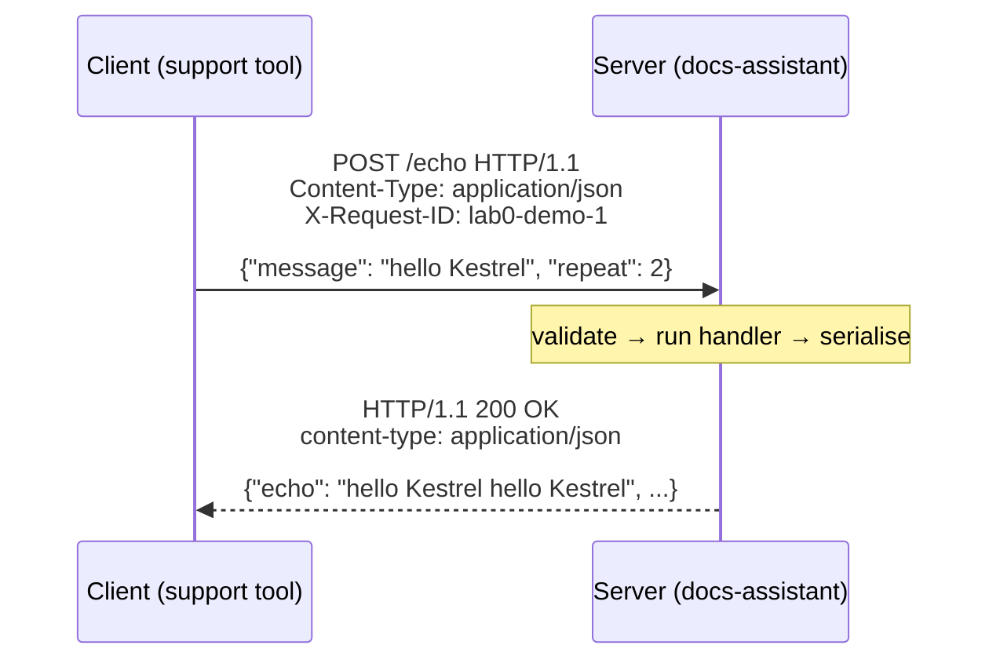
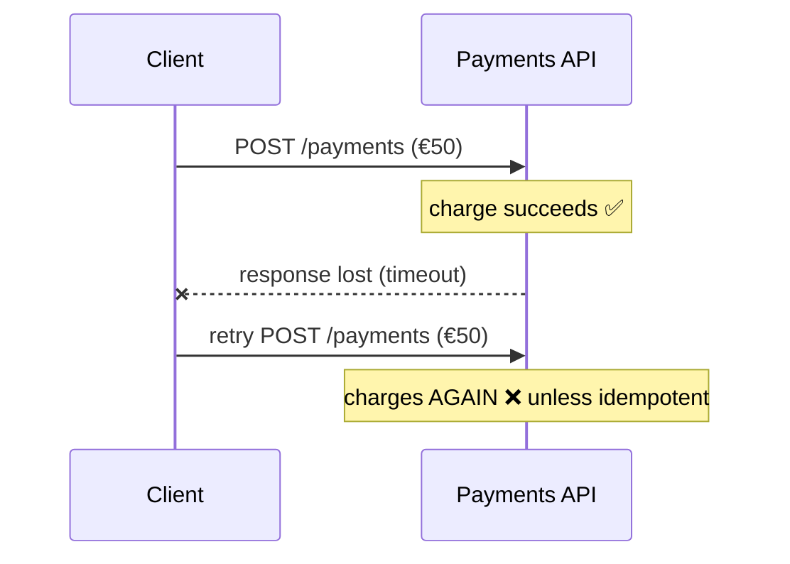
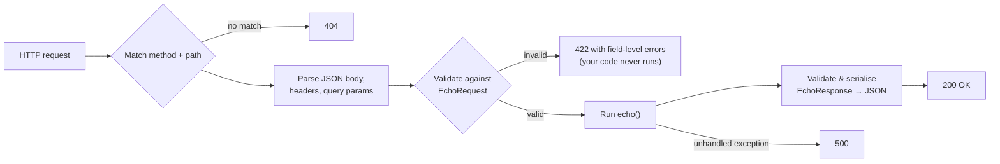

# Lección 0.3: HTTP y APIs
<!-- id: l-0-3 -->

> ⏱ ~50 min · 🎚 Nivel: Core · 🧰 Requisitos: [Lección 0.2](02-python-for-production.md)

[Inicio del curso](../../README.md) › [Módulo 0](README.md) › Lección 0.3

## 📨 La situación

> **De: Lena (Head of Customer Support)**
> Una pregunta rápida de alguien que no es de ingeniería: la herramienta de soporte va a «llamar a la API del asistente». ¿Qué significa eso en realidad? Y ayer el chatbot antiguo le respondió «429» a mi equipo y luego «503». ¿Es grave? ¿A quién llamo?

## 🎯 Al terminar podrás

- **Describir** la anatomía de una request y una response HTTP: método, ruta, cabeceras, cuerpo y código de estado.
- **Interpretar** los códigos de estado y **decir** quién tiene que actuar ante un 4xx y ante un 5xx (y, en concreto, ante un 429 y un 503).
- **Explicar** la idempotencia y por qué importa para los reintentos, los pagos y las llamadas a un LLM.
- **Construir** un servicio mínimo con FastAPI, con validación y documentación generada automáticamente, y **llamarlo** con `curl` y `httpx`.

## 🤔 Predice primero

1. Un cliente envía una request, la red se cae y el cliente nunca ve la response. ¿Es seguro volver a enviarla sin más? <!-- id: p-0-3-1 -->
2. ¿De quién es la culpa de un `422`: del cliente o del servidor? ¿Y de un `500`? <!-- id: p-0-3-2 -->
3. ¿Qué crees que hace FastAPI si al cuerpo JSON le falta un campo obligatorio? ¿Se ejecuta tu función? <!-- id: p-0-3-3 -->

---

## 1. HTTP en una imagen

Casi todos los servicios de este curso hablan con otros por **HTTP**: la herramienta de soporte llama al docs-assistant, el docs-assistant llama a Ollama y tus tests llaman a tu API. HTTP es un protocolo de **request/response**: un cliente envía una request y un servidor devuelve una response.

**Analogía:** pedir en un mostrador. Dices *qué* quieres hacer (el método), *sobre qué* (la ruta), das detalles (las cabeceras y el cuerpo) y recibes un ticket con un código de estado y tu pedido (el cuerpo de la response).



### La request

```http
POST /echo HTTP/1.1
Host: localhost:8000
Content-Type: application/json
X-Request-ID: lab0-demo-1

{"message": "hello Kestrel", "repeat": 2}
```

| Parte | Ejemplo | Significado |
|---|---|---|
| **Método** | `POST` | El tipo de acción |
| **Ruta** | `/echo` | Qué recurso o endpoint |
| **Query string** | `/search?q=refund&top_k=3` | Parámetros clave/valor opcionales en la URL |
| **Cabeceras** | `Content-Type`, `Authorization`, `X-Request-ID` | Metadatos de la request |
| **Cuerpo** | JSON | El contenido que se envía (normalmente con `POST`, `PUT`, `PATCH`) |

### La response

```http
HTTP/1.1 200 OK
content-type: application/json
content-length: 102

{"echo":"hello Kestrel hello Kestrel","length":27,"request_id":"lab0-demo-1"}
```

Un **código de estado**, cabeceras y un cuerpo. Nada más. Todo lo demás (REST, gateways de gRPC, streaming, webhooks) se construye sobre esto.

---

## 2. Métodos e idempotencia

| Método | Uso típico | ¿Seguro (sin efectos secundarios)? | ¿Idempotente? |
|---|---|---|---|
| `GET` | Leer un recurso | ✅ | ✅ |
| `POST` | Crear algo o ejecutar una acción (puntuar, generar, cobrar) | ❌ | ❌ por defecto |
| `PUT` | Reemplazar un recurso entero | ❌ | ✅ |
| `PATCH` | Cambiar parte de un recurso | ❌ | ❌ por defecto |
| `DELETE` | Eliminar un recurso | ❌ | ✅ |

**Idempotente** significa que *hacerlo dos veces tiene el mismo efecto que hacerlo una*. `DELETE /cards/123` dos veces deja la tarjeta 123 igual de eliminada. `POST /payments` dos veces puede cobrarle dos veces al cliente.

Por qué te importa: las redes fallan **a mitad de camino**. El cliente envía una request, el servidor la procesa y la response se pierde. El cliente no puede distinguir «nunca llegó» de «se hizo, pero no me enteré».



La solución habitual es una **clave de idempotencia**: el cliente genera un ID único por operación *lógica* y lo envía en una cabecera (a menudo `Idempotency-Key`). El servidor recuerda las claves que ya ha procesado y, ante una repetición, devuelve el resultado guardado en lugar de volver a actuar. Las API de pago como la de Stripe funcionan así.

> 💡 **Consejo de producción:** los reintentos (Lección 1.3) solo son seguros en operaciones idempotentes. Antes de añadir `retry=3` a cualquier llamada, pregúntate: *¿qué pasa si esto se ejecuta dos veces?* En las llamadas a un LLM la respuesta suele ser «pagas dos veces y quizá obtienes una respuesta distinta», algo aceptable para lecturas, pero no para un agente que envía un email o mueve dinero (Lección 6.6).

---

## 3. Códigos de estado: ¿quién tiene que actuar?

El primer dígito te dice **de quién es el problema**:

| Clase | Significado | Quién actúa |
|---|---|---|
| **2xx** | Éxito | Nadie 🎉 |
| **3xx** | Redirección (busca en otro sitio) | El cliente, normalmente de forma automática |
| **4xx** | **Error del cliente**: la request está mal | Quien **llama** debe cambiar la request |
| **5xx** | **Error del servidor**: el servidor falló ante una request válida | **Quien mantiene el servicio** (y quien llama puede reintentar) |

Los que te vas a encontrar constantemente en sistemas de IA:

| Código | Nombre | Causa típica en un sistema de IA | ¿Reintentar? |
|---|---|---|---|
| `200` | OK | — | — |
| `201` | Created | Se creó un recurso nuevo | — |
| `400` | Bad Request | Entrada mal formada | ❌ corrige la request |
| `401` | Unauthorized | Faltan credenciales o no son válidas (en realidad, «no autenticado») | ❌ consigue un token válido |
| `403` | Forbidden | Con autenticación, pero sin permiso (un cliente que pide documentos de HR) | ❌ |
| `404` | Not Found | Ruta equivocada o recurso inexistente; también un nombre de modelo que el servidor no tiene | ❌ |
| `422` | Unprocessable Content | JSON válido que no pasa la validación (lo que FastAPI devuelve por defecto ante una entrada incorrecta) | ❌ |
| `429` | Too Many Requests | **Rate limit**: superaste tu cuota (muy habitual con las API de LLM) | ✅ tras esperar; respeta `Retry-After` |
| `500` | Internal Server Error | Un bug o una excepción no controlada en el servidor | Quizá, con cautela |
| `502` / `504` | Bad Gateway / Gateway Timeout | Un servicio upstream falló o tardó demasiado | ✅ con backoff |
| `503` | Service Unavailable | Sobrecargado, arrancando o en mantenimiento | ✅ con backoff |

Así que, respondiendo a Lena: **429** significa que el chatbot antiguo enviaba más requests de las que su proveedor de LLM permitía (la solución está de nuestro lado: rate limiting, backoff, cuotas). **503** significa que el propio servicio estaba sobrecargado o caído (se avisa al equipo de Diego). En ninguno de los dos casos fue culpa del equipo de soporte.

> ⚠️ **Error común:** devolver `200 OK` con `{"error": "something went wrong"}` en el cuerpo. La monitorización, los balanceadores de carga, los reintentos y las librerías cliente se basan en los **códigos de estado**. Esconder los fallos en un 200 hace que tu tasa de errores parezca del 0 % mientras quienes usan el servicio lo sufren.

---

## 4. Cabeceras que importan en producción

| Cabecera | Para qué sirve | Dónde la verás |
|---|---|---|
| `Content-Type: application/json` | En qué formato está el cuerpo | En toda API JSON |
| `Authorization: Bearer <token>` | Quién llama | Lección 5.3 (JWT) y el adaptador compatible con OpenAI |
| `X-Request-ID` | Correlaciona los logs de una request entre servicios | Lecciones 1.4 y 4.4 |
| `Retry-After` | Cuánto esperar antes de reintentar (en 429 y 503) | Lección 1.3 |
| `Idempotency-Key` | Hace que reintentar un `POST` sea seguro | Pagos, acciones de agentes |
| `Cache-Control` | Si una response se puede guardar en caché y durante cuánto tiempo | Lección 3.5 |

El endpoint `/echo` del lab ya propaga el request ID: si quien llama envía `X-Request-ID`, el servidor lo reutiliza; si no, genera un UUID. Cuando la request de un usuario pasa por un gateway, el docs-assistant, una base de datos vectorial y un LLM, ese único ID te permite encontrar cada línea de log que produjo.

---

## 5. JSON y contratos de API

La mayoría de las API de servicios de IA intercambian **JSON**. El problema del JSON es que *no tiene tipos*: `{"repeat": "lots"}` es JSON perfectamente válido. Por eso defines un **contrato**, un esquema que dice qué está permitido, y lo haces cumplir en el borde (el «valida en los bordes» de la Lección 0.2).

Con FastAPI, el contrato **es** tu modelo de Pydantic:

```python
class EchoRequest(BaseModel):
    """The *contract*: FastAPI rejects bad input with 422 before your code runs."""
    message: str = Field(min_length=1, max_length=1000, examples=["hello Kestrel"])
    repeat: int = Field(default=1, ge=1, le=5)


class EchoResponse(BaseModel):
    echo: str
    length: int
    request_id: str
```

A partir de estos modelos, FastAPI genera un documento **OpenAPI** (`/openapi.json`), una descripción legible por máquinas de cada endpoint. Otros equipos pueden generar clientes a partir de él, y tú obtienes gratis documentación interactiva en `/docs`.

> 💡 **Consejo de producción:** `max_length` no es puntillosidad. Sin límites, cualquiera puede enviar un «mensaje» de 50 MB a un endpoint que lo reenvía a un LLM que cobra por token. Los límites de entrada son un control de costes y un control de seguridad (Lección 5.1, «unbounded consumption»).

---

## 6. Tu primera API, línea a línea

`src/kestrel_foundations/hello_api.py`:

```python
def create_app() -> FastAPI:
    """App factory: tests and servers each build a fresh app (pattern reused in Module 1)."""
    app = FastAPI(title="Kestrel hello API", version="0.1.0")

    @app.get("/health")
    def health() -> dict[str, str]:
        """Cheap liveness check: 'the process is up'. Load balancers call this constantly."""
        return {"status": "ok"}

    @app.post("/echo", response_model=EchoResponse)
    def echo(body: EchoRequest, x_request_id: str | None = Header(default=None)) -> EchoResponse:
        request_id = x_request_id or str(uuid.uuid4())
        text = " ".join([body.message] * body.repeat)
        return EchoResponse(echo=text, length=len(text), request_id=request_id)

    return app

app = create_app()
```

Lo que hace FastAPI con cada request:



Fíjate en tres hábitos que mantendrás durante todo el curso:

1. **App factory** (`create_app()`): los tests construyen una app nueva; los módulos siguientes le pasan configuración y dependencias.
2. **Endpoint `/health`**: algo barato que responde «¿está vivo el proceso?». El Módulo 1 añade `/ready` («¿puede servir de verdad?», por ejemplo, ¿está cargado el modelo?).
3. **Request IDs**: se reutiliza el de quien llama cuando lo envía.

### Llamarla desde Python con httpx

Los servicios llaman a otros servicios con un cliente HTTP. `hello_client.py`:

```python
def call_echo(client: httpx.Client, message: str, repeat: int = 1, request_id: str | None = None) -> dict:
    headers = {"X-Request-ID": request_id} if request_id else {}
    resp = client.post("/echo", json={"message": message, "repeat": repeat}, headers=headers)
    resp.raise_for_status()  # turn 4xx/5xx into exceptions instead of silently using bad data
    return resp.json()

with httpx.Client(base_url="http://localhost:8000", timeout=httpx.Timeout(5.0)) as client:
    call_echo(client, "hello Kestrel", 2, request_id="lab0-demo-1")
```

Ahí se esconden dos hábitos de producción:

- **Pon siempre un timeout.** Una llamada sin timeout puede quedarse colgada para siempre y bloquear tu servicio. httpx usa 5 segundos por defecto; ponerlo de forma explícita deja clara tu intención. (La Lección 1.3 trata entera de timeouts.)
- **`raise_for_status()`**: nunca trates una response de error como si fueran datos.

Y un truco para los tests: el `TestClient` de FastAPI *es* un `httpx.Client`, así que el mismo helper `call_echo` se prueba contra la app en el mismo proceso, sin ningún servidor en marcha (`test_client_helper_against_app`).

---

## 🧪 Pruébalo

Desde `modules/00-foundations/lab`, arranca el servidor en una terminal:

```bash
uv run uvicorn kestrel_foundations.hello_api:app --reload --port 8000
```

En una segunda terminal:

1. **Health check, mostrando las cabeceras:**
   ```bash
   curl -i localhost:8000/health
   ```
   **Resultado esperado:** `HTTP/1.1 200 OK`, una cabecera `content-type: application/json` y `{"status":"ok"}`.
2. **Una request válida:**
   ```bash
   curl -s -X POST localhost:8000/echo -H 'Content-Type: application/json' \
        -H 'X-Request-ID: my-first-trace' -d '{"message":"hello Kestrel","repeat":2}'
   ```
   **Resultado esperado:** `{"echo":"hello Kestrel hello Kestrel","length":27,"request_id":"my-first-trace"}`
3. **Una request no válida:**
   ```bash
   curl -s -X POST localhost:8000/echo -H 'Content-Type: application/json' -d '{"message":"","repeat":9}'
   ```
   **Resultado esperado:** estado 422 y una lista `detail` que nombra tanto `message` como `repeat`. Tu función nunca se ejecutó.
4. **Una ruta que no existe:** `curl -i localhost:8000/nope` → **`404 Not Found`**. Un método equivocado: `curl -i localhost:8000/echo` (GET en lugar de POST) → **`405 Method Not Allowed`**.
5. **El cliente:** `uv run hello-client` (salida esperada en el [README del lab](lab/README.md#paso-7--ejecuta-una-api-y-llámala)).
6. **La documentación:** abre **http://localhost:8000/docs**, despliega `POST /echo`, haz clic en *Try it out* y envía una request desde el navegador. Después abre **http://localhost:8000/openapi.json** y busca `maxLength`.

## 🏭 En el mundo real

Todos los grandes proveedores de LLM exponen una API HTTP, y muchos servidores de inferencia autoalojados (vLLM, Ollama y otros) ofrecen un endpoint **compatible con OpenAI**, `POST /v1/chat/completions`. Por eso el adaptador `OpenAICompatibleLLM` del lab puede hablar con OpenAI, con un servidor vLLM local o con LM Studio cambiando solo `base_url`. Con los errores pasa lo mismo: un 429 de una API de LLM es tan rutinario que los clientes en producción tratan el rate limiting, el backoff y los modelos de respaldo (fallback) como funciones básicas, no como casos raros (Lecciones 1.3 y 3.3).

## ✅ Comprueba lo aprendido

<details><summary>P1. Un cliente recibe un timeout en <code>POST /payments</code>. ¿Debería reintentar automáticamente? <!-- id: c-0-3-1 --></summary>

Solo si la operación es **idempotente**, por ejemplo porque el cliente envía una `Idempotency-Key` y el servidor elimina los duplicados. Si no, un reintento puede cobrar dos veces, porque puede que la primera request saliera bien y solo se perdiera la response.

</details>

<details><summary>P2. Tu servicio devuelve 401 a un cliente y 403 a otro. ¿Cuál es la diferencia? <!-- id: c-0-3-2 --></summary>

**401**: quien llama no se ha autenticado (no hay token, o es inválido o ha caducado): «¿quién eres?». **403**: quien llama *sí* se ha autenticado, pero no tiene permiso para hacer eso: «sé quién eres, y la respuesta es no». En el Módulo 5, un cliente que pide documentos de HR recibe un 403.

</details>

<details><summary>P3. Una API de LLM devuelve <code>429</code> con <code>Retry-After: 20</code>. ¿Qué debería hacer tu cliente? <!-- id: c-0-3-3 --></summary>

Esperar al menos 20 segundos antes de reintentar esa request (con jitter si hay muchos clientes afectados) y tratar los 429 continuados como un problema de capacidad: pedir una cuota mayor, añadir rate limiting en el cliente, usar caché o enviar parte del tráfico a un modelo de respaldo.

</details>

<details><summary>P4. ¿Por qué FastAPI devuelve 422 en lugar de ejecutar tu función con datos incorrectos? <!-- id: c-0-3-4 --></summary>

Porque el cuerpo de la request se valida contra el modelo de Pydantic **antes** de que se ejecute el handler. Los datos no válidos nunca entran en tu lógica de negocio, y el cliente recibe errores por campo que le dicen exactamente qué corregir.

</details>

<details><summary>P5. ¿Por qué es dañino devolver <code>{"error": "failed"}</code> con estado 200? <!-- id: c-0-3-5 --></summary>

La monitorización, las alertas, los balanceadores de carga, los reintentos y las librerías cliente se basan en los códigos de estado. Un 200 hace invisibles los fallos: los dashboards muestran un 0 % de errores, no se producen reintentos y quien llama puede tratar el cuerpo del error como datos válidos.

</details>

<details><summary>P6. ¿Para qué sirve la cabecera <code>X-Request-ID</code>? <!-- id: c-0-3-6 --></summary>

Para **correlacionar** todo lo que ocurrió con una request entre servicios y líneas de log. El primer servicio lo crea (o acepta el de quien llama), y cada llamada posterior y cada entrada de log lo llevan. El tracing distribuido (Lección 4.4) generaliza esta idea.

</details>

## 💬 Explícalo con tus palabras
<!-- id: e-0-3 -->

Escribe una respuesta de tres frases a Lena que explique qué significaban ayer el «429» y el «503», quién se encarga de cada uno y qué deberían ver idealmente los usuarios en lugar de un error (pista: degradación elegante, o graceful degradation, Lección 1.3).

## 🔑 Ideas clave

- HTTP = **método + ruta + cabeceras + cuerpo → estado + cabeceras + cuerpo**.
- **4xx: quien llama tiene que cambiar algo. 5xx: falló el servidor.** 429 y 503 se pueden reintentar *con backoff*; la mayoría de los 4xx, no.
- La **idempotencia** decide si un reintento es seguro. Usa claves de idempotencia para las acciones con efectos secundarios.
- Un **modelo de Pydantic es el contrato de tu API**: la validación, los límites y la documentación OpenAPI vienen gratis.
- Pon siempre **timeouts**, llama a **`raise_for_status()`** y propaga un **request ID**.

## 📚 Para profundizar (gratis)

| | Recurso | Por qué leerlo | Tiempo |
|---|---|---|---|
| ⭐ | [MDN: An overview of HTTP](https://developer.mozilla.org/en-US/docs/Web/HTTP/Overview) | La introducción gratuita más clara a HTTP | 20 min |
| 🔍 | [MDN: HTTP response status codes](https://developer.mozilla.org/en-US/docs/Web/HTTP/Status) | Referencia de todos los códigos de estado | Consulta |
| 🔍 | [FastAPI tutorial](https://fastapi.tiangolo.com/tutorial/) | Parámetros de ruta y de query, cuerpos, dependencias, tests | 2–3 h |
| 🔍 | [HTTPX documentation](https://www.python-httpx.org/) | Clientes síncronos y asíncronos, timeouts, transportes | 30 min |
| 🔍 | [Stripe: Designing robust and predictable APIs with idempotency](https://stripe.com/blog/idempotency) | La explicación de referencia de las claves de idempotencia | 15 min |
| 🔍 | [RFC 9110: HTTP Semantics](https://www.rfc-editor.org/rfc/rfc9110) | El estándar en sí; échale un vistazo a los métodos y los códigos de estado | Consulta |

---
⬅️ [Lección 0.2: Python para producción](02-python-for-production.md) · ➡️ [Lección 0.4: Machine learning en una hora](04-ml-in-one-hour.md)
