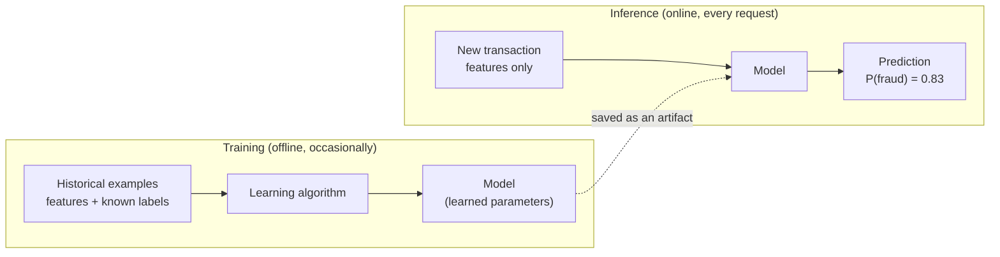
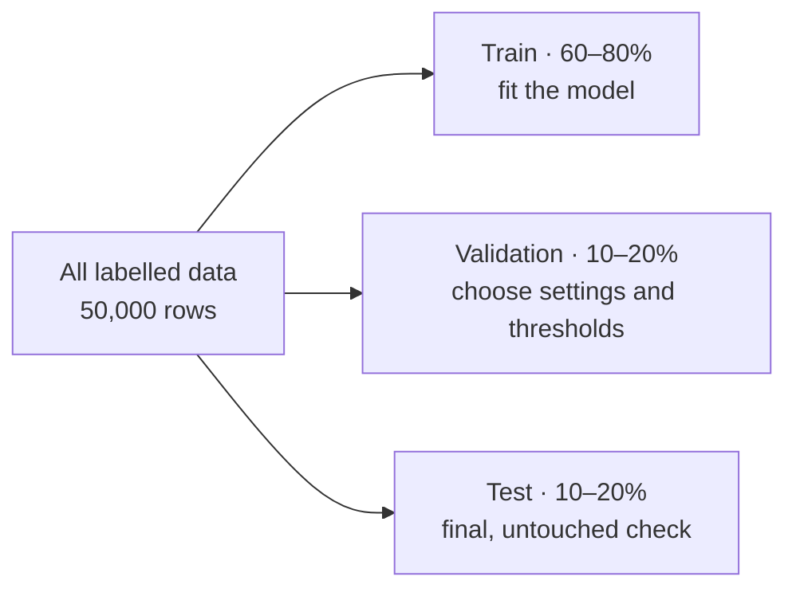
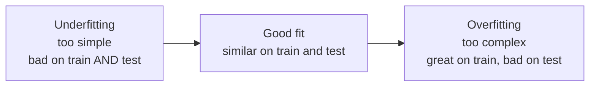
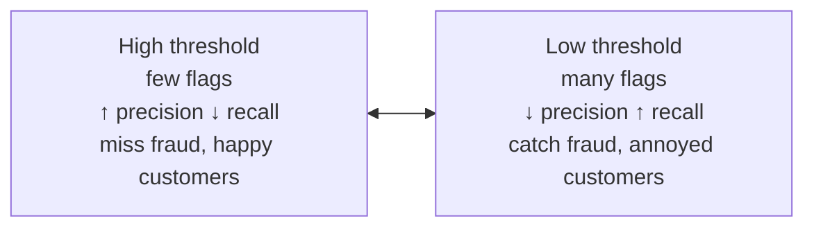

# Lección 0.4: Machine learning en una hora
<!-- id: l-0-4 -->

> ⏱ ~60 min · 🎚 Nivel: Core · 🧰 Requisitos: [Lección 0.2](02-python-for-production.md)

[Inicio del curso](../../README.md) › [Módulo 0](README.md) › Lección 0.4

## 📨 La situación

> **De: Omar (Risk Analyst)**
> Sam le dijo a la dirección que el modelo de fraude tiene «un 98,6 % de accuracy» y a todo el mundo le encantó.
> Pero mi equipo sigue revisando a mano los casos de fraude y no veo que bajen. ¿Puedes comprobar qué significa de verdad esa cifra antes de que nos juguemos el trimestre con ella?

## 🎯 Al terminar podrás

- **Definir** features, labels, entrenamiento e inferencia, y **explicar** qué aprende realmente un modelo.
- **Dividir** los datos en conjuntos de entrenamiento, validación y test, y **decir** por qué la estratificación importa con eventos poco frecuentes.
- **Reconocer** el sobreajuste (overfitting) por la diferencia entre entrenamiento y test.
- **Demostrar** la paradoja de la accuracy con los datos de Kestrel y **leer** una matriz de confusión.
- **Calcular** la precision y el recall, y **explicar** cómo el umbral de decisión cambia uno por otro.
- **Detectar** una feature con fuga de datos antes de que llegue a producción.

## 🤔 Predice primero

1. El 1,41 % de las transacciones de Kestrel son fraude. ¿Qué accuracy obtiene un «modelo» que responde *siempre* «no es fraude»? <!-- id: p-0-4-1 -->
2. Un modelo acierta el 100 % en los datos con los que se entrenó. ¿Buena noticia o mala? <!-- id: p-0-4-2 -->
3. Una columna llamada `chargeback_filed` predice el fraude extremadamente bien. ¿Deberías usarla? <!-- id: p-0-4-3 -->

---

## 1. Qué es realmente el machine learning

Software tradicional: **las reglas las escribes tú.**

```python
if amount > 1000 and country_mismatch:
    flag_as_fraud()
```

Machine learning (aprendizaje automático): **tú das ejemplos y un algoritmo encuentra las reglas.**



Vocabulario que usarás a diario:

| Término | Significado | Ejemplo en Kestrel |
|---|---|---|
| **Ejemplo / fila** | Una observación | Una transacción con tarjeta |
| **Feature** | Una entrada que el modelo puede usar | `amount`, `hour`, `country_mismatch`, `merchant_category` |
| **Label / target** | La respuesta que quieres predecir | `is_fraud` (0 o 1) |
| **Entrenamiento** | Ajustar parámetros para que encajen con ejemplos etiquetados | `model.fit(X_train, y_train)` |
| **Inferencia / predicción** | Usar el modelo entrenado con datos nuevos | `model.predict_proba(new_txn)` |
| **Artefacto** | El archivo del modelo entrenado y guardado | El Módulo 1 lo versiona y lo despliega |

Esta lección solo trata el **aprendizaje supervisado** (aprender de ejemplos etiquetados), que es lo que es el modelo de fraude. Los LLM se entrenan con una idea relacionada, la predicción del siguiente token (Lección 0.5).

### Los datos de fraude

Genéralos una vez (el Lab 0 lo hace automáticamente):

```bash
python3 datasets/fraud/generate.py
# wrote 50,000 rows to datasets/fraud/transactions.csv  (scenario=baseline, fraud rate=1.41%)
```

Cada fila es una transacción con features fáciles de leer (consulta [el diccionario de datos](../../../../datasets/fraud/README.md)). Las labels salen de una función oculta más algo de azar, así que ningún modelo puede ser perfecto, igual que con el fraude real.

---

## 2. Tu primer modelo: regresión logística

La **regresión logística** es el «hola, mundo» de la clasificación y se sigue usando mucho en el scoring de riesgo porque es rápida, estable y explicable.

Calcula una suma ponderada de las features y luego la comprime en una probabilidad entre 0 y 1 con la función **sigmoide**:

```
z = w₀ + w₁·amount + w₂·country_mismatch + w₃·device_is_new + …
P(fraud) = 1 / (1 + e^(−z))
```

El entrenamiento encuentra los pesos `w` que hacen que las probabilidades predichas se ajusten lo más posible a las labels (minimiza una **pérdida**, o loss, llamada log-loss). Un peso positivo significa «esta feature empuja hacia el fraude».

**Analogía:** alguien con experiencia en análisis de fraude que tiene una lista mental con puntos por cada señal de alarma («+2 por un dispositivo nuevo, +3 por un país extranjero, −1 por compras de supermercado») y una idea de cuántos puntos significan «probablemente fraude». El entrenamiento es cómo se aprenden esos puntos a partir de casos pasados.

En el lab (`first_model.py`), el modelo es un **pipeline**: preprocesamiento y modelo en un solo objeto.

```python
def build_model() -> Pipeline:
    preprocess = ColumnTransformer([
        ("num", StandardScaler(), NUMERIC_FEATURES),                       # put numbers on a similar scale
        ("cat", OneHotEncoder(handle_unknown="ignore"), CATEGORICAL_FEATURES),  # "crypto_exchange" → 0/1 columns
    ])
    return Pipeline([("preprocess", preprocess), ("clf", LogisticRegression(max_iter=1000))])
```

> 💡 **Consejo de producción:** distribuir el preprocesamiento **dentro** del artefacto del modelo significa que el código que sirve las predicciones no puede olvidarse de un paso ni aplicar uno ligeramente distinto. Un desajuste entre cómo se calculan las features en el entrenamiento y en producción se llama **training/serving skew**, y es uno de los bugs de ML en producción más comunes (Lección 1.1).

---

## 3. Entrenamiento, validación y test: no corrijas tu propio examen

Si evalúas un modelo con los mismos datos de los que aprendió, mides **memoria**, no **habilidad**. Por eso divides los datos:



| Conjunto | Para qué se usa | Regla |
|---|---|---|
| **Entrenamiento** | Ajustar los parámetros | El modelo lo ve |
| **Validación** | Comparar modelos, ajustar la configuración, elegir un umbral | Lo miras a menudo |
| **Test** | Una estimación final y honesta | Lo miras **pocas veces**; nunca ajustes nada con él |

El Lab 0 lo mantiene simple con una división 80/20 entre entrenamiento y test. A partir del Módulo 2 añadirás un conjunto de validación y divisiones **temporales** (entrenar con el pasado, evaluar con el futuro), que es como se usa de verdad un modelo de fraude.

### Estratificación: mantén la clase rara en cada división

Con solo un 1,41 % de fraude, un conjunto de test aleatorio del 20 % *podría* acabar con 100 fraudes o con 180, y todas las métricas bailarían. `stratify=y` mantiene la misma tasa de fraude en entrenamiento y en test:

```python
X_tr, X_te, y_tr, y_te = train_test_split(X, y, test_size=0.2, random_state=42, stratify=y)
```

Resultado con los datos de Kestrel: **40 000 filas de entrenamiento; 10 000 filas de test con 141 fraudes.**

---

## 4. Sobreajuste: memorizar en lugar de aprender

Un modelo **se sobreajusta** (overfitting) cuando aprende el ruido y las rarezas de sus datos de entrenamiento en lugar de patrones que generalizan. El síntoma es una gran diferencia entre el rendimiento en entrenamiento y en test.

El lab entrena **árboles de decisión** (modelos que hacen una secuencia de preguntas de sí o no) cada vez más profundos. Un árbol sin límite puede seguir dividiendo hasta que cada ejemplo de entrenamiento quede solo en su propia hoja.

```bash
uv run train-first-model --overfitting
```

```
Overfitting demo (decision trees):
 max_depth  train recall  test recall  train prec.  test prec.
         3         0.18%        0.00%      100.00%       0.00%
         6         5.13%        0.00%      100.00%       0.00%
 unlimited       100.00%        7.09%      100.00%       5.52%
```

El árbol sin límite detecta el **100 %** de los fraudes de entrenamiento y solo el **7 %** de los de test. Ha memorizado. (Los árboles poco profundos tienen el problema contrario, el **subajuste** o underfitting: son demasiado simples para separar una clase tan rara.)



> ⚠️ **Error común:** presentar las métricas de entrenamiento como la calidad del modelo. Cualquier cifra que no se haya calculado con datos reservados (held-out) es marketing, no evaluación.

---

## 5. La paradoja de la accuracy

Aquí está la respuesta para Omar. Ejecuta:

```bash
uv run train-first-model
```

```
model                        accuracy  precision   recall         caught false alarms
-------------------------------------------------------------------------------------
always 'not fraud'             98.59%      0.00%    0.00%      0 / 141        0
logistic regression @0.50      98.59%     50.00%    0.71%      1 / 141        1
```

**Accuracy** = predicciones correctas / todas las predicciones. Cuando el 98,59 % de las transacciones son legítimas, el modelo más perezoso posible, uno que *nunca* marca nada, tiene un 98,59 % de accuracy. El modelo de Sam tiene la misma accuracy y detecta **un fraude de 141**. «Un 98,6 % de accuracy» era verdad y no significaba nada.

### La matriz de confusión

Cada predicción binaria cae en una de cuatro casillas:

|  | Predicho: fraude | Predicho: no fraude |
|---|---|---|
| **Fraude real** | ✅ Verdadero positivo (TP): fraude detectado | ❌ **Falso negativo (FN)**: fraude que se escapa, dinero perdido |
| **No es fraude** | ❌ **Falso positivo (FP)**: falsa alarma, cliente con molestias | ✅ Verdadero negativo (TN) |

De las casillas salen las dos métricas que importan con eventos poco frecuentes:

- **Recall** = TP / (TP + FN): *de todos los fraudes reales, ¿cuántos detectamos?* (las pérdidas de Omar)
- **Precision** = TP / (TP + FP): *de todo lo que marcamos, ¿cuánto era fraude de verdad?* (la carga de trabajo del equipo de Omar y las molestias para la clientela)

Para el modelo con umbral 0,5: recall = 1 / 141 = **0,71 %**; precision = 1 / (1 + 1) = **50 %**.

---

## 6. Umbrales: la decisión de negocio escondida en `predict()`

`model.predict()` usa en silencio un umbral de **0,5**: marca si P(fraud) ≥ 0,5. Con eventos poco frecuentes, un modelo razonable rara vez le da a una transacción concreta más del 50 %, así que casi nunca marca nada. El modelo devuelve una **puntuación**; convertir esa puntuación en una decisión es una elección aparte, de **negocio**.

```python
def predict_with_threshold(model, X, threshold: float):
    return (model.predict_proba(X)[:, 1] >= threshold).astype(int)
```

El mismo modelo entrenado con distintos umbrales (conjunto de test de Kestrel, 141 fraudes):

| Umbral | Precision | Recall | Fraudes detectados | Falsas alarmas |
|---|---|---|---|---|
| 0,50 | 50,0 % | 0,7 % | 1 | 1 |
| 0,20 | 33,3 % | 5,0 % | 7 | 14 |
| 0,10 | 17,3 % | 16,3 % | 23 | 110 |
| 0,05 | 10,3 % | 28,4 % | 40 | 348 |
| 0,02 | 4,9 % | 61,7 % | 87 | 1677 |



En esta tabla no hay un umbral «correcto». Depende de cuánto cuesta un fraude que se escapa frente a cuánto cuesta una falsa alarma (tiempo de análisis, una tarjeta bloqueada en la caja del supermercado). El Módulo 4 elige el umbral **minimizando el coste esperado**, con las cifras de Omar.

> 🔎 **Por dentro:** ¿por qué el recall sigue siendo modesto incluso con umbrales bajos? El patrón de fraude oculto incluye efectos no lineales (por ejemplo, la *proporción* entre el importe y la media del cliente, y las horas nocturnas), y una regresión logística simple sobre las features en bruto solo puede trazar fronteras rectas. Mejores features y mejores modelos (árboles con gradient boosting) lo mejoran en el Módulo 2. La *lección* no cambia: mira siempre más allá de la accuracy.

---

## 7. Fuga de datos: la feature demasiado buena para ser verdad

El dataset tiene una columna `chargeback_filed`. Prueba el primer experimento de «Rómpelo» del lab: añádela como feature y vuelve a entrenar. Con los datos de Kestrel:

| Features | Precision | Recall | Fraudes detectados |
|---|---|---|---|
| Solo features legítimas (@0,5) | 50,0 % | 0,7 % | 1 / 141 |
| **+ `chargeback_filed`** (@0,5) | 74,0 % | 76,6 % | 108 / 141 |

Impresionante, e inútil. Un chargeback (contracargo) se presenta **días o semanas después** de la transacción, normalmente *porque* era fraude. En el momento en que el modelo tiene que decidir (mientras se pasa la tarjeta), esa columna todavía no existe. El modelo aprendió a leer la hoja de respuestas.

La **fuga de datos** (data leakage) es cualquier información del entrenamiento que no estará disponible en el momento de predecir. Produce modelos que parecen brillantes offline y fallan en producción. La pregunta que hay que hacerse sobre cada feature: ***«¿Conocería este valor en el momento exacto en que necesito la predicción?»*** La Lección 2.2 enseña a detectar fugas de datos de forma sistemática.

> ⚠️ **Error común:** usar IDs y timestamps como features. `transaction_id` es único por fila, así que un modelo flexible puede memorizar IDs, y los timestamps pueden codificar «en este periodo hubo una ola de fraude». El lab los excluye de forma explícita (`EXCLUDED` en `first_model.py`), con un comentario que explica por qué, para que la próxima persona no los vuelva a añadir «para ayudar».

---

## 🧪 Pruébalo

Desde `modules/00-foundations/lab`:

1. `uv run train-first-model --threshold 0.1` y confirma la fila 0,10 de la tabla de arriba (`23 / 141` detectados, `110` falsas alarmas).
2. Elige tu propio umbral: `uv run train-first-model --threshold 0.03`. **Antes de ejecutarlo, predice** si la precision sube o baja respecto a 0,05. (Espera menos precision y más recall.)
3. Haz el experimento de fuga de datos («Rómpelo» n.º 1 del lab) y comprueba que coincide con la tabla de la sección 7; luego **deshazlo** con `git checkout -- src/`.
4. Abre `tests/test_first_model.py` y lee `test_accuracy_paradox`. Fíjate en que comprueba *a la vez* «accuracy > 95 %» *y* «recall == 0». Esa pareja es la paradoja, congelada en un test para que nadie la olvide.

## 🏭 En el mundo real

El fraude, el impago de créditos, el diagnóstico médico, la moderación de contenido y el churn (la pérdida de clientes) son problemas **desbalanceados**, así que en la práctica se reportan la precision, el recall y el PR-AUC en lugar de la accuracy, y los umbrales se eligen a partir de los costes de negocio. Los modelos interpretables, como la regresión logística y los scorecards, siguen siendo habituales en entornos de riesgo regulados porque cada peso se puede explicar a los auditores (Lección 5.6). La fuga de datos es una causa famosa de modelos que «funcionan» en desarrollo y fallan en producción, y por eso en las revisiones lo primero que se pregunta es cuándo se conoce cada feature.

## ✅ Comprueba lo aprendido

<details><summary>P1. Un modelo tiene un 99 % de accuracy en un dataset con un 1 % de positivos. ¿Qué puedes concluir? <!-- id: c-0-4-1 --></summary>

Casi nada. Una predicción constante de «negativo» también saca un 99 %. Necesitas la matriz de confusión, o al menos la precision y el recall de la clase positiva, idealmente comparados con un baseline.

</details>

<details><summary>P2. Define precision y recall en el lenguaje de Omar. <!-- id: c-0-4-2 --></summary>

**Recall**: de todo el fraude que ocurrió de verdad, la parte que detectamos (fraude que se escapa = dinero perdido). **Precision**: de todas las transacciones que marcamos, la parte que de verdad era fraude (poca precision = tiempo de análisis desperdiciado y clientes con molestias).

</details>

<details><summary>P3. Bajas el umbral de 0,5 a 0,1: ¿qué pasa con el recall, la precision y el número de alertas? <!-- id: c-0-4-3 --></summary>

Se marcan más transacciones, así que **el recall sube** (o se queda igual) y **la precision normalmente baja**. Con los datos de Kestrel: de 1 a 23 fraudes detectados, de 1 a 110 falsas alarmas.

</details>

<details><summary>P4. Recall de entrenamiento del 100 %, recall de test del 7 %. Nombra el problema y dos soluciones. <!-- id: c-0-4-4 --></summary>

**Sobreajuste (overfitting).** Soluciones: limitar la complejidad del modelo (profundidad máxima, mínimo de muestras por hoja, regularización), conseguir más datos, usar ensembles diseñados para generalizar (random forests, gradient boosting con early stopping) y elegir la configuración con un conjunto de validación.

</details>

<details><summary>P5. ¿Por qué un modelo de fraude nunca debe usar <code>chargeback_filed</code>? <!-- id: c-0-4-5 --></summary>

Solo se conoce **después** de la label (cuando el fraude se confirma y el cliente lo reclama). En el momento de puntuar no existe. Entrenar con esa columna es **fuga de datos** (data leakage): métricas estupendas offline, inútil en producción.

</details>

<details><summary>P6. ¿Por qué estratificamos aquí la división entre entrenamiento y test? <!-- id: c-0-4-6 --></summary>

Con un ~1,4 % de positivos, una división aleatoria puede dar un conjunto de test con bastantes más o bastantes menos fraudes, lo que vuelve ruidosas las métricas e injustas las comparaciones. Estratificar mantiene idéntica la proporción de clases en cada división.

</details>

## 💬 Explícalo con tus palabras
<!-- id: e-0-4 -->

Escribe a Omar una respuesta (cinco frases como máximo) que explique qué significaba de verdad «un 98,6 % de accuracy», qué cifras debería pedir en su lugar y qué decisión le corresponde a Omar (pista: el umbral).

## 🔑 Ideas clave

- El ML aprende reglas a partir de **ejemplos etiquetados**; el modelo entrenado es un **artefacto** que vas a desplegar.
- Evalúa con datos **reservados** (held-out); una diferencia entre entrenamiento y test significa **sobreajuste**.
- Con eventos poco frecuentes, **la accuracy miente**. Usa la **matriz de confusión**, la **precision** y el **recall**, y compara siempre con un baseline trivial.
- El **umbral** convierte las puntuaciones en decisiones, y elegirlo es una decisión de **negocio**.
- **Fuga de datos**: si no conocerías una feature en el momento de predecir, no debe estar en el modelo.
- Pon el preprocesamiento **dentro** del pipeline del modelo para evitar el training/serving skew.

## 📚 Para profundizar (gratis)

| | Recurso | Por qué leerlo | Tiempo |
|---|---|---|---|
| ⭐ | [Google Machine Learning Crash Course](https://developers.google.com/machine-learning/crash-course) | Fundamentos gratuitos excelentes; haz ya los módulos *Logistic regression* y *Classification* | 2–4 h |
| 🔍 | [scikit-learn: Getting started](https://scikit-learn.org/stable/getting_started.html) | Estimadores, pipelines y evaluación en la librería que vas a usar | 30 min |
| 🔍 | [scikit-learn: Common pitfalls and recommended practices](https://scikit-learn.org/stable/common_pitfalls.html) | Fuga de datos en el preprocesamiento y preprocesamiento inconsistente, con ejemplos | 20 min |
| 🔍 | [Kaggle Learn: Intro to Machine Learning](https://www.kaggle.com/learn/intro-to-machine-learning) | Notebooks cortos e interactivos; el curso siguiente trata la fuga de datos | 3 h |
| 🔍 | [3Blue1Brown: Neural networks](https://www.3blue1brown.com/topics/neural-networks) | Intuición visual de cómo aprenden los modelos con el descenso de gradiente | 1 h |

---
⬅️ [Lección 0.3: HTTP y APIs](03-http-and-apis.md) · ➡️ [Lección 0.5: LLMs en una hora](05-llms-in-one-hour.md)
