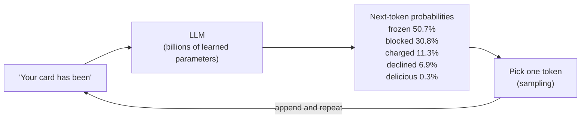
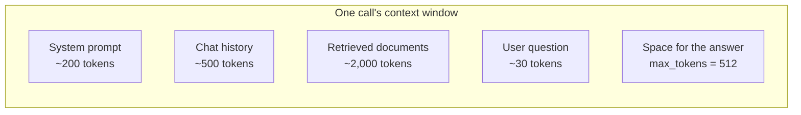
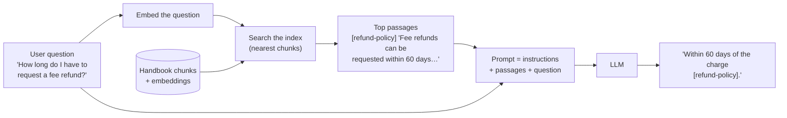
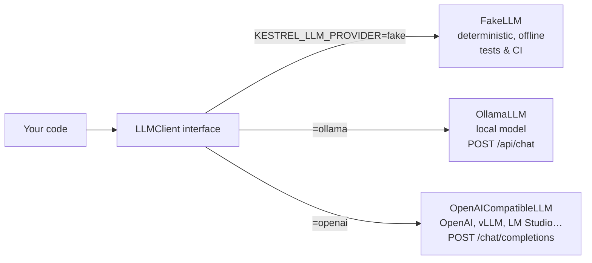

# Lección 0.5: LLMs en una hora
<!-- id: l-0-5 -->

> ⏱ ~60 min · 🎚 Nivel: Core · 🧰 Requisitos: [Lección 0.3](03-http-and-apis.md)

[Inicio del curso](../../README.md) › [Módulo 0](README.md) › Lección 0.5

## 📨 La situación

> **De: Lena (Head of Customer Support)**
> Probé un chatbot público con nuestras preguntas sobre reembolsos. Respondió de maravilla, y se inventó un «plazo de reembolso de 90 días» que no tenemos. 😬
> Sam dice que nuestro docs-assistant «usa RAG, así que no hará eso». ¿Qué es RAG, por qué ayudaría y por qué el otro se inventó cosas?

## 🎯 Al terminar podrás

- **Explicar** los tokens, la predicción del siguiente token y las ventanas de contexto, y **estimar** cuántos tokens y cuánto coste tiene una llamada.
- **Describir** qué hacen la temperatura y top-p con la salida.
- **Explicar** los embeddings y la similitud coseno, y **contrastar** la coincidencia léxica con la semántica usando números reales.
- **Explicar** por qué los LLMs alucinan y cómo **RAG** lo reduce (pero no lo elimina).
- **Llamar** a un LLM a través de la interfaz del curso, independiente del proveedor: falso (fake), local (Ollama) o por API.

## 🤔 Predice primero

1. ¿Un LLM «busca» datos en una base de datos cuando responde? <!-- id: p-0-5-1 -->
2. Si pones la temperatura a 0, ¿está garantizado que la salida sea correcta? <!-- id: p-0-5-2 -->
3. ¿Qué cuesta más en una llamada RAG típica: la pregunta, los documentos recuperados o la respuesta? <!-- id: p-0-5-3 -->

---

## 1. Tokens: la unidad de todo

Los LLMs no leen caracteres ni palabras. Leen **tokens**: trozos de texto de un vocabulario fijo (normalmente entre decenas de miles y un par de cientos de miles de entradas), aprendido de forma que las cadenas comunes ocupan un token y las raras se parten en varios trozos.

```
"Kestrel Pay refunds card fees"  →  ["K", "est", "rel", " Pay", " ref", "unds", " card", " fees"]   (illustrative)
```

La división exacta depende del tokenizador del modelo, pero una regla práctica útil para el inglés es **~4 caracteres ≈ 1 token**, o **~0,75 palabras por token**. Otros idiomas (el español incluido), el código y los números suelen necesitar más tokens por palabra.

Los tokens importan porque **todo se mide en ellos**:

| Qué | Medido en tokens | Por qué te importa |
|---|---|---|
| Precio | $ por 1M de tokens de entrada y por 1M de tokens de salida | Tu factura (sección 7) |
| Ventana de contexto | Máximo de tokens de entrada + salida en una llamada | Cuántos documentos caben |
| Latencia | La salida se genera token a token | Respuestas largas, respuestas lentas |
| Límites de tasa (rate limits) | Tokens por minuto | Los `429` de la lección 0.3 |

El estimador del lab usa la regla práctica. Sirve para hacer cuentas rápidas, nunca para facturar:

```python
def estimate_tokens(text: str) -> int:
    """Rough rule of thumb for English: ~4 characters per token."""
    return max(1, round(len(text) / 4)) if text else 0
```

---

## 2. Predicción del siguiente token: lo que de verdad hace un LLM

Un LLM es una red neuronal (un **Transformer**) entrenada con una cantidad enorme de texto para hacer una sola cosa: **dados los tokens hasta ahora, predecir una probabilidad para cada posible token siguiente.**



Generar una respuesta es solo este bucle: predecir, elegir, añadir, repetir, hasta un token de parada o hasta `max_tokens`. Eso tiene tres consecuencias enormes:

1. **La generación es secuencial.** 300 tokens de salida son 300 pasos por el modelo. Por eso la longitud de la salida marca la latencia, y por eso existe el streaming (sección 8).
2. **El modelo no tiene base de datos.** Los datos están guardados de forma implícita en sus parámetros, como patrones estadísticos de los datos de entrenamiento, y tiene una **fecha de corte del entrenamiento**. No sabe nada de la política de reembolsos privada de Kestrel Pay.
3. **Siempre produce algo plausible.** El objetivo es «el texto siguiente más probable», no «el texto siguiente verdadero». Cuando el dato correcto no está en los parámetros ni en el prompt, la continuación que *suena* más plausible puede ser falsa.

Cómo aprenden modales los modelos de chat: tras el **preentrenamiento** con texto general, los modelos pasan por un **postentrenamiento** (fine-tuning con ejemplos de instrucción y respuesta, refinado con feedback humano o automático) para seguir instrucciones, usar el formato de chat y rechazar algunas peticiones. La lección 2.7 trata cuándo deberías hacer fine-tuning *tú*.

### Mensajes: cómo se le pasa el chat al modelo

Las APIs aceptan una lista de **mensajes** con roles, que el servidor convierte en una sola secuencia de tokens:

```python
messages = [
    Message("system", "You are a concise assistant for Kestrel Pay employees. Answer in at most two sentences."),
    Message("user", "What is a card chargeback?"),
]
```

- **system**: instrucciones y reglas (la «descripción del puesto»).
- **user**: lo que preguntó la persona.
- **assistant**: las respuestas anteriores del modelo (en conversaciones de varios turnos).

> ⚠️ **Error común:** creer que el system prompt es una barrera de seguridad. Son solo más tokens. Quien usa el sistema (¡y los documentos!) puede incluir texto que intente anularlo. Eso es **prompt injection**, y el módulo 5 le dedica dos lecciones. (Ya hay una escondida en `datasets/handbook/partner-faq.md`.)

---

## 3. Temperatura y top-p: controlar la aleatoriedad

El modelo devuelve probabilidades; el **muestreo** (sampling) elige el token. Toma el ejemplo de `"Your card has been"` con unas puntuaciones brutas inventadas (logits) y mira qué hace la **temperatura**:

| Siguiente token | T = 0,2 (enfocada) | T = 1,0 (como se entrenó) | T = 1,5 (creativa) |
|---|---|---|---|
| frozen | **92,4 %** | 50,7 % | 42,0 % |
| blocked | 7,6 % | 30,8 % | 30,1 % |
| charged | 0,1 % | 11,3 % | 15,4 % |
| declined | 0,0 % | 6,9 % | 11,1 % |
| delicious | 0,0 % | 0,3 % | 1,5 % |

La temperatura divide las puntuaciones antes de convertirlas en probabilidades. **Una temperatura baja afila** la distribución hacia la opción más probable; **una temperatura alta la aplana**, así que los tokens improbables (a veces absurdos) salen más a menudo. **T = 0** significa «elige siempre el token más probable» (decodificación voraz, greedy decoding).

**Top-p** (nucleus sampling) es un segundo filtro: quédate solo con el conjunto más pequeño de tokens cuyas probabilidades sumen *p*, y muestrea entre ellos. Con T = 1,0 y top-p = 0,9: frozen (50,7 %) + blocked (30,8 %) + charged (11,3 %) = 92,8 % ≥ 90 %, así que «declined» y «delicious» nunca se eligen.

| Caso de uso | Ajuste típico | Por qué |
|---|---|---|
| Extracción, clasificación, respuestas RAG, llamadas a herramientas | Temperatura 0–0,3 | Quieres consistencia y fidelidad al contexto |
| Borradores, lluvia de ideas, textos de marketing | 0,7–1,0 | La variedad es una ventaja |

> ⚠️ **Error común:** «la temperatura 0 lo hace correcto» o «la temperatura 0 lo hace totalmente determinista». Hace la salida *menos aleatoria*, no *verdadera*: un token más probable que está equivocado sigue estando equivocado, por mucha seguridad que tenga. Y muchas APIs alojadas no garantizan salidas idénticas bit a bit ni siquiera con temperatura 0 (por efectos del batching y del hardware). Para los tests, usa el LLM falso; para la calidad, usa evaluaciones (módulo 4).

---

## 4. Ventanas de contexto

La **ventana de contexto** es el número máximo de tokens que el modelo puede procesar en una llamada, entrada y salida juntas. Los modelos actuales van de unos pocos miles a más de un millón de tokens.



Las ventanas más grandes no salen gratis:

- **Coste**: pagas cada token de entrada en cada llamada.
- **Latencia**: más entrada significa más espera hasta el primer token de salida (prefill, lección 3.2).
- **Calidad**: los modelos pueden pasar por alto información enterrada en mitad de contextos largos (*«lost in the middle»*, lección 2.5).

Así que «pega el handbook entero en cada prompt» funciona en una demo con 14 documentos y falla con 140 000. Elegir los pocos pasajes *adecuados* es el trabajo de la recuperación (retrieval).

---

## 5. Embeddings: el significado como coordenadas

Un **embedding** es una lista de números (un vector) que representa un trozo de texto, producida por un modelo entrenado para que **los textos con significado parecido den vectores que apunten en direcciones parecidas**.

**Analogía:** un mapa donde cada frase es una ciudad. «Freeze my card» y «block my card» son pueblos vecinos; «how many vacation days do I get» está en otro continente. Buscar se convierte en «encuentra las ciudades más cercanas a mi pregunta».

Medimos «apuntar en una dirección parecida» con la **similitud coseno**:

```
cos(θ) = (a · b) / (|a| · |b|)      1 = same direction · 0 = unrelated · −1 = opposite
```

```python
def cosine(a, b) -> float:
    dot = sum(x * y for x, y in zip(a, b))
    na = math.sqrt(sum(x * x for x in a))
    nb = math.sqrt(sum(y * y for y in b))
    return dot / (na * nb) if na and nb else 0.0
```

### Léxico vs semántico: números reales del lab

El lab tiene dos embedders. Los **embeddings por hash** (los de por defecto) asignan cada palabra, mediante un hash, a uno de 1024 buckets. Son instantáneos, deterministas y no descargan nada, pero solo «ven» **palabras compartidas**. **`all-MiniLM-L6-v2`** (un extra opcional) es un modelo de embeddings pequeño y entrenado que capta el **significado**.

| Par | Hash (léxico) | MiniLM (semántico) |
|---|---|---|
| "freeze my card" vs "block my card" | 0,333 | 0,672 |
| "freeze my card" vs "how many vacation days do I get" | 0,000 | 0,061 |
| "refund a fee" vs "get my money back for a charge" | **0,000** | **0,719** |

Y al buscar en el handbook *"Can I get my money back for a fee?"*:

| Puesto | Embeddings por hash | MiniLM |
|---|---|---|
| 1 | ❌ [partner-faq] "How do partners get support?" (coincidió por la palabra *get*) | ✅ [refund-policy] "Fee refunds can be requested within 60 days of the charge." |
| 2 | ❌ [performance-review-process] … | ✅ [refund-policy] "How to request a refund" |
| 3 | ✅ [refund-policy] "Fee refunds can be requested within 60 days…" | ✅ [refund-policy] "Kestrel Pay customers can request a refund…" |

Aun así, la coincidencia léxica no es inútil: es excelente para identificadores exactos, códigos de producto y nombres poco comunes («SEV2», «T+2», «Premium plan») que los modelos semánticos pueden difuminar. Por eso la búsqueda en producción **combina las dos** (recuperación híbrida, lección 2.5).

> 💡 **Consejo de producción:** un embedding solo es comparable con embeddings del **mismo modelo**. Si cambias el modelo de embeddings, tienes que volver a generar los embeddings de todo el corpus. Trata el nombre y la versión del modelo de embeddings como parte de la identidad de tu índice.

---

## 6. Alucinación y por qué existe RAG

Una **alucinación** es una salida fluida y segura de sí misma que es falsa o no tiene respaldo. El «plazo de reembolso de 90 días» de Lena es un caso de manual: el chatbot público nunca había visto la política de Kestrel, así que produjo un número plausible.

**Retrieval-Augmented Generation (RAG)** resuelve la parte del *conocimiento que falta*: en el momento de la pregunta, recupera los pasajes relevantes de tus propios documentos y los pone en el prompt, con instrucciones de responder **solo** a partir de ellos y de citar las fuentes.



| Sin RAG | Con RAG |
|---|---|
| Responde a partir de los datos de entrenamiento (antiguos, públicos, genéricos) | Responde a partir de *tus* documentos actuales |
| No puede citar fuentes | Puede citar el documento exacto |
| Actualizar el conocimiento = reentrenar o hacer fine-tuning | Actualizar el conocimiento = volver a indexar un documento |
| No puede respetar permisos por persona | Puede filtrar la recuperación según quién pregunta (lección 5.3) |

**Lo que RAG *no* garantiza:** si la recuperación devuelve el pasaje equivocado, el modelo responderá con toda seguridad a partir del pasaje equivocado. Si falta el pasaje correcto, el modelo puede seguir adivinando. Un pasaje malicioso puede inyectar instrucciones. Por eso los módulos 2, 4 y 5 tratan la calidad de la recuperación, la evaluación de la fidelidad (faithfulness) y los guardarraíles (guardrails). RAG reduce la alucinación; no la elimina.

Para que conste: RAG se presentó con ese nombre en Lewis et al., 2020 ([arXiv:2005.11401](https://arxiv.org/abs/2005.11401)).

---

## 7. Coste: cuentas rápidas

Los proveedores cobran **por millón de tokens**, y **los tokens de salida suelen costar varias veces más que los de entrada**. La fórmula:

```
cost per call = input_tokens / 1,000,000 × input_price  +  output_tokens / 1,000,000 × output_price
```

El `first-llm-call` del lab usa dos precios **ilustrativos** (no son precios de tarifa actuales, que cambian a menudo; consulta siempre la página de precios del proveedor): un *modelo alojado pequeño* a 0,15 USD de entrada / 0,60 USD de salida por 1M de tokens, y un *modelo alojado grande* a 2,50 USD de entrada / 10,00 USD de salida.

| Escenario (por llamada) | Tokens de entrada | Tokens de salida | Modelo pequeño, por 1M de llamadas | Modelo grande, por 1M de llamadas |
|---|---|---|---|---|
| Pregunta y respuesta mínima (la llamada del lab) | 28 | 36 | ~26 USD | ~430 USD |
| **Respuesta RAG típica** | 2000 | 300 | **~480 USD** | **~8000 USD** |

Esa tabla esconde dos lecciones:

1. En RAG, **los tokens de entrada (el contexto recuperado) suelen dominar el coste**. Recuperar cinco pasajes precisos en lugar de quince vagos es una optimización de coste tanto como de calidad.
2. **La elección del modelo es una palanca de coste de ~15×.** Enviar las preguntas fáciles a un modelo pequeño y las difíciles a uno grande (lección 3.3), y cachear las preguntas repetidas (lección 3.5), son prácticas habituales en producción.

> 💡 **Consejo de producción:** alojar el modelo por tu cuenta (self-hosting: Ollama, vLLM) cambia los precios por token por costes de **hardware por hora**. Solo sale más barato a partir de cierto volumen, y si es estable. La lección 3.3 hace bien esas cuentas del punto de equilibrio.

---

## 8. Tu primera llamada a un LLM a través de una sola interfaz

Todos los labs usan la misma interfaz pequeña, así que al código de la aplicación nunca le importa qué proveedor hay detrás:

```python
class LLMClient(Protocol):
    async def complete(self, messages: list[Message], *, temperature: float = 0.0,
                       max_tokens: int = 512) -> Completion: ...
    def stream(self, messages: list[Message], *, temperature: float = 0.0,
               max_tokens: int = 512) -> AsyncIterator[str]: ...
```



```bash
uv run first-llm-call                                   # fake
uv run first-llm-call --provider ollama                 # local
uv run first-llm-call --provider ollama --stream        # token by token
```

El **streaming** envía los tokens a medida que se generan. El tiempo total es más o menos el mismo, pero quien usa el producto ve las primeras palabras casi al instante. Hay dos cifras de latencia que importan en cualquier producto con LLMs:

- **Tiempo hasta el primer token (TTFT, time to first token)**: cuánto tarda en aparecer algo (lo domina la lectura de la entrada, el *prefill*).
- **Tiempo total**: crece con el número de tokens de salida (el *decode*).

Medirás bien las dos en la lección 3.4.

---

## 🧪 Pruébalo

Desde `modules/00-foundations/lab`:

1. **Llamada falsa y coste:** ejecuta `uv run first-llm-call` y mira las dos líneas de coste (≈ 25,80 USD y 430,00 USD por millón de llamadas).
2. **Léxico vs semántico:** ejecuta `uv run embeddings-playground --query "Can I get my money back for a fee?"` y encuentra el resultado que solo coincidió por la palabra «get». Si puedes permitirte la descarga, repítelo con `--semantic` (consulta el [paso 8 del lab](lab/README.md#paso-8--busca-en-el-handbook-con-embeddings)).
3. **Tu propio par:** `uv run python -c "from kestrel_foundations.embeddings import hash_embed, cosine; print(cosine(hash_embed('lost card'), hash_embed('stolen card')))"`. **Predice** primero: ¿por encima o por debajo de 0,5? (Palabras compartidas: solo «card».)
4. **Modelo local** (requiere Ollama):
   ```bash
   uv run first-llm-call --provider ollama --prompt "What is Kestrel Pay's fee refund window?"
   ```
   El modelo nunca ha visto el handbook de Kestrel. ¿Admite que no lo sabe o se inventa un número? En cualquier caso, acabas de reproducir el problema de Lena. El módulo 2 lo resuelve con RAG.
5. **Temperatura:** ejecuta `uv run first-llm-call --provider ollama --temperature 1.2 --prompt "Name a bird."` tres veces, y luego otras tres con `--temperature 0`. Compara la variedad.

## 🏭 En el mundo real

Las aplicaciones de LLMs en producción rara vez son «solo un prompt». Combinan recuperación (para basar las respuestas en datos privados y actuales), una abstracción sobre los proveedores (para cambiar de modelo por coste, calidad o disponibilidad), streaming (para que se perciba rapidez), temperaturas bajas para tareas factuales y conjuntos de evaluaciones que miden la fidelidad en lugar de fiarse de un texto fluido. Muchos servidores de inferencia exponen endpoints compatibles con OpenAI precisamente para que las aplicaciones puedan pasar de modelos alojados a modelos propios con un cambio de configuración.

## ✅ Comprueba lo aprendido

<details><summary>P1. ¿Por qué alucinan los LLMs? <!-- id: c-0-5-1 --></summary>

Se entrenan para producir continuaciones **probables**, no datos **verificados**, y no tienen ningún paso de consulta. Cuando la información necesaria no está en sus parámetros ni en el prompt (datos privados, hechos posteriores a la fecha de corte, datos poco comunes), la continuación que suena más plausible puede ser falsa, y se entrega con la misma fluidez que una correcta.

</details>

<details><summary>P2. En una frase cada una: ¿qué hacen la temperatura y top-p? <!-- id: c-0-5-2 --></summary>

La **temperatura** cambia la forma de la distribución del siguiente token (baja = más afilada, más predecible; alta = más plana, más variada). **Top-p** limita el muestreo al conjunto más pequeño de tokens cuya probabilidad acumulada llega a *p*, y corta la cola de tokens improbables.

</details>

<details><summary>P3. Los embeddings por hash dan 0,000 a «refund a fee» frente a «get my money back for a charge»; MiniLM da 0,719. Explícalo. <!-- id: c-0-5-3 --></summary>

Los embeddings por hash solo captan **palabras compartidas** (y colisiones aleatorias); las dos frases no comparten ninguna palabra con contenido. MiniLM se entrenó para que las **paráfrasis** caigan en vectores cercanos, así que capta que las dos hablan de recuperar dinero.

</details>

<details><summary>P4. Una llamada RAG tiene 2000 tokens de entrada y 300 de salida. ¿Qué parte cuesta probablemente más, y cuál es una forma de reducirla? <!-- id: c-0-5-4 --></summary>

Con precios típicos (la salida cuesta ~4× la entrada por token), la entrada cuesta ~2000 unidades y la salida ~1200, así que normalmente domina la **entrada**. Recupera menos fragmentos y más relevantes; acorta el system prompt; cachea las preguntas repetidas; o usa un modelo más barato para las preguntas fáciles.

</details>

<details><summary>P5. ¿RAG elimina las alucinaciones? <!-- id: c-0-5-5 --></summary>

No. Ancla el modelo en el texto recuperado, pero una recuperación equivocada o incompleta, documentos contradictorios o un modelo que ignora el contexto pueden seguir produciendo respuestas sin respaldo. Por eso se mide la **fidelidad** (faithfulness) y la **corrección de la respuesta** (answer correctness) (lección 4.3) y se añaden comprobaciones de groundedness (lección 5.5).

</details>

<details><summary>P6. ¿Por qué sirve el streaming si el tiempo total de generación no cambia? <!-- id: c-0-5-6 --></summary>

Mejora la **latencia percibida**: quien usa el producto empieza a leer tras el **tiempo hasta el primer token** en lugar de esperar a la respuesta entera. Además, permite que el cliente cancele antes, lo que ahorra tokens.

</details>

## 💬 Explícalo con tus palabras
<!-- id: e-0-5 -->

Responde a Lena en cinco frases: por qué el chatbot público se inventó un plazo de 90 días, qué cambia RAG y una cosa que RAG sigue sin poder garantizar.

## 🔑 Ideas clave

- Los LLMs predicen el **siguiente token**, de uno en uno. Los tokens marcan el **coste, la latencia, los límites y el tamaño del contexto**.
- La **temperatura y top-p** controlan la aleatoriedad, no la verdad.
- Los **embeddings** convierten el texto en vectores; la **similitud coseno** mide la cercanía. La coincidencia léxica ve palabras; los embeddings semánticos ven significado. En producción se combinan los dos.
- Los LLMs **alucinan** porque optimizan la plausibilidad. **RAG** basa las respuestas en tus documentos y hace posibles las citas y los permisos, pero hay que evaluarlo.
- En RAG, **el contexto de entrada suele dominar el coste**; la elección del modelo es una gran palanca de coste.
- Programa contra **una sola interfaz de LLM** (falso, local, API), para que cambiar de proveedor sea un cambio de configuración.

## 📚 Para profundizar (gratis)

| | Recurso | Por qué leerlo | Tiempo |
|---|---|---|---|
| ⭐ | [Canal de YouTube de Andrej Karpathy](https://www.youtube.com/@AndrejKarpathy): *Deep Dive into LLMs like ChatGPT* | La mejor explicación gratuita, de principio a fin, de cómo se construyen y se comportan los LLMs | 3,5 h (merece la pena) |
| 🔍 | [The Illustrated Transformer (Jay Alammar)](https://jalammar.github.io/illustrated-transformer/) | Intuición visual de la arquitectura | 45 min |
| 🔍 | [Hugging Face LLM Course](https://huggingface.co/learn/llm-course) | Tokenizadores, Transformers, fine-tuning; práctico y gratis | 4–10 h |
| 🔍 | [Documentación de Sentence-Transformers](https://www.sbert.net/) | Modelos de embeddings, búsqueda semántica, rerankers | 30 min |
| 🔍 | [Lewis et al., Retrieval-Augmented Generation (2020)](https://arxiv.org/abs/2005.11401) | El artículo que le puso nombre a RAG | 45 min |
| 🔍 | [Holtzman et al., The Curious Case of Neural Text Degeneration (2019)](https://arxiv.org/abs/1904.09751) | De dónde sale el muestreo top-p (nucleus) | 40 min |
| 🔍 | [Referencia de la API de Ollama](https://github.com/ollama/ollama/blob/main/docs/api.md) | La API HTTP exacta a la que llama el `OllamaLLM` del lab | 15 min |

---
⬅️ [Lección 0.4: Machine learning en una hora](04-ml-in-one-hour.md) · ➡️ [Lab 0](lab/README.md)
