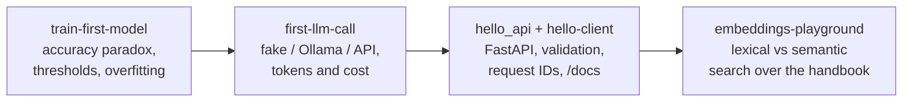

# Módulo 0: Fundamentos
<!-- id: m-0 -->

> ⏱ ~6 h (5 lecciones × ~1 h + un lab de 2 h) · 🎚 Apto para principiantes · 🧰 Requisitos: Python básico, un portátil

[Inicio del curso](../../README.md) › Módulo 0

## 🧭 Dónde estás

```mermaid
flowchart LR
    M0["0 · Foundations<br/>📍 YOU ARE HERE"]
    M1["1 · Prototype → Production"]
    M2["2 · Data & Model Pipelines"]
    M3["3 · Serving & Optimization"]
    M4["4 · Evaluation & Monitoring"]
    M5["5 · Security & Governance"]
    M6["6 · Scaling & Operations"]
    C["🏆 Capstone"]
    M0 --> M1 --> M2 --> M3 --> M4 --> M5 --> M6 --> C
    classDef here fill:#ffd166,stroke:#b8860b,stroke-width:3px,color:#000
    class M0 here
```

## 📨 La historia hasta ahora

> **De: Maya (Engineering Manager)**
> ¡Te damos la bienvenida a Kestrel Pay! 🎉 Tu primera semana va de fundamentos: deja tu máquina configurada igual que nuestra CI y producción, y asegúrate de que lo básico está sólido.
> Para el viernes me gustaría que pudieras explicar, con palabras sencillas, qué significan los números de nuestro modelo de fraude, qué hace realmente un LLM y cómo se comunican dos servicios por HTTP.
> Diego, Sam, Omar y Lena te enviarán esta semana una pregunta por persona. Responderlas *es* tu incorporación.

Este módulo es la rampa de entrada. Si ya pones en producción servicios en Python y conoces lo básico de ML y de los LLMs, échales un vistazo rápido a las lecciones, haz el [cuestionario](quiz.md), haz el [lab](lab/README.md) y sigue adelante.

## 🎯 Objetivos del módulo

Al terminar el Módulo 0 podrás:

1. **Reproducir** un entorno de Python exactamente con uv, Git y Docker, y ejecutar modelos en local con Ollama.
2. **Estructurar** código Python como un proyecto testeable: configuración desde el entorno, validación en los bordes, I/O asíncrona.
3. **Construir y llamar** a una API HTTP, e **interpretar** códigos de estado, cabeceras e idempotencia.
4. **Entrenar y evaluar** un clasificador con honestidad: particiones, baselines, precision/recall, umbrales, sobreajuste, fuga de datos.
5. **Explicar** tokens, muestreo, embeddings, ventanas de contexto, alucinación, RAG y el coste de un LLM, y **llamar** a un LLM a través de una interfaz independiente del proveedor.

## 📖 Lecciones

| # | Lección | Lo que aprenderás | ⏱ |
|---|---|---|---|
| 0.1 | [Prepara tu entorno de trabajo](01-setup-your-workbench.md) | uv, Git, Docker, Ollama, WSL2; para qué existe cada uno; compruébalo con el verificador | 60 min |
| 0.2 | [Python para producción](02-python-for-production.md) | pyproject + lock files, anotaciones de tipo, dataclasses frente a Pydantic, configuración y secretos, pytest, logging, async | 60 min |
| 0.3 | [HTTP y APIs](03-http-and-apis.md) | Requests y responses, métodos, idempotencia, códigos de estado (429, 503…), FastAPI, httpx | 50 min |
| 0.4 | [Machine learning en una hora](04-ml-in-one-hour.md) | Features y labels, particiones, sobreajuste, la paradoja de la accuracy, precision/recall, umbrales, fuga de datos | 60 min |
| 0.5 | [LLMs en una hora](05-llms-in-one-hour.md) | Tokens, predicción del siguiente token, temperature/top-p, embeddings, alucinación, RAG, coste | 60 min |
| 🛠 | [Lab 0](lab/README.md) | Tu primer modelo, tu primera llamada a un LLM, tu primera API, tu primera búsqueda semántica | 2 h |
| ✅ | [Cuestionario del módulo](quiz.md) | 12 preguntas | 20 min |
| 📄 | [Hoja de referencia](cheatsheet.md) | Una página para repasar antes del Módulo 1 | 5 min |

**Orden sugerido:** 0.1 → 0.2 → 0.3 → 0.4 → 0.5 → Lab → Cuestionario. La sección 🧪 *Pruébalo* de cada lección usa el código del lab, así que ten una terminal abierta en `modules/00-foundations/lab`.

## 🛠 Lab 0: tu primer modelo, tu primera llamada a un LLM, tu primera API

Ejecutarás una vez cada pieza de un sistema de IA, de principio a fin:

### ✅ Definition of Done

- [ ] `python3 tools/check_setup.py` pasa (Ollama es opcional)
- [ ] `cd modules/00-foundations/lab && uv sync && uv run pytest` muestra **33 passed**
- [ ] Sabes explicar por qué el modelo con un «98,59 % de accuracy» es inútil, usando la matriz de confusión
- [ ] Has comparado dos umbrales y sabes describir el equilibrio entre precision y recall
- [ ] Has llamado a la API con `curl`, has visto un `422` y has abierto `/docs`
- [ ] Has ejecutado el playground de embeddings y sabes explicar la similitud léxica frente a la semántica
- [ ] Has hecho al menos dos experimentos 💥 *Rómpelo* y un ejercicio 🚀 *Amplíalo*
- [ ] Has hecho commit de tu trabajo en tu fork

## 📊 Autoevaluación

Puntúate antes y después del módulo. **Apunta a un 3 o más en todo antes de empezar el Módulo 1.**

| Habilidad | 1 · No me suena | 2 · Me suena | 3 · Sé hacerlo con apuntes | 4 · Podría enseñarlo |
|---|---|---|---|---|
| Entorno de Python reproducible (uv, lock files) | | | | |
| Configuración y secretos mediante variables de entorno | | | | |
| Validación con Pydantic en los bordes | | | | |
| Escribir tests con pytest y fakes | | | | |
| async frente a I/O bloqueante | | | | |
| Códigos de estado HTTP e idempotencia | | | | |
| Construir un endpoint con FastAPI | | | | |
| Particiones de entrenamiento y test, y sobreajuste | | | | |
| Precision, recall y umbrales | | | | |
| Fuga de datos | | | | |
| Tokens, muestreo y ventanas de contexto | | | | |
| Embeddings y similitud coseno | | | | |
| Qué resuelve RAG y qué no | | | | |

## 🎤 Rincón de entrevistas

Los temas del Módulo 0 aparecen como preguntas de calentamiento en entrevistas de ML e ingeniería de IA. Practica respondiendo cada una en voz alta en dos minutos:

1. *«Tu modelo de fraude tiene un 99 % de accuracy. ¿Es bueno?»* Habla de las tasas base, la matriz de confusión, precision/recall y quién elige el umbral.
2. *«¿Cómo te asegurarías de que un modelo entrenado en un notebook se comporta igual en producción?»* Habla de lock files, contenedores, pipelines que incluyen el preprocesamiento y el desajuste entre entrenamiento y serving (training/serving skew).
3. *«¿Cuándo ayuda async a un servicio web en Python y cuándo no?»* Habla del trabajo limitado por I/O frente al limitado por CPU, y de las llamadas bloqueantes dentro del bucle de eventos.
4. *«¿Por qué alucinan los LLMs y cómo se reduce en un producto?»* Habla de la predicción del siguiente token, RAG, la temperatura baja para tareas factuales, las citas y la evaluación de la fidelidad (faithfulness).
5. *«Un cliente reintenta un POST tras un timeout. ¿Qué puede salir mal y cómo lo diseñas?»* Habla de claves de idempotencia y deduplicación.

## 📚 Recursos del módulo

Los mejores recursos gratuitos para este módulo, por orden de prioridad (cada lección tiene su propia lista):

1. ⭐ [The Missing Semester of Your CS Education (MIT)](https://missing.csail.mit.edu/): shell, Git, herramientas
2. ⭐ [Google Machine Learning Crash Course](https://developers.google.com/machine-learning/crash-course): fundamentos de ML
3. ⭐ [FastAPI: Concurrency and async / await](https://fastapi.tiangolo.com/async/): async para servicios web
4. ⭐ [MDN: An overview of HTTP](https://developer.mozilla.org/en-US/docs/Web/HTTP/Overview): fundamentos de HTTP
5. ⭐ [Andrej Karpathy's YouTube channel](https://www.youtube.com/@AndrejKarpathy): *Deep Dive into LLMs like ChatGPT*

---
⬅️ [Inicio del curso](../../README.md) · ➡️ [Lección 0.1: Prepara tu entorno de trabajo](01-setup-your-workbench.md)
