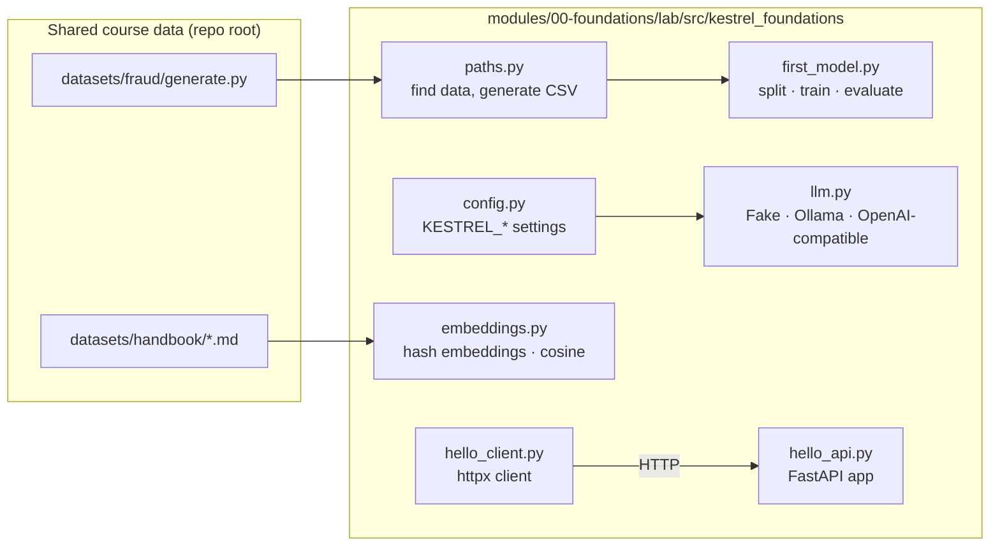

# 🛠 Lab 0: Tu primer modelo, tu primera llamada a un LLM, tu primera API
<!-- id: lab-0 -->

> ⏱ ~2 h · 🎚 Beginner · 🧰 Requisitos: [Lección 0.1](../01-setup-your-workbench.md) completada (`python3 tools/check_setup.py` todo en verde)

[Inicio del curso](../../../README.md) › [Módulo 0](../README.md) › Lab 0

> **De: Maya (Engineering Manager)**
> Antes de que toques los prototipos de Sam, quiero que hayas ejecutado cada pieza por tu cuenta, una vez, de principio a fin:
> un modelo entrenado con nuestros datos de transacciones, una llamada a un LLM, una API respondiendo por HTTP y una búsqueda por similitud en el handbook.
> Nada sofisticado. Solo asegúrate de entender cada línea. Todo lo que viene después se apoya en esto.

## 🎯 Objetivos

Al terminar este lab habrás:

1. Entrenado un modelo de fraude y **visto la paradoja de la accuracy con tus propios números**.
2. Llamado a un LLM a través de una **interfaz independiente del proveedor** (modelo falso, modelo local o API).
3. Ejecutado una API HTTP con **validación, un health check y documentación generada automáticamente**, y la habrás llamado con `curl` y con `httpx`.
4. Buscado en el handbook con **embeddings y similitud coseno**, y visto por qué coincidir en palabras no es coincidir en significado.

## 🗺 Qué hay en la caja

El código, la configuración y los tests del lab están en inglés, en [`modules/00-foundations/lab/`](../../../../../modules/00-foundations/lab/).



| Archivo | Qué enseña | Lección |
|---|---|---|
| [`paths.py`](../../../../../modules/00-foundations/lab/src/kestrel_foundations/paths.py) | Resolver rutas a partir de un ancla o de una variable de entorno en lugar de escribirlas a mano | 0.2 |
| [`config.py`](../../../../../modules/00-foundations/lab/src/kestrel_foundations/config.py) | Configuración desde variables de entorno con `pydantic-settings`; `SecretStr` | 0.2 |
| [`hello_api.py`](../../../../../modules/00-foundations/lab/src/kestrel_foundations/hello_api.py), [`hello_client.py`](../../../../../modules/00-foundations/lab/src/kestrel_foundations/hello_client.py) | HTTP, validación, códigos de estado, request IDs, OpenAPI | 0.3 |
| [`first_model.py`](../../../../../modules/00-foundations/lab/src/kestrel_foundations/first_model.py), [`train_first_model.py`](../../../../../modules/00-foundations/lab/src/kestrel_foundations/train_first_model.py) | Features, divisiones (splits), pipelines, baselines, umbrales, sobreajuste (overfitting) | 0.4 |
| [`llm.py`](../../../../../modules/00-foundations/lab/src/kestrel_foundations/llm.py), [`first_llm_call.py`](../../../../../modules/00-foundations/lab/src/kestrel_foundations/first_llm_call.py) | Una interfaz para muchos proveedores de LLMs, tokens, streaming, coste | 0.5 |
| [`embeddings.py`](../../../../../modules/00-foundations/lab/src/kestrel_foundations/embeddings.py), [`embeddings_playground.py`](../../../../../modules/00-foundations/lab/src/kestrel_foundations/embeddings_playground.py) | Embeddings, similitud coseno, búsqueda por fuerza bruta | 0.5 |
| [`tests/`](../../../../../modules/00-foundations/lab/tests/) | Cómo se prueba cada pieza **sin red ni claves de API** | 0.2 |

## 📋 Pasos

Todos los comandos se ejecutan desde la carpeta del lab en inglés, que es donde vive su código, partiendo de la raíz del repo:

```bash
cd modules/00-foundations/lab
```

### Paso 1 · Instala y ejecuta los tests
<!-- id: lab-0-step-1 -->

```bash
uv sync
uv run pytest
```

**Salida esperada** (los tiempos varían):

```
.................................                                        [100%]
33 passed in 3.8s
```

`uv sync` lee `pyproject.toml` y `uv.lock`, crea `.venv/` con Python 3.12 (lo descarga si hace falta) e instala las versiones exactas. Si algún test falla aquí, lo que está mal es tu instalación, no tu código: vuelve a la [lección 0.1](../01-setup-your-workbench.md).

### Paso 2 · Entrena tu primer modelo
<!-- id: lab-0-step-2 -->

```bash
uv run train-first-model
```

La primera ejecución genera `datasets/fraud/transactions.csv` (50 000 filas) con el generador compartido. **Salida esperada:**

```
Loaded 50,000 transactions from transactions.csv; fraud rate = 1.41%
Train: 40,000 rows · Test: 10,000 rows (141 frauds)

model                        accuracy  precision   recall         caught false alarms
-------------------------------------------------------------------------------------
always 'not fraud'             98.59%      0.00%    0.00%      0 / 141        0
logistic regression @0.50      98.59%     50.00%    0.71%      1 / 141        1
```

Para y míralo bien. Un modelo que **nunca** predice fraude tiene un 98,59 % de accuracy. El modelo entrenado tiene exactamente la misma accuracy y detecta **un** fraude de 141. La accuracy es la pregunta equivocada para los sucesos poco frecuentes ([lección 0.4](../04-ml-in-one-hour.md)).

### Paso 3 · Mueve el umbral
<!-- id: lab-0-step-3 -->

```bash
uv run train-first-model --threshold 0.1
```

**Línea extra esperada:**

```
logistic regression @0.10      97.72%     17.29%   16.31%     23 / 141      110
```

Mismo modelo, otra regla de decisión: ahora detecta 23 fraudes y lanza 110 falsas alarmas. La accuracy **bajó** mientras el modelo se volvía más útil. ¿Quién decide si 110 falsas alarmas son aceptables? Omar (Risk), no tú. El módulo 4 convierte esto en una decisión basada en costes.

### Paso 4 · Observa cómo un modelo se sobreajusta
<!-- id: lab-0-step-4 -->

```bash
uv run train-first-model --overfitting
```

**Bloque extra esperado:**

```
Overfitting demo (decision trees):
 max_depth  train recall  test recall  train prec.  test prec.
         3         0.18%        0.00%      100.00%       0.00%
         6         5.13%        0.00%      100.00%       0.00%
 unlimited       100.00%        7.09%      100.00%       5.52%
```

El árbol sin límite de profundidad detecta el **100 %** de los fraudes de entrenamiento y el **7 %** de los de test. Se aprendió de memoria los datos de entrenamiento. Tu conjunto de test existe justo para detectar esto.

### Paso 5 · Tu primera llamada a un LLM (sin red)
<!-- id: lab-0-step-5 -->

```bash
uv run first-llm-call
```

**Salida esperada:**

```
assistant> [fake-llm:7a3f00ca] You asked: "What is a card chargeback?". A real model would answer here. Set KESTREL_LLM_PROVIDER=ollama to use a local model.

model=fake-llm-v1  prompt_tokens=28  completion_tokens=36  latency=0 ms

What would 1,000,000 calls like this cost? (illustrative prices)
  small hosted model   $     25.80
  large hosted model   $    430.00
```

El modelo falso no entiende nada, y de eso se trata: es **determinista**, así que los tests construidos sobre él nunca fallan de forma intermitente. La tabla de costes usa precios *ilustrativos* para enseñar las cuentas; los precios reales cambian, así que consulta la página de precios del proveedor.

### Paso 6 · Un modelo real, en local (opcional, requiere Ollama)
<!-- id: lab-0-step-6 -->

```bash
ollama pull qwen2.5:1.5b-instruct     # ~1 GB, once
uv run first-llm-call --provider ollama
uv run first-llm-call --provider ollama --stream
KESTREL_LLM_PROVIDER=ollama uv run first-llm-call --prompt "Explain a chargeback to a 10-year-old."
```

**Resultado esperado:** una respuesta real de dos frases, recuentos de tokens reales devueltos por Ollama y (con `--stream`) las palabras apareciendo una a una, seguidas de `time to first token: … ms`. La primera llamada es más lenta porque Ollama carga el modelo en memoria. Tu texto y tus tiempos exactos serán distintos.

> ¿No tienes Ollama? Sáltate este paso. Todo lo demás del curso funciona con el modelo falso.

### Paso 7 · Ejecuta una API y llámala
<!-- id: lab-0-step-7 -->

Terminal 1:

```bash
uv run uvicorn kestrel_foundations.hello_api:app --reload --port 8000
```

Terminal 2:

```bash
uv run hello-client
```

**Salida esperada:**

```
GET /health -> {'status': 'ok'}
POST /echo  -> {'echo': 'hello Kestrel hello Kestrel', 'length': 27, 'request_id': 'lab0-demo-1'}
POST /echo with bad input -> 422
   body.message: String should have at least 1 character
   body.repeat: Input should be less than or equal to 5
```

Después pruébala con `curl` a pelo, y abre **http://localhost:8000/docs** en el navegador para ver la documentación interactiva que FastAPI generó a partir de tu código:

```bash
curl -i -X POST localhost:8000/echo -H 'Content-Type: application/json' -d '{"message":"hello Kestrel","repeat":2}'
```

```
HTTP/1.1 200 OK
content-type: application/json
...
{"echo":"hello Kestrel hello Kestrel","length":27,"request_id":"7a76e977-..."}
```

### Paso 8 · Busca en el handbook con embeddings
<!-- id: lab-0-step-8 -->

```bash
uv run embeddings-playground
uv run embeddings-playground --query "Can I get my money back for a fee?"
```

**Salida esperada (segundo comando):**

```
Embedder: hash embeddings (1024 dims)

Pairwise similarity:
  +0.333  'freeze my card'  vs  'block my card'
  +0.000  'freeze my card'  vs  'how many vacation days do I get'
  +0.000  'refund a fee'  vs  'get my money back for a charge'

Searching 95 handbook sentences for: 'Can I get my money back for a fee?'
  +0.169  [partner-faq] How do partners get support?
  +0.114  [performance-review-process] Reviews happen twice a year, in March and September.
  +0.105  [refund-policy] Fee refunds can be requested within 60 days of the charge.
```

El primer resultado coincidió por la palabra **«get»**. Los embeddings por hash solo ven palabras compartidas (más colisiones aleatorias del hash), así que «refund a fee» y «get my money back for a charge» puntúan **0,000**.

**Opcional: embeddings semánticos de verdad** (descarga PyTorch y un modelo de ~90 MB):

```bash
uv sync --extra semantic
uv run embeddings-playground --semantic --query "Can I get my money back for a fee?"
uv sync          # go back to the light environment afterwards
```

Observado en un portátil con `all-MiniLM-L6-v2`:

```
  +0.672  'freeze my card'  vs  'block my card'
  +0.061  'freeze my card'  vs  'how many vacation days do I get'
  +0.719  'refund a fee'  vs  'get my money back for a charge'

  +0.640  [refund-policy] Fee refunds can be requested within 60 days of the charge.
  +0.569  [refund-policy] How to request a refund
  +0.541  [refund-policy] Kestrel Pay customers can request a refund for card fees and account fees charged by Kestrel Pay.
```

La misma consulta, tres resultados correctos. Esa diferencia entre la coincidencia *léxica* y la *semántica* es la razón por la que el módulo 2 combina las dos (recuperación híbrida).

## 💥 Rómpelo

Cada experimento enseña algo. Predice el resultado, ejecútalo y luego deshaz el cambio (`git checkout -- .`).

1. **Filtra la label.** En `first_model.py`, añade `"chargeback_filed"` a `NUMERIC_FEATURES` y ejecuta `uv run train-first-model`. El recall se dispara. ¿Por qué este modelo no sirve de nada en producción? *(Pista: ¿cuándo se conoce `chargeback_filed`?)*
2. **Quita la estratificación.** Borra `stratify=y` en `split()` y ejecuta los tests varias veces con distintos valores de `seed` en `split(df, seed=...)`. ¿Cuánto varía el número de fraudes en el conjunto de test?
3. **Usa `hash()` en lugar de `hashlib`.** En `embeddings.py`, sustituye el cuerpo de `_bucket` por `h = hash(feature) & ((1 << 64) - 1)` y deja el resto igual. Ejecuta `uv run python -c "from kestrel_foundations.embeddings import hash_embed; print(hash_embed('card')[:5])"` dos veces. ¿Por qué cambió el vector entre una ejecución y otra?
4. **Envía basura a la API.** `curl -X POST localhost:8000/echo -H 'Content-Type: application/json' -d '{"message": 42}'`. ¿Qué código de estado recibes y qué línea de *tu* código se ejecutó? (Respuesta: ninguna.)
5. **Apunta Ollama al puerto equivocado.** `KESTREL_OLLAMA_BASE_URL=http://localhost:9999 uv run first-llm-call --provider ollama`. Lee la excepción. En el módulo 1 convertirás este fallo en un timeout, un reintento y una alternativa elegante (graceful fallback).


## 🚀 Amplíalo

Inténtalo primero por tu cuenta. Cada ejercicio tiene pistas y una solución de referencia.

### Extensión 1: Añade un endpoint `/stats` con validación

Añade `POST /stats` a `hello_api.py`. Recibe `{"text": "..."}` (de 1 a 10 000 caracteres) y devuelve el número de caracteres, de palabras y de *tokens estimados* (reutiliza `estimate_tokens` de `llm.py`). Añade un test.

<details><summary>💡 Pista</summary>

Crea un nuevo modelo de request de Pydantic con `Field(min_length=1, max_length=10_000)`, importa `estimate_tokens` y copia la forma de `test_echo_repeats_and_propagates_request_id`.

</details>

<details><summary>✅ Solución</summary>

```python
# hello_api.py, inside create_app()
from .llm import estimate_tokens

class StatsRequest(BaseModel):
    text: str = Field(min_length=1, max_length=10_000)

@app.post("/stats")
def stats(body: StatsRequest) -> dict[str, int]:
    return {
        "characters": len(body.text),
        "words": len(body.text.split()),
        "estimated_tokens": estimate_tokens(body.text),
    }

# tests/test_hello_api.py
def test_stats():
    r = client.post("/stats", json={"text": "a" * 400})
    assert r.json() == {"characters": 400, "words": 1, "estimated_tokens": 100}
```

</details>

### Extensión 2: Encuentra el umbral que detecta al menos el 50 % del fraude

Escribe `threshold_for_recall(model, X, y, target_recall)`, que devuelve el umbral **más alto** cuyo recall es ≥ el objetivo, e imprime su precision y su número de falsas alarmas.

<details><summary>💡 Pista</summary>

Obtén `probs = model.predict_proba(X)[:, 1]`, recorre umbrales candidatos de mayor a menor (por ejemplo `numpy.linspace(0.99, 0.0, 100)`) y para en el primero que alcance el recall objetivo. `sklearn.metrics.precision_recall_curve` lo hace de forma más eficiente; lo usarás en el módulo 4.

</details>

<details><summary>✅ Solución</summary>

```python
import numpy as np
from kestrel_foundations.first_model import evaluate

def threshold_for_recall(model, X, y, target_recall: float) -> tuple[float, object]:
    probs = model.predict_proba(X)[:, 1]
    for t in np.linspace(0.99, 0.0, 100):
        m = evaluate(y, (probs >= t).astype(int))
        if m.recall >= target_recall:
            return float(t), m
    return 0.0, evaluate(y, np.ones_like(y))
```

Con los datos base, espera un umbral de alrededor de 0,02, una precision de alrededor del 5 % y bastante más de mil falsas alarmas. Las features lineales tienen sus límites; el módulo 2 entrena un modelo mejor.

</details>

### Extensión 3: Haz que el LLM falso «recupere»

Cambia `FakeLLM._answer` para que, si el mensaje de system contiene una línea que empieza por `CONTEXT:`, la respuesta falsa cite la primera frase que viene después. Así es como los módulos posteriores prueban la fontanería de RAG sin un modelo real.

<details><summary>💡 Pista</summary>

Encuentra el mensaje de system con `next((m.content for m in messages if m.role == "system"), "")`, y luego usa `str.partition("CONTEXT:")` y `split(".")[0]`. Mantenlo determinista.

</details>

<details><summary>✅ Solución</summary>

```python
def _answer(self, messages: list[Message]) -> str:
    system = next((m.content for m in messages if m.role == "system"), "")
    _, found, context = system.partition("CONTEXT:")
    if found and context.strip():
        first = context.strip().split(".")[0].strip()
        return f"According to the provided context: {first}."
    ...  # existing behaviour
```

Después añade un test que compruebe que la frase citada aparece en la respuesta (completion).

</details>

### Extensión 4 (reto): Tiempo hasta el primer token vs tiempo total

Ejecuta `uv run first-llm-call --provider ollama --stream --prompt "Write 150 words about card fraud."` tres veces y apunta el **tiempo hasta el primer token** y el **tiempo total**. Después ejecútalo con un prompt que pida una respuesta de una sola palabra. ¿Qué cifra depende de la longitud de la salida, y cuál sobre todo del prompt y de la carga del modelo? (Lo verás como *prefill vs decode* en la lección 3.2.)

## ✅ Definition of Done

- [ ] `uv run pytest` muestra **33 passed**
- [ ] Ejecuté `train-first-model` y sé explicar por qué aquí un 98,59 % de accuracy no significa nada
- [ ] Comparé los umbrales 0,5 y 0,1 y sé decir qué compromiso cambió
- [ ] Ejecuté la demo de sobreajuste y sé explicar la diferencia entre train y test
- [ ] Llamé al LLM falso (y a Ollama, si lo tengo instalado) y sé leer la salida de tokens y de coste
- [ ] Arranqué la API, la llamé con `curl` y con `hello-client`, y abrí `/docs`
- [ ] Ejecuté el embeddings playground y sé explicar por qué los embeddings por hash no ven que «money back» ≈ «refund»
- [ ] Hice al menos **dos** experimentos de «Rómpelo» y **un** ejercicio de «Amplíalo»
- [ ] Hice commit de mi trabajo en mi fork: `git add -A && git commit -m "lab 0 done"`

---
⬅️ [Lección 0.5: LLMs en una hora](../05-llms-in-one-hour.md) · ➡️ [Cuestionario del módulo 0](../quiz.md)
