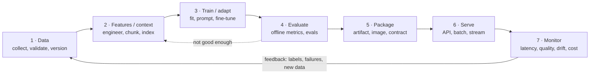
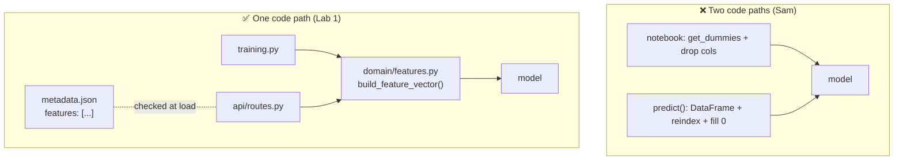

# Lección 1.1: Prototipo frente a producción y el ciclo de vida de la IA
<!-- id: l-1-1 -->

> ⏱ ~45 min · 🎚 Nivel: Core · 🧰 Requisitos: [Módulo 0](../00-foundations/README.md)

[Inicio del curso](../../README.md) › [Módulo 1](README.md) › Lección 1.1

## 📨 La situación

> **De: Sam (Data Scientist)**
> ¡Hola! Te doy la bienvenida 👋 El modelo de fraude está en `fraud_model_v2_FINAL.ipynb`: 99 % de accuracy, 0,95 de AUC.
> La dirección vio la demo y le encantó. Creo que solo le falta «una API alrededor», ¿no?
> Te puedo mandar el archivo pickle. Ah, y el asistente de documentación funciona en mi portátil, por si quieres probarlo.

«Solo le falta una API alrededor» es una de las frases más caras de la ingeniería de IA. Esta lección explica por qué y te da el mapa que usarás durante el resto del curso.

## 🎯 Al terminar podrás

- **Explicar** al menos seis diferencias concretas entre un prototipo y un sistema de IA en producción.
- **Dibujar** el ciclo de vida de la IA, de los datos a la monitorización, tanto para un modelo de ML clásico como para una aplicación con un LLM.
- **Definir** el training/serving skew, nombrar sus cuatro causas más comunes y **detectarlo** en código real.
- **Enumerar** los artefactos de traspaso que debe producir cada etapa del ciclo de vida y **explicar** por qué «el archivo pickle» no basta.

## 🤔 Predice primero

Responde mentalmente o en un cuaderno antes de seguir leyendo. Equivocarse no pasa nada: intentar adivinar primero hace que la explicación se quede.

1. El modelo de Sam tiene un 99 % de accuracy en un dataset en el que el 1,4 % de las transacciones son fraude. ¿Es bueno? <!-- id: p-1-1-1 -->
2. Si entrenas un modelo en un notebook y lo sirves desde una API, ¿cuántos fragmentos de código distintos calculan las features? <!-- id: p-1-1-2 -->
3. Di tres cosas, aparte del archivo del modelo, que alguien necesitaría para reconstruir desde cero el modelo de Sam dentro de seis meses. <!-- id: p-1-1-3 -->

---

## 1. Qué significa de verdad «producción»

Un **prototipo** responde a la pregunta *«¿puede funcionar esto?»*. Un **sistema en producción** responde a una pregunta más difícil: *«¿seguirá funcionando, para usuarios reales, cuando las cosas vayan mal, y podemos demostrarlo?»*

Piensa en alguien que cocina en casa y en la cocina de un restaurante. En casa se puede preparar un plato excelente: se prueba sobre la marcha, se usa lo que haya en la nevera y, si sale mal, se pide una pizza. Un restaurante tiene que servir ese mismo plato 400 veces cada noche, con ingredientes de proveedores que a veces llegan tarde, cocinado por quien esté de turno y con una inspección de sanidad que puede presentarse en cualquier momento. **La receta es la misma. Todo lo que la rodea es distinto.**

| Dimensión | Prototipo (el notebook de Sam) | Producción (`fraud-service`) |
|---|---|---|
| **Usuarios** | Una persona, que sabe cómo funciona | Miles de requests por segundo desde sistemas a los que les da igual |
| **Entradas** | Un CSV limpio, escogido a mano | Campos que faltan, tipos incorrectos, valores nunca vistos |
| **Fallos** | Reiniciar el kernel | Cada fallo cuesta algo: pagos bloqueados, fraude no detectado, avisos a las 3 de la madrugada |
| **Latencia** | «Ha terminado» | Un presupuesto estricto, p. ej. p99 por debajo de 50 ms |
| **Reproducibilidad** | «Ejecuta las celdas de arriba abajo… más o menos» | Cualquiera puede reconstruir cualquier versión a partir de código + datos + configuración |
| **Cambios** | Editar y volver a ejecutar | Revisados, probados, versionados, publicados de forma gradual y reversibles |
| **Responsable** | Sam | Un equipo con on-call, runbooks y SLOs |
| **Seguridad** | La clave de API en una celda | Secretos gestionados, entradas que no son de fiar, accesos auditados |
| **Observabilidad** | `print()` | Logs, métricas, trazas, monitorización del drift |
| **Coste** | Un portátil, gratis | Dinero real por cada request, que alguien tiene que justificar |

> 🔎 **Por dentro:** un conocido artículo de Google, *Hidden Technical Debt in Machine Learning Systems* (2015), tiene una figura famosa en la que el «código de ML» es una cajita rodeada de cajas mucho más grandes: configuración, recogida de datos, extracción de features, verificación de datos, infraestructura de serving, monitorización y más. Esa figura es la razón de que exista este curso. El modelo es quizá un 5–10 % del trabajo.

### La trampa del 99 % de accuracy

Volvamos a la pregunta 1. Si el 1,4 % de las transacciones son fraude, un «modelo» que **siempre responde "no es fraude"** acierta el 98,6 % de las veces. El 99,2 % de accuracy de Sam lo supera por menos de un punto porcentual. La accuracy es la métrica equivocada para problemas desequilibrados; el Módulo 4 enseña las correctas (precision, recall, PR-AUC). De momento, recuerda esto: **la métrica estrella de un prototipo es una afirmación, no un hecho.** La ingeniería de producción empieza por comprobar esa afirmación.

---

## 2. Dos tracks, una disciplina

Este curso lleva dos sistemas en paralelo, porque hoy el trabajo de IA en producción llega en dos variantes que comparten la mayor parte de su ingeniería:

| | Track A: ML clásico (`fraud-service`) | Track B: aplicación con un LLM (`docs-assistant`) |
|---|---|---|
| **Qué construyes** | Un modelo que entrenas con tus propios datos etiquetados | Un sistema alrededor de un modelo preentrenado que normalmente no entrenas |
| **Artefacto principal** | Pesos del modelo + código de features | Prompts + índice de recuperación + elección del modelo + guardrails |
| **Latencia típica** | 1–50 ms | 0,5–30 s (el streaming ayuda) |
| **Principal fuente de coste** | CPU, pipelines de datos | Tokens u horas de GPU |
| **Señal de calidad** | Las labels llegan más tarde (contracargos semanas después) | A menudo no hay labels; necesitas evals y jueces |
| **Fallo clásico** | Training/serving skew, drift | Alucinación, fallos de recuperación, prompt injection |
| **Igual en ambos** | Versionado, tests, APIs, contenedores, observabilidad, publicaciones graduales, seguridad, coste | |

La última fila es la clave: **cuando sabes llevar uno a producción, casi todo lo aprendido sirve para el otro.** Cada módulo enseña un concepto una vez y lo aplica a los dos tracks.

---

## 3. El ciclo de vida de la IA

Todo sistema de IA en producción recorre el mismo bucle. Es un *bucle*, no una línea, porque lo que aprendes en producción alimenta la siguiente versión.



Así es cada etapa en los dos tracks, y esto es lo que suele salir mal:

| Etapa | Track A: fraude | Track B: asistente de documentación | Fallo clásico |
|---|---|---|---|
| **1 · Datos** | Transacciones con tarjeta + labels de contracargos | Páginas del handbook, PDFs, HTML | Un cambio de esquema silencioso aguas arriba |
| **2 · Features / contexto** | Ratios, recuentos, categorías one-hot | Documentos parseados, troceados y convertidos en embeddings | La feature se calcula distinto online y offline |
| **3 · Entrenar / adaptar** | Ajustar un clasificador de gradient boosting | Elegir un modelo, escribir prompts, quizá LoRA | Una «mejor ejecución» que no se puede reproducir |
| **4 · Evaluar** | PR-AUC, recall con una tasa de falsos positivos fija | Preguntas de referencia (golden), fidelidad, exactitud de las citas | La métrica no coincide con el objetivo de negocio |
| **5 · Empaquetar** | `model.joblib` + `metadata.json` + imagen | Versión del prompt + versión del índice + imagen | «¿Qué versión hay en producción?» |
| **6 · Servir** | `POST /v1/score`, p99 < 50 ms | `POST /v1/ask`, tokens en streaming | Sin timeouts, sin alternativa |
| **7 · Monitorizar** | Distribución de las puntuaciones, fraude detectado, drift | Calidad de las respuestas, rechazos, coste por respuesta | La calidad se degrada y nadie se da cuenta |

> 💡 **Consejo de producción:** cuando alguien diga «el modelo está listo», pregunta *«¿qué etapa del ciclo de vida está lista?»*. Normalmente es la 3 o la 4. En las etapas 5–7 es donde está la mayor parte de la ingeniería, y la mayoría de los incidentes.

### Dónde cubre este curso cada etapa

| Etapa | Módulo |
|---|---|
| Datos, features, contexto, entrenamiento | [Módulo 2](../../../../modules/02-data-and-model-pipelines/README.md) |
| Evaluar | [Módulo 4](../../../../modules/04-evaluation-and-monitoring/README.md) |
| Empaquetar y servir | Módulo 1 (este) y [Módulo 3](../../../../modules/03-serving-and-optimization/README.md) |
| Monitorizar | [Módulo 4](../../../../modules/04-evaluation-and-monitoring/README.md) |
| Asegurar y gobernar (todas las etapas) | [Módulo 5](../../../../modules/05-security-and-governance/README.md) |
| Operar a escala (todas las etapas) | [Módulo 6](../../../../modules/06-scaling-and-operations/README.md) |

---

## 4. Training/serving skew: el asesino silencioso

El **training/serving skew** es cualquier diferencia entre lo que el modelo vio durante el entrenamiento y lo que ve cuando sirve predicciones. El modelo no falla con un error. Simplemente hace peores predicciones sin hacer ruido, y nadie se da cuenta hasta que se mueve una métrica de negocio.

Una analogía: aprendes a conducir en un coche con la palanca de cambios a la derecha. El primer día de trabajo te dan un coche con la palanca a la izquierda. Sigues pudiendo conducir, mal, y cometerás errores que nunca cometiste mientras aprendías.

### Las cuatro causas más comunes

| Causa | Qué pasa | Ejemplo del notebook de Sam |
|---|---|---|
| **1. Dos caminos de código** | Un fragmento de código calcula las features al entrenar y otro distinto al servir. Con el tiempo se separan. | `pd.get_dummies(df)` al entrenar frente a `pd.get_dummies(row).reindex(…, fill_value=0)` al predecir |
| **2. Información que todavía no existe al servir** (*fuga de datos*, leakage) | El entrenamiento usa una columna que solo se conoce después del evento que intentas predecir. | `chargeback_filed` se presenta *semanas después* de confirmarse el fraude. En el momento de puntuar siempre vale 0. |
| **3. Distinta frescura u origen de los datos** | El entrenamiento usa una instantánea nocturna del data warehouse; el serving usa una caché en vivo con otro retraso u otros valores por defecto. | «Transacciones de las últimas 24 h» calculadas offline a partir de una tabla completa y online a partir de un stream parcial |
| **4. Distintas versiones de bibliotecas o valores por defecto** | Un tokenizador, un escalador o un codificador de categorías se comporta distinto en otra versión. | scikit-learn sin fijar; deserializar con pickle un modelo con otra versión puede fallar o comportarse de otra forma |

### Un ejemplo resuelto con números reales

Ejecuta el notebook de Sam (Lab 1, paso 2) y obtendrás aproximadamente un **ROC-AUC de 0,95**. Entrena como es debido, sin la columna con fuga y con una partición temporal (Lab 1, paso 3), y obtendrás alrededor de **0,75**.

Esa caída no significa que el modelo empeore. **0,75 es lo que el modelo iba a hacer siempre en producción.** El 0,95 era una ilusión creada por dos cosas:

1. **La fuga de datos**: `chargeback_filed` es casi una copia de la label (el 85 % del fraude tiene un contracargo; las transacciones legítimas, el 0,5 %). El modelo aprendió «contracargo → fraude». En producción el contracargo todavía no existe, así que la señal más fuerte del modelo siempre vale cero.
2. **Una partición aleatoria sobre datos ordenados en el tiempo**: mezclar transacciones «futuras» en el entrenamiento hace que el conjunto de test sea más fácil que la vida real, donde siempre predices el futuro a partir del pasado.

> ⚠️ **Error común:** celebrar una gran mejora offline sin preguntarse «¿podría existir esta información en el momento de predecir?». Cuando una feature nueva mejora de forma espectacular un modelo de fraude o de abandono (churn), la primera hipótesis debería ser una fuga de datos, no un golpe de genialidad.

### Cómo evitan el skew los sistemas en producción



1. **Una sola función de features, importada tanto por el entrenamiento como por el serving.** En el lab es `build_feature_vector()`, en `src/kestrel_fraud/domain/features.py`. Un test (`test_training_and_serving_build_identical_rows`) demuestra que una fila del CSV y un payload de la API de la misma transacción producen vectores idénticos.
2. **Un contrato de features guardado con el modelo.** `metadata.json` registra los nombres exactos de las features y su orden. Al arrancar, el servicio los compara con su propio código y se niega a declararse listo si no coinciden (`ArtifactIncompatible`).
3. **Una lista explícita de columnas prohibidas por fuga.** `FORBIDDEN_COLUMNS` las documenta, y un test falla si el código de entrenamiento llega siquiera a *leer* una.
4. **Registra lo que sirves y entrena con lo que registraste.** La solución más sólida, la que usan las grandes empresas: registra los valores exactos de las features usados al servir y construye el siguiente conjunto de entrenamiento a partir de esos logs. Así, los datos de entrenamiento *son* los datos de serving. Las *Rules of Machine Learning* de Google recomiendan exactamente esto.
5. **Un feature store** (lección 1.2): un sistema calcula las features una vez y sirve los mismos valores al entrenamiento (offline, correctos en el tiempo, point-in-time) y al serving (online, con baja latencia).

### El skew en las aplicaciones con LLMs

Las aplicaciones con LLMs tienen su propia versión del skew:

- La plantilla de prompt que evaluaste no es la que está desplegada (alguien «arregló una errata» en producción).
- La evaluación se hizo contra el índice de ayer; producción usa el de hoy, con documentos nuevos troceados de otra forma.
- Hiciste las pruebas con `temperature=0` y producción se ejecuta con `temperature=0.7`.
- El proveedor actualizó sin avisar el modelo que hay detrás del mismo nombre.

Las soluciones son las mismas ideas: **versiona todo lo que influye en la salida** (ID del modelo, versión del prompt, versión del índice, parámetros de decodificación) y regístralo junto a cada response.

---

## 5. Artefactos de traspaso: lo que debe producir cada etapa

Un **artefacto de traspaso** es lo que una etapa (o una persona) entrega a la siguiente para que pueda trabajar **sin tener que hacer preguntas**. En un equipo, cada pregunta sin respuesta se convierte en una reunión, un retraso o un bug.

El traspaso de Sam fue «Te puedo mandar el archivo pickle». Así es un traspaso completo:

| De → a | Artefacto | Responde a la pregunta… | En el Lab 1 |
|---|---|---|---|
| Datos → entrenamiento | **Contrato de datos / esquema** | ¿Con qué columnas, tipos y rangos puedo contar? | `datasets/fraud/README.md`, `ScoreRequest` |
| Datos → entrenamiento | **Versión del dataset + digest** | ¿Qué datos se usaron exactamente? | `metadata.json → data.sha256` |
| Features → serving | **Especificación de features** | ¿Cómo se calculan las features y en qué orden? | `domain/features.py`, `metadata.json → features` |
| Entrenamiento → serving | **Artefacto del modelo** | ¿Qué cargo? | `model.joblib` |
| Entrenamiento → serving | **Metadatos del artefacto** | ¿Qué código, datos, parámetros, métricas y entorno lo produjeron? ¿Está intacto el archivo? | `metadata.json` (sha256, commit de git, semilla, versión de sklearn) |
| Entrenamiento → negocio | **Informe de evaluación / model card** | ¿Cómo de bueno es, para quién y dónde falla? | `metadata.json → metrics` (model cards en el Módulo 5) |
| Serving → clientes | **Contrato de la API** | ¿Cómo lo llamo y qué puede salir mal? | OpenAPI en `/docs` |
| Serving → on-call | **Runbook** | Son las 3 de la madrugada y está roto: ¿qué hago? | Plantilla en `templates/` (Módulo 6) |
| Track de LLMs | **Versión del prompt, versión del índice, ID del modelo, parámetros de decodificación** | ¿Qué produjo esta respuesta? | Módulos 2, 4 y 5 |

> 💡 **Consejo de producción:** una buena prueba para un traspaso es la *«prueba del autobús»* (bus test): si la persona autora estuviera ilocalizable durante un mes, ¿podría otra persona reconstruir, desplegar, depurar y revertir este modelo? Si no, el traspaso está incompleto.

### Cómo es un artefacto mínimo

Esta es una versión recortada de lo que escribe `scripts/train.py` en el lab:

```json
{
  "name": "fraud-model",
  "version": "20261110T115648Z-2a36bb33",
  "model_sha256": "4de749d1b2ca66862397a838261ab2f0870ed1095f13450a77617e4127a727c7",
  "features": ["amount_log", "amount_to_avg_ratio_log", "hour", "…"],
  "excluded_columns": ["chargeback_filed", "is_fraud", "transaction_id"],
  "data": {"path": "transactions.csv", "sha256": "2a36bb33…", "rows": 50000, "split": "time-based 80/20"},
  "metrics": {"roc_auc": 0.747, "pr_auc": 0.063, "test_base_rate": 0.0155},
  "code": {"commit": "9c1e2f0…", "dirty": false},
  "environment": {"python": "3.12.7", "sklearn": "1.7.2", "numpy": "2.3.4"},
  "seed": 42
}
```

Cada campo responde a una pregunta que alguien hará durante un incidente. La lección 1.5 explica el sha256 y el esquema de versionado.

---

## 🧪 Pruébalo

Haz los **pasos 1–3** del [Lab 1](lab/README.md):

1. Revisa `prototype/sam_notebook.py` y apunta todos los problemas que encuentres (intenta llegar a 10 o más).
2. Ejecútalo y apunta su accuracy y su AUC.
3. Ejecuta `uv run python scripts/train.py` y compara las métricas honestas. Abre `metadata.json` y responde a las cuatro preguntas del paso 3.

Resultado esperado: el notebook de Sam da un AUC ≈ 0,95; el pipeline como es debido da un ROC-AUC ≈ 0,75 y un PR-AUC ≈ 0,06, frente a una tasa base ≈ 0,015.

## 🏭 En el mundo real

- Las [*Rules of Machine Learning*](https://developers.google.com/machine-learning/guides/rules-of-ml) de Google dedican una sección entera al training/serving skew. Su consejo de registrar las features usadas al servir y reutilizarlas para entrenar es una de las recomendaciones prácticas más citadas del ML en producción.
- El artículo de 2015 [*Hidden Technical Debt in Machine Learning Systems*](https://proceedings.neurips.cc/paper/2015/hash/86df7dcfd896fcaf2674f757a2463eba-Abstract.html) introdujo términos que oirás en entrevistas: *entanglement* (cambiar cualquier cosa lo cambia todo), *undeclared consumers* (consumidores no declarados) y *glue code* (código pegamento).
- La [guía de arquitectura de MLOps](https://cloud.google.com/architecture/mlops-continuous-delivery-and-automation-pipelines-in-machine-learning) de Google Cloud describe los niveles de madurez 0 → 2. El notebook de Sam es el «nivel 0»: manual, a base de scripts, sin automatización. Este curso te lleva al nivel 2.

## ✅ Comprueba lo aprendido

<details>
<summary>P1. El nuevo modelo de abandono (churn) de una persona de tu equipo pasó de 0,71 a 0,93 de AUC tras añadir una feature llamada <code>account_closed_reason</code>. ¿Cuál es tu primera hipótesis? <!-- id: c-1-1-1 --></summary>

**Fuga de datos.** El motivo del cierre solo existe *después* de que el cliente se haya ido, así que no se puede conocer en el momento de predecir. Pregunta: «En el momento en que hacemos esta predicción en producción, ¿existe este valor y significa lo mismo?». Los saltos enormes por una sola feature son sospechosos hasta que se demuestre lo contrario.
</details>

<details>
<summary>P2. Di las cuatro causas comunes del training/serving skew. <!-- id: c-1-1-2 --></summary>

1. Dos caminos de código distintos que calculan las features. 2. Información que todavía no está disponible al servir (fuga de datos). 3. Distintos orígenes o frescura de los datos entre offline y online. 4. Distintas versiones de bibliotecas o comportamientos por defecto.
</details>

<details>
<summary>P3. ¿Por qué una partición temporal entre entrenamiento y test es más honesta que una aleatoria en el caso del fraude? <!-- id: c-1-1-3 --></summary>

En producción siempre predices el **futuro** con un modelo entrenado con el **pasado**. Una partición aleatoria deja que el modelo se entrene con transacciones posteriores a algunas de las de test, lo que filtra patrones del futuro y hace que las métricas salgan optimistas. Una partición temporal simula el despliegue.
</details>

<details>
<summary>P4. Sam te envía <code>model.pkl</code>. Di cuatro preguntas que no puedes responder solo con ese archivo. <!-- id: c-1-1-4 --></summary>

Cuatro cualesquiera de estas: con qué datos (y qué versión) se entrenó; qué código o commit; qué lista de features y en qué orden espera; qué versiones de bibliotecas hacen falta para cargarlo; cuáles fueron sus métricas y con qué conjunto de test; qué semilla aleatoria; si el archivo está intacto (checksum); quién lo aprobó; qué umbral usar.
</details>

<details>
<summary>P5. Pon un ejemplo de training/serving skew propio de las aplicaciones con LLMs. <!-- id: c-1-1-5 --></summary>

Ejemplos: el prompt evaluado es distinto del desplegado; la evaluación usó otra versión del índice que producción; distintos parámetros de decodificación (temperature); el proveedor actualizó el modelo que hay detrás del mismo nombre; el troceado (chunking) o el modelo de embeddings cambiaron entre la evaluación y el serving.
</details>

<details>
<summary>P6. ¿Qué etapas del ciclo de vida ignora «solo le falta una API alrededor»? <!-- id: c-1-1-6 --></summary>

Sobre todo el **empaquetado, la fiabilidad del serving y la monitorización** (etapas 5–7), y normalmente también la reproducibilidad de las etapas 1–4. Una API alrededor de un modelo sin versionar, sin monitorizar y con features con fuga sigue siendo un prototipo, solo que ahora depende de él más gente.
</details>

## 💬 Explícalo con tus palabras
<!-- id: e-1-1 -->

Explícale el **training/serving skew** a Omar, de Risk, en tres frases y sin usar las palabras «feature», «pipeline» ni «distribución». Si no puedes, relee la sección 4.

## 🔑 Ideas clave

- El modelo es una parte pequeña de un sistema de IA en producción; el resto son datos, empaquetado, serving, monitorización, seguridad y operaciones.
- La métrica estrella de un prototipo es una **afirmación**. Antes que nada, comprueba si hay fugas de datos, métricas equivocadas o particiones poco realistas.
- El **training/serving skew** no hace ruido. Evítalo con una única función de features compartida, un contrato de features que se comprueba al cargar y el registro de las features servidas.
- El ciclo de vida de la IA es un **bucle** (datos → features → entrenamiento → evaluación → empaquetado → serving → monitorización → datos), y es el mismo para el ML clásico y para las aplicaciones con LLMs.
- Cada etapa entrega **artefactos con metadatos**, no solo archivos. Pasa la prueba del autobús.

## 📚 Para profundizar (gratis)

| | Recurso | Por qué leerlo | Tiempo |
|---|---|---|---|
| ⭐ | [Rules of Machine Learning](https://developers.google.com/machine-learning/guides/rules-of-ml), Martin Zinkevich (Google) | Décadas de lecciones de producción en 43 reglas; lee primero la sección «Training-Serving Skew» | 45 min |
| ⭐ | [Machine Learning in Production](https://mlip-cmu.github.io/book/), Christian Kästner (CMU) | Libro gratuito; capítulos sobre la visión del ML como «modelo frente a sistema» | 1 h |
| 🔍 | [Hidden Technical Debt in ML Systems](https://proceedings.neurips.cc/paper/2015/hash/86df7dcfd896fcaf2674f757a2463eba-Abstract.html), Sculley et al. (2015) | El artículo clásico sobre por qué se pudren los sistemas de ML | 30 min |
| 🔍 | [MLOps: Continuous delivery and automation pipelines in ML](https://cloud.google.com/architecture/mlops-continuous-delivery-and-automation-pipelines-in-machine-learning), Google Cloud | Niveles de madurez de MLOps 0–2 | 30 min |
| 🔍 | [Made With ML](https://madewithml.com/), Goku Mohandas | Recorrido completo del notebook a producción | según lo necesites |
| 🔍 | [What We Learned from a Year of Building with LLMs](https://applied-llms.org/) | El equivalente de las «Rules of ML» para el track de LLMs | 1 h |

---
⬅️ [Módulo 0: LLMs en una hora](../00-foundations/05-llms-in-one-hour.md) · ➡️ [Lección 1.2: Patrones de arquitectura](02-architecture-patterns.md)
