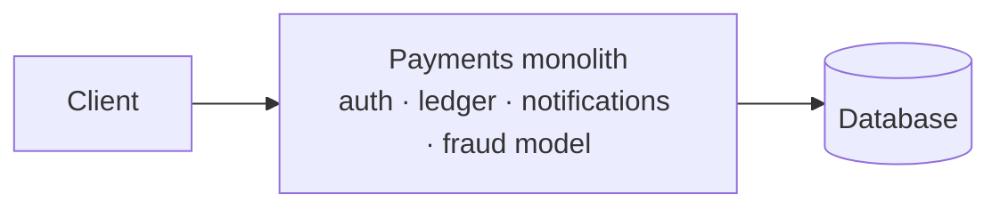
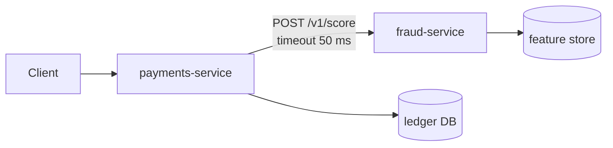
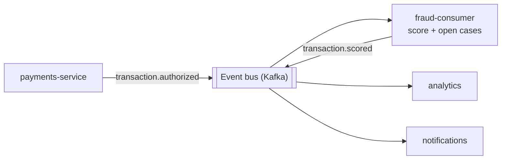
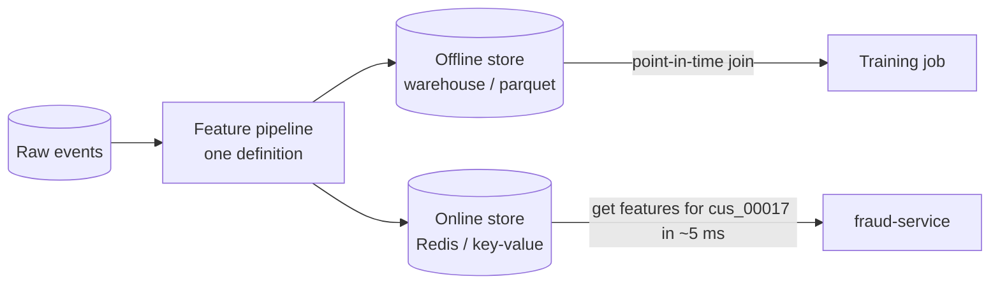
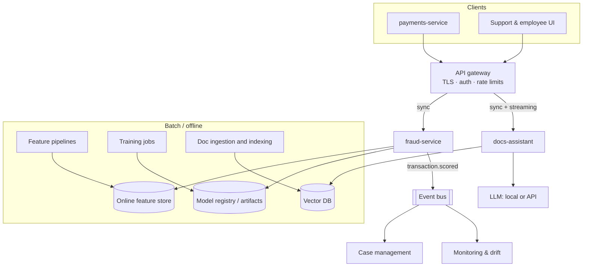

# Lección 1.2: Patrones de arquitectura para sistemas de IA
<!-- id: l-1-2 -->

> ⏱ ~50 min · 🎚 Nivel: Core · 🧰 Requisitos: [Lección 1.1](01-prototype-vs-production.md)

[Inicio del curso](../../README.md) › [Módulo 1](README.md) › Lección 1.2

## 📨 La situación

> **De: Diego (SRE / Platform)**
> Antes de que escribas nada de código, dos preguntas para la revisión de diseño del jueves:
> 1. ¿La puntuación de fraude se hace **en tiempo real** durante la autorización de la tarjeta, o puede ejecutarse **por lotes** durante la noche?
> 2. ¿Es **un servicio propio**, parte del monolito de pagos, o un consumidor del bus de eventos?
> Y, por favor, no te inventes una base de datos nueva. Dime cuáles de nuestras piezas necesitas.

Las decisiones de arquitectura son caras de revertir. Esta lección te da el vocabulario y los compromisos (trade-offs) para responder a Diego con seguridad y defender tu respuesta.

## 🎯 Al terminar podrás

- **Elegir** entre inferencia por lotes (batch), online y en streaming para un caso de uso concreto, y justificar la elección por latencia, frescura y coste.
- **Comparar** las arquitecturas monolítica, de microservicios y orientada a eventos, y **escoger** una para un componente de IA.
- **Describir** qué hacen un API gateway, un feature store, una base de datos vectorial y un registro de modelos (model registry), y **cuándo necesitas cada uno**.
- **Construir** un presupuesto de latencia para un camino de predicción online.

## 🤔 Predice primero

1. Las filas de «Selección para ti» al estilo de Netflix: ¿se calculan cuando abres la aplicación o antes? <!-- id: p-1-2-1 -->
2. Una comprobación de fraude tiene que responder dentro de la ventana de autorización de la red de tarjetas. ¿Qué parte de esa ventana crees que le toca, más o menos, al propio modelo de ML: el 50 %, el 10 % o el 1 %? <!-- id: p-1-2-2 -->
3. ¿«Convertir la IA en un microservicio» es siempre la decisión correcta? <!-- id: p-1-2-3 -->

---

## 1. ¿Inferencia por lotes, online o en streaming?

**Inferencia** significa usar un modelo entrenado para hacer predicciones. Hay tres formas de hacerlo, y elegir la equivocada es el error de arquitectura de IA más común.

| | **Por lotes (batch)** (offline) | **Online** (en tiempo real, síncrona) | **Streaming** (casi en tiempo real, asíncrona) |
|---|---|---|---|
| **Cómo** | Un job programado puntúa muchas filas de una vez y guarda los resultados | Llega una request; el modelo responde en la misma request | Los eventos fluyen por un stream; un consumidor puntúa cada uno en cuestión de segundos |
| **Latencia para el usuario** | ~0 (resultados precalculados), pero desactualizados | Tiene que ser rápida: de ms a s | Segundos; normalmente el usuario no está esperando |
| **Frescura** | De horas a un día de antigüedad | Al momento | Segundos de antigüedad |
| **Throughput / coste** | La más barata por predicción: vectorizada, instancias spot, fuera de las horas punta | La más cara: dimensionada para el pico, capacidad ociosa | Intermedia |
| **Complejidad** | Baja: un script y una tabla | Alta: disponibilidad, latencia, escalado | La más alta: infraestructura de streams, orden, semántica exactly-once |
| **Impacto de un fallo** | El job se reintenta más tarde; los usuarios ven los resultados de ayer | Los usuarios ven errores o páginas lentas al instante | El trabajo pendiente (backlog) crece; se recupera después |
| **Ejemplo en Kestrel** | Volver a puntuar cada noche todas las cuentas para las revisiones de riesgo | `POST /v1/score` durante la autorización de la tarjeta | Puntuar cada transacción del bus de eventos para la gestión de casos |
| **Otros ejemplos** | Puntuaciones de abandono (churn), recomendaciones por email, reindexar documentos | Ranking de búsqueda, chat, fraude en el pago | Detección de anomalías en logs, dashboards en vivo |

### Cómo decidir

Hazte tres preguntas, en este orden:

1. **¿La predicción necesita información que solo existe en el momento de la request?** (El importe de la transacción, la pregunta del usuario.) Si es así → online o streaming. Si no → probablemente basta con batch.
2. **¿Hay alguien esperando la respuesta?** Si espera una persona o un sistema bloqueado → online. Si no → streaming o batch.
3. **¿Cuánto puede estar desactualizada la respuesta?** Horas → batch. Segundos → streaming. Nada → online.

Para Kestrel:

- **fraud-service**: el importe, el comercio y el dispositivo solo existen en el momento de la autorización, y el pago está esperando una decisión → **online**.
- **docs-assistant**: la pregunta solo existe en el momento de la request y hay una persona esperando → **online**, con *responses en streaming* (lección 1.3) para que la espera se haga más corta. La **ingesta e indexación** de documentos es un job **batch**: los documentos cambian cada día, no cada segundo.

> 💡 **Consejo de producción:** las mejores arquitecturas suelen ser **híbridas**. Precalcula por lotes todo lo que puedas (agregados de clientes, embeddings de documentos, recomendaciones candidatas) y haz online la menor cantidad posible de trabajo (consultar, combinar, reordenar). La inferencia online es cara; gástala solo en lo que de verdad tiene que estar fresco.

### Haz las cuentas

El *Amplíalo n.º 1* del Lab 1 te pide puntuar por lotes 50 000 transacciones. Vectorizado en una sola llamada a `predict_proba`, tarda alrededor de un segundo. A través de la API HTTP, una request cada vez a ~3 ms cada una, tarda ~2,5 minutos, y a 20 ms cada una por una red real, ~17 minutos. El mismo modelo, un coste ~1000× distinto. **Batch no es una forma menor de servir; para muchos casos de uso, es la correcta.**

---

## 2. ¿Monolito, microservicios u orientado a eventos?

Una vez que sabes *cuándo* se hacen las predicciones, decide *dónde vive el código*.

### Monolito

Una sola aplicación desplegable lo contiene todo: pagos, cuentas, notificaciones y puntuación de fraude.

- ✅ Lo más sencillo de construir, probar, desplegar y depurar. Una llamada a una función es más rápida y más fiable que una llamada por red.
- ❌ Las dependencias pesadas del modelo de ML (NumPy, scikit-learn, quizá PyTorch) inflan cada despliegue. Actualizar el modelo obliga a volver a desplegar pagos. Una fuga de memoria del modelo tumba el libro contable (ledger). Necesidades de escalado distintas (un modelo que tira de CPU frente a una API que tira de I/O) quedan forzadas a ir juntas.

### Microservicios

La puntuación de fraude es un servicio propio, con su propia API, su pipeline de despliegue y su escalado.

- ✅ Publicaciones independientes (sacas un modelo nuevo sin tocar pagos), escalado independiente (más réplicas de fraude en el Black Friday), aislamiento de fallos (si se hace bien), el lenguaje y el hardware adecuados para cada servicio (GPUs solo donde hacen falta).
- ❌ Cada llamada pasa a ser una **llamada por red** que puede ir lenta o fallar (lección 1.3). Necesitas descubrimiento de servicios, autenticación entre servicios, trazas distribuidas, versionado de APIs y una rotación de on-call que lo entienda todo.

### Orientado a eventos

Los servicios se comunican publicando **eventos** («transaction.authorized») en un log o un broker (Kafka, Pulsar, RabbitMQ, colas en la nube). Los consumidores reaccionan de forma asíncrona; quien publica no los conoce ni los espera.

- ✅ Bajo acoplamiento (añades consumidores sin tocar a los productores), absorción natural de los picos de tráfico, reproducción (volver a puntuar los eventos de la semana pasada con un modelo nuevo); ideal para la inferencia en streaming y para los registros de auditoría.
- ❌ Consistencia eventual (la respuesta llega *más tarde*), depuración más difícil, problemas de orden y de entregas duplicadas (los consumidores tienen que ser **idempotentes**) e infraestructura que operar.

### La respuesta habitual: combinarlos

Para Kestrel, el diseño sensato es:

1. Un microservicio **síncrono** `POST /v1/score` para la decisión de autorización, con un timeout ajustado y una alternativa (fallback), porque el pago está esperando.
2. El fraud-service **publica** un evento `transaction.scored`, para que la gestión de casos, la analítica y la monitorización del modelo lo consuman de forma **asíncrona**, sin ralentizar el pago.

> ⚠️ **Error común:** dividir en microservicios demasiado pronto. Si hay un solo equipo con un solo modelo, un **monolito modular** (capas y módulos limpios dentro de un solo desplegable) te da el 80 % del beneficio con el 20 % del coste. Divide cuando tengas una razón concreta: otro ritmo de publicaciones, otro perfil de escalado, otro hardware, otro equipo o aislamiento de fallos. «Los microservicios son modernos» no es una razón.

### Servicios sin estado frente a servicios con estado

Un servicio **sin estado** (stateless) no guarda en memoria entre requests nada que otra réplica fuera a necesitar. Puedes ejecutar 2 o 200 copias detrás de un balanceador de carga y matar cualquiera de ellas en cualquier momento. Los servicios en producción deberían ser sin estado siempre que sea posible; el estado va en bases de datos, cachés y almacenamiento de objetos.

El Lab 1 contiene un contraejemplo a propósito: `/v1/explain/{transaction_id}` lee de un `LRUStore` **en memoria** con las puntuaciones recientes. Ejecuta dos réplicas y puede que la request de explicación caiga en la réplica que nunca puntuó esa transacción y reciba un 404. La solución es un almacén compartido (Redis) o una request autocontenida. Verás este problema en el Módulo 6, cuando escales horizontalmente.

---

## 3. Las piezas

La IA en producción no se construye desde cero. Se monta con componentes bien conocidos. Estos son los que toda persona que se dedique a la ingeniería de IA debe conocer:

| Pieza | Qué hace | Uso en Kestrel | Opciones comunes | Curso |
|---|---|---|---|---|
| **API gateway** | Punto de entrada único: TLS, autenticación, rate limiting, enrutado, límites de tamaño de las requests | Enruta `/fraud/*` y `/assistant/*`, exige claves de API y aplica cuotas | Kong, Envoy, NGINX, AWS API Gateway, balanceadores de carga en la nube | Módulos 5 y 6 |
| **Feature store** | Calcula las features una vez y las sirve **offline** (conjuntos de entrenamiento correctos en el tiempo, point-in-time) y **online** (consultas de baja latencia) | `txn_count_24h`, `avg_amount_30d` por cliente | Feast (código abierto), Tecton, feature stores en la nube, o Redis + un pipeline | Lab 1 (falso), Módulo 2 |
| **Base de datos vectorial** | Guarda embeddings y encuentra rápido los más cercanos, con filtros por metadatos | Fragmentos del handbook para el docs-assistant | Qdrant, pgvector, Weaviate, Milvus, FAISS (biblioteca), servicios gestionados | Módulo 2 |
| **Registro de modelos (model registry)** | Catálogo de versiones de modelos con metadatos, linaje y etapas (staging → producción) | Qué versión del modelo de fraude está aprobada para producción | MLflow Model Registry, registros en la nube | Módulos 1 y 2 |
| **Cola de mensajes / stream de eventos** | Comunicación asíncrona y con búfer entre servicios | Eventos `transaction.scored`, jobs de ingesta de documentos | Kafka, RabbitMQ, SQS, Pub/Sub, Redis Streams | Módulos 2 y 6 |
| **Almacenamiento de objetos** | Almacenamiento de blobs barato y duradero | Datasets, artefactos de modelos, documentos en bruto | S3, GCS, Azure Blob, MinIO | Módulos 2 y 6 |
| **Seguimiento de experimentos (experiment tracker)** | Registra ejecuciones: parámetros, métricas, artefactos | Comparar ejecuciones del modelo de fraude | MLflow, Weights & Biases | Módulo 2 |
| **Stack de observabilidad** | Logs, métricas, trazas, dashboards, alertas | Latencia, tasa de errores, drift de las puntuaciones | OpenTelemetry, Prometheus, Grafana, Langfuse | Módulo 4 |
| **Registro de prompts (prompt registry)** | Prompts versionados y revisados, con rollback | El prompt de system del docs-assistant | MLflow Prompt Registry, Langfuse, Git | Módulos 4 y 5 |

### El feature store, más de cerca

El feature store merece atención extra porque ataca directamente el training/serving skew (lección 1.1).

**Ser correcto en el tiempo** (point-in-time correctness) significa que, cuando construyes una fila de entrenamiento para una transacción que ocurrió el 3 de marzo a las 14:02, usas el valor de `txn_count_24h` *tal y como era a las 14:02 del 3 de marzo*, no el valor de hoy. Equivocarse aquí es una forma de fuga de datos, y es tan sutil que es la razón principal de que existan los feature stores.

En el Lab 1, `scripts/fake_feature_store.py` hace de almacén online y `adapters/enrichment.py` es el cliente. Quien llama puede pasar los agregados directamente; si no lo hace, el servicio los obtiene.

---

## 4. Una arquitectura de referencia para Kestrel

Juntándolo todo, aquí es adonde vamos de cara al Módulo 6. No te preocupes todavía por cada caja; cada módulo completa una parte.

---

## 5. Ejemplo resuelto: un presupuesto de latencia

Las redes de tarjetas dan al emisor un tiempo limitado para aprobar o rechazar. Supón que el equipo de pagos de Kestrel concede a la comprobación de fraude **150 ms de extremo a extremo en el p99** (el percentil 99, es decir, 99 de cada 100 requests tienen que ser más rápidas; el Módulo 3 explica los percentiles a fondo). ¿En qué se va el tiempo?

| Paso | Presupuesto p99 | Notas |
|---|---|---|
| Red pagos → gateway → fraud-service | 10 ms | Misma región, conexiones keep-alive |
| Gateway (autenticación, enrutado) | 5 ms | |
| Parseo y validación de la request | 2 ms | Pydantic |
| **Consulta al feature store** | **40 ms** | El paso más arriesgado: una llamada por red a otro sistema |
| Cálculo de features | 1 ms | |
| **Inferencia del modelo** | **5 ms** | Los árboles con gradient boosting en CPU son rápidos |
| Logging, métricas, publicación del evento | 2 ms | Tiene que ser asíncrono / no bloqueante |
| Response | 5 ms | |
| **Margen de seguridad** | **80 ms** | Para reintentos, pausas del recolector de basura (GC), vecinos ruidosos |
| **Total** | **150 ms** | |

Esto responde a la pregunta 2 de predicción: al modelo le toca más o menos el **3 %** del presupuesto. La **llamada al feature store** es el riesgo dominante, y por eso el Lab 1 la envuelve en timeouts, reintentos, un deadline y una alternativa. El margen no es desperdicio: es lo que te permite reintentar una vez.

> 💡 **Consejo de producción:** escribe siempre un presupuesto de latencia **antes** de construir. Te dice qué llamadas necesitan timeouts, si te puedes permitir un reintento, si cabe un modelo más grande y qué componente optimizar primero. Sin él, cada equipo da por hecho que los demás son rápidos.

Para el docs-assistant el presupuesto es completamente distinto: domina la llamada al LLM (segundos), así que la cifra importante es el **tiempo hasta el primer token** (TTFT) y no el tiempo total. El Módulo 3 construye ese presupuesto.

---

## 🧪 Pruébalo

1. En el [Lab 1](lab/README.md), haz el **paso 7** y fíjate en que el fraud-service llama al feature store por HTTP: esa es la frontera de microservicio de la sección 2, con todos sus modos de fallo.
2. Haz el **Amplíalo n.º 1 (inferencia por lotes)**. Mide el tiempo de la ejecución vectorizada por lotes y luego calcula cuánto tardarían esas mismas 50 000 filas a través de `POST /v1/score` (mide una request con `time curl …`). Apunta la proporción.
3. Dibuja en papel, de memoria, tu propia versión del diagrama de la sección 4. Compáralos.

## 🏭 En el mundo real

- Las entradas del blog de ingeniería de Uber sobre **Michelangelo**, su plataforma de ML, describen las mismas piezas: un feature store, un registro de modelos y serving tanto por lotes como online. Busca «Uber Michelangelo» en el blog de ingeniería de Uber.
- La documentación de [Feast](https://feast.dev/), de código abierto, explica con diagramas los joins correctos en el tiempo (point-in-time) y los almacenes online y offline; su página de conceptos es una buena lectura de 20 minutos.
- El artículo [Microservices](https://martinfowler.com/articles/microservices.html) de Martin Fowler (con James Lewis) es la definición clásica, y su nota [MonolithFirst](https://martinfowler.com/bliki/MonolithFirst.html) defiende empezar por lo sencillo.

## ✅ Comprueba lo aprendido

P1. Kestrel quiere enviar por email a cada cliente un resumen de «tus gastos de este mes» redactado por un LLM. ¿Batch, online o streaming? ¿Por qué? <!-- id: c-1-2-1 -->

**Batch.** Nadie está esperando, los datos (las transacciones del mes pasado) están completos de antemano y una frescura de horas es suficiente. Batch te permite usar capacidad más barata (fuera de las horas punta, requests agrupadas, quizá un modelo más barato) y reintentar los fallos sin que lo note nadie.

P2. Da tres razones concretas para sacar la puntuación de fraude del monolito de pagos y una para no hacerlo. <!-- id: c-1-2-2 -->

A favor: publicar modelos de forma independiente sin volver a desplegar pagos; escalado y hardware independientes; aislamiento de fallos (una fuga de memoria del modelo no tumba el libro contable); pilas de dependencias distintas. En contra: un salto de red añade latencia y nuevos modos de fallo (timeouts, reintentos, caídas parciales), además de carga operativa.

P3. ¿Qué es ser correcto en el tiempo (point-in-time correctness) y qué sale mal sin ello? <!-- id: c-1-2-3 -->

Al construir una fila de entrenamiento para un evento en el instante *t*, cada feature debe usar solo información disponible en *t*. Sin ello, filtras información del futuro (p. ej., la media de 30 días de hoy en una transacción de marzo), y las métricas offline son mejores que el rendimiento en producción: una forma de training/serving skew.

P4. ¿Por qué los consumidores de eventos tienen que ser idempotentes? <!-- id: c-1-2-4 -->

La mayoría de los brokers garantizan una entrega **al menos una vez** (at-least-once): después de una caída o un reintento, el mismo evento puede llegar dos veces. Un consumidor idempotente produce el mismo resultado tanto si procesa un evento una vez como varias (p. ej., «crear o actualizar el caso de la transacción X» en lugar de «crear un caso nuevo»).

P5. En el presupuesto de 150 ms para el fraude, ¿qué componente merece más atención de ingeniería y por qué? <!-- id: c-1-2-5 -->

La **consulta al feature store**: es una llamada por red a otro sistema, así que tiene la latencia mayor y menos predecible, y puede fallar. Por eso necesita un timeout, reintentos acotados y una alternativa (valores por defecto o reglas). El propio modelo es una parte pequeña y predecible del presupuesto.

P6. ¿Por qué el endpoint <code>/v1/explain/{id}</code> del Lab 1 es un problema al escalar? <!-- id: c-1-2-6 -->

Depende de un **estado en memoria** (una LRU con las puntuaciones recientes) dentro de un proceso. Con varias réplicas, una request puede llegar a una réplica que nunca vio esa transacción → 404. Solución: guardar las puntuaciones recientes en un almacén compartido (Redis o una base de datos) o hacer que la request sea autocontenida.

## 💬 Explícalo con tus palabras
<!-- id: e-1-2 -->

Diego hizo dos preguntas al principio de esta lección. Escribe la respuesta que darías en la revisión de diseño: batch, online o streaming, qué arquitectura, qué piezas y tu presupuesto de latencia, en **menos de 150 palabras**.

## 🔑 Ideas clave

- Elige **batch** cuando nadie espera, **online** cuando alguien espera y **streaming** cuando la frescura importa pero nada se bloquea. Lo híbrido (precalcular + poco trabajo online) suele ser lo mejor.
- Empieza con un **monolito modular**; divide en servicios por razones concretas (ritmo de publicaciones, escalado, hardware, aislamiento, equipo responsable).
- Usa **eventos** para todo lo que no tenga que bloquear al usuario; los consumidores tienen que ser **idempotentes**.
- Conoce las piezas: **gateway, feature store, base de datos vectorial, registro de modelos, cola, almacenamiento de objetos, seguimiento de experimentos, observabilidad, registro de prompts**.
- Escribe primero un **presupuesto de latencia**. El modelo rara vez es la parte más lenta; las llamadas por red sí.

## 📚 Para profundizar (gratis)

| | Recurso | Por qué leerlo | Tiempo |
|---|---|---|---|
| ⭐ | [Machine Learning in Production](https://mlip-cmu.github.io/book/), Kästner (CMU), capítulos sobre despliegue y arquitectura | Patrones de serving de modelos y sus compromisos, explicados con claridad | 1 h |
| ⭐ | [Microservices](https://martinfowler.com/articles/microservices.html), Lewis y Fowler | La definición canónica, con sus compromisos | 40 min |
| 🔍 | [MonolithFirst](https://martinfowler.com/bliki/MonolithFirst.html), Fowler | Por qué empezar con un monolito | 10 min |
| 🔍 | [Documentación de Feast](https://docs.feast.dev/) | Conceptos de feature store: almacenes online y offline, joins point-in-time | 30 min |
| 🔍 | [Stanford CS 329S: ML Systems Design](https://stanford-cs329s.github.io/), Chip Huyen | Apuntes de clase sobre predicción por lotes frente a online y sobre despliegue | 1 h |
| 🔍 | [Patterns for Building LLM-based Systems & Products](https://eugeneyan.com/writing/llm-patterns/), Eugene Yan | La misma forma de pensar aplicada a las aplicaciones con LLMs | 45 min |

---
⬅️ [Lección 1.1: Prototipo frente a producción](01-prototype-vs-production.md) · ➡️ [Lección 1.3: Primitivas de fiabilidad](03-reliability-primitives.md)
