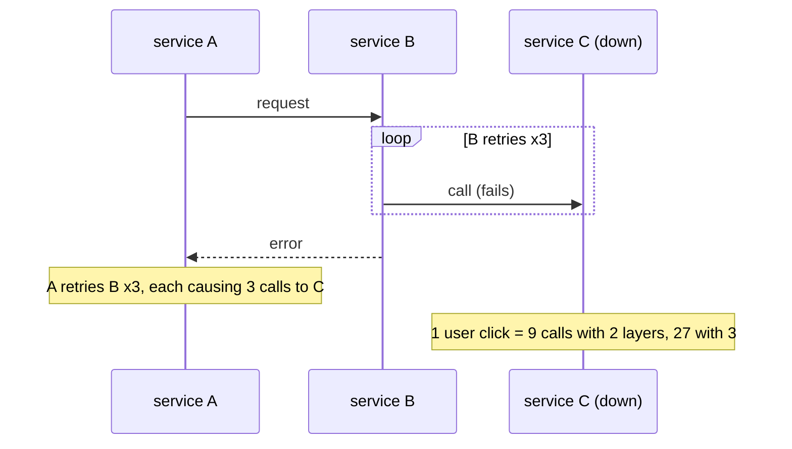
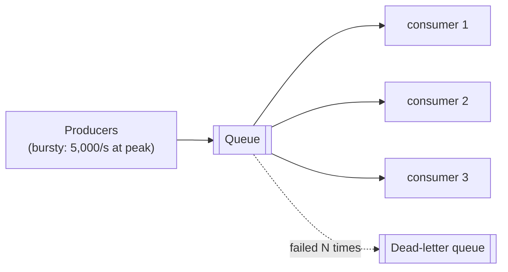
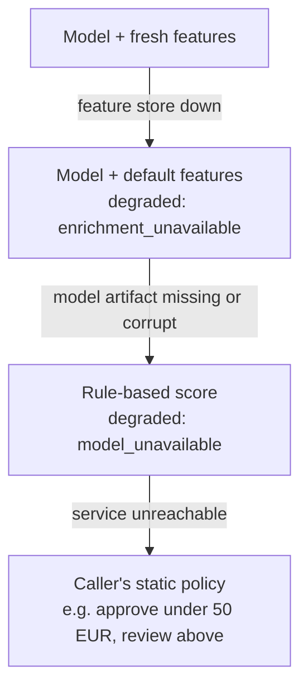

# Lección 1.3: Primitivas de fiabilidad
<!-- id: l-1-3 -->

> ⏱ ~60 min · 🎚 Nivel: Core · 🧰 Requisitos: [Lección 1.2](02-architecture-patterns.md)

[Inicio del curso](../../README.md) › [Módulo 1](README.md) › Lección 1.3

## 📨 La situación

> **De: Omar (Risk Analyst)**
> Una regla desde el lado de riesgos: una comprobación de fraude que **bloquea los pagos cuando se cae** es peor que no tener comprobación de fraude. Los clientes se irán a otro banco.
>
> **De: Diego (SRE)**
> Contexto: el trimestre pasado, un servicio de validación de direcciones que iba lento tumbó el checkout durante 40 minutos. Nadie había puesto un timeout, todos los hilos se quedaron esperándolo y, cuando se recuperó, una avalancha de reintentos lo volvió a tumbar. No quiero que se repita con la puntuación de fraude.

Esta lección trata del pequeño conjunto de patrones que mantienen un sistema funcionando cuando sus dependencias no funcionan: **timeouts, reintentos, backoff, jitter, deadlines, presupuestos de reintentos, colas y degradación elegante (graceful degradation)**. Termina con **cómo se comunican los servicios** (REST frente a gRPC) y con las **responses en streaming** para los LLMs.

## 🎯 Al terminar podrás

- **Calcular** cómo se acumulan los fallos de las dependencias a lo largo del camino de una request.
- **Fijar** timeouts a partir de un presupuesto de latencia y **explicar** por qué «sin timeout» es un bug.
- **Implementar** reintentos con backoff exponencial, full jitter, un deadline y un presupuesto de reintentos, y **decir qué errores no hay que reintentar**.
- **Diseñar** una escalera de degradación elegante para un servicio de ML y para un servicio con un LLM.
- **Elegir** entre REST y gRPC, y **explicar** cómo las responses en streaming (SSE) mejoran la latencia percibida.

## 🤔 Predice primero

1. Una request pasa por 5 dependencias, cada una disponible el 99,9 % del tiempo. ¿Cuál es la disponibilidad de la request? <!-- id: p-1-3-1 -->
2. Tres servicios se llaman entre sí en cadena, y cada uno reintenta 3 veces las llamadas fallidas. Si el último está caído, ¿cuántas requests recibe por un solo clic de un usuario? <!-- id: p-1-3-2 -->
3. ¿Deberías reintentar un HTTP 400? ¿Un 503? ¿Un timeout en `POST /payments`? <!-- id: p-1-3-3 -->

---

## 1. Fallar es lo normal: las cuentas

Si una llamada tiene éxito con probabilidad *p*, una request que necesita que *n* llamadas independientes tengan éxito tiene una disponibilidad de *pⁿ*.

| Dependencias (cada una al 99,9 %) | Disponibilidad de la request | Requests fallidas por millón |
|---|---|---|
| 1 | 99,9 % | 1000 |
| 5 | 99,50 % | ~5000 |
| 10 | 99,00 % | ~10 000 |
| 30 | 97,0 % | ~30 000 |

Así que la respuesta a la predicción 1 es alrededor del **99,5 %**: cinco dependencias excelentes por separado te dan un servicio mediocre. A escala, *algo* está fallando siempre. No puedes hacer que las dependencias sean perfectas, así que haces que tu servicio **tolere** sus fallos. Para eso sirven las primitivas que vienen a continuación.

> 🔎 **Por dentro:** los fallos no son solo «caído». El fallo más peligroso es el **lento**. Una dependencia que devuelve errores en 1 ms es fácil de manejar; una que tarda 30 s en responder acapara tus workers, tus conexiones y tu memoria, y te contagia la caída a *ti*. Eso es lo que le pasó al checkout de Diego.

---

## 2. Timeouts: siempre y en todas partes

Un **timeout** es el tiempo máximo que esperarás por algo antes de rendirte. Muchos clientes HTTP y drivers de bases de datos vienen por defecto *sin* timeout o con uno muy largo, así que una dependencia colgada puede retener tu worker para siempre.

Una analogía: llamas a un restaurante para reservar mesa. Si nadie contesta después de 10 tonos, cuelgas y llamas a otro. Sin timeout, seguirías con el teléfono en la oreja hasta que cerrara el restaurante.

### Dos tipos de timeout

- **Timeout de conexión**: cuánto esperar para establecer la conexión. Debería ser corto (de decenas a unos cientos de ms dentro de un centro de datos): si ni siquiera puedes conectar, el servidor no está.
- **Timeout de lectura (de response)**: cuánto esperar la respuesta una vez establecida la conexión. Se deriva de la latencia normal de la dependencia.

En el Lab 1 (`adapters/enrichment.py`):

```python
self.client = httpx.AsyncClient(
    base_url=base_url,
    timeout=httpx.Timeout(timeout_s, connect=min(timeout_s, 0.2)),  # 300 ms read, 200 ms connect
)
```

### Cómo elegir un valor

Parte de la **distribución de latencia de la dependencia** y del **presupuesto de quien te llama**:

1. Mide el p99 de la dependencia (pongamos 25 ms para el feature store).
2. Fija el timeout por intento un poco por encima (pongamos 2–3× el p99 ≈ 60–80 ms), para que las requests lentas normales salgan bien pero se corten las patológicas.
3. Comprueba que cabe en tu presupuesto de latencia (lección 1.2), *incluidos* los reintentos.

### Deadlines: un timeout para toda la operación

Un timeout por intento no basta cuando reintentas: 3 intentos × 300 ms + backoff pueden superar lo que quien llama está dispuesto a esperar. Un **deadline** es un límite al tiempo *total* de todos los intentos. El bucle de reintentos del Lab 1 se niega a empezar un reintento que no pueda terminar antes del deadline:

```python
delay = policy.backoff(attempt)
if clock() - start + delay >= policy.deadline_s:
    stats.gave_up_reason = "deadline"
    raise
```

> 💡 **Consejo de producción:** en una cadena de servicios, **propaga el deadline** hacia abajo (gRPC lo hace de forma nativa; con HTTP pasas una cabecera, por ejemplo con el presupuesto de tiempo que queda). No tiene sentido que el servicio C trabaje 2 s si el servicio A se rindió al cabo de 1 s.

---

## 3. Reintentos: útiles, hasta que dejan de serlo

Muchos fallos son **transitorios**: un pod que se reinicia, una conexión que se corta, una sobrecarga breve. Volver a intentarlo un momento después suele funcionar. Pero los reintentos multiplican la carga, y los reintentos mal diseñados provocan caídas.

### Regla 1: reintenta solo lo que pueda salir bien la próxima vez

| Response | ¿Reintentar? | Por qué |
|---|---|---|
| Error de conexión, timeout | ✅ Sí (si la operación es idempotente) | Probablemente transitorio |
| `429 Too Many Requests` | ✅ Sí, respetando `Retry-After` | El servidor te pide que vayas más despacio, no que pares |
| `500`, `502`, `503`, `504` | ✅ Normalmente | Del lado del servidor, a menudo transitorio |
| `400`, `401`, `403`, `404`, `422` | ❌ Nunca | Tu request está mal; seguirá estando mal |

### Regla 2: reintenta solo operaciones idempotentes (o hazlas idempotentes)

Una operación es **idempotente** si hacerla dos veces tiene el mismo efecto que hacerla una. `GET /features/cus_1` es idempotente. `POST /payments` **no** lo es: si el primer intento en realidad salió bien pero la response se perdió por un timeout, un reintento le cobra dos veces al cliente.

La solución es una **clave de idempotencia**: el cliente genera un ID único por operación lógica y lo envía en cada intento (`Idempotency-Key: 4f1c…`). El servidor guarda el resultado de esa clave y devuelve el resultado guardado en las repeticiones. Puntuar una transacción es idempotente por naturaleza (misma entrada → misma puntuación), y por eso nuestros reintentos son seguros.

### Regla 3: haz backoff exponencial, con jitter

Si todos los clientes reintentan de inmediato, un servicio que ya va con problemas recibe una lluvia de golpes en el peor momento. El **backoff exponencial** espera más después de cada fallo: 50 ms, 100 ms, 200 ms, 400 ms… hasta un máximo.

Pero si 10 000 clientes fallaron en el mismo instante, todos reintentarán *exactamente* a los +50 ms, luego a los +100 ms: oleadas sincronizadas que se conocen como **estampida** (thundering herd). El **jitter** añade aleatoriedad para que los reintentos se repartan. La variante más sencilla y, en general, la mejor, el **full jitter** (descrito en el AWS Architecture Blog y en la Builders' Library), espera un tiempo aleatorio entre cero y el tope exponencial:

```
sleep = random_between(0, min(max_delay, base_delay × 2^(attempt − 1)))
```

De `adapters/retry.py`:

```python
def backoff(self, retry_number: int) -> float:
    """Full jitter. retry_number starts at 1 for the first retry."""
    cap = min(self.max_delay_s, self.base_delay_s * (2 ** (retry_number - 1)))
    return self.rng.uniform(0, cap)
```

### Regla 4: limita la cantidad total de reintentos

Volvamos a la predicción 2. Si A → B → C y cada capa hace hasta 3 intentos, cuando C está caído un clic produce hasta 3 × 3 × 3 = **27 requests** a C. Eso es la **amplificación de reintentos** (retry amplification), y es como un pequeño tropiezo se convierte en una caída larga: C se recupera, recibe 27× su tráfico normal y vuelve a caerse.



Tres defensas:

1. **Reintenta en una sola capa**, normalmente la más cercana al fallo, o el borde.
2. **Limita los intentos** (lo típico son 2–3 en total) y aplica un **deadline**.
3. Usa un **presupuesto de reintentos** (retry budget): los reintentos pueden añadir como mucho una fracción fija (p. ej., el 10 %) de carga extra. Cuando una dependencia está caída de verdad, el presupuesto se agota y **fallas rápido** en lugar de echar más leña al fuego.

El Lab 1 implementa el presupuesto como un token bucket: cada primer intento deposita 0,1 tokens y cada reintento cuesta 1 token. Con tráfico normal y fallos poco frecuentes siempre hay tokens. Durante una caída total se agotan al cabo de unas pocas requests:

```python
@dataclass
class RetryBudget:
    ratio: float = 0.1     # retries may add at most ~10% load
    max_tokens: float = 10.0
    tokens: float = 3.0

    def record_request(self) -> None:
        self.tokens = min(self.max_tokens, self.tokens + self.ratio)

    def try_spend(self) -> bool:
        if self.tokens >= 1.0:
            self.tokens -= 1.0
            return True
        return False
```

> ⚠️ **Error común:** poner `@retry(times=5)` alrededor de cada llamada «para ganar resiliencia». Sin jitter, deadlines ni presupuestos, los reintentos hacen que las caídas sean **más largas y más grandes**. Los reintentos multiplican la carga; trátalos como tal.

### Patrones relacionados, en una línea cada uno

- **Circuit breaker**: después de N fallos seguidos, deja de llamar a la dependencia durante un periodo de enfriamiento y luego deja pasar una request de prueba. Quita *toda* la carga a una dependencia que está claramente caída (*Amplíalo n.º 4* del Lab 1).
- **Bulkhead** (mamparo): pools de recursos separados (conexiones, hilos) por dependencia, para que una dependencia lenta no pueda agotarlo todo.
- **Load shedding** (descarte de carga): con sobrecarga, rechaza algunas requests pronto (un 503 rápido) en lugar de atenderlas todas despacio.
- **Hedged requests** (requests de cobertura): en llamadas de solo lectura, envía una segunda request si la primera tarda más que el p95 y quédate con la que responda antes. Reduce la latencia de cola a cambio de algo de carga extra.

---

## 4. Colas: desacoplar, absorber y proteger

Una **cola** se sitúa entre un productor y un consumidor. El productor añade trabajo y sigue con lo suyo; los consumidores procesan el trabajo a su propio ritmo.



Lo que te dan las colas:

- **Suavizar los picos**: un pico de 5000 documentos que indexar se convierte en un flujo constante que los consumidores pueden manejar.
- **Desacoplar la disponibilidad**: si los consumidores están caídos, el trabajo espera en lugar de fallar.
- **Contrapresión (backpressure)**: la longitud de la cola es una señal: si crece, escala los consumidores o frena a los productores.
- **Reintentos sin bloquear a nadie**: los elementos que fallan vuelven a la cola; tras *N* fallos van a una **dead-letter queue (DLQ)** para que una persona los revise, de modo que un mensaje envenenado no pueda bloquearlo todo.

Lo que cuestan: el resultado es **asíncrono** (el usuario no lo recibe en la misma request), y la entrega suele ser **al menos una vez** (at-least-once), así que los consumidores tienen que ser **idempotentes** (lección 1.2).

**En Kestrel:** la decisión de fraude en sí tiene que ser síncrona (el pago está esperando), pero «abrir un caso de revisión por cada decisión `review`» y «reindexar el handbook cuando cambia un documento» son cargas de trabajo perfectas para una cola.

---

## 5. Degradación elegante: una respuesta peor es mejor que ninguna

La **degradación elegante** (graceful degradation) significa que, cuando falla un componente, el sistema sigue dando un servicio reducido pero útil en lugar de fallar del todo. Diseñas una **escalera de alternativas** (fallback ladder) por adelantado, con negocio, *antes* del incidente.

### La escalera del fraud-service (implementada en el Lab 1)



- Nivel 1 → 2: `ScoringService` captura `EnrichmentUnavailable` y puntúa con valores por defecto de la población (`DEFAULT_TXN_COUNT_24H = 4`, `DEFAULT_AVG_AMOUNT_30D = 30.0`), y la response lo dice: `"degraded": true, "degraded_reasons": ["enrichment_unavailable"]`.
- Nivel 2 → 3: si no se puede verificar el artefacto, `FraudScorer` usa `rule_based_score()`: reglas sencillas y transparentes que cualquier analista de riesgos puede leer.
- El nivel 4 vive en **quien llama** (pagos): si el fraud-service no responde dentro de su timeout, pagos aplica una política estática acordada con Risk.

> 💡 **Consejo de producción:** **dile siempre a quien llama que te has degradado**, como hace el Lab 1 con `degraded_reasons`. La degradación silenciosa oculta los incidentes y corrompe la monitorización: una semana después verás que «ha bajado el fraude detectado» sin saber por qué.

### ¿Fail open o fail closed?

Cuando la comprobación no puede ejecutarse en absoluto, ¿**apruebas** (fail open) o **rechazas** (fail closed)? Es una **decisión de negocio**, no de ingeniería, y depende del coste de cada error:

- Fail open: no se bloquea a los clientes, pero el fraude se cuela durante la caída.
- Fail closed: no se cuela ningún fraude, pero se rechaza a todos los clientes legítimos.

La regla de Omar («no bloquear nunca los pagos») significa fail open con límites; por ejemplo, aprobar por debajo de 50 € y enviar a revisión los importes mayores. Pon la política por escrito y pruébala.

### La escalera del docs-assistant (la construyen los módulos 3–5)

1. LLM principal → 2. un modelo alternativo más pequeño o local → 3. una respuesta cacheada para una pregunta semánticamente parecida → 4. «Estas son las 3 páginas del handbook más relevantes» (solo recuperación, sin generación) → 5. un error amable con un enlace al soporte humano.

---

## 6. Cómo se comunican los servicios: REST frente a gRPC

| | **REST (HTTP + JSON)** | **gRPC (HTTP/2 + Protocol Buffers)** |
|---|---|---|
| Payload | Texto JSON legible por personas | Protobuf binario y compacto |
| Contrato | OpenAPI (a menudo generado a partir del código, como hace FastAPI) | El archivo `.proto` es la fuente de verdad; el código del cliente y del servidor se genera |
| Streaming | En un sentido con SSE; en los dos sentidos hacen falta WebSockets | Streaming del cliente, del servidor y bidireccional de serie |
| Soporte en navegadores | Nativo | Necesita un proxy (gRPC-Web) |
| Depuración | `curl`, el navegador, cualquier herramienta | Necesita `grpcurl` o herramientas parecidas |
| Rendimiento | Suficiente para la mayoría de APIs; parsear JSON cuesta CPU a gran volumen | Payloads más pequeños, conexiones multiplexadas, menos sobrecarga |
| Deadlines | Por convención (cabeceras) | Propagación de deadlines integrada |
| Uso típico | APIs públicas y para partners, clientes web y móviles, la mayoría de APIs internas | Llamadas internas entre servicios con mucho throughput, servidores de modelos (p. ej., NVIDIA Triton admite los dos) |

El mismo contrato de puntuación en protobuf tendría este aspecto:

```protobuf
syntax = "proto3";
package kestrel.fraud.v1;

service FraudScoring {
  rpc Score (ScoreRequest) returns (ScoreResponse);
}

message ScoreRequest {
  string transaction_id = 1;
  string customer_id = 2;
  double amount = 3;
  string merchant_category = 4;
  int32 hour = 5;
  bool is_online = 6;
  // … field numbers are the wire format: never reuse or renumber them
}

message ScoreResponse {
  string transaction_id = 1;
  double score = 2;
  string decision = 3;
  string model_version = 4;
}
```

**Regla práctica:** usa REST por defecto; es más sencillo, fácil de depurar y universal. Recurre a gRPC cuando hayas medido que la serialización o la sobrecarga de las conexiones importan (tasas de requests muy altas entre servicios internos), o cuando necesites streaming con contratos estrictos. El Lab 1 usa REST; el Módulo 3 vuelve sobre los contratos de gRPC para los servidores de modelos.

---

## 7. Responses en streaming: que lo lento parezca rápido

Un LLM genera texto **de token en token**. Una respuesta de 300 tokens de un modelo que produce 50 tokens/s tarda **6 segundos**. Si esperas a la respuesta completa, el usuario se queda 6 s mirando un indicador de carga. Si haces **streaming**, las primeras palabras aparecen tras el **tiempo hasta el primer token (TTFT)**, a menudo unos cientos de ms, y el usuario va leyendo mientras llega el resto.

El tiempo total es el mismo. La **latencia percibida** es completamente distinta. Por eso todos los productos de chat usan streaming.

### Server-Sent Events (SSE)

SSE es la forma más sencilla de hacer streaming del servidor al cliente sobre HTTP normal. La response tiene `Content-Type: text/event-stream` y se queda abierta; el servidor escribe tramas separadas por una línea en blanco:

```
data: Freezing

data:  the card

event: done
data: [DONE]
```

El `/v1/explain/{transaction_id}` del Lab 1 transmite así los tokens del LLM:

```python
async def event_stream() -> AsyncIterator[str]:
    async for token in llm.stream(messages, max_tokens=120):
        for line in token.splitlines() or [""]:
            yield f"data: {line}\n"
        yield "\n"
        if await request.is_disconnected():  # stop generating if the client left
            return
    yield "event: done\ndata: [DONE]\n\n"

return StreamingResponse(event_stream(), media_type="text/event-stream")
```

| Opción | Sentido | Úsala para |
|---|---|---|
| **SSE** | Servidor → cliente | Streaming de tokens de un LLM (las APIs compatibles con OpenAI lo usan) |
| **WebSockets** | En los dos sentidos | Aplicaciones interactivas, voz, edición colaborativa |
| **Streaming de gRPC** | En los dos sentidos | Streaming entre servicios |

### Las trampas del streaming

> ⚠️ **Errores comunes con el streaming:**
> - **El buffering del proxy**: algunos proxies inversos (NGINX, algunos balanceadores de carga) acumulan la response y la entregan entera al final, lo que deshace el streaming sin avisar. Desactiva el buffering en las rutas de streaming.
> - **No parar cuando el cliente se desconecta**: si el usuario cierra la pestaña y sigues generando, pagas tokens que nadie lee. Comprueba las desconexiones, como arriba.
> - **Errores a mitad del stream**: una vez enviada la cabecera `200 OK` ya no puedes cambiar el código de estado. Envía un evento de error explícito (`event: error`) y haz que los clientes lo manejen.
> - **Timeouts**: los timeouts de conexión inactiva de los balanceadores de carga pueden cortar los streams largos. Si la generación se detiene, envía datos o comentarios periódicos para mantener viva la conexión.
> - **Medir lo que no es**: los logs de acceso registran cuándo se enviaron las cabeceras, no cuándo terminó el stream (mira el comentario de `api/middleware.py`). Mide por separado el TTFT y el tiempo total del stream (Módulo 4).

---

## 🧪 Pruébalo

En el [Lab 1](lab/README.md):

1. **Paso 7**: ejecuta el feature store inestable con un 40 % de fallos y observa las líneas de log `enrichment_retry` con valores aleatorios de `sleep_s`. Después usa `--fail-rate 1.0` y busca la línea de log `budget_exhausted`.
2. **Paso 8**: `curl -N localhost:8001/v1/explain/txn_r1` y mira cómo llegan los tokens. Vuelve a ejecutarlo *sin* `-N` (curl acumula la salida) y fíjate en la diferencia de velocidad percibida.
3. **Rómpelo n.º 4 y n.º 5**: quita el jitter, luego quita el presupuesto, y compara cuántas requests llegan al feature store.
4. Lee `tests/test_retry.py`. Prueba los reintentos con un **reloj falso**, así que un test que «espera» varios segundos se ejecuta al instante. Explícate por qué eso importa en un pipeline de CI.

## 🏭 En el mundo real

- El artículo de la AWS Builders' Library [*Timeouts, retries, and backoff with jitter*](https://aws.amazon.com/builders-library/timeouts-retries-and-backoff-with-jitter/) (Marc Brooker) es la referencia que sigue el diseño de reintentos de esta lección, incluido reintentar en una sola capa y los peligros de la amplificación de reintentos.
- Los capítulos *Handling Overload* y *Addressing Cascading Failures* del [libro de SRE](https://sre.google/sre-book/table-of-contents/) de Google describen los presupuestos de reintentos, el load shedding y la propagación de deadlines tal y como se usan a la escala de Google.
- La nota [CircuitBreaker](https://martinfowler.com/bliki/CircuitBreaker.html) de Martin Fowler es la explicación de referencia de ese patrón.

## ✅ Comprueba lo aprendido

<details>
<summary>P1. El camino de una request tiene 4 dependencias al 99,95 % cada una. ¿Qué disponibilidad puede alcanzar, más o menos, la request sin ninguna tolerancia a fallos? <!-- id: c-1-3-1 --></summary>

0,9995⁴ ≈ **99,80 %**, unas 2000 requests fallidas por millón. La tolerancia a fallos (timeouts + reintentos + alternativas) es la forma de volver a subir por encima de las cifras de cada dependencia.
</details>

<details>
<summary>P2. ¿Por qué el full jitter es mejor que un backoff exponencial fijo cuando fallan muchos clientes a la vez? <!-- id: c-1-3-2 --></summary>

Con un backoff fijo, todos los clientes que fallaron en el mismo momento reintentan en los mismos momentos, lo que produce picos de carga sincronizados (una estampida o thundering herd). El full jitter reparte los reintentos de manera uniforme por la ventana de backoff, así que la dependencia ve una carga más baja y suave, y puede recuperarse.
</details>

<details>
<summary>P3. Tu servicio llama a <code>POST /refunds</code> en otro servicio y recibe un timeout. ¿Deberías reintentar? <!-- id: c-1-3-3 --></summary>

Solo si la operación es **idempotente**, y un reembolso normalmente no lo es: puede que el primer intento saliera bien aunque no recibieras la response. Envía una **clave de idempotencia** en cada intento para que el servidor pueda devolver el resultado guardado en los duplicados; entonces reintentar es seguro.
</details>

<details>
<summary>P4. ¿Qué diferencia hay entre un presupuesto de reintentos y un circuit breaker? <!-- id: c-1-3-4 --></summary>

Un **presupuesto de reintentos** limita la carga *extra* que crean los reintentos a una fracción del tráfico normal; los primeros intentos siguen pasando. Un **circuit breaker** corta *todas* las llamadas a una dependencia durante un tiempo después de fallos repetidos, y luego tantea. Se complementan.
</details>

<details>
<summary>P5. El feature store está caído. El Lab 1 sigue devolviendo 200 con <code>"degraded": true</code>. ¿Por qué no devolver un 503? <!-- id: c-1-3-5 --></summary>

Porque el requisito de negocio (Omar) es que las comprobaciones de fraude no bloqueen los pagos. Una puntuación degradada (el modelo con features por defecto) sigue siendo mucho mejor que ninguna puntuación, y el campo explícito `degraded_reasons` mantiene la degradación visible para quien llama y para la monitorización. Devolver un 503 trasladaría la decisión a la alternativa de quien llama, que es mucho más tosca.
</details>

<details>
<summary>P6. La respuesta de un LLM tarda 8 s en total y el TTFT es de 400 ms. Sin streaming, ¿cuál es la espera percibida? ¿Y con streaming? <!-- id: c-1-3-6 --></summary>

Sin streaming: ~8 s sin nada y luego la respuesta completa. Con streaming: el texto empieza a aparecer al cabo de ~0,4 s. El tiempo total no cambia; la latencia percibida baja ~20×, y quien lee puede dejar de leer (y tú puedes dejar de generar) antes.
</details>

## 💬 Explícalo con tus palabras
<!-- id: e-1-3 -->

La caída del checkout de Diego tuvo dos fases: «todo se colgó» y «se recuperó y volvió a caerse». Explícale a una persona nueva del equipo qué primitiva faltaba en cada fase y cómo el cliente de enriquecimiento del Lab 1 evita las dos. Usa como mucho cinco frases.

## 🔑 Ideas clave

- Con muchas dependencias, los fallos son constantes; lo **lento** es más peligroso que lo **caído**.
- **Toda llamada por red necesita un timeout**; las operaciones con varios intentos necesitan un **deadline**.
- Reintenta solo errores transitorios en operaciones idempotentes, con **backoff exponencial + full jitter**, en **una sola capa** y dentro de un **presupuesto de reintentos**.
- Las **colas** absorben los picos y desacoplan la disponibilidad; los consumidores tienen que ser idempotentes; los mensajes envenenados van a una DLQ.
- Diseña con negocio, por adelantado, una **escalera de degradación**, y marca siempre las responses degradadas.
- REST por defecto, **gRPC** para necesidades internas de mucho throughput que hayas medido. Haz **streaming** de la salida del LLM (SSE) y deja de generar cuando el cliente se desconecte.

## 📚 Para profundizar (gratis)

| | Recurso | Por qué leerlo | Tiempo |
|---|---|---|---|
| ⭐ | [Timeouts, retries, and backoff with jitter](https://aws.amazon.com/builders-library/timeouts-retries-and-backoff-with-jitter/), AWS Builders' Library | La mejor guía práctica sobre el núcleo de esta lección | 25 min |
| ⭐ | [Libro de SRE de Google](https://sre.google/sre-book/table-of-contents/): *Handling Overload* y *Addressing Cascading Failures* | Presupuestos de reintentos, deadlines y load shedding a escala | 1 h |
| 🔍 | [CircuitBreaker](https://martinfowler.com/bliki/CircuitBreaker.html), Martin Fowler | El patrón circuit breaker, explicado | 15 min |
| 🔍 | [gRPC: Introduction and core concepts](https://grpc.io/docs/what-is-grpc/) | Servicios, streaming, deadlines | 30 min |
| 🔍 | [Server-sent events (MDN)](https://developer.mozilla.org/en-US/docs/Web/API/Server-sent_events) | El formato SSE y la API del navegador | 20 min |
| 🔍 | [Idempotent requests (documentación de la API de Stripe)](https://docs.stripe.com/api/idempotent_requests) | Cómo implementa las claves de idempotencia una API de pagos real | 10 min |

---
⬅️ [Lección 1.2: Patrones de arquitectura](02-architecture-patterns.md) · ➡️ [Lección 1.4: Construir servicios para producción](04-production-services.md)
