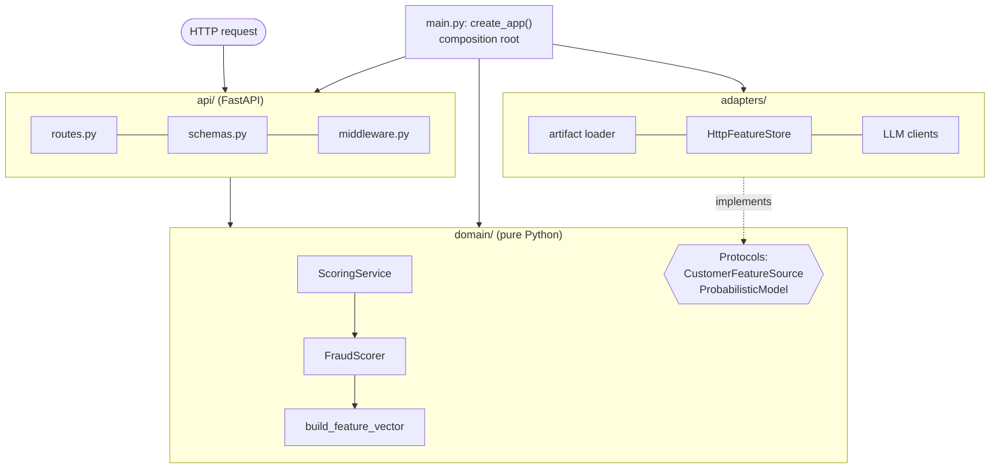
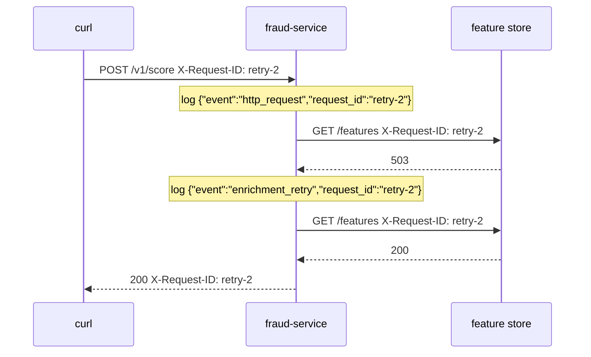

# Lección 1.4: Construir servicios para producción
<!-- id: l-1-4 -->

> ⏱ ~60 min · 🎚 Nivel: Core · 🧰 Requisitos: [Lección 1.3](03-reliability-primitives.md), [Lección 0.2](../00-foundations/02-python-for-production.md)

[Inicio del curso](../../README.md) › [Módulo 1](README.md) › Lección 1.4

## 📨 La situación

> **De: Priya (Security)**
> He encontrado una clave de API que empieza por `sk-live-` en el notebook de Sam, que está en una unidad compartida. Por favor, rótala y cuéntame cómo mantiene el nuevo servicio los secretos fuera del código, de las imágenes y de los logs.
>
> **De: Diego (SRE)**
> Y cuando algo se rompa a las 3 de la madrugada, necesito encontrar *todas* las líneas de log de *una* request en menos de un minuto. Otra cosa: ¿qué diferencia hay entre tu `/health` y tu `/ready`? Los voy a conectar a Kubernetes.

Esta lección recorre el interior de un servicio en producción: cómo se organiza el código, cómo se configura, cómo se manejan los secretos, cómo usa `async` para la I/O lenta, cómo escribe logs y cómo le dice a la plataforma que está sano. Cada sección corresponde a un archivo del servicio del Lab 1.

## 🎯 Al terminar podrás

- **Organizar** un servicio en capas de API, dominio y adaptadores, y **explicar** la regla de dependencias.
- **Cargar** desde el entorno una configuración tipada y validada, y **mantener los secretos** fuera del código, de las imágenes y de los logs.
- **Explicar** cuándo ayuda `async` (trabajo limitado por I/O) y cuándo perjudica (trabajo bloqueante o limitado por CPU dentro del bucle de eventos).
- **Añadir** IDs de request y logs estructurados en JSON, y **seguir** una request a través de varios servicios.
- **Implementar** correctamente las comprobaciones de liveness, readiness y startup.

## 🤔 Predice primero

1. Tu endpoint de FastAPI es `async def` y llama a `requests.get(...)` (una biblioteca síncrona) sobre una URL lenta. ¿Qué les pasa mientras tanto a las *demás* requests? <!-- id: p-1-4-1 -->
2. ¿Debería `/health` devolver 503 cuando la base de datos está caída? <!-- id: p-1-4-2 -->
3. ¿Dónde debería vivir el umbral de decisión (0,30): en el código, en un archivo de configuración metido en la imagen o en una variable de entorno? <!-- id: p-1-4-3 -->

---

## 1. Arquitectura por capas: API, dominio y adaptadores

El `predict()` de Sam lo mezclaba todo: una entrada con forma de HTTP, pandas, el modelo, el umbral y el texto de salida, todo en una función que usaba variables globales. Eso hace imposible probarlo, cambiar una parte sin romper otra o sustituir el runtime del modelo.

Un servicio en producción separa **tres responsabilidades**:

| Capa | Responsabilidad | Conoce | NO debe conocer | Archivos del Lab 1 |
|---|---|---|---|---|
| **API** | Traducir HTTP ↔ dominio: esquemas, códigos de estado, cabeceras | FastAPI, Pydantic, el dominio | Archivos del modelo, URLs de otros servicios, SQL | `api/schemas.py`, `api/routes.py`, `api/middleware.py` |
| **Dominio** | Reglas de negocio: features, puntuación, política de decisión, alternativas, orquestación | Python puro, dataclasses, *protocolos* (interfaces) | HTTP, FastAPI, httpx, scikit-learn, archivos | `domain/features.py`, `domain/scoring.py`, `domain/service.py` |
| **Adaptadores** | Hablar con el mundo exterior: artefactos del modelo, otros servicios, LLMs | httpx, joblib, sistemas de archivos | El manejo de las requests HTTP, las reglas de negocio | `adapters/artifacts.py`, `adapters/enrichment.py`, `adapters/llm.py` |



### La regla de dependencias

**Las dependencias apuntan hacia dentro.** La API depende del dominio. Los adaptadores implementan interfaces que define el dominio. El dominio no depende de nada que esté fuera de él.

¿Cómo llama el dominio al feature store sin importar httpx? Declara lo que necesita como un **protocolo** (una interfaz) y recibe una implementación en tiempo de ejecución:

```python
# domain/service.py: the domain says WHAT it needs
class CustomerFeatureSource(Protocol):
    async def get_customer_features(self, customer_id: str) -> dict[str, float]: ...

class ScoringService:
    def __init__(self, scorer: FraudScorer, features: CustomerFeatureSource | None): ...
```

```python
# adapters/enrichment.py: the adapter says HOW (HTTP, timeouts, retries)
class HttpFeatureStore:
    async def get_customer_features(self, customer_id: str) -> dict[str, float]: ...
```

```python
# main.py: the composition root wires them together
feature_store = HttpFeatureStore(settings.enrichment_base_url, ...)
app.state.scoring_service = ScoringService(app.state.scorer, feature_store)
```

A este estilo se le suele llamar **arquitectura hexagonal** o **puertos y adaptadores** (ports and adapters). Sus ventajas son concretas:

- **Testabilidad**: los tests del dominio no necesitan servidor, ni red, ni archivo del modelo. Un fake de tres líneas cumple el protocolo.
- **Sustituibilidad**: el Módulo 3 sustituye la inferencia de scikit-learn por ONNX Runtime. Solo cambia un adaptador; `FraudScorer` solo necesita «algo que tenga `predict_proba`».
- **Legibilidad**: alguien de riesgos puede leer `domain/scoring.py` y entender la política de decisión sin pelearse con código HTTP.

> ⚠️ **Error común:** abstraer de más. Tres capas bastan para la mayoría de los servicios. Si te ves escribiendo `AbstractScoringServiceFactoryProvider`, para. Una capa tiene que ganarse su sitio aislando algo que cambia por un motivo distinto.

### La factoría de la aplicación y el lifespan

El notebook de Sam entrenaba el modelo al importarse. En el servicio, `create_app()` construye la aplicación, y una función de **lifespan** se ejecuta una vez al arrancar y otra al apagarse:

```python
@asynccontextmanager
async def lifespan(app: FastAPI):
    loaded = load_artifact(settings.model_dir, settings.model_version)  # once, not per request
    app.state.scorer = FraudScorer(loaded.model, loaded.version, policy)
    ...
    yield                       # the app serves requests here
    await feature_store.aclose()  # clean shutdown: close connection pools
```

Las cosas caras (cargar el modelo, crear pools de conexiones HTTP) pasan **una sola vez**. Una factoría también permite que los tests construyan una aplicación con configuración de test y dependencias falsas: `create_app(settings, enrichment_transport=fake, llm=FakeLLM())`.

---

## 2. Gestión de la configuración

La metodología **Twelve-Factor App** dice: **guarda la configuración en el entorno**. La configuración es todo lo que varía entre despliegues (dev, staging, producción): URLs, umbrales, niveles de log, feature flags. El código es lo que no cambia.

El Lab 1 usa `pydantic-settings`, que lee las variables de entorno `KESTREL_*` y las convierte en un objeto **tipado y validado**:

```python
class Settings(BaseSettings):
    model_config = SettingsConfigDict(env_prefix="KESTREL_", env_file=".env", extra="ignore")

    review_threshold: float = Field(0.30, ge=0.0, le=1.0)
    decline_threshold: float = Field(0.80, ge=0.0, le=1.0)
    enrichment_timeout_s: float = Field(0.3, gt=0)
    openai_api_key: SecretStr | None = None

    @model_validator(mode="after")
    def _thresholds_are_ordered(self):
        if self.review_threshold > self.decline_threshold:
            raise ValueError("review_threshold must be <= decline_threshold")
        return self
```

Por qué importa:

- **Falla rápido**: `KESTREL_REVIEW_THRESHOLD=abc` o un umbral de revisión por encima del de rechazo hacen que el servicio falle **al arrancar**, en el pipeline de despliegue, en lugar de producir decisiones erróneas a las 3 de la madrugada (*Rómpelo n.º 3* del Lab 1).
- **Una imagen, muchos entornos**: la misma imagen de contenedor se ejecuta en staging y en producción con distintas variables de entorno. Pruebas exactamente el artefacto que distribuyes.
- **Acceso tipado**: `settings.enrichment_timeout_s` es un float, no un string que tengas que parsear en 12 sitios.

Respuesta a la predicción 3: un umbral es un **parámetro de negocio** que cambia con independencia del código → variable de entorno (o un servicio de configuración), con un valor por defecto validado. El Módulo 4 enseña a *elegirlo*; el Módulo 5, a publicar sus cambios de forma segura.

> 💡 **Consejo de producción:** ten un `.env.example` en el repositorio con todos los ajustes, valores por defecto seguros y comentarios (el Lab 1 tiene uno), y **nunca** hagas commit de `.env`. El ejemplo documenta qué se puede configurar; el archivo real se queda en local.

---

## 3. Secretos: separados, ocultos y rotables

Un **secreto** es configuración que da acceso: claves de API, contraseñas de bases de datos, claves de firma. Los secretos necesitan todo lo que necesita la configuración, más tres reglas extra:

1. **Nunca en el código ni en Git.** El historial de Git es para siempre: borrar la línea en un commit posterior no la elimina. Si se ha hecho commit de un secreto, dalo por filtrado y **rótalo** (lo que pide Priya).
2. **Nunca en la imagen.** Cualquiera que pueda descargar la imagen puede leer todas sus capas (`docker history`, `docker save`). El `.dockerignore` del Lab 1 excluye `.env` por este motivo.
3. **Nunca en los logs ni en los mensajes de error.** El Lab 1 declara la clave como `SecretStr`, así que al imprimir la configuración aparece `**********`:

```python
>>> Settings(openai_api_key="sk-test-123")
Settings(..., openai_api_key=SecretStr('**********'), ...)
>>> settings.openai_api_key.get_secret_value()   # explicit, greppable, reviewable
'sk-test-123'
```

De dónde salen los secretos, de menos a más madurez:

| Enfoque | Ejemplo | Notas |
|---|---|---|
| Archivo `.env` local (ignorado por git) | Tu portátil | Vale solo para desarrollo |
| Variables de entorno que inyecta la plataforma | `Secret` de Kubernetes → `envFrom` (mira `k8s/secret.example.yaml`) | Los Secrets de Kubernetes están *codificados* en base64, no cifrados, salvo que configures el cifrado en reposo |
| Archivos montados | Un volumen de secretos en `/var/run/secrets/...` | Se pueden rotar sin reiniciar, si la aplicación los vuelve a leer |
| **Gestor de secretos** | HashiCorp Vault, AWS Secrets Manager, GCP Secret Manager, Azure Key Vault | Auditoría centralizada, políticas de acceso, rotación automática; el estándar en producción |

> ⚠️ **Error común:** «es un repositorio privado, así que no pasa nada». Los repositorios privados se forkean, se clonan en portátiles, acaban copiados en los logs de CI y se comparten con contratistas. Usa en CI un escáner de secretos (por ejemplo, gitleaks o el secret scanning de GitHub) para detectar los errores antes del merge.

---

## 4. Async para el trabajo limitado por I/O

### La analogía del camarero

Un worker síncrono es un camarero que toma la comanda de una mesa, va a la cocina, **se queda allí plantado hasta que la comida está lista**, la lleva y solo entonces atiende la siguiente mesa. Un worker asíncrono toma una comanda, la pasa a la cocina y **atiende otras mesas mientras se cocina**. La cocina (la red, el LLM) es igual de rápida en los dos casos; simplemente, el camarero no pierde el tiempo esperando de pie.

Los servicios de IA pasan la mayor parte del tiempo **esperando**: a las APIs de LLMs (segundos), a las bases de datos vectoriales, a los feature stores, a otros servicios. Ese es trabajo **limitado por I/O** (I/O-bound), y es justo donde brilla `async`.

### Los números

Supón que cada request del docs-assistant espera 2 s al LLM y usa 5 ms de CPU.

| Modelo de worker | Requests concurrentes por worker | Throughput por worker |
|---|---|---|
| Síncrono (una request cada vez) | 1 | ~0,5 requests/s |
| Asíncrono (bucle de eventos) | Cientos (limitado por la memoria y la capacidad del LLM) | ~100+ requests/s |

### Hacer en paralelo las llamadas independientes

`async` también permite que una request haga I/O independiente de forma **concurrente**:

```python
import asyncio

# Sequential: 300 + 200 + 250 = ~750 ms
features = await feature_store.get_customer_features(cid)
history = await history_client.recent(cid)
device = await device_client.reputation(device_id)

# Concurrent: max(300, 200, 250) = ~300 ms
features, history, device = await asyncio.gather(
    feature_store.get_customer_features(cid),
    history_client.recent(cid),
    device_client.reputation(device_id),
)
```

El docs-assistant usa el mismo truco para consultar a la vez la búsqueda por palabras clave y la búsqueda vectorial (Módulo 2).

### La trampa: bloquear el bucle de eventos

Un bucle de eventos se ejecuta en **un solo hilo**. Si algo dentro de un `async def` bloquea ese hilo, *todas* las requests que atiende ese worker se congelan. Respuesta a la predicción 1: llamar a `requests.get(...)` (síncrono) dentro de `async def` bloquea el bucle durante toda la llamada, así que todas las demás requests también esperan.

| Dentro de `async def`… | Problema | Solución |
|---|---|---|
| `requests.get(...)`, drivers de bases de datos síncronos | Bloquea el bucle con I/O de red | Usa clientes asíncronos (`httpx.AsyncClient`, drivers asíncronos) |
| `time.sleep(1)` | Bloquea el bucle | `await asyncio.sleep(1)` |
| Trabajo pesado de CPU (inferencia de un modelo grande, jobs grandes de pandas) | Retiene el bucle mientras calcula | `await run_in_threadpool(fn, ...)` (Starlette) o `asyncio.to_thread`; para CPU pesada, un pool de procesos o un servidor de inferencia dedicado (Módulo 3) |

El scorer del Lab 1 llama directamente a `predict_proba` porque, con este modelo pequeño, tarda bastante menos de un milisegundo. El comentario de `domain/scoring.py` marca el punto en el que un modelo pesado pasaría a un pool de hilos.

> 💡 **Consejo de producción:** FastAPI ejecuta automáticamente en un pool de hilos los endpoints declarados con `def` normal. Si un endpoint solo usa bibliotecas síncronas, decláralo con `def`, no con `async def`. Usa `async def` solo cuando todo lo que hay dentro sea no bloqueante.

> 🔎 **Por dentro:** la concurrencia también necesita **límites**. Un servicio asíncrono puede aceptar 1000 llamadas concurrentes a un LLM, pero puede que tu proveedor del LLM permita 50. Usa un `asyncio.Semaphore` o los límites del pool de conexiones del cliente para acotar las llamadas en curso; si no, solo conviertes latencia en errores 429.

---

## 5. IDs de request y logs estructurados

### Logging estructurado

Compara estas dos líneas de log del mismo evento:

```
WARNING retry 1 for feature store after 503, sleeping 0.031s (customer cus_00017)
```

```json
{"event": "enrichment_retry", "attempt": 1, "sleep_s": 0.031, "error": "HTTP 503",
 "request_id": "retry-2", "service": "fraud-service", "level": "warning",
 "timestamp": "2026-11-10T11:57:25.913247Z"}
```

La primera es para una persona que lee una línea. La segunda es para **máquinas que buscan entre millones de líneas**: puedes filtrar `event == "enrichment_retry"`, agrupar por `error`, contar por minuto o sacar todas las líneas en las que `request_id == "retry-2"`. Las plataformas de logs (Loki, Elasticsearch, Cloud Logging, Datadog) indexan directamente los campos JSON.

El Lab 1 configura `structlog` para que imprima un objeto JSON por línea (`logging.py`). Reglas prácticas:

- Usa un **nombre de evento estable** (`model_loaded`, `enrichment_failed`) más campos, no frases con los valores metidos dentro.
- Incluye **quién, qué y cuánto ha tardado**: ID de request, servicio, versión, duración, resultado.
- Elige los niveles a propósito: `info` para los eventos normales, `warning` para los problemas que se han manejado (un reintento), `error` para los fallos que requieren atención.
- **Nunca registres secretos ni datos personales en bruto**: números de tarjeta, prompts completos con datos de clientes, tokens. (El Módulo 5 añade la ocultación automática de PII.)

### IDs de request: seguir una request por todo el sistema

Un **ID de request** (también llamado ID de correlación) es una cadena única que se asocia a una request y la acompaña allá donde va. El middleware del Lab 1:

1. Lee `X-Request-ID` de la request entrante (para conservar el ID que haya puesto un gateway) **si parece válido**, y si no, genera uno. Nunca te fíes a ciegas del contenido de una cabecera: la expresión regular rechaza saltos de línea y basura que podrían inyectar líneas de log falsas.
2. Lo asocia a cada línea de log mediante `structlog.contextvars`.
3. Lo guarda en una `ContextVar` para que el adaptador de enriquecimiento pueda **reenviarlo** al feature store.
4. Lo devuelve en la cabecera y en el cuerpo de la response, para que un cliente o una persona de soporte puedan citarlo.



Así es como Diego encuentra en menos de un minuto todas las líneas de log de una request, de todos los servicios. El Módulo 4 lo mejora con **trazas distribuidas** con OpenTelemetry (cabeceras `traceparent` del W3C, spans con tiempos), pero la idea es la misma.

---

## 6. Comprobaciones de salud, de disponibilidad y de arranque

La plataforma (Docker, Kubernetes, un balanceador de carga) necesita hacerle dos preguntas distintas a tu servicio:

| Comprobación | Pregunta | Si falla, la plataforma… | Debe comprobar | NO debe comprobar | Lab 1 |
|---|---|---|---|---|---|
| **Liveness** | «¿Está este proceso atascado o muerto?» | **Reinicia** el contenedor | Que el proceso puede responder por HTTP | Las dependencias (base de datos, feature store, API del LLM) | `GET /health` → siempre 200 si está vivo |
| **Readiness** | «¿Debería mandar tráfico a esta instancia ahora mismo?» | **Deja de enrutarle** tráfico (sin reiniciar) | Que puede hacer trabajo útil: modelo cargado y verificado, calentamiento terminado | Cosas que harían que *todas* las réplicas dejaran de estar listas a la vez por una caída compartida, salvo que eso sea lo que buscas | `GET /ready` → 200 solo si el artefacto está cargado y el checksum verificado |
| **Startup** | «¿Ha terminado de arrancar?» | Espera; la liveness no se comprueba hasta que esta pasa | Lo mismo que la liveness, con un margen largo | | `startupProbe` en `k8s/deployment.yaml` |

Respuesta a la predicción 2: **no**. Si `/health` fallara cada vez que una dependencia estuviera caída, Kubernetes reiniciaría **todas** las réplicas sanas durante la caída de la dependencia. Volverían, fallarían de nuevo y se reiniciarían otra vez: una caída total provocada por tu propia comprobación de salud. Reiniciar no puede arreglar la base de datos de otro.

El Lab 1 combina la readiness con la degradación elegante: un artefacto manipulado significa `/health` 200 (vivo), `/ready` 503 (no me enrutes tráfico) y, si aun así llega una request, `/v1/score` recurre a las reglas con `degraded_reasons: ["model_unavailable"]`.

> 💡 **Consejo de producción:** la readiness ante una dependencia compartida es una cuestión de criterio. Si el feature store está caído para *todas* las réplicas, marcarlas todas como no listas deja cero instancias sirviendo, lo que echa por tierra la degradación elegante. El Lab 1 liga a propósito la readiness solo al artefacto **local** del modelo, y gestiona el feature store compartido con timeouts y alternativas.

### Apagado ordenado (graceful shutdown)

Cuando Kubernetes sustituye un pod, envía **SIGTERM**, espera (`terminationGracePeriodSeconds`, 30 s en el manifiesto del Lab 1) y luego lo mata. Un buen servicio deja de aceptar requests nuevas, termina las que están en curso y cierra las conexiones: uvicorn se encarga de lo primero y de lo segundo, y el bloque de apagado del lifespan cierra el cliente HTTP. El Dockerfile usa la forma exec de `CMD` para que uvicorn sea el PID 1 y reciba de verdad la señal (lección 1.5).

---

## 7. Todo junto: una request a través del Lab 1

1. `RequestIdMiddleware` asigna el `request_id` y lo asocia a los logs.
2. FastAPI valida el cuerpo contra `ScoreRequest` → 422 si no es válido (`hour: 25`, un campo desconocido, un importe negativo).
3. `routes.score` lo convierte en una `Transaction` del dominio y llama a `ScoringService.score`.
4. Si faltan los agregados del cliente, el servicio llama al puerto `CustomerFeatureSource` → `HttpFeatureStore` (timeout, reintentos, jitter, deadline, presupuesto, ID de request reenviado) → si falla, valores por defecto + `degraded_reasons`.
5. `FraudScorer` construye el vector de features con la **misma función que se usa en el entrenamiento**, llama al modelo (o a las reglas) y aplica `DecisionPolicy`.
6. La ruta guarda el resultado para `/v1/explain` y devuelve `ScoreResponse` con el ID de request; el middleware registra en JSON el método, la ruta, el código de estado y la duración.

---

## 🧪 Pruébalo

En el [Lab 1](lab/README.md):

1. **Pasos 4–6**: ejecuta los tests, arranca el servicio, envía una request con tu propio `X-Request-ID` y encuentra su línea de log.
2. Arranca el servicio con una combinación de umbrales **no válida** (*Rómpelo n.º 3*) y lee el error de arranque.
3. Abre `src/kestrel_fraud/domain/` y confirma que **no** hay ningún `import fastapi`, `import httpx` ni `import sklearn`: `grep -rE "import (fastapi|httpx|sklearn)" src/kestrel_fraud/domain` no debería imprimir nada.
4. Extra: en `api/routes.py`, añade temporalmente `time.sleep(2)` dentro de `score`, lanza 5 requests en paralelo (`for i in 1 2 3 4 5; do curl … & done; wait`) y mide el tiempo. Sustitúyelo por `await asyncio.sleep(2)` y repite. Explica la diferencia.

## 🏭 En el mundo real

- [The Twelve-Factor App](https://12factor.net/) es una metodología breve, y todavía vigente, para servicios; los factores III (Config), XI (Logs) y IX (Disposability) corresponden directamente a esta lección.
- La página de la documentación de Kubernetes sobre las [sondas de liveness, readiness y startup](https://kubernetes.io/docs/tasks/configure-pod-container/configure-liveness-readiness-startup-probes/) explica cada tipo de sonda con ejemplos.
- La documentación de FastAPI sobre [concurrencia y async/await](https://fastapi.tiangolo.com/async/) explica (con una analogía de hamburguesas) exactamente cuándo usar `async def` y cuándo `def`.

## ✅ Comprueba lo aprendido

<details>
<summary>P1. Una persona de tu equipo añade <code>import httpx</code> a <code>domain/scoring.py</code> para llamar a una nueva API de riesgo. ¿Qué está mal y cómo lo reestructurarías? <!-- id: c-1-4-1 --></summary>

Rompe la regla de dependencias: el dominio pasa a depender de detalles de transporte, se vuelve más difícil de probar y mezcla la lógica de negocio con la I/O. En su lugar: define un protocolo en el dominio (p. ej., `RiskSignalSource`), impleméntalo en `adapters/` con httpx (timeouts, reintentos) e inyéctalo en `main.py`.
</details>

<details>
<summary>P2. Di tres sitios en los que nunca debe acabar un secreto y una herramienta que ayude a detectar errores. <!-- id: c-1-4-2 --></summary>

El código fuente y el historial de Git, las imágenes de contenedor (cualquier capa) y los logs o mensajes de error (también: notebooks en unidades compartidas, la salida de CI). Un escáner de secretos como gitleaks o el secret scanning de GitHub detecta los commits que contienen secretos.
</details>

<details>
<summary>P3. Tu endpoint <code>async def ask()</code> llama a una API de LLM que tarda 1,5 s usando la biblioteca síncrona <code>requests</code>. Con carga, la latencia de <i>todos</i> los endpoints, incluso <code>/health</code>, se dispara. ¿Por qué? <!-- id: c-1-4-3 --></summary>

`requests` bloquea el hilo del bucle de eventos durante 1,5 s en cada llamada, así que el worker no puede ejecutar ninguna otra corrutina, tampoco `/health`. Usa un cliente asíncrono (`httpx.AsyncClient`), o declara el endpoint con `def` normal para que FastAPI lo ejecute en un pool de hilos.
</details>

<details>
<summary>P4. ¿Qué diferencia hay entre liveness y readiness, y qué hace Kubernetes cuando falla cada una? <!-- id: c-1-4-4 --></summary>

Liveness: «¿está vivo el proceso?». Si falla → se reinicia el contenedor. Readiness: «¿debería recibir tráfico ahora?». Si falla → se retira de los endpoints del Service (sin reiniciar) hasta que vuelva a estar listo.
</details>

<details>
<summary>P5. ¿Por qué el middleware del ID de request valida la cabecera entrante en lugar de copiarla tal cual? <!-- id: c-1-4-5 --></summary>

Las cabeceras son entradas que no son de fiar. Un valor con saltos de línea o caracteres de control podría falsificar líneas de log adicionales (log injection) o romper sistemas posteriores; un valor larguísimo desperdicia almacenamiento. Valida el formato y sustituye los valores no válidos por un ID generado.
</details>

<details>
<summary>P6. ¿Por qué <code>{"event": "enrichment_retry", "attempt": 1, ...}</code> es mejor que <code>"retry 1 after 503"</code>? <!-- id: c-1-4-6 --></summary>

Los campos estructurados se pueden filtrar, agregar y usar en alertas sin un parseo frágil con expresiones regulares (p. ej., contar `enrichment_retry` por minuto, agrupar por `error`, seguir un `request_id`). Los nombres de evento estables, además, sobreviven a los cambios de redacción.
</details>

## 💬 Explícalo con tus palabras
<!-- id: e-1-4 -->

Priya y Diego hicieron una pregunta por persona al principio. Escribe una respuesta breve a cada pregunta (3–4 frases), mencionando archivos concretos del servicio del Lab 1.

## 🔑 Ideas clave

- **Capas**: API (HTTP), dominio (reglas, Python puro), adaptadores (el mundo exterior). Las dependencias apuntan hacia dentro; el dominio define protocolos, los adaptadores los implementan y `create_app()` los conecta.
- **La configuración, en el entorno**, tipada y validada al arrancar; una sola imagen para todos los entornos.
- **Secretos**: nunca en el código, las imágenes ni los logs; `SecretStr`; gestores de secretos en producción; rota todo lo que se haya filtrado.
- **Async** gana en las cargas de IA limitadas por I/O; nunca bloquees el bucle de eventos; acota la concurrencia.
- **Logs estructurados en JSON + IDs de request** reenviados entre servicios hacen que los incidentes se puedan depurar.
- **Liveness** = vivo (nunca compruebes dependencias), **readiness** = puede servir (modelo verificado), **startup** = todavía arrancando.

## 📚 Para profundizar (gratis)

| | Recurso | Por qué leerlo | Tiempo |
|---|---|---|---|
| ⭐ | [Tutorial de FastAPI](https://fastapi.tiangolo.com/tutorial/), incluido *Bigger Applications* | El framework que se usa en todo el curso | 2 h |
| ⭐ | [The Twelve-Factor App](https://12factor.net/) | Configuración, logs, desechabilidad: lo básico de un servicio | 30 min |
| 🔍 | [FastAPI: Concurrency and async/await](https://fastapi.tiangolo.com/async/) | Cuándo usar `async def` y cuándo `def` | 20 min |
| 🔍 | [Documentación de Pydantic Settings](https://docs.pydantic.dev/latest/concepts/pydantic_settings/) | Configuración tipada desde variables de entorno y archivos | 20 min |
| 🔍 | [Documentación de structlog](https://www.structlog.org/) | Logging estructurado en Python | 30 min |
| 🔍 | [Kubernetes: Configure liveness, readiness and startup probes](https://kubernetes.io/docs/tasks/configure-pod-container/configure-liveness-readiness-startup-probes/) | La guía oficial de las tres sondas | 20 min |
| 🔍 | [OWASP Secrets Management Cheat Sheet](https://cheatsheetseries.owasp.org/cheatsheets/Secrets_Management_Cheat_Sheet.html) | Cómo guardan y rotan los secretos los equipos maduros | 30 min |

---
⬅️ [Lección 1.3: Primitivas de fiabilidad](03-reliability-primitives.md) · ➡️ [Lección 1.5: Artefactos, Docker y Kubernetes](05-artifacts-and-containers.md)
