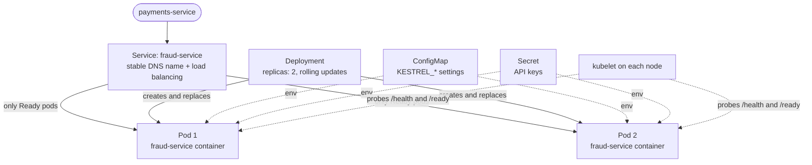

# Lección 1.5: Artefactos, Docker y Kubernetes
<!-- id: l-1-5 -->

> ⏱ ~60 min · 🎚 Nivel: Core · 🧰 Requisitos: [Lección 1.4](04-production-services.md), [Lección 0.1](../00-foundations/01-setup-your-workbench.md) (Docker instalado)

[Inicio del curso](../../README.md) › [Módulo 1](README.md) › Lección 1.5

## 📨 La situación

> **De: Maya (Engineering Manager)**
> Una rápida de parte de la dirección: «¿qué modelo de fraude se está ejecutando en producción y con qué datos se entrenó?».
> Sam dice que es `model_final_v2.pkl`, pero hay tres archivos con ese nombre en tres portátiles.
> Diego también quiere una imagen de contenedor para el viernes, para que el equipo de plataforma pueda desplegarla.

Esta lección cubre el último tramo del camino de empaquetado: **notebook → artefacto versionado → API → imagen de contenedor → clúster**. Aprenderás a serializar modelos de forma segura, a versionarlos para que cualquiera pueda responder en segundos a la pregunta de Maya, a construir imágenes de Docker ligeras y seguras, y a leer los objetos de Kubernetes que las ejecutarán.

## 🎯 Al terminar podrás

- **Comparar** formatos de serialización de modelos y **explicar** por qué cargar un pickle de una fuente que no es de fiar es peligroso.
- **Producir** un artefacto inmutable y versionado, con metadatos sha256, y **verificarlo** antes de cargarlo.
- **Explicar** las imágenes, los contenedores, las capas y la caché, y **escribir** un Dockerfile multietapa que no se ejecuta como root.
- **Decidir** si meter el modelo dentro de la imagen o descargarlo al arrancar.
- **Relacionar** los Pods, Deployments, Services, ConfigMaps, Secrets, sondas y recursos con los problemas que resuelven.

## 🤔 Predice primero

1. Cambias una línea de Python y vuelves a construir tu imagen. ¿Por qué podría Docker volver a descargar todas las dependencias y cómo lo evitas? <!-- id: p-1-5-1 -->
2. Un checksum sha256 demuestra cuál de estas cosas: que el archivo no está corrupto, que el archivo lo produjo tu job de entrenamiento, que el modelo es bueno. <!-- id: p-1-5-2 -->
3. Tu imagen de Python ocupa 1,2 GB. Di dos motivos por los que podría ser tan grande. <!-- id: p-1-5-3 -->

---

## 1. Serializar modelos: formatos y riesgos

La **serialización** convierte un objeto en memoria (un modelo entrenado) en bytes en disco para que otro proceso pueda cargarlo más tarde. El formato que elijas afecta a la seguridad, la portabilidad y la velocidad.

| Formato | Qué guarda | Se carga en | Seguridad | Uso típico |
|---|---|---|---|---|
| **pickle / joblib** | Cualquier objeto de Python, incluidas referencias a código | Python, con las mismas versiones de las bibliotecas | ⚠️ **Cargarlo puede ejecutar código arbitrario** | Modelos de scikit-learn (Lab 1), prototipos rápidos |
| **skops** | Modelos de scikit-learn sin código arbitrario | Python | Más seguro: lista explícita de tipos permitidos | Compartir modelos de sklearn |
| **Formatos nativos** (JSON de XGBoost/LightGBM, `.keras` de Keras) | Estructura del modelo + pesos | La propia biblioteca, a menudo desde varios lenguajes | En general, solo datos | Gradient boosting, Keras |
| **ONNX** | Un grafo de cómputo + pesos en un formato estándar | ONNX Runtime (C++, Python, Java, JS…), muchos aceleradores | Solo datos | Inferencia portable y rápida (Módulo 3) |
| **safetensors** | Tensores en bruto (solo pesos) | PyTorch, JAX, TF mediante bibliotecas | Diseñado para ser seguro: no ejecuta código | Pesos de LLMs y de deep learning (el formato por defecto en Hugging Face) |
| **GGUF** | Pesos cuantizados de LLMs + metadatos | llama.cpp, Ollama | Solo datos | LLMs locales (Módulo 3) |

### Por qué pickle es peligroso

Un archivo pickle contiene instrucciones para reconstruir un objeto, y esas instrucciones pueden llamar a **cualquier función de Python**, por ejemplo `os.system`. Cargar un `model.pkl` malicioso ejecuta el código de quien lo preparó con los permisos de tu servicio. No es algo teórico: los hubs públicos de modelos analizan las subidas precisamente por esto.

Reglas para pickle/joblib en producción:

1. **Carga solo artefactos producidos por tu propio pipeline**, desde un almacenamiento que controles.
2. **Verifica el checksum antes de cargar** (sección 2). El Lab 1 calcula el sha256 y lo compara con los metadatos *antes* de llamar a `joblib.load`.
3. **Fija las versiones de las bibliotecas**: puede que un modelo serializado con scikit-learn 1.5 no se pueda deserializar (o se comporte de otra forma) con la 1.7. El lab registra `sklearn.__version__` en los metadatos y bloquea las dependencias en `uv.lock`.
4. Cuando puedas, prefiere **formatos que solo contienen datos** (ONNX, safetensors, JSON nativo), sobre todo para cualquier cosa que descargues.

---

## 2. Artefactos versionados y sha256

### Lo que debe garantizar una versión de un artefacto

Un **artefacto** es el resultado empaquetado del entrenamiento: el archivo del modelo más todo lo necesario para usarlo y fiarse de él. Una buena versión de un artefacto es:

- **Inmutable**: una vez que existe `20261110T115648Z-2a36bb33`, nunca cambia. Una nueva ejecución de entrenamiento crea una versión nueva. El entrenamiento del Lab 1 usa `mkdir(exist_ok=False)`, así que *no puede* sobrescribir una versión.
- **Con un nombre único**: el lab usa `<UTC timestamp>-<first 8 hex chars of the data's sha256>`, así que el nombre por sí solo te dice *cuándo* y *con qué datos*.
- **Autodescriptiva**: `metadata.json` responde a quién, qué, cuándo y cómo (la tabla de traspaso de la lección 1.1).
- **Verificable**: un checksum demuestra que los bytes son exactamente los que produjo el entrenamiento.

```
artifacts/fraud-model/
├── LATEST                          → "20261110T115648Z-2a36bb33"
├── 20261109T090000Z-2a36bb33/
│   ├── model.joblib
│   └── metadata.json
└── 20261110T115648Z-2a36bb33/
    ├── model.joblib
    └── metadata.json
```

### Qué es un sha256

**SHA-256** es una función hash criptográfica: convierte cualquier entrada, del tamaño que sea, en una huella fija de 256 bits (64 caracteres hexadecimales). Tres propiedades la hacen útil:

1. **Determinista**: los mismos bytes dan siempre el mismo hash.
2. **Efecto avalancha**: cambiar un solo bit cambia el hash por completo.
3. **Resistente a colisiones**: es computacionalmente inviable encontrar dos entradas distintas con el mismo hash.

Pruébalo:

```bash
echo "Kestrel" | shasum -a 256    # macOS (Linux: sha256sum)
echo "kestrel" | shasum -a 256    # one letter different → a completely different hash
```

El Lab 1 calcula el hash del archivo por trozos, así que ni siquiera los archivos de modelos de varios GB tienen que caber en memoria:

```python
def sha256_file(path: Path, chunk_size: int = 1 << 20) -> str:
    digest = hashlib.sha256()
    with path.open("rb") as fh:
        for chunk in iter(lambda: fh.read(chunk_size), b""):
            digest.update(chunk)
    return digest.hexdigest()
```

Y verifica **antes** de deserializar:

```python
expected = metadata.get("model_sha256")
actual = sha256_file(path / MODEL_FILENAME)
if expected != actual:
    raise ArtifactIntegrityError(...)
...
model = joblib.load(path / MODEL_FILENAME)   # only after the check
```

### Lo que un checksum demuestra y lo que no

Volvamos a la predicción 2:

| Afirmación | ¿La demuestra la comprobación del sha256? |
|---|---|
| El archivo no está corrupto ni truncado (una copia mala, una subida a medias, un error de disco) | ✅ Sí |
| El archivo es el mismo que registran estos metadatos | ✅ Sí |
| El archivo lo produjo *tu* job de entrenamiento | ❌ No: cualquiera que pueda reescribir a la vez `model.joblib` y `metadata.json` puede hacer que coincidan |
| El modelo es bueno | ❌ No: eso es la evaluación (Módulo 4) |

Demostrar **quién** produjo un artefacto necesita una **firma**: el pipeline de entrenamiento firma el hash con una clave privada y el servicio la verifica con la clave pública. Herramientas como cosign, de Sigstore, lo hacen con imágenes de contenedor y con archivos. El Módulo 5 trata la seguridad de la cadena de suministro.

### El puntero LATEST y las actualizaciones atómicas

El servicio carga `latest` leyendo el archivo `LATEST`. El entrenamiento lo actualiza de forma **atómica**: escribe un archivo temporal y luego lo renombra encima del antiguo. En los sistemas POSIX, renombrar es atómico, así que un servicio que arranque justo en ese momento lee la versión antigua o la nueva, nunca un archivo a medio escribir.

```python
tmp = out_dir / ".LATEST.tmp"
tmp.write_text(version + "\n")
tmp.replace(out_dir / "LATEST")
```

> 💡 **Consejo de producción:** en producción, «latest» suele ser lo que no hay que desplegar. Fija una **versión explícita** en la configuración (`KESTREL_MODEL_VERSION=20261110T115648Z-2a36bb33`) para que un despliegue sea reproducible y un rollback sea un cambio de configuración. Un **registro de modelos** (MLflow, Módulo 2) gestiona estas versiones y etapas como *staging* y *production*, con su historial de aprobaciones.

---

## 3. El camino del empaquetado

```mermaid
flowchart LR
    NB["📓 Notebook<br/>exploration"] -->|"extract functions,<br/>fix seeds"| SCRIPT["🐍 Training script<br/>scripts/train.py"]
    SCRIPT -->|"run with pinned data + code"| ART["📦 Artifact<br/>model.joblib + metadata.json"]
    ART -->|"load + verify at startup"| API["🌐 Service<br/>FastAPI + domain"]
    API -->|"docker build"| IMG["🐳 Image<br/>kestrel/fraud-service:0.1.0"]
    IMG -->|"docker push"| REG[("Image registry")]
    REG -->|"kubectl / CD"| K8S["☸️ Cluster<br/>Deployment + Service"]
```



Cada flecha elimina una fuente de «funciona en mi máquina»:

| Paso | Elimina |
|---|---|
| Notebook → script | Estado oculto, celdas ejecutadas fuera de orden, pasos manuales |
| Script → artefacto | «¿Qué modelo es este?» |
| Artefacto → servicio | Funciones `predict()` improvisadas, dos caminos de código para las features |
| Servicio → imagen | Un Python, unas bibliotecas del sistema operativo y unas versiones de dependencias distintos en cada máquina |
| Imagen → registro → clúster | Despliegues manuales, servidores «copo de nieve» (snowflake servers) |

---

## 4. Lo básico de Docker

### Imágenes y contenedores

- Una **imagen** es una plantilla de solo lectura: un sistema de archivos (bibliotecas del sistema operativo, Python, tus paquetes, tu código, el modelo) más metadatos (qué comando ejecutar, qué puerto, qué usuario).
- Un **contenedor** es una instancia en ejecución de una imagen, con su propio espacio de procesos, su red y una fina capa escribible encima.

Una analogía: la imagen es una ficha de receta más todos los ingredientes sellados en una caja; un contenedor es un plato cocinado con ella. Con una sola caja puedes cocinar muchos platos idénticos.

### Capas y caché

Cada instrucción de un Dockerfile (`FROM`, `COPY`, `RUN`) crea una **capa**. Docker guarda las capas en caché y las reutiliza mientras no cambien ni la instrucción ni sus entradas. **En cuanto cambia una capa, se reconstruyen todas las que vienen después.**

Esa es la respuesta a la predicción 1. Este orden es lento:

```dockerfile
COPY . .                         # any code change invalidates this layer…
RUN pip install -r requirements.txt   # …so dependencies reinstall on every build
```

Este orden (el que usa el Lab 1) es rápido:

```dockerfile
COPY pyproject.toml uv.lock ./                               # changes rarely
RUN uv sync --frozen --no-dev --no-install-project           # cached until deps change
COPY src ./src                                               # changes often
RUN uv sync --frozen --no-dev --no-editable                  # seconds
```

**Ordena las instrucciones de la que cambia con menos frecuencia a la que cambia con más.**

### Builds multietapa

Construir suele necesitar herramientas que no quieres en tiempo de ejecución (compiladores, gestores de paquetes, cachés). Un build **multietapa** (multi-stage) usa una etapa para construir y copia solo el resultado en una etapa final limpia:

```dockerfile
FROM python:3.12-slim AS builder
COPY --from=ghcr.io/astral-sh/uv:0.8.0 /uv /bin/uv
# … resolve and install dependencies into /app/.venv …

FROM python:3.12-slim AS runtime
RUN groupadd --system --gid 10001 app && \
    useradd --system --uid 10001 --gid app --no-create-home app
COPY --from=builder --chown=app:app /app/.venv /app/.venv
COPY --chown=app:app artifacts/fraud-model/ /app/artifacts/fraud-model/
USER app
HEALTHCHECK CMD python -c "import urllib.request; urllib.request.urlopen('http://127.0.0.1:8001/health', timeout=2)"
CMD ["uvicorn", "kestrel_fraud.main:create_app", "--factory", "--host", "0.0.0.0", "--port", "8001"]
```

### La lista de comprobación de un Dockerfile para producción

| Práctica | Por qué | En el Lab 1 |
|---|---|---|
| Imagen base pequeña y fijada (`python:3.12-slim`, idealmente fijada por digest) | Menos paquetes = menos vulnerabilidades; builds reproducibles | ✅ slim (fijarla por digest queda como ejercicio) |
| Fija las versiones de las herramientas (`uv:0.8.0`) y usa un lock file (`uv.lock`, `--frozen`) | La misma imagen cada vez | ✅ |
| Las dependencias antes que el código | Reconstrucciones rápidas y aprovechando la caché | ✅ |
| Multietapa | Ni herramientas de build ni cachés en la imagen final | ✅ |
| **Usuario que no es root** | Si comprometen la aplicación, no es root dentro del contenedor | ✅ `USER app` (uid 10001) |
| `.dockerignore` | Deja `.env`, `.venv`, los tests y los datos fuera del contexto de build | ✅ |
| Ningún secreto en ninguna capa | Las capas las puede leer cualquiera que pueda descargar la imagen | ✅ los secretos llegan del entorno en tiempo de ejecución |
| `CMD ["uvicorn", …]` en forma exec | La aplicación es el PID 1 y recibe SIGTERM para apagarse de forma ordenada | ✅ |
| `HEALTHCHECK` | Docker (y docker compose) pueden detectar un contenedor colgado | ✅ (Kubernetes usa sus propias sondas) |
| Un proceso por contenedor | Ciclo de vida, logs y escalado sencillos | ✅ |

> ⚠️ **Error común:** pasarse a `alpine` para «hacer la imagen más pequeña». Alpine usa musl en lugar de glibc, así que muchos wheels de Python científico (NumPy, SciPy, scikit-learn) no están disponibles precompilados y hay que compilarlos desde el código fuente: builds más lentos, a veces imágenes más grandes y bugs sutiles. Para ML en Python, `slim` suele ser el punto óptimo.

### ¿Por qué ocupa la imagen ~440 MB?

La predicción 3. Ejecuta `docker images kestrel/fraud-service:0.1.0`: unos 440 MB. La mayor parte son NumPy, SciPy y scikit-learn con sus bibliotecas matemáticas compiladas, más la base de Python. Para reducirla: exporta el modelo a ONNX y sírvelo con `onnxruntime` en lugar de scikit-learn (Módulo 3), o usa una base distroless. En las imágenes para GPU con PyTorch y CUDA, que ocupen varios GB es normal, y esa es una de las razones por las que el tiempo de descarga de la imagen importa para el autoescalado (Módulo 6).

### ¿Meter el modelo en la imagen o descargarlo al arrancar?

| | **Meterlo en la imagen** (Lab 1) | **Descargarlo de un registro o de un almacenamiento de objetos al arrancar** |
|---|---|---|
| Qué significa un tag | Código + modelo, exactamente | Solo el código; el modelo lo elige la configuración |
| Reproducibilidad y rollback | Excelentes: vuelves al tag de imagen anterior | Buenos, si la versión del modelo está fijada en la configuración |
| Publicar un modelo nuevo | Reconstruir y volver a desplegar la imagen | Cambiar la configuración y reiniciar; sin reconstruir |
| Arranque | Rápido, sin depender de la red | Más lento; depende de la disponibilidad del almacenamiento (necesita reintentos y readiness) |
| Tamaño de la imagen | Crece con el modelo (malo para pesos de LLMs de varios GB) | Imagen pequeña |
| Ideal para | Modelos pequeños (MB), requisitos de auditoría estrictos | Modelos grandes, actualizaciones frecuentes del modelo, muchos modelos por servicio |

Muchos equipos empiezan metiendo el modelo en la imagen (sencillo, auditable) y pasan a descargarlo de un registro de modelos a medida que los modelos crecen o se publican más a menudo. Los pesos grandes de los LLMs casi siempre se descargan o se montan desde un volumen.

---

## 5. De la imagen al registro

Un **registro de imágenes** (image registry) guarda y distribuye imágenes (Docker Hub, GitHub Container Registry, AWS ECR, GCP Artifact Registry). Un pipeline de despliegue sube `kestrel/fraud-service:0.1.0` y el clúster la descarga.

> 💡 **Consejo de producción:** los tags son **mutables** (cualquiera puede subir una imagen nueva como `0.1.0` o, peor aún, como `latest`). El **digest** de una imagen (`kestrel/fraud-service@sha256:9f2c…`) es inmutable: la misma idea del sha256 de la sección 2, aplicada a toda la imagen. Los despliegues en producción deberían hacer referencia a tags inmutables o a digests, nunca a `latest`.

---

## 6. Kubernetes en una página

Desplegarás en Kubernetes en el Módulo 6. De momento, necesitas saber leer un manifiesto y qué objeto resuelve qué problema. **Kubernetes** es un sistema que mantiene un clúster de máquinas en un **estado deseado** que declaras en YAML: «ejecuta 2 copias de esta imagen, con esta configuración, y envía tráfico solo a las que estén sanas». Unos controladores comparan continuamente la realidad con la declaración y corrigen las diferencias.



| Objeto | Problema que resuelve | Manifiesto del Lab 1 |
|---|---|---|
| **Pod** | La unidad más pequeña: uno o más contenedores que comparten red y almacenamiento. Los pods son desechables. | Los crea el Deployment |
| **Deployment** | «Mantén en marcha *N* pods idénticos; sustitúyelos de forma gradual en las actualizaciones» | `replicas: 2`, `RollingUpdate` con `maxUnavailable: 0`, `maxSurge: 1` |
| **Service** | Los pods van y vienen con IPs nuevas; un Service da un **nombre estable** y reparte la carga entre los pods **listos** | `fraud-service`, puerto 80 → 8001 |
| **ConfigMap** | Configuración no secreta como variables de entorno o archivos (12 factores) | Umbrales y timeouts `KESTREL_*` |
| **Secret** | Configuración sensible, con control de acceso aparte | `secret.example.yaml` (solo un ejemplo) |
| **Sondas** | Liveness → reiniciar; readiness → enrutar tráfico; startup → permitir arranques lentos (lección 1.4) | `/health`, `/ready`, `startupProbe` |
| **Recursos** | `requests`: lo que reserva el planificador; `limits`: topes estrictos (si se supera la memoria → el contenedor muere por OOM) | 250m de CPU / 256Mi solicitados, límite de 512Mi |
| **securityContext** | Obliga a no ejecutarse como root, sin escalada de privilegios y con el sistema de archivos de solo lectura | `runAsNonRoot`, `readOnlyRootFilesystem`, quitar todas las capabilities |

### Qué pasa durante una actualización gradual (rolling update)

1. Cambias el tag de la imagen a `0.2.0`.
2. Con `maxSurge: 1`, Kubernetes arranca un **tercer** pod con la imagen nueva.
3. El pod nuevo pasa su sonda de **startup** y luego su sonda de **readiness** (modelo cargado y verificado).
4. Solo entonces se añade al Service y se termina uno de los pods antiguos (SIGTERM → apagado ordenado).
5. Se repite hasta que todos los pods ejecutan `0.2.0`. Con `maxUnavailable: 0`, la capacidad nunca baja de 2.

Si la imagen nueva tiene un modelo corrupto, su sonda de readiness nunca pasa, así que **nunca recibe tráfico** y el despliegue se detiene en lugar de romper producción. Ahí están las lecciones 1.4 y 1.5 trabajando juntas. El Módulo 6 añade encima los **despliegues canary** con rollback automático.

> 🔎 **Por dentro:** los Kubernetes gestionados (EKS, GKE, AKS) operan por ti el plano de control; los manifiestos, las imágenes, las sondas y los ajustes de recursos siguen siendo cosa tuya. Para servicios sencillos, las plataformas de contenedores gestionadas (Cloud Run, ECS, Azure Container Apps) ofrecen el mismo camino de imagen de contenedor → servicio en marcha, con menos que operar. El Módulo 6 las compara.

---

## 🧪 Pruébalo

En el [Lab 1](lab/README.md):

1. **Paso 3**: entrena dos veces y confirma que obtienes dos carpetas de versión con valores de `created_at` distintos. Después ejecuta `shasum -a 256 artifacts/fraud-model/*/model.joblib` y compáralo con cada `metadata.json`. Verás que los dos archivos del modelo son **idénticos bit a bit**: mismos datos + mismo código + misma semilla + mismas versiones de las bibliotecas = el mismo modelo. Eso es una reproducibilidad que puedes *demostrar* con un hash. Ahora cambia a `--seed 7` y vuelve a entrenar: el hash cambia.
2. **Rómpelo n.º 1**: manipula el artefacto y observa `/health` 200, `/ready` 503 y la puntuación basada en reglas.
3. **Paso 9**: construye y ejecuta la imagen. Comprueba `docker exec fraud whoami` → `app`. Edita un comentario en `src/`, vuelve a construir y mira qué capas dicen `CACHED`.
4. Ejecuta `docker history kestrel/fraud-service:0.1.0` y encuentra la capa que contiene el artefacto del modelo. ¿Por qué es importante que ninguna capa contenga `.env`?
5. **Paso 10**: anota cada campo de `k8s/deployment.yaml` con el problema que resuelve.

## 🏭 En el mundo real

- Hugging Face creó [safetensors](https://huggingface.co/docs/safetensors/index) precisamente porque cargar pesos de PyTorch serializados con pickle podía ejecutar código, y hoy es el formato por defecto para compartir pesos de modelos en el Hub.
- La [guía de buenas prácticas](https://docs.docker.com/build/building/best-practices/) de Docker cubre los builds multietapa, la caché de capas, `.dockerignore` y los usuarios que no son root: la misma lista de la sección 4.
- La [guía de integración con Docker](https://docs.astral.sh/uv/guides/integration/docker/) de uv muestra el patrón de dependencias primero y multietapa que sigue el Dockerfile del Lab 1.

## ✅ Comprueba lo aprendido

<details>
<summary>P1. ¿Por qué el Lab 1 calcula el sha256 <i>antes</i> de llamar a <code>joblib.load</code> y no después? <!-- id: c-1-5-1 --></summary>

Porque cargar un archivo joblib/pickle puede ejecutar código. Si el archivo se hubiera manipulado, cargarlo primero ya podría haber ejecutado código malicioso. Verificar primero significa que un archivo corrupto o sustituido se rechaza antes de deserializarlo.
</details>

<details>
<summary>P2. Alguien con permiso de escritura en el bucket de artefactos sustituye <code>model.joblib</code> <i>y</i> actualiza <code>metadata.json</code> con el nuevo hash. ¿Lo detecta la comprobación? ¿Qué lo detectaría? <!-- id: c-1-5-2 --></summary>

No: el checksum solo demuestra que el archivo coincide con los metadatos. Lo detectaría una **firma**: el pipeline de entrenamiento firma el hash con una clave privada que esa persona no tiene, y el servicio la verifica con la clave pública (p. ej., Sigstore/cosign). Además, restringe el permiso de escritura en el bucket.
</details>

<details>
<summary>P3. Reordena estas líneas de un Dockerfile para aprovechar al máximo la caché: <code>COPY src ./src</code>, <code>COPY pyproject.toml uv.lock ./</code>, <code>RUN uv sync --no-install-project</code>, <code>RUN uv sync</code>. <!-- id: c-1-5-3 --></summary>

1. `COPY pyproject.toml uv.lock ./` 2. `RUN uv sync --no-install-project` (solo las dependencias, en caché hasta que cambie el lock file) 3. `COPY src ./src` 4. `RUN uv sync` (instala el propio proyecto, rápido).
</details>

<details>
<summary>P4. Da dos ventajas de meter el modelo en la imagen y dos de descargarlo al arrancar. <!-- id: c-1-5-4 --></summary>

Meterlo en la imagen: el tag de la imagen identifica exactamente código + modelo (ideal para auditorías y rollbacks); el arranque no depende del almacenamiento. Descargarlo: imágenes más pequeñas y builds más rápidos (importante con modelos grandes); se pueden publicar modelos nuevos sin reconstruir la imagen.
</details>

<details>
<summary>P5. La sonda de readiness de un pod nuevo nunca tiene éxito. ¿Qué hace un Deployment con <code>maxUnavailable: 0</code> y por qué es bueno? <!-- id: c-1-5-5 --></summary>

El pod nuevo nunca se une al Service, así que no recibe tráfico, y el despliegue se detiene porque los pods antiguos no se retiran hasta que los nuevos están listos. Producción sigue funcionando con la versión antigua en lugar de romperse; investigas y haces rollback.
</details>

<details>
<summary>P6. ¿Por qué los manifiestos de producción deberían evitar <code>image: kestrel/fraud-service:latest</code>? <!-- id: c-1-5-6 --></summary>

`latest` es un tag mutable: puede apuntar a imágenes distintas con el tiempo, así que no puedes saber qué se está ejecutando, los despliegues no son reproducibles y distintos nodos pueden descargar imágenes distintas. Usa un tag de versión inmutable o un digest (`@sha256:…`).
</details>

## 💬 Explícalo con tus palabras
<!-- id: e-1-5 -->

Responde a la pregunta de la dirección que trae Maya («¿qué modelo de fraude se está ejecutando y con qué datos se entrenó?») como lo harías después de esta lección: qué comando o archivo comprobarías y qué campos leerías, en menos de cinco frases.

## 🔑 Ideas clave

- **pickle/joblib pueden ejecutar código**: carga solo tus propios artefactos, verifica antes el checksum, fija las versiones de las bibliotecas y, cuando puedas, prefiere formatos que solo contienen datos (ONNX, safetensors).
- Un buen artefacto es **inmutable, tiene una versión única, se describe a sí mismo y es verificable**. El sha256 demuestra la integridad, no la autoría (para eso hacen falta firmas) ni la calidad (para eso hacen falta evals).
- Docker: **dependencias antes que el código**, **multietapa**, **base slim**, **sin root**, **sin secretos en las capas**, **CMD en forma exec**, **versiones fijadas**.
- Mete en la imagen los modelos pequeños, por sencillez; descarga de un registro los grandes o los que se actualizan a menudo.
- Kubernetes mantiene un **estado declarado**: los Deployments gestionan las réplicas y los despliegues, los Services enrutan a los pods **listos**, y las sondas y los recursos protegen el clúster y el servicio.

## 📚 Para profundizar (gratis)

| | Recurso | Por qué leerlo | Tiempo |
|---|---|---|---|
| ⭐ | [Docker: Get started](https://docs.docker.com/get-started/) | Imágenes, contenedores y capas, con práctica | 1–2 h |
| ⭐ | [Tutorial Kubernetes Basics](https://kubernetes.io/docs/tutorials/kubernetes-basics/) | Introducción interactiva a los Deployments, los Services, el escalado y las actualizaciones | 1 h |
| 🔍 | [Docker build best practices](https://docs.docker.com/build/building/best-practices/) | La lista de comprobación oficial | 30 min |
| 🔍 | [Using uv in Docker](https://docs.astral.sh/uv/guides/integration/docker/) | El patrón de caché de dependencias que usa el Lab 1 | 20 min |
| 🔍 | [Documentación de safetensors](https://huggingface.co/docs/safetensors/index) | Por qué y cómo guardar pesos sin ejecutar código | 15 min |
| 🔍 | [ONNX](https://onnx.ai/) | El formato portable de modelos que se usa en el Módulo 3 | 15 min |
| 🔍 | [Sigstore](https://www.sigstore.dev/) | Firmar y verificar artefactos e imágenes | 20 min |

---
⬅️ [Lección 1.4: Construir servicios para producción](04-production-services.md) · ➡️ [Lab 1: distribuye el modelo de fraude](lab/README.md)
