# Módulo 1: Del prototipo a producción
<!-- id: m-1 -->

> ⏱ ~10 h (5 lecciones ≈ 4,5 h + lab ≈ 3–4 h + cuestionario) · Track A: `fraud-service`

[Inicio del curso](../../README.md) › Módulo 1

## 🧭 Dónde estás

```mermaid
flowchart LR
    M0["0 · Foundations"] --> M1["1 · Prototype → Production"] --> M2["2 · Data & Model Pipelines"] --> M3["3 · Serving & Optimization"] --> M4["4 · Evaluation & Monitoring"] --> M5["5 · Security & Governance"] --> M6["6 · Scaling & Operations"] --> C["🏆 Capstone"]
    classDef done fill:#d1fae5,stroke:#059669,color:#064e3b
    classDef here fill:#fde68a,stroke:#d97706,stroke-width:3px,color:#78350f
    class M0 done
    class M1 here
```



## 📨 La historia hasta ahora

> **De: Maya (Engineering Manager)**
> ¡Primera semana! El notebook de fraude de Sam ha impresionado a la dirección, y Risk quiere que puntúe transacciones con tarjeta en tiempo real antes de fin de mes.
> Antes de eso, necesito que sea algo en lo que podamos **confiar y que podamos operar**: reproducible, versionado, observable, resistente a los fallos y empaquetado para que el equipo de Diego pueda desplegarlo.
> Sam cree que «solo le falta una API alrededor». Sospecho que le falta algo más. Te toca.

En este módulo conviertes el notebook de Sam en un **servicio versionado, por capas y empaquetado en un contenedor**, que se degrada de forma elegante cuando algo se rompe. Los mismos hábitos sirven para todos los sistemas de IA que construirás después, incluido el `docs-assistant` basado en un LLM a partir del Módulo 2.

## 🎯 Objetivos del módulo

Al terminar este módulo podrás:

1. **Explicar** qué separa un prototipo de un sistema de IA en producción y **dibujar** el ciclo de vida de la IA para el ML clásico y para las aplicaciones con LLMs.
2. **Detectar y prevenir** el training/serving skew y la fuga de la label (label leakage).
3. **Elegir** entre inferencia por lotes (batch), online y en streaming, y entre diseños monolíticos, de microservicios y orientados a eventos, con ayuda de un presupuesto de latencia.
4. **Implementar** timeouts, reintentos con backoff exponencial y jitter, deadlines, presupuestos de reintentos y degradación elegante (graceful degradation).
5. **Estructurar** un servicio de FastAPI en capas de API, dominio y adaptadores, con configuración tipada, secretos separados, I/O asíncrona, IDs de request, logs estructurados y endpoints de salud y de disponibilidad (health/readiness).
6. **Empaquetar** un modelo como un artefacto inmutable verificado con sha256 y distribuirlo en un contenedor multietapa (multi-stage) que no se ejecuta como root y que Kubernetes puede ejecutar.

## 📖 Lecciones

| # | Lección | Lo que aprenderás | ⏱ |
|---|---|---|---|
| 1.1 | [Prototipo frente a producción y el ciclo de vida de la IA](01-prototype-vs-production.md) | Qué cambia en producción; los dos tracks; el ciclo de vida; training/serving skew; artefactos de traspaso | 45 min |
| 1.2 | [Patrones de arquitectura para sistemas de IA](02-architecture-patterns.md) | Batch frente a online frente a streaming; monolito frente a microservicios frente a eventos; gateways, feature stores, bases de datos vectoriales, registros de modelos; presupuestos de latencia | 50 min |
| 1.3 | [Primitivas de fiabilidad](03-reliability-primitives.md) | Timeouts, deadlines, reintentos, backoff, jitter, presupuestos de reintentos, colas, degradación elegante; REST frente a gRPC; responses en streaming | 60 min |
| 1.4 | [Construir servicios para producción](04-production-services.md) | Arquitectura por capas; configuración y secretos; I/O asíncrona; IDs de request; logs estructurados; liveness, readiness, startup | 60 min |
| 1.5 | [Artefactos, Docker y Kubernetes](05-artifacts-and-containers.md) | Formatos de serialización y sus riesgos; artefactos versionados con sha256; capas de Docker y builds multietapa; objetos de Kubernetes | 60 min |

**Orden sugerido:** lee la 1.1 → haz los pasos 1–3 del lab → lee la 1.2 y la 1.3 → haz los pasos 4–8 del lab → lee la 1.4 y la 1.5 → haz los pasos 9–10 del lab → cuestionario.

## 🛠 Lab 1: distribuye el modelo de fraude como un servicio en un contenedor

📂 [`lab/`](lab/README.md) · ⏱ 3–4 h · funciona sin conexión en la CPU de un portátil

Revisarás el prototipo de Sam y encontrarás sus problemas, entrenarás un artefacto versionado y reproducible, ejecutarás un servicio de FastAPI por capas, sobrevivirás a una dependencia que falla a propósito con reintentos y degradación elegante, transmitirás en streaming una explicación de un LLM con Server-Sent Events y construirás una imagen de Docker reforzada con manifiestos de Kubernetes listos para el Módulo 6.

```bash
cd modules/01-prototype-to-production/lab
uv sync && uv run python scripts/train.py && uv run pytest
```

### ✅ Definition of Done

- [ ] Listé al menos 10 problemas en `prototype/sam_notebook.py` y sé qué lección trata cada uno
- [ ] `scripts/train.py` produce una carpeta de versión inmutable con `model.joblib` y un `metadata.json` completo, y sé demostrar que dos ejecuciones son idénticas bit a bit
- [ ] `uv run pytest` pasa (32 tests)
- [ ] Seguí un ID de request desde `curl`, a través del servicio, hasta los logs del feature store
- [ ] Con el feature store fallando el 100 % de las veces, `/v1/score` sigue devolviendo 200 con `degraded: true`, y los reintentos se detienen cuando se agota el presupuesto
- [ ] Con un artefacto manipulado: `/health` 200, `/ready` 503, y la puntuación recurre a las reglas
- [ ] La imagen de Docker se construye, se ejecuta con un usuario que no es root e informa de `(healthy)`
- [ ] Sé explicar cada campo de `k8s/deployment.yaml`
- [ ] Hice al menos 3 experimentos de «Rómpelo» y 1 ejercicio de «Amplíalo»
- [ ] Saqué al menos un 80 % en el [cuestionario del módulo](quiz.md)

## 📊 Autoevaluación

Puntúate antes y después del módulo. Apunta a un **3 o más** en todo antes de seguir. Si algo se queda en 1–2 después del lab, relee las 🔑 ideas clave de esa lección y repite su 🧪 Pruébalo.

| Habilidad | 1 · No me suena | 2 · Me suena | 3 · Sé hacerlo con apuntes | 4 · Podría enseñarlo |
|---|---|---|---|---|
| Explicar el training/serving skew y la fuga de datos | | | | |
| Dibujar el ciclo de vida de la IA para los dos tracks | | | | |
| Elegir entre batch, online y streaming | | | | |
| Escribir un presupuesto de latencia | | | | |
| Timeouts, reintentos, backoff, jitter, presupuestos | | | | |
| Diseñar una escalera de degradación elegante | | | | |
| REST frente a gRPC, streaming con SSE | | | | |
| Estructura de servicio por capas (puertos y adaptadores) | | | | |
| Configuración tipada y manejo de secretos | | | | |
| I/O asíncrona y cómo no bloquear el bucle de eventos | | | | |
| IDs de request y logs estructurados | | | | |
| Sondas de liveness, readiness y startup | | | | |
| Artefactos versionados con sha256 | | | | |
| Dockerfiles multietapa que no se ejecutan como root | | | | |
| Leer un Deployment y un Service de Kubernetes | | | | |

## 🎤 Rincón de entrevistas

Estas preguntas salen en entrevistas de diseño de sistemas de ML/IA y de MLOps. Intenta responder cada una en voz alta en 3–5 minutos y luego compáralo con las lecciones.

1. **«Una persona de data science te entrega un notebook con un modelo excelente. Explícame cómo lo llevarías a producción.»** *(Lecciones 1.1 y 1.5: reproducibilidad, comprobación de fugas, artefacto + metadatos, contrato de la API, empaquetado, plan de monitorización.)*
2. **«Diseña un sistema de detección de fraude en tiempo real con un presupuesto de 150 ms en el p99. ¿Qué pasa cuando el feature store va lento?»** *(Lecciones 1.2 y 1.3: presupuesto de latencia, timeouts, reintentos acotados, escalera de alternativas, fail-open frente a fail-closed como decisión de negocio.)*
3. **«¿Qué es el training/serving skew? Pon ejemplos y di cómo lo evitarías.»** *(Lección 1.1: dos caminos de código, fuga de datos, frescura, versiones; código de features compartido, contratos de features, registrar las features servidas, feature stores.)*
4. **«¿Cómo haces que los reintentos sean seguros?»** *(Lección 1.3: solo errores reintentables, claves de idempotencia, backoff exponencial + jitter, una sola capa de reintentos, deadlines, presupuestos de reintentos, circuit breakers.)*
5. **«¿Qué diferencia hay entre las sondas de liveness y de readiness, y qué sale mal si compruebas la base de datos en la de liveness?»** *(Lección 1.4: bucles de reinicios durante las caídas de una dependencia.)*

## 🧰 Extras

- 📝 [Cuestionario del módulo 1](quiz.md): 14 preguntas, incluido repaso espaciado del Módulo 0
- 📄 [Hoja de referencia del módulo 1](cheatsheet.md): una página para repasar antes del Módulo 2 y antes de las entrevistas
- 🗂 Plantillas que puedes reutilizar: mira [`templates/`](../../../../templates/) (documento de diseño, ADR, runbook)

---
⬅️ [Módulo 0: Fundamentos](../00-foundations/README.md) · ➡️ [Módulo 2: Data and Model Pipelines](../../../../modules/02-data-and-model-pipelines/README.md)
