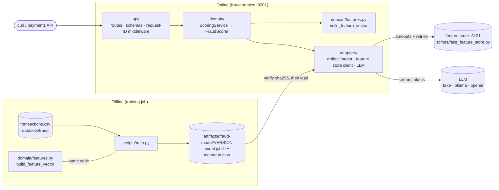

# 🛠 Lab 1: Distribuye el modelo de fraude como un servicio en un contenedor
<!-- id: lab-1 -->

> ⏱ 3–4 h · Track A (`fraud-service`, puerto **8001**) · Lecciones: [1.1](../01-prototype-vs-production.md) · [1.2](../02-architecture-patterns.md) · [1.3](../03-reliability-primitives.md) · [1.4](../04-production-services.md) · [1.5](../05-artifacts-and-containers.md)

[Inicio del curso](../../../README.md) › [Módulo 1](../README.md) › Lab 1

> **De: Maya**
> El notebook de fraude de Sam es un éxito. Risk quiere que puntúe transacciones con tarjeta en tiempo real antes de fin de mes.
> Diego dice que nada se acerca a producción sin health checks, logs en los que pueda buscar y una imagen de contenedor.
> Omar dice que una comprobación de fraude que bloquea los pagos cuando se cae es peor que no tener comprobación de fraude.
> ¿Puedes convertir el notebook en un servicio de verdad?

## 🎯 Qué vas a construir

Al terminar este lab habrás:

1. Diagnosticado **qué falla** en un prototipo con aspecto de real (hay al menos 12 problemas).
2. Convertido el entrenamiento en un **job repetible** que escribe un **artefacto versionado** con metadatos sha256.
3. Ejecutado un **servicio de FastAPI por capas** con liveness/readiness, IDs de request y logs estructurados en JSON.
4. Visto cómo **los reintentos con backoff, jitter, un deadline y un presupuesto de reintentos** sobreviven a una dependencia inestable.
5. Visto la **degradación elegante**: el servicio sigue respondiendo cuando falta el modelo o una dependencia.
6. Transmitido en streaming, token a token, una **explicación de un LLM** con Server-Sent Events.
7. Construido una **imagen de Docker multietapa que no se ejecuta como root** y leído los manifiestos de **Kubernetes** que la ejecutarán.



## 📁 Qué hay en esta carpeta

El código, la configuración y los tests del lab están en inglés, en [`modules/01-prototype-to-production/lab/`](../../../../../modules/01-prototype-to-production/lab/), y todos los comandos se ejecutan desde allí.

```
lab/
├── prototype/sam_notebook.py     ← the "before": read it, don't fix it
├── scripts/train.py              ← training job → versioned artifact
├── scripts/fake_feature_store.py ← a deliberately flaky dependency
├── src/kestrel_fraud/
│   ├── api/        schemas.py · routes.py · middleware.py
│   ├── domain/     features.py · scoring.py · service.py
│   ├── adapters/   artifacts.py · retry.py · enrichment.py · faults.py · llm.py · …
│   ├── config.py   typed settings (KESTREL_* env vars)
│   ├── logging.py  structlog JSON logging
│   ├── training.py the training logic used by scripts/train.py
│   └── main.py     create_app(): wires everything together
├── tests/          32 tests, offline, ~5 s
├── Dockerfile      multi-stage, non-root, healthcheck
└── k8s/            preview manifests (deployed in Module 6)
```

---

## 📋 Pasos

### Paso 0 · Prepara el entorno (5 min)
<!-- id: lab-1-step-0 -->

```bash
cd modules/01-prototype-to-production/lab
uv sync
python3 ../../../datasets/fraud/generate.py
```

Resultado esperado:

```
wrote 50,000 rows to …/datasets/fraud/transactions.csv  (scenario=baseline, fraud rate=1.41%)
```

> 💡 El dataset **no** está en Git. Se regenera con un script y una semilla fija. Ese es tu primer hábito de reproducibilidad: versiona la *receta*, no solo el resultado.

### Paso 1 · Revisa el código del prototipo de Sam (20 min)
<!-- id: lab-1-step-1 -->

Abre [`prototype/sam_notebook.py`](../../../../../modules/01-prototype-to-production/lab/prototype/sam_notebook.py). Imagina que Sam te ha pedido una revisión antes de ponerlo en marcha. Apunta en un archivo (o en papel) **todos los problemas** que encuentres. Para cada uno, anota *qué saldría mal de verdad en producción*.

Intenta llegar al menos a 10 antes de abrir la respuesta.

<details>
<summary>✅ Respuesta: 15 problemas y la lección que arregla cada uno</summary>

| # | Problema | Qué sale mal en producción | Se arregla en |
|---|---|---|---|
| 1 | `DATA = "../../../../datasets/…"`, una ruta relativa al *directorio actual* | Solo funciona desde una carpeta; falla en CI, en cron y en los contenedores | `training.py` resuelve las rutas a partir de la ubicación del archivo o de `KESTREL_DATA_DIR` |
| 2 | `API_KEY = "sk-live-…"`, un secreto escrito en el código | Se filtra para siempre a través del historial de Git, de capturas de pantalla y de los logs | 1.4: secretos desde el entorno o un gestor de secretos, `SecretStr` |
| 3 | Entrena con `chargeback_filed` | **Fuga de la label**: esa columna solo existe *después* de confirmarse el fraude. AUC offline de 0,95; en el mundo real, mucho peor | 1.1, `FORBIDDEN_COLUMNS` + un test |
| 4 | `train_test_split` sin `random_state` | Métricas distintas en cada ejecución; nadie puede reproducir un resultado | 1.5: semillas fijas registradas en los metadatos |
| 5 | Partición aleatoria sobre datos ordenados en el tiempo | El conjunto de test mezcla el «pasado» y el «futuro»: métricas optimistas | `training.py`: partición temporal |
| 6 | Celebra un `accuracy 0.99` con una tasa de fraude del 1,4 % | Predecir «nunca es fraude» da un 98,6 % de accuracy. Aquí la accuracy no significa nada | Módulo 4 (PR-AUC); los metadatos registran el PR-AUC y la tasa base |
| 7 | `pd.get_dummies` al entrenar; otro camino de código en `predict()` | **Training/serving skew**: los conjuntos de columnas pueden diferir sin avisar | 1.1: un único `build_feature_vector` compartido |
| 8 | `predict()` rellena en silencio con 0 las columnas que faltan (`reindex(fill_value=0)`) | `chargeback_filed` siempre vale 0 al servir; el modelo ve un mundo con el que nunca se entrenó | Igual que el 7, más una comprobación del contrato de features al cargar |
| 9 | `pickle.dump` sin versión, sin metadatos y sin hash | Nadie sabe qué datos o qué código produjeron `model.pkl`; un archivo corrupto o sustituido se carga igualmente; pickle puede ejecutar código | 1.5: artefacto versionado + sha256 verificado *antes* de cargar |
| 10 | Estado global (`model`, `X`) usado dentro de `predict` | Importar el notebook vuelve a entrenar el modelo; imposible probarlo de forma aislada | 1.4: factoría de la aplicación + lifespan |
| 11 | Umbral `0.5` escrito en el código, devuelve `"FRAUD"`/`"OK"` | Negocio no puede ajustarlo; hacen falta tres acciones (aprobar, revisar, rechazar) | `DecisionPolicy` + configuración |
| 12 | Sin validación de la entrada | `hour=37` o un importe negativo dan una puntuación absurda con total seguridad | 1.4: esquemas de Pydantic → 422 |
| 13 | `print` en lugar de logs | Sin marcas de tiempo, niveles ni IDs de request; imposible buscar | 1.4: structlog en JSON |
| 14 | Sin tests | Cada cambio es una apuesta | `tests/` |
| 15 | Sin dependencias fijadas ni registro del entorno | «Funciona en mi máquina» con otra versión de scikit-learn, lo que puede romper la deserialización con pickle | `uv.lock`, `environment` en los metadatos |

Problemas extra: codificación one-hot del país al entrenar, pero al servir llega un país que nunca apareció en el entrenamiento; nada previsto para cuando falta el modelo; ningún timeout en nada; y el modelo se entrena en el mismo proceso que lo va a servir.
</details>

### Paso 2 · Ejecuta el prototipo de Sam y desconfía (10 min)
<!-- id: lab-1-step-2 -->

```bash
cd prototype && uv run python sam_notebook.py && rm -f model.pkl && cd ..
```

Resultado esperado (tus números variarán un poco; pregúntate *por qué* cambian de una ejecución a otra):

```
(50000, 16)
accuracy 0.992
auc 0.951…
saved
FRAUD
```

🤔 Un AUC de 0,95 para fraude con diez features sencillas es **demasiado bueno para ser verdad**. Antes del paso 3, apunta cuál crees que será el AUC honesto una vez quitada la columna con fuga.

### Paso 3 · Entrena como es debido e inspecciona el artefacto (15 min)
<!-- id: lab-1-step-3 -->

```bash
uv run python scripts/train.py
```

Resultado esperado:

```
✅ wrote artifact …/artifacts/fraud-model/20261110T115648Z-2a36bb33
   sha256   4de749d1…
   metrics  {"roc_auc": 0.747, "pr_auc": 0.063, "brier": 0.015, "test_base_rate": 0.0155, "n_train": 40000, "n_test": 10000}
```

Ahora abre el artefacto:

```bash
cat artifacts/fraud-model/LATEST
cat artifacts/fraud-model/$(cat artifacts/fraud-model/LATEST)/metadata.json
```

Responde a estas preguntas a partir de `metadata.json`:

1. ¿Con qué archivo de datos (por su **sha256**) se entrenó este modelo?
2. ¿Con qué commit de git (y tenía cambios sin confirmar el árbol de trabajo)?
3. ¿En qué orden tiene que enviar la API las features?
4. ¿Cuánto vale el PR-AUC comparado con la tasa base? (El PR-AUC de un modelo aleatorio ≈ la tasa base.)

> 💡 El ROC-AUC honesto (~0,75) queda muy por debajo del 0,95 de Sam. **No es un retroceso, es la verdad.** La cifra de Sam estaba inflada por la fuga de datos y por una partición aleatoria. El Módulo 4 te enseña a leer bien el PR-AUC; de momento, fíjate en que 0,063 es unas **4× mejor que el azar** (0,0155) en un problema muy desequilibrado.

Vuelve a ejecutar el entrenamiento. Obtienes una **carpeta de versión nueva** y `LATEST` se mueve, pero la versión antigua se queda: las versiones son inmutables. Ahora compara los dos archivos del modelo:

```bash
shasum -a 256 artifacts/fraud-model/*/model.joblib
```

Los dos hashes son **idénticos**. Los mismos datos, código, semilla y versiones de las bibliotecas producen un modelo idéntico bit a bit: una reproducibilidad que puedes demostrar. (Prueba `--seed 7` y verás cómo cambia el hash.)

### Paso 4 · Ejecuta los tests (5 min)
<!-- id: lab-1-step-4 -->

```bash
uv run pytest -v
```

Resultado esperado: `32 passed`. Échales un vistazo a los nombres de los tests: son la especificación ejecutable del servicio. Lee al menos `tests/test_features.py::test_training_and_serving_build_identical_rows` y `tests/test_retry.py::test_retry_budget_prevents_retry_storms`.

### Paso 5 · Ejecuta el servicio (15 min)
<!-- id: lab-1-step-5 -->

```bash
uv run uvicorn kestrel_fraud.main:create_app --factory --port 8001
```

En una segunda terminal:

```bash
curl -s localhost:8001/health
curl -s localhost:8001/ready
curl -s -X POST localhost:8001/v1/score \
  -H 'content-type: application/json' \
  -d '{"transaction_id":"txn_0001","customer_id":"cus_00017","amount":249.99,
       "merchant_category":"electronics","hour":2,"is_online":true,"country_mismatch":true,
       "card_age_days":12,"device_is_new":true,"distance_from_home_km":912.4,
       "txn_count_24h":6,"avg_amount_30d":41.5}'
```

Resultado esperado (la puntuación y la versión serán distintas):

```json
{"status":"ok"}
{"status":"ready","model_version":"20261110T115648Z-2a36bb33","reason":null}
{"transaction_id":"txn_0001","score":0.55,"decision":"review","source":"model",
 "model_version":"20261110T115648Z-2a36bb33",
 "reasons":["transaction country differs from card country", "…"],
 "degraded":false,"degraded_reasons":[],"request_id":"9f1c…"}
```

Abre **http://localhost:8001/docs**. La página interactiva de OpenAPI se generó a partir de `api/schemas.py`. Prueba a enviar `"hour": 25` desde la página de documentación y mira la response 422.

### Paso 6 · IDs de request y logs estructurados (10 min)
<!-- id: lab-1-step-6 -->

Envía una request con tu propio ID:

```bash
curl -si -X POST localhost:8001/v1/score -H 'content-type: application/json' \
  -H 'X-Request-ID: lab1-step6' \
  -d '{"transaction_id":"txn_0002","customer_id":"cus_1","amount":12.5,"merchant_category":"grocery","hour":11,"is_online":false,"country_mismatch":false,"card_age_days":400,"device_is_new":false,"distance_from_home_km":1.2,"txn_count_24h":3,"avg_amount_30d":30}' | grep -i x-request-id
```

En la terminal del servicio verás una línea JSON como esta:

```json
{"method": "POST", "path": "/v1/score", "status": 200, "duration_ms": 3.1, "event": "http_request", "request_id": "lab1-step6", "service": "fraud-service", "level": "info", "timestamp": "…"}
```

Pasa los logs por `jq` para filtrarlos (`… | jq 'select(.request_id=="lab1-step6")'`). Ese único hábito es lo que hace posible depurar a las 3 de la madrugada.

### Paso 7 · Sobrevive a una dependencia inestable (25 min)
<!-- id: lab-1-step-7 -->

Para el servicio (Ctrl+C). Arranca el feature store falso con un **40 % de fallos**:

```bash
uv run python scripts/fake_feature_store.py --port 8101 --fail-rate 0.4 --latency-ms 30
```

Vuelve a arrancar el servicio apuntando a él:

```bash
KESTREL_ENRICHMENT_BASE_URL=http://127.0.0.1:8101 \
  uv run uvicorn kestrel_fraud.main:create_app --factory --port 8001
```

Ahora puntúa transacciones **sin** `txn_count_24h` / `avg_amount_30d`, para que el servicio tenga que obtenerlos:

```bash
for i in $(seq 1 10); do
  curl -s -X POST localhost:8001/v1/score -H 'content-type: application/json' -H "X-Request-ID: retry-$i" \
    -d '{"transaction_id":"txn_r'$i'","customer_id":"cus_00017","amount":249.99,"merchant_category":"electronics","hour":2,"is_online":true,"country_mismatch":true,"card_age_days":12,"device_is_new":true,"distance_from_home_km":912.4}' \
    | python3 -c 'import sys,json; d=json.load(sys.stdin); print(d["request_id"], d["degraded"], d["degraded_reasons"])'
done
```

Resultado esperado: la mayoría de las líneas dicen `False []`. En los logs del servicio verás reintentos con tiempos de espera **aleatorios**:

```json
{"attempt": 1, "sleep_s": 0.031, "error": "HTTP 503", "event": "enrichment_retry", "request_id": "retry-2", …}
```

y en la terminal del feature store verás llegar el **mismo ID de request** más de una vez: es la propagación del ID de request entre servicios.

Ahora empeóralo: vuelve a arrancar el feature store con `--fail-rate 1.0`. Todas las requests vuelven ahora con `True ['enrichment_unavailable']`, **con código de estado 200**: el pago se sigue puntuando, solo que con menos información. Al cabo de unas pocas requests, el log dice `"reason": "budget_exhausted"` y el servicio deja de reintentar por completo. Es el presupuesto de reintentos protegiendo a una dependencia que ya está caída.

### Paso 8 · Transmite una explicación en streaming (10 min)
<!-- id: lab-1-step-8 -->

```bash
curl -N localhost:8001/v1/explain/txn_r1
```

Verás llegar Server-Sent Events, palabra a palabra:

```
data: [fake-llm]

data:  Summary

data:  of
…
event: done
data: [DONE]
```

Opcional, con Ollama instalado: `ollama pull qwen2.5:1.5b-instruct`, vuelve a arrancar el servicio con `KESTREL_LLM_PROVIDER=ollama` y obtendrás una explicación real sin ningún otro cambio en el código.

### Paso 9 · Construye y ejecuta el contenedor (20 min)
<!-- id: lab-1-step-9 -->

Primero para el servicio local y el feature store falso (Ctrl+C), para que el puerto 8001 quede libre. Asegúrate de haber entrenado un modelo en el paso 3: la imagen incluye `artifacts/fraud-model/`.

```bash
docker build -t kestrel/fraud-service:0.1.0 .
docker run --rm -p 8001:8001 --name fraud kestrel/fraud-service:0.1.0
```

En otra terminal:

```bash
curl -s localhost:8001/ready
docker exec fraud whoami                   # → app (not root)
docker ps --filter name=fraud              # STATUS shows "(healthy)" after ~15 s
docker images kestrel/fraud-service:0.1.0  # ≈ 440 MB, mostly numpy/scipy/scikit-learn
```

Cambia una línea en `src/` y vuelve a construir: fíjate en que la capa de dependencias sale como **CACHED** y la reconstrucción tarda segundos. Por eso el Dockerfile copia `pyproject.toml` + `uv.lock` antes que `src/`.

### Paso 10 · Lee los manifiestos de Kubernetes (15 min)
<!-- id: lab-1-step-10 -->

Abre [`k8s/deployment.yaml`](../../../../../modules/01-prototype-to-production/lab/k8s/deployment.yaml) y [`k8s/README.md`](../../../../../modules/01-prototype-to-production/lab/k8s/README.md). Para cada uno de estos campos, escribe una frase sobre qué se rompería sin él: `replicas: 2`, `maxUnavailable: 0`, `readinessProbe → /ready`, `livenessProbe → /health`, `resources.limits.memory`, `runAsNonRoot`, `image: …:0.1.0` (no `:latest`).

---

## 💥 Rómpelo (aprende provocando fallos)

Cada experimento lleva unos minutos. Predice qué va a pasar **antes** de ejecutarlo.

1. **Manipula el artefacto.** `echo x >> artifacts/fraud-model/$(cat artifacts/fraud-model/LATEST)/model.joblib` y luego arranca el servicio. ¿Qué devuelven `/health`, `/ready` y `/v1/score`? ¿Por qué es esa la combinación correcta? *(Después, vuelve a entrenar para arreglarlo.)*
2. **Un contrato de features que no coincide.** En `domain/features.py`, añade un nombre nuevo a `NUMERIC_FEATURES` (y un valor en `build_feature_vector`) y arranca el servicio sin volver a entrenar. ¿Qué error obtienes y qué incidente de producción acaba de evitar?
3. **Una configuración incorrecta falla rápido.** Arranca con `KESTREL_REVIEW_THRESHOLD=0.9 KESTREL_DECLINE_THRESHOLD=0.5`. ¿Por qué es mejor que falle al arrancar que arrancar?
4. **Una tormenta de reintentos sin jitter.** En `adapters/retry.py`, haz temporalmente que `backoff` devuelva `cap` (sin aleatoriedad). Ejecuta el paso 7 con `--fail-rate 0.6`. Mira las marcas de tiempo de los reintentos en el log del feature store. ¿Por qué los reintentos sincronizados perjudican a un servicio que se está recuperando?
5. **Sin presupuesto.** Define `KESTREL_RETRY_BUDGET_RATIO=1.0` y `KESTREL_ENRICHMENT_MAX_ATTEMPTS=6` con `--fail-rate 1.0`. Cuenta cuántas requests llegan al feature store por cada request de puntuación. Multiplícalo por 1000 requests por segundo. Esa es la carga que estás añadiendo a un servicio que ya está caído.
6. **Una liveness que comprueba las dependencias (experimento mental).** Imagina que `/health` devolviera 503 cuando el feature store está caído. Con 2 réplicas y Kubernetes reiniciando los pods cuando falla la liveness, describe qué pasa durante una caída del feature store de 10 minutos.

## 🚀 Amplíalo

<details>
<summary><b>1. Inferencia por lotes</b>: puntúa un CSV entero offline (⭐ recomendado)</summary>

**Objetivo:** escribe `scripts/batch_score.py`, que lee `datasets/fraud/transactions.csv`, puntúa cada fila con el *mismo* artefacto y el mismo código de dominio, y escribe `scores.csv` (`transaction_id,score,decision,model_version`).

**Pistas:** reutiliza `load_artifact`, `transaction_from_csv_row` y `build_feature_vector`; llama a `predict_proba` sobre una matriz de NumPy entera de una vez en lugar de fila a fila (¡compara la velocidad!).

**Esbozo de la solución:**

```python
import csv, sys, numpy as np
from pathlib import Path
from kestrel_fraud.adapters.artifacts import load_artifact
from kestrel_fraud.config import Settings
from kestrel_fraud.domain.features import build_feature_vector, transaction_from_csv_row
from kestrel_fraud.domain.scoring import DecisionPolicy

s = Settings()
loaded = load_artifact(s.model_dir, s.model_version)
policy = DecisionPolicy(s.review_threshold, s.decline_threshold)
rows = list(csv.DictReader(open(sys.argv[1])))
X = np.array([build_feature_vector(transaction_from_csv_row(r)) for r in rows])
scores = loaded.model.predict_proba(X)[:, 1]          # one vectorised call
with open("scores.csv", "w", newline="") as fh:
    w = csv.writer(fh); w.writerow(["transaction_id", "score", "decision", "model_version"])
    for r, p in zip(rows, scores):
        w.writerow([r["transaction_id"], round(float(p), 4), policy.decide(p), loaded.version])
```

Puntuar así 50 000 filas por lotes tarda alrededor de un segundo; hacerlo de una en una a través de la API HTTP tardaría minutos. Ese es, en números, el compromiso entre batch y online de la lección 1.2.
</details>

<details>
<summary><b>2. Respeta <code>Retry-After</code> en los HTTP 429</b></summary>

**Objetivo:** cuando el feature store responda `429 Too Many Requests` con una cabecera `Retry-After: 0.2`, espera al menos ese tiempo antes de reintentar (pero sigue respetando el deadline).

**Pistas:** lleva el retraso dentro de `RetryableError` (p. ej., `RetryableError(msg, retry_after=0.2)`) y, en `call_with_retries`, usa `max(policy.backoff(n), exc.retry_after or 0)`. Añade un test con `FaultInjectingTransport(status_code=429)` y un handler que ponga la cabecera.
</details>

<details>
<summary><b>3. Un endpoint <code>/version</code></b></summary>

**Objetivo:** devuelve `{"service_version": ..., "model_version": ..., "model_sha256": ..., "trained_at": ..., "git_commit": ...}` para que cualquiera pueda comprobar exactamente qué se está ejecutando.

**Pista:** guarda todo `LoadedModel.metadata` en `app.state` durante el `lifespan`. Nunca devuelvas a ciegas todos los metadatos: decide qué campos es seguro exponer públicamente.
</details>

<details>
<summary><b>4. Un circuit breaker</b> (avanzado)</summary>

**Objetivo:** después de 5 fallos de enriquecimiento seguidos, deja de llamar al feature store durante 10 segundos (circuito «abierto») y luego deja pasar una request de prueba («semiabierto»).

**Pistas:** una clase pequeña con `state`, `failures` y `opened_at`; compruébala en `HttpFeatureStore.get_customer_features` antes de llamar a `call_with_retries`. Compárala con el presupuesto de reintentos: el presupuesto limita la carga *extra*, mientras que el breaker quita *toda* la carga a una dependencia que está claramente caída. Consulta el artículo «CircuitBreaker» de Martin Fowler en los recursos de la lección 1.3.
</details>

<details>
<summary><b>5. Explica con un modelo real</b></summary>

Ejecuta Ollama, define `KESTREL_LLM_PROVIDER=ollama` y compara el tiempo hasta el primer token con el tiempo total de `curl -N` frente a `curl` sin `-N`. Después mejora `EXPLAIN_SYSTEM_PROMPT` para que la explicación nunca se invente hechos que no estén en la lista de motivos. (El Módulo 4 enseña a *probarlo* de forma automática.)
</details>

## ✅ Definition of Done

- [ ] Listé al menos 10 problemas en el notebook de Sam y sé explicar el impacto en producción de cada uno
- [ ] `uv run python scripts/train.py` crea una carpeta de versión nueva con `model.joblib` y un `metadata.json` completo
- [ ] Sé explicar por qué las métricas honestas son más bajas que las de Sam y por qué eso es una buena noticia
- [ ] `uv run pytest` → 32 passed
- [ ] El servicio responde a `/health`, `/ready`, `/v1/score`, `/v1/explain/{id}` y `/docs`
- [ ] Seguí un ID de request desde `curl`, a través de los logs del servicio, hasta los logs del feature store
- [ ] Con el feature store al 100 % de fallos, la puntuación sigue devolviendo 200 con `degraded: true`
- [ ] Con un artefacto manipulado, `/health` da 200, `/ready` da 503 y la puntuación recurre a las reglas
- [ ] `docker build` funciona, el contenedor se ejecuta como `app` e informa de `(healthy)`
- [ ] Sé explicar cada campo de `k8s/deployment.yaml` que listé en el paso 10
- [ ] Hice al menos 3 experimentos de «Rómpelo» y un ejercicio de «Amplíalo»

➡️ Vuelve a la [presentación del módulo 1](../README.md) · Haz el [cuestionario del módulo 1](../quiz.md)
