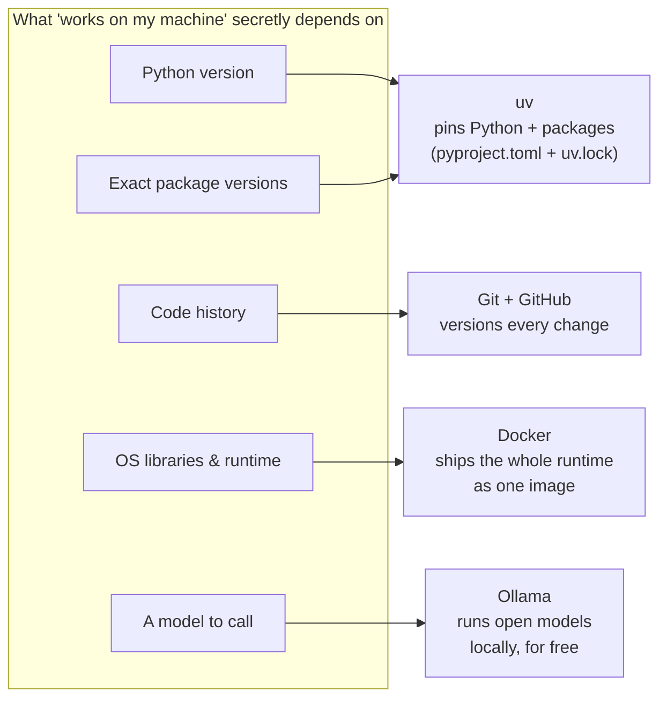
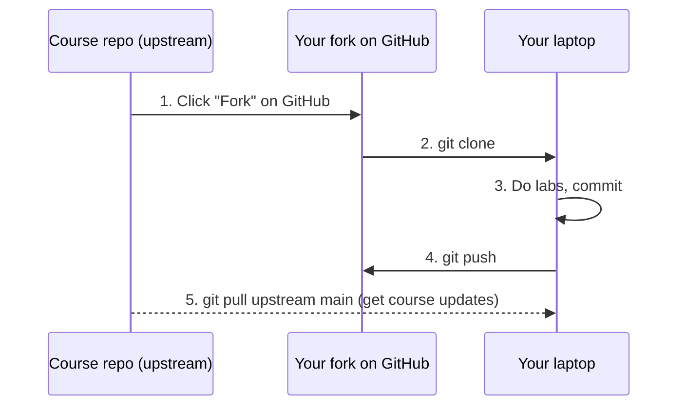

# Lesson 0.1: Set up your workbench
<!-- id: l-0-1 -->

> ⏱ ~60 min (most of it waiting for downloads) · 🎚 Level: Core · 🧰 Needs: a laptop with ~10 GB free disk and admin rights

[Course home](../../README.md) › [Module 0](README.md) › Lesson 0.1

## 📨 The situation

> **From: Diego (SRE / platform lead)**
> Hi! Before you write a single line of code: Sam's prototypes only run on Sam's laptop, with Python versions and packages nobody wrote down.
> We are not doing that again. Your machine needs to build **exactly** what CI builds and what production runs.
> Install the standard toolchain, run the checker, and ping me when it's all green. 🟢

## 🎯 By the end you can

- **Install** the five tools this course uses (uv, Git, Docker, Ollama and an editor) on macOS, Linux or Windows (WSL2).
- **Explain** what problem each tool solves in a production AI workflow.
- **Verify** your environment with `python3 tools/check_setup.py` and fix the most common failures.
- **Fork** the course and track your progress in your own copy.

## 🤔 Predict first

Answer in your head before reading on:

1. Two engineers run `pip install fastapi` one month apart. Will they get the same code? Why might that matter? <!-- id: p-0-1-1 -->
2. Why would you run an application inside a *container* when it already runs fine on your laptop? <!-- id: p-0-1-2 -->
3. Why would a course want you to run an LLM **locally** instead of just using an API key? <!-- id: p-0-1-3 -->

---

## 1. Why tooling is the first production problem

"It works on my machine" is the most expensive sentence in software. A notebook that ran on Sam's laptop depends on hundreds of invisible things: the Python version, the exact version of every package (and *their* dependencies), environment variables, files in a folder on Sam's desktop, even the CPU architecture.

Production engineering starts by making every one of those invisible things **explicit and reproducible**. Here is what each tool in this course pins down:



| Tool | Problem it solves | Where you'll use it |
|---|---|---|
| **uv** | Installs the right Python and *exact* package versions, very fast | Every lab |
| **Git** | Records every change so you can review, revert and collaborate | Every lab; CI in Module 4 |
| **Docker** | Packages code + dependencies + OS libraries into one portable image | Module 1 onwards |
| **Ollama** | Runs open-weight LLMs on your laptop with an HTTP API | Optional in every LLM lab |
| **Editor** (VS Code or PyCharm) | Type checking, debugging, test running | Everywhere |

> 💡 **Production tip:** Your laptop, CI and production should differ only in **configuration** (URLs, secrets, sizes), never in **code or dependency versions**. This is one of the core ideas of [The Twelve-Factor App](https://12factor.net/), which you'll study in Module 1.

---

## 2. Install the toolchain

Pick your operating system. Install **in this order**.

### 2.1 Windows users: start with WSL2

Production AI systems run on Linux. On Windows, install the **Windows Subsystem for Linux (WSL2)** and do the whole course inside it. It gives you a real Ubuntu environment, and every command in this course will work unchanged.

```powershell
# PowerShell as Administrator
wsl --install
```

Restart, open the "Ubuntu" app, create a Linux user, and from now on follow the **Linux** instructions *inside* Ubuntu. Official guide: [Install WSL](https://learn.microsoft.com/en-us/windows/wsl/install).

> ⚠️ **Common mistake:** cloning the repo into `C:\Users\...` and working on it from WSL. File access across the Windows/Linux boundary is very slow and causes permission oddities. Clone it **inside** your Linux home (`~/code/...`).

### 2.2 Git

| OS | Command |
|---|---|
| macOS | `xcode-select --install` (or `brew install git`) |
| Ubuntu / WSL2 | `sudo apt update && sudo apt install -y git` |

Then tell Git who you are (it stamps this on every commit):

```bash
git config --global user.name "Your Name"
git config --global user.email "you@example.com"
git config --global init.defaultBranch main
```

### 2.3 uv (Python and packages)

[uv](https://docs.astral.sh/uv/) is a Python package and project manager. It replaces `pip`, `venv`, `pyenv` and `pip-tools` with one fast tool, and it can **download the right Python version for you**.

```bash
# macOS / Linux / WSL2
curl -LsSf https://astral.sh/uv/install.sh | sh
# restart your terminal, then:
uv --version
```

You do **not** need to install Python separately for the labs: each lab has a `.python-version` file (3.12), and `uv sync` downloads that version automatically. You do need *some* `python3` on your PATH (3.11+) to run the root-level setup checker; macOS and Ubuntu usually have one, and `uv python install 3.12` provides one if not.

> 🔎 **Under the hood:** `uv sync` reads `pyproject.toml` (what you *asked for*, e.g. `fastapi>=0.115`) and `uv.lock` (what was *actually resolved*, e.g. `fastapi==0.118.0` plus every transitive dependency with hashes). The lock file is what makes two installs a month apart identical. Lesson 0.2 explains this in depth.

### 2.4 Docker

Docker builds and runs **containers**: isolated processes that carry their own filesystem, libraries and runtime. Module 1 packages the fraud model as a Docker image; Modules 4–6 use Docker Compose to run Prometheus, Grafana and friends.

| OS | Install |
|---|---|
| macOS | [Docker Desktop](https://docs.docker.com/desktop/) (free for personal use, education and small businesses; check the licence terms for your company) or the open-source alternative [Colima](https://github.com/abiosoft/colima) |
| Ubuntu / WSL2 | [Docker Engine](https://docs.docker.com/engine/install/ubuntu/), or Docker Desktop with WSL2 integration enabled |

Verify:

```bash
docker run --rm hello-world
```

You should see `Hello from Docker!`. If you get `permission denied` on Linux, add yourself to the `docker` group (`sudo usermod -aG docker $USER`, then log out and in).

### 2.5 Ollama (optional, recommended)

[Ollama](https://ollama.com) runs open-weight LLMs locally and exposes them over an HTTP API on `http://localhost:11434`. It means you can learn everything about LLM serving, streaming, latency and cost **without an API key or a credit card**.

```bash
# macOS: download the app from https://ollama.com/download
# Linux / WSL2:
curl -fsSL https://ollama.com/install.sh | sh

ollama pull qwen2.5:1.5b-instruct   # ~1 GB download, runs on CPU
ollama run qwen2.5:1.5b-instruct "Say hello in five words."
```

Why this model? It is small enough to run on a CPU-only laptop with 8 GB RAM, yet it follows instructions well enough to demonstrate RAG, tool calls and guardrails. If you have 16 GB+ RAM and want better answers, try a 3B–8B model later; the course code reads the model name from `KESTREL_OLLAMA_MODEL`, so nothing else changes.

> 💡 **Production tip:** Every lab defaults to a **fake, deterministic LLM**, so tests never depend on Ollama, a GPU or the internet. Real models are an *opt-in* for experiments. That separation (deterministic tests, real models in evals) is exactly how production LLM teams keep CI fast and reliable.

### 2.6 An editor

Any editor works. Two good free options:

- **VS Code** with the *Python* and *Pylance* extensions. Open a lab folder, then pick the interpreter at `.venv/bin/python` (Command Palette → *Python: Select Interpreter*). For WSL, install the *WSL* extension and open the folder from inside Ubuntu with `code .`.
- **PyCharm Community Edition**. Point the project interpreter at the lab's `.venv`.

Turn on **format on save** and **type checking (basic)**. You will read a lot of type-hinted code in this course, and your editor will catch mistakes before you run anything.

---

## 3. Get the course and track your progress

### 3.1 Fork, then clone your fork

A **fork** is your own copy of the repository on GitHub. You commit your lab solutions and tick progress boxes there, without affecting anyone else.



```bash
# 1. On GitHub, click "Fork" on the course page.
# 2. Clone YOUR fork (replace <you>):
git clone https://github.com/<you>/Build-Production-Grade-AI-Systems.git
cd Build-Production-Grade-AI-Systems

# 5. Later, to receive course updates:
git remote add upstream https://github.com/elrincondeldev/Build-Production-Grade-AI-Systems.git
git pull upstream main
```

GitHub's guide: [Fork a repository](https://docs.github.com/en/pull-requests/collaborating-with-pull-requests/working-with-forks/fork-a-repo).

### 3.2 Track progress

- Tick the module boxes in the root `README.md` of your fork. GitHub shows checked tasks as a progress indicator.
- After every lesson, write three lines in your copy of [`docs/progress-journal.md`](../../docs/progress-journal.md): *what I learned, what confused me, one question*. Writing it down is retrieval practice, and it gives you material for interviews later.
- Commit at the end of every lab: `git add -A && git commit -m "lab N: <what you did>"`. Your fork's history becomes a visible portfolio.

---

## 4. Verify everything

From the repo root:

```bash
python3 tools/check_setup.py
```

The checker has two groups. **Required** (must show a green ✔): Python ≥ 3.11, uv, Git, and the shared data generator. **Optional** (a yellow • is fine for now): the Docker daemon (Modules 1, 4, 6), Ollama with a pulled model (real LLM answers), kubectl and kind (Module 6). It exits with code 1 only if a required check fails.

Then run the Lab 0 test suite. This is the real proof that your environment can build a lab from scratch:

```bash
cd modules/00-foundations/lab
uv sync
uv run pytest
```

**Expected output:**

```
.................................                                        [100%]
33 passed in 3.8s
```

### 🩺 Troubleshooting the usual suspects

| Symptom | Likely cause | Fix |
|---|---|---|
| `uv: command not found` | Shell not restarted after install | Open a new terminal, or `source ~/.zshrc` / `~/.bashrc` |
| `uv sync` fails with SSL or proxy errors | Corporate network | Set `HTTPS_PROXY`, or try another network; see the uv docs on proxies |
| `Cannot connect to the Docker daemon` | Docker Desktop / Colima not running | Start it; on Linux `sudo systemctl start docker` |
| `permission denied ... docker.sock` (Linux) | User not in `docker` group | `sudo usermod -aG docker $USER`, then log out and in |
| Ollama check ⚠️ | App not running or model not pulled | Start Ollama; `ollama pull qwen2.5:1.5b-instruct` |
| Tests fail with `Could not find the course repo root` | Running the lab from a copied folder | Run from inside the cloned repo, or set `KESTREL_DATA_DIR=/path/to/repo/datasets` |
| Everything is slow on Windows | Repo cloned under `C:\` | Re-clone inside the WSL home directory |

> ⚠️ **Common mistake:** "fixing" a failing install with `sudo pip install ...`. That writes into the system Python, can break OS tools, and makes your environment *less* reproducible. With uv you never need `sudo` for Python packages.

---

## 🧪 Try it

1. Run the checker and the Lab 0 tests (above) until everything passes.
2. Prove that `uv.lock` pins versions:
   ```bash
   cd modules/00-foundations/lab
   grep -A2 '^name = "fastapi"' uv.lock
   ```
   **Expected:** a `version = "..."` line with one exact version. That is what *everyone* who runs `uv sync` on this commit gets.
3. Prove Docker isolation:
   ```bash
   docker run --rm python:3.12-slim python -c "import sys; print(sys.version)"
   python3 -c "import sys; print(sys.version)"
   ```
   **Expected:** the container prints Python 3.12.x even if your laptop has a different version. The container carries its own runtime.
4. *(Optional)* Ask your local model something and time it:
   ```bash
   time ollama run qwen2.5:1.5b-instruct "What is a chargeback? One sentence."
   ```
   Run it twice. The first run includes **loading the model into memory**, so it is noticeably slower. Remember this "cold start" effect; it matters a lot when you autoscale model servers in Module 6.

## 🏭 In the real world

Teams that ship ML reliably treat the development environment as code. The repo pins the Python version and dependencies, CI rebuilds the environment from scratch on every change, and the same container image moves from staging to production. Reproducible environments are also a basic expectation in the ML reproducibility checklists used by research venues such as NeurIPS: if a result cannot be rebuilt, nobody can trust or debug it. You'll write your own reproducibility checklist in Lesson 2.6.

## ✅ Check yourself

<details><summary>Q1. What is the difference between <code>pyproject.toml</code> and <code>uv.lock</code>? <!-- id: c-0-1-1 --></summary>

`pyproject.toml` declares what you **want** (often ranges, like `fastapi>=0.115`). `uv.lock` records what was **actually resolved**: exact versions and hashes of every package, including transitive dependencies. Commit both. The lock file makes installs reproducible across machines and over time.

</details>

<details><summary>Q2. Why does every lab default to a fake LLM instead of Ollama? <!-- id: c-0-1-2 --></summary>

Tests must be **deterministic, fast, free and offline**. A real model's output can vary, it needs memory and time, and an API needs keys and costs money. The fake model tests the *plumbing* (request formatting, parsing, error handling); real models are used deliberately in experiments and evaluations (Module 4).

</details>

<details><summary>Q3. A teammate says "Docker is just a lightweight VM." What's the important difference? <!-- id: c-0-1-3 --></summary>

A VM emulates hardware and runs a full guest OS kernel. A container is an **isolated process sharing the host's kernel**, with its own filesystem and libraries. That makes containers start in milliseconds to seconds and much smaller, which is why they are the standard unit of deployment. (On macOS and Windows, Docker runs a small Linux VM behind the scenes because containers need a Linux kernel.)

</details>

<details><summary>Q4. Why should Windows users clone the repo inside the WSL filesystem? <!-- id: c-0-1-4 --></summary>

Accessing Windows files from Linux (and the reverse) goes through a translation layer that is much slower and can produce permission and line-ending issues. Keeping the code inside WSL's own filesystem gives native Linux performance and behaviour, which matches production.

</details>

<details><summary>Q5. Why is the first <code>ollama run</code> slower than the second? <!-- id: c-0-1-5 --></summary>

The first call must **load the model weights from disk into memory** (cold start). Later calls reuse the loaded model until Ollama unloads it after an idle period. In production, cold starts are why you keep warm replicas and why scaling model servers from zero is slow.

</details>

## 💬 Explain it back
<!-- id: e-0-1 -->

Explain to Sam, in four sentences or fewer, why "just send me your notebook and a `requirements.txt` with no versions" isn't enough to put the fraud model in production, and which two tools from this lesson fix it.

## 🔑 Key takeaways

- Production starts with **reproducibility**: same Python, same packages, same runtime, everywhere.
- **uv** pins Python and dependencies (`pyproject.toml` + `uv.lock`); **Git** versions changes; **Docker** ships the runtime; **Ollama** gives you free local LLMs.
- Tests use a **fake LLM** by default so they are deterministic, offline and free.
- On Windows, work **inside WSL2**.
- Fork the repo, commit after every lab, and keep a short learning journal.

## 📚 Go deeper (free)

| | Resource | Why read it | Time |
|---|---|---|---|
| ⭐ | [The Missing Semester of Your CS Education (MIT)](https://missing.csail.mit.edu/) | Shell, Git and tooling fluency that every later module assumes | 2–6 h (pick lectures) |
| 🔍 | [uv documentation](https://docs.astral.sh/uv/) | Projects, lock files, Python versions, tools | 30 min |
| 🔍 | [Pro Git book](https://git-scm.com/book/en/v2) | Chapters 1–3 cover everything you need for this course | 2 h |
| 🔍 | [Docker "Get started"](https://docs.docker.com/get-started/) | Images, containers and Dockerfiles, hands-on | 1–2 h |
| 🔍 | [Ollama on GitHub](https://github.com/ollama/ollama) | Model library, API reference, configuration | 20 min |
| 🔍 | [Install WSL (Microsoft)](https://learn.microsoft.com/en-us/windows/wsl/install) | Official Windows setup guide | 15 min |

---
⬅️ [Module 0 overview](README.md) · ➡️ [Lesson 0.2: Python for production](02-python-for-production.md)
