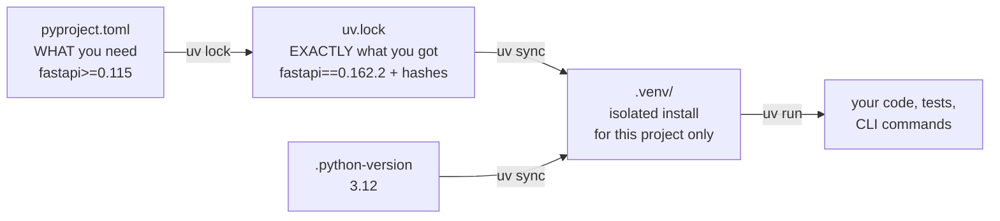
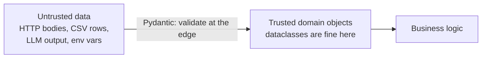
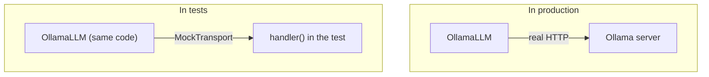
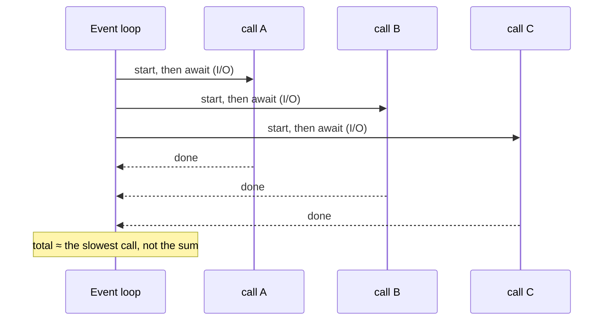

# Lesson 0.2: Python for production

> ⏱ ~60 min · 🎚 Level: Core · 🧰 Needs: [Lesson 0.1](01-setup-your-workbench.md)

[Course home](../../README.md) › [Module 0](README.md) › Lesson 0.2

## 📨 The situation

> **From: Sam (Data Scientist)**
> Hey! Heads-up before you open my notebooks 😅 They're… exploratory. Global variables, `print` everywhere, a CSV path pointing at my Desktop, and the API key is pasted in cell 3.
> It all *works*, though! What do I need to change so you can actually run it?

## 🎯 By the end you can

- **Explain** how `pyproject.toml`, `uv.lock` and a virtual environment work together.
- **Use** type hints, dataclasses and Pydantic models, and **choose** between them.
- **Load** configuration and secrets from environment variables with `pydantic-settings`.
- **Write** pytest tests with fixtures and `monkeypatch`, without network access.
- **Replace** `print` with logging, and say why it matters.
- **Describe** the async/await mental model and **decide** when async helps (I/O-bound) and when it doesn't (CPU-bound).

## 🤔 Predict first

1. A function is declared `def score(amount: float) -> float`. What happens if you call `score("12.5")`?
2. You call five slow web APIs, each taking 0.5 s. Sequentially that's 2.5 s. With `async`, roughly how long could it take?
3. Why is `print(f"user {email} paid {amount}")` a problem in a production service, beyond style?

---

## 1. Projects, not scripts: `pyproject.toml`, lock files, environments

A notebook is a *document*. A production service is a *project*: something that can be installed, tested and run identically by anyone.



Open `modules/00-foundations/lab/pyproject.toml`. The important parts:

```toml
[project]
name = "kestrel-foundations"
requires-python = ">=3.11"
dependencies = [
    "fastapi>=0.115",        # a *range*: what the code is compatible with
    "pydantic>=2.7",
    "scikit-learn>=1.5",
    # ...
]

[project.optional-dependencies]
semantic = ["sentence-transformers>=3.0"]   # heavy, opt-in: uv sync --extra semantic

[project.scripts]
train-first-model = "kestrel_foundations.train_first_model:main"   # → `uv run train-first-model`

[dependency-groups]
dev = ["pytest>=8.2"]                        # needed to develop, not to run
```

And in `uv.lock`, the **resolved** truth:

```toml
name = "fastapi"
version = "0.162.2"
source = { registry = "https://pypi.org/simple" }
```

| Concept | Analogy | Why it matters in production |
|---|---|---|
| `pyproject.toml` | A recipe ("2–3 eggs") | Declares compatibility; readable by humans and tools |
| `uv.lock` | The exact shopping receipt | Identical installs on laptop, CI and Docker image |
| `.venv/` | Your own kitchen | Projects can't break each other's dependencies |
| `[project.scripts]` | Named buttons | `uv run train-first-model` instead of "run cell 1, then 4, then 7" |

> ⚠️ **Common mistake:** committing `.venv/` to Git, or *not* committing the lock file. Commit `pyproject.toml` and `uv.lock`; ignore `.venv/`. The environment is rebuilt from the lock file, never copied.

### The `src/` layout

```
lab/
  pyproject.toml
  src/kestrel_foundations/   ← the importable package
    __init__.py
    config.py
    llm.py
  tests/                     ← tests import the *installed* package
```

Putting code under `src/` forces tests to import the package the same way production does, so a test can't accidentally pass because it happened to run from the right folder. It's a small habit that prevents "works in tests, fails when installed" bugs.

---

## 2. Type hints: documentation that tools can check

Type hints say what a function expects and returns:

```python
def estimate_cost_usd(
    prompt_tokens: int, completion_tokens: int, input_price_per_m: float, output_price_per_m: float
) -> float:
    return prompt_tokens / 1e6 * input_price_per_m + completion_tokens / 1e6 * output_price_per_m
```

**Python does not enforce them at runtime.** `estimate_cost_usd("10", ...)` will run until the arithmetic fails, possibly far from where the bad value came from. Type hints are checked by your **editor** and by type checkers such as mypy or Pyright, *before* the code runs. Think of them as a spell-checker for data shapes.

Types you'll see constantly in this course:

```python
from collections.abc import AsyncIterator
from typing import Literal, Protocol

Role = Literal["system", "user", "assistant"]   # only these three strings are valid

class LLMClient(Protocol):                       # "anything with these methods"
    async def complete(self, messages: list[Message], *, temperature: float = 0.0,
                       max_tokens: int = 512) -> Completion: ...
    def stream(self, messages: list[Message], *, temperature: float = 0.0,
               max_tokens: int = 512) -> AsyncIterator[str]: ...

def find(path: Path | None = None) -> Path: ...  # Optional value: Path or None
```

`Protocol` is worth pausing on. `FakeLLM`, `OllamaLLM` and `OpenAICompatibleLLM` in `llm.py` don't inherit from anything, yet all three satisfy `LLMClient` because they have the right methods. That's **structural typing** ("if it quacks like a duck…"), and it's how you swap providers without touching the code that uses them.

> 💡 **Production tip:** Type hints pay off most at **boundaries**: function signatures, API schemas and adapters. You don't need to annotate every local variable.

---

## 3. Dataclasses vs Pydantic: holding data vs validating data

Both give you classes with named fields. The difference is what happens with **bad input**.

```python
from dataclasses import dataclass
from pydantic import BaseModel

@dataclass
class TxnDC:
    amount: float
    hour: int

class Txn(BaseModel):
    amount: float
    hour: int
```

What actually happens (run in the lab environment):

```python
>>> TxnDC(amount="12.5", hour="late")
TxnDC(amount='12.5', hour='late')          # accepted silently, wrong types inside

>>> Txn(amount="12.5", hour="3")
amount=12.5 hour=3                          # coerced to the declared types

>>> Txn(amount="12.5", hour="late")
1 validation error for Txn
hour
  Input should be a valid integer, unable to parse string as an integer [type=int_parsing, ...]
```



| Use | When | In this course |
|---|---|---|
| `@dataclass(frozen=True)` | Internal data you created yourself; fast, simple, immutable | `Message`, `Completion`, `Metrics` |
| Pydantic `BaseModel` | Data crossing a **trust boundary**: API requests, config, files, LLM outputs | `EchoRequest`, `Settings`, later structured LLM outputs |

The rule: **validate at the edges, trust inside.** Once data has passed a Pydantic model, the rest of your code doesn't need defensive checks everywhere.

Pydantic also carries **constraints**, which become your API contract (Lesson 0.3):

```python
class EchoRequest(BaseModel):
    message: str = Field(min_length=1, max_length=1000)
    repeat: int = Field(default=1, ge=1, le=5)
```

---

## 4. Configuration and secrets: never in the code

Sam's notebook had a CSV path on their Desktop and an API key pasted into a cell. Both are bugs waiting to happen: the path breaks on every other machine, and the key ends up in Git history forever (and in screenshots, and in shared notebooks).

The production pattern: **code reads configuration from the environment.** The lab's `config.py`:

```python
class Settings(BaseSettings):
    model_config = SettingsConfigDict(env_prefix="KESTREL_", env_file=".env", extra="ignore")

    llm_provider: Literal["fake", "ollama", "openai"] = "fake"
    ollama_base_url: str = "http://localhost:11434"
    ollama_model: str = "qwen2.5:1.5b-instruct"
    openai_api_key: SecretStr = SecretStr("")   # never shown in logs or reprs
```

- `KESTREL_LLM_PROVIDER=ollama` in the environment sets `llm_provider`, with **validation**: `KESTREL_LLM_PROVIDER=olama` fails at startup instead of at 3 a.m.
- `.env` files are convenient locally and **must be git-ignored** (the repo's `.gitignore` already does this).
- `SecretStr` prints as `**********`. You must call `.get_secret_value()` explicitly, which makes accidental leaks into logs much less likely.

Paths follow the same idea: `paths.py` finds the data by walking up to the repo root, or reads `KESTREL_DATA_DIR`. No hard-coded `/Users/sam/Desktop`.

> ⚠️ **Common mistake:** "I'll remove the key before committing." Git keeps history. If a secret was ever committed, consider it leaked: **rotate it**, then clean the history.

---

## 5. Testing with pytest

A test is a small program that checks your code does what you claim. In production, tests are what let you change code on Friday without fear (although Kestrel Pay's deploy freeze says you shouldn't, anyway).

```python
# tests/test_llm.py
def test_fake_llm_is_deterministic():
    llm = FakeLLM()
    a, b = run(llm.complete(MSGS)), run(llm.complete(MSGS))
    assert a.text == b.text
```

Three pytest features you'll use in every lab:

**1. Fixtures**: reusable setup, injected by name.

```python
# tests/conftest.py
@pytest.fixture(scope="session")
def small_fraud_csv(tmp_path_factory) -> Path:
    out = tmp_path_factory.mktemp("data") / "transactions_small.csv"
    return ensure_fraud_data(out=out, rows=8000, seed=42)

# any test that asks for `small_fraud_csv` gets the file, generated once per session
def test_accuracy_paradox(small_fraud_csv): ...
```

**2. `monkeypatch`**: temporarily change environment variables or attributes, automatically undone after the test.

```python
def test_factory_reads_env(monkeypatch):
    monkeypatch.setenv("KESTREL_LLM_PROVIDER", "ollama")
    assert isinstance(get_llm(Settings()), OllamaLLM)
```

**3. Fake the network, not the logic.** `httpx.MockTransport` lets the *real* Ollama adapter talk to a fake server inside the test, so you test request building and response parsing with no Ollama running:

```python
def handler(request: httpx.Request) -> httpx.Response:
    assert request.url.path == "/api/chat"
    return httpx.Response(200, json={"message": {"content": "A reversal."},
                                     "prompt_eval_count": 12, "eval_count": 3})

llm = OllamaLLM("http://ollama.test", "qwen", transport=httpx.MockTransport(handler))
```

This works because `OllamaLLM` accepts the transport as a constructor argument (**dependency injection**). Designing code so its dependencies can be swapped is the single biggest thing that makes code testable.



> 💡 **Production tip:** A test suite that needs the internet, an API key or a GPU will eventually be skipped, flaky, or both. Keep unit tests hermetic; run real-model checks as separate, explicitly named evaluation jobs (Module 4).

---

## 6. Logging, not `print`

`print` writes text to standard output. Logging writes **events** with a level, a timestamp, a source and structured context, and can route them anywhere.

```python
import logging
logging.basicConfig(level=logging.INFO, format="%(asctime)s %(levelname)s %(name)s %(message)s")
log = logging.getLogger("fraud")

log.info("scored transaction", extra={"txn_id": "txn_0000042", "score": 0.91})
log.warning("model artifact older than 30 days")
log.debug("feature vector: %s", features)   # hidden unless level=DEBUG
```

| `print` | `logging` |
|---|---|
| No level: can't filter noise from errors | DEBUG / INFO / WARNING / ERROR / CRITICAL |
| No timestamp or source | Timestamp, logger name, line number |
| Always on | Configured per environment, without code changes |
| Easy to leak PII (`print(email)`) | Central place to redact (Lesson 5.4) |

In Module 1 you'll go one step further with **structured logging** (one JSON object per event, with a request ID), which is what log search tools and dashboards need.

> ⚠️ **Common mistake:** logging full prompts, emails or card numbers "for debugging". Logs are copied to many systems and kept for a long time. Treat them like a database you cannot delete from.

---

## 7. async/await: one waiter, many tables

AI services spend most of their time **waiting**: for an LLM API, a vector database or another service. `async` lets one process do useful work during those waits.

**Analogy.** A restaurant waiter takes an order, gives it to the kitchen, and serves *other tables* while the food cooks. They don't stand at the kitchen door. The waiter is the **event loop**; each table is a **coroutine**; "the kitchen is cooking" is an `await` on I/O.

```python
import asyncio, time

async def fake_io(i):
    await asyncio.sleep(0.5)      # stands in for an HTTP call
    return i

async def sequential():
    for i in range(5):
        await fake_io(i)          # wait for each one before starting the next

async def concurrent():
    await asyncio.gather(*(fake_io(i) for i in range(5)))   # start all, then wait
```

Measured in the lab environment: **sequential 2.51 s, concurrent 0.50 s**.



**When async helps and when it doesn't:**

| Workload | Example | Async helps? | Use instead |
|---|---|---|---|
| **I/O-bound** | Calling an LLM API, querying a DB, fetching documents | ✅ Yes, a lot | — |
| **CPU-bound** | Running a scikit-learn model on a big batch, parsing huge PDFs, tokenizing | ❌ No: there's no waiting, the CPU is busy | Processes, worker pools, batching, a dedicated inference server |

> ⚠️ **Common mistake:** calling a blocking function inside an `async def`, for example `requests.get(...)` or `time.sleep(1)`. It freezes the **whole event loop**, so every other request waits too. Use async clients (`httpx.AsyncClient`, `asyncio.sleep`), or run blocking work in a thread pool.

The lab's LLM adapters are `async` for this reason:

```python
async def complete(self, messages, *, temperature=0.0, max_tokens=512) -> Completion:
    async with self._client() as client:
        resp = await client.post("/api/chat", json=payload)   # the loop serves others meanwhile
```

And `stream()` is an **async generator**: it `yield`s pieces of text as they arrive, so a chat UI can show the first words in milliseconds instead of waiting for the whole answer.

---

## 🧪 Try it

From `modules/00-foundations/lab`:

1. **See configuration in action.**
   ```bash
   KESTREL_LLM_PROVIDER=olama uv run first-llm-call
   ```
   **Expected:** the CLI's `--provider` choices accept only `fake|ollama|openai`, but the default is read from `Settings()`, so the typo is rejected at startup with a Pydantic `ValidationError` mentioning `llm_provider` and `Input should be 'fake', 'ollama' or 'openai'`. Fails early, fails clearly.
2. **See a secret stay secret.**
   ```bash
   KESTREL_OPENAI_API_KEY=sk-demo uv run python -c "from kestrel_foundations.config import Settings; print(Settings())"
   ```
   **Expected:** `openai_api_key=SecretStr('**********')` in the output.
3. **Run one test file, verbosely.**
   ```bash
   uv run pytest tests/test_llm.py -v
   ```
   **Expected:** 11 test names with `PASSED`. Read `test_ollama_adapter_against_fake_server` and find where the fake server lives.
4. **Break the event loop.** In a Python shell inside the lab (`uv run python`), paste the `fake_io` example, but replace `await asyncio.sleep(0.5)` with `time.sleep(0.5)`, and time `concurrent()`. **Expected:** ~2.5 s. The blocking call serialised everything.

## 🏭 In the real world

Most production Python services follow the same skeleton you just saw: a `pyproject.toml` with a lock file, a `src/` package, settings from environment variables, Pydantic at the boundaries, pytest with injected fakes, structured logging, and async I/O for network-heavy work. FastAPI, which you'll use from Lesson 0.3 on, is built on exactly these pieces (Pydantic and async), which is a big part of why it's popular for ML and LLM services.

## ✅ Check yourself

<details><summary>Q1. You must accept JSON from an external partner and pass it to your scoring logic. Dataclass or Pydantic model, and why?</summary>

**Pydantic**: the data crosses a trust boundary. It validates types and constraints, coerces safe conversions (`"3"` → `3`), and rejects bad input with a clear error before it reaches your logic. Inside, after validation, dataclasses are fine.

</details>

<details><summary>Q2. Why does <code>OllamaLLM</code> take an optional <code>transport</code> argument?</summary>

**Dependency injection** for testability. In production it's `None` (real network). In tests you pass `httpx.MockTransport(handler)`, so the real adapter code runs against a fake server: no Ollama, no network, deterministic.

</details>

<details><summary>Q3. Your async FastAPI endpoint calls <code>requests.get()</code> to fetch a document. Under load, everything gets slow. Why?</summary>

`requests` is **blocking**: while it waits for the network, the event loop can't run anything else, so every concurrent request on that worker stalls. Use `httpx.AsyncClient` with `await`, or move the blocking call to a thread pool.

</details>

<details><summary>Q4. Will <code>async</code> make training a scikit-learn model on 1M rows faster?</summary>

No. Training is **CPU-bound**: there's no waiting for I/O, so there's nothing to overlap. Speed-ups come from better algorithms, vectorised libraries, multiple processes or cores, or more hardware.

</details>

<details><summary>Q5. A teammate committed an API key, then deleted it in the next commit. Is it safe now?</summary>

No. It's still in **Git history** (and maybe in forks, CI logs and clones). Rotate (revoke and replace) the key immediately, then clean the history if needed. Prevent repeats with `.env` files that are git-ignored and secret scanning in CI.

</details>

<details><summary>Q6. What does <code>uv.lock</code> give you that <code>pyproject.toml</code> alone doesn't?</summary>

Exact, hashed versions of **every** dependency, including transitive ones. Without it, `fastapi>=0.115` could resolve to different versions (with different behaviour or bugs) on different days and machines.

</details>

## 💬 Explain it back

Reply to Sam's message: in five bullet points, list the changes their notebook needs to become a runnable project, and give one sentence of *why* for each.

## 🔑 Key takeaways

- **Project, not script:** `pyproject.toml` + `uv.lock` + `src/` package + named entry points.
- **Validate at the edges** with Pydantic; use dataclasses for trusted internal data.
- **Config and secrets come from the environment** (`KESTREL_*`), validated at startup; `SecretStr` hides secrets.
- **Testable code takes its dependencies as arguments**; fake the network, not the logic.
- **Log, don't print**, and never log secrets or personal data.
- **async helps I/O-bound work** (LLM and DB calls), not CPU-bound work, and one blocking call can stall the whole loop.

## 📚 Go deeper (free)

| | Resource | Why read it | Time |
|---|---|---|---|
| ⭐ | [FastAPI: Concurrency and async / await](https://fastapi.tiangolo.com/async/) | The clearest explanation of async for web services (the burger analogy) | 25 min |
| 🔍 | [Pydantic documentation](https://docs.pydantic.dev/latest/) | Models, validators, settings, JSON schema | 45 min |
| 🔍 | [pytest documentation](https://docs.pytest.org/) | Fixtures, parametrize, monkeypatch | 45 min |
| 🔍 | [Writing your pyproject.toml (Python Packaging User Guide)](https://packaging.python.org/en/latest/guides/writing-pyproject-toml/) | The official reference for every field you saw | 20 min |
| 🔍 | [mypy type hints cheat sheet](https://mypy.readthedocs.io/en/stable/cheat_sheet_py3.html) | Every common type annotation on one page | 15 min |
| 🔍 | [Python Logging HOWTO](https://docs.python.org/3/howto/logging.html) | Loggers, handlers, levels, formatters | 30 min |
| 🔍 | [Async IO in Python (Real Python)](https://realpython.com/async-io-python/) | A long, careful walkthrough of asyncio | 60 min |

---
⬅️ [Lesson 0.1: Set up your workbench](01-setup-your-workbench.md) · ➡️ [Lesson 0.3: HTTP and APIs](03-http-and-apis.md)
