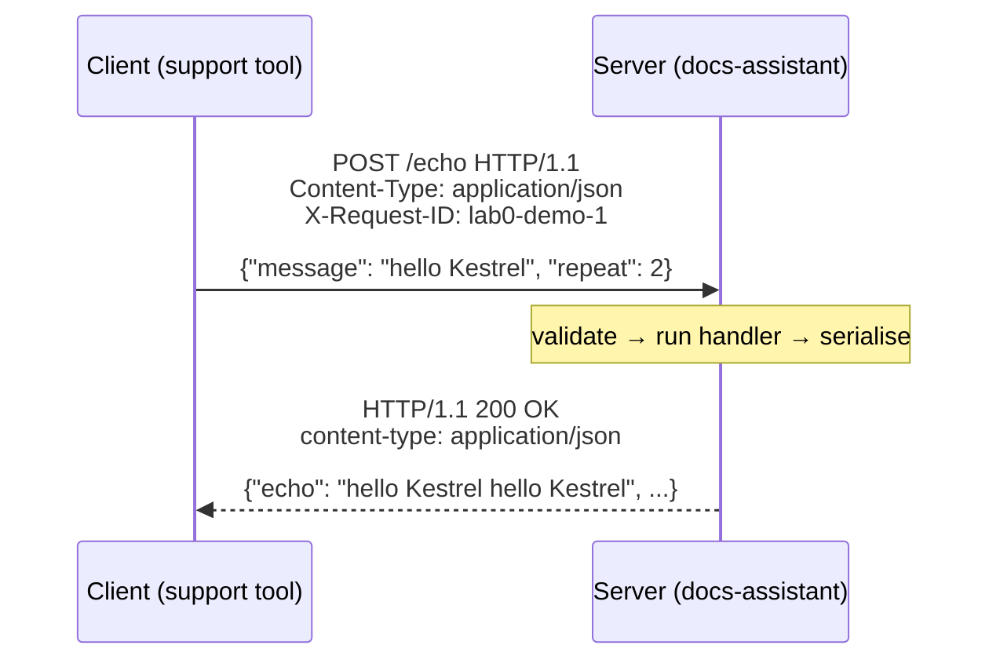
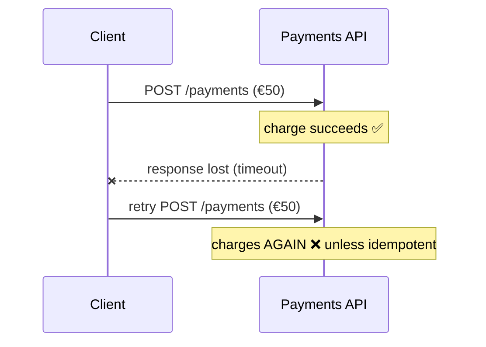
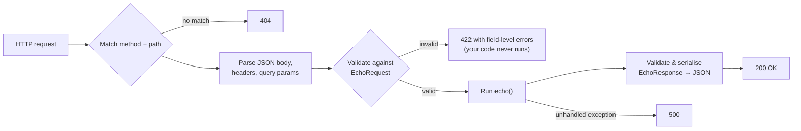

# Lesson 0.3: HTTP and APIs
<!-- id: l-0-3 -->

> ⏱ ~50 min · 🎚 Level: Core · 🧰 Needs: [Lesson 0.2](02-python-for-production.md)

[Course home](../../README.md) › [Module 0](README.md) › Lesson 0.3

## 📨 The situation

> **From: Lena (Head of Customer Support)**
> Quick question from a non-engineer: the support tool will "call the assistant's API". What does that actually mean? And yesterday the old chatbot answered "429" to my agents and then "503". Are those bad? Who do I call?

## 🎯 By the end you can

- **Describe** the anatomy of an HTTP request and response: method, path, headers, body, status code.
- **Interpret** status codes, and **say** who must act on a 4xx vs a 5xx (and on 429 and 503 in particular).
- **Explain** idempotency and why it matters for retries, payments and LLM calls.
- **Build** a minimal FastAPI service with validation and auto-generated docs, and **call** it with `curl` and `httpx`.

## 🤔 Predict first

1. A client sends a request, the network drops, and the client never sees the response. Is it safe to just send it again? <!-- id: p-0-3-1 -->
2. Which side is at fault for a `422`: the client or the server? And for a `500`? <!-- id: p-0-3-2 -->
3. What do you think FastAPI does if the JSON body is missing a required field: does your function run? <!-- id: p-0-3-3 -->

---

## 1. HTTP in one picture

Almost every service in this course talks to others over **HTTP**: the support tool calls the docs-assistant, the docs-assistant calls Ollama, your tests call your API. HTTP is a **request/response** protocol: a client sends one request, a server sends back one response.

**Analogy:** ordering at a counter. You say *what* you want to do (the method), *to what* (the path), give details (headers and body), and get back a slip with a status code and your order (the response body).



### The request

```http
POST /echo HTTP/1.1
Host: localhost:8000
Content-Type: application/json
X-Request-ID: lab0-demo-1

{"message": "hello Kestrel", "repeat": 2}
```

| Part | Example | Meaning |
|---|---|---|
| **Method** | `POST` | The kind of action |
| **Path** | `/echo` | Which resource or endpoint |
| **Query string** | `/search?q=refund&top_k=3` | Optional key/value parameters in the URL |
| **Headers** | `Content-Type`, `Authorization`, `X-Request-ID` | Metadata about the request |
| **Body** | JSON | The payload (usually for `POST`, `PUT`, `PATCH`) |

### The response

```http
HTTP/1.1 200 OK
content-type: application/json
content-length: 102

{"echo":"hello Kestrel hello Kestrel","length":27,"request_id":"lab0-demo-1"}
```

A **status code**, headers, and a body. That's it. Everything else (REST, gRPC gateways, streaming, webhooks) builds on this.

---

## 2. Methods and idempotency

| Method | Typical use | Safe (no side effects)? | Idempotent? |
|---|---|---|---|
| `GET` | Read a resource | ✅ | ✅ |
| `POST` | Create something or run an action (score, generate, charge) | ❌ | ❌ by default |
| `PUT` | Replace a resource fully | ❌ | ✅ |
| `PATCH` | Change part of a resource | ❌ | ❌ by default |
| `DELETE` | Remove a resource | ❌ | ✅ |

**Idempotent** means *doing it twice has the same effect as doing it once*. `DELETE /cards/123` twice still leaves card 123 deleted. `POST /payments` twice might charge the customer twice.

Why you care: networks fail **in the middle**. The client sends a request, the server processes it, and the response gets lost. The client can't tell "never arrived" from "done, but I didn't hear back".



The standard fix is an **idempotency key**: the client generates a unique ID per *logical* operation and sends it in a header (often `Idempotency-Key`). The server remembers the keys it has processed and returns the stored result for a repeat instead of acting again. Payment APIs such as Stripe's work this way.

> 💡 **Production tip:** Retries (Lesson 1.3) are only safe for idempotent operations. Before you add `retry=3` to any call, ask: *what happens if this runs twice?* For LLM calls the answer is usually "you pay twice and maybe get a different answer", which is acceptable for reads, but not for an agent that sends an email or moves money (Lesson 6.6).

---

## 3. Status codes: who has to act?

The first digit tells you **whose problem it is**:

| Class | Meaning | Who acts |
|---|---|---|
| **2xx** | Success | Nobody 🎉 |
| **3xx** | Redirection (look elsewhere) | The client, usually automatically |
| **4xx** | **Client error**: the request is wrong | The **caller** must change the request |
| **5xx** | **Server error**: the server failed a valid request | The **service owner** (and the caller may retry) |

The ones you will meet constantly in AI systems:

| Code | Name | Typical AI-system cause | Retry? |
|---|---|---|---|
| `200` | OK | — | — |
| `201` | Created | A new resource was created | — |
| `400` | Bad Request | Malformed input | ❌ fix the request |
| `401` | Unauthorized | Missing or invalid credentials (really "unauthenticated") | ❌ get a valid token |
| `403` | Forbidden | Authenticated, but not allowed (a customer asking for HR documents) | ❌ |
| `404` | Not Found | Wrong path or missing resource; also a model name the server doesn't have | ❌ |
| `422` | Unprocessable Content | Valid JSON that fails validation (FastAPI's default for bad input) | ❌ |
| `429` | Too Many Requests | **Rate limit**: you exceeded your quota (very common with LLM APIs) | ✅ after waiting; respect `Retry-After` |
| `500` | Internal Server Error | A bug or unhandled exception in the server | Maybe, cautiously |
| `502` / `504` | Bad Gateway / Gateway Timeout | An upstream service failed or was too slow | ✅ with backoff |
| `503` | Service Unavailable | Overloaded, starting up, or in maintenance | ✅ with backoff |

So, Lena's question: **429** means the old chatbot was sending more requests than its LLM provider allowed (the fix is on our side: rate limiting, backoff, quotas). **503** means the service itself was overloaded or down (Diego's team gets paged). Neither was the support agents' fault.

> ⚠️ **Common mistake:** returning `200 OK` with `{"error": "something went wrong"}` in the body. Monitoring, load balancers, retries and client libraries all rely on **status codes**. Hiding failures in a 200 makes your error rate look like 0% while users suffer.

---

## 4. Headers that matter in production

| Header | Purpose | Where you'll see it |
|---|---|---|
| `Content-Type: application/json` | What format the body is in | Every JSON API |
| `Authorization: Bearer <token>` | Who is calling | Lesson 5.3 (JWT) and the OpenAI-compatible adapter |
| `X-Request-ID` | Correlates logs for one request across services | Lessons 1.4 and 4.4 |
| `Retry-After` | How long to wait before retrying (on 429 and 503) | Lesson 1.3 |
| `Idempotency-Key` | Makes `POST` retries safe | Payments, agent actions |
| `Cache-Control` | Whether and how long a response can be cached | Lesson 3.5 |

The lab's `/echo` endpoint already does request-ID propagation: if the caller sends `X-Request-ID`, the server reuses it; otherwise it generates a UUID. When one user request travels through a gateway, the docs-assistant, a vector DB and an LLM, that one ID lets you find every log line it produced.

---

## 5. JSON and API contracts

Most AI service APIs exchange **JSON**. The problem with JSON is that it's *untyped*: `{"repeat": "lots"}` is perfectly valid JSON. That's why you define a **contract**, a schema stating what's allowed, and enforce it at the edge (Lesson 0.2's "validate at the edges").

With FastAPI, the contract **is** your Pydantic model:

```python
class EchoRequest(BaseModel):
    """The *contract*: FastAPI rejects bad input with 422 before your code runs."""
    message: str = Field(min_length=1, max_length=1000, examples=["hello Kestrel"])
    repeat: int = Field(default=1, ge=1, le=5)


class EchoResponse(BaseModel):
    echo: str
    length: int
    request_id: str
```

From these models FastAPI generates an **OpenAPI** document (`/openapi.json`), a machine-readable description of every endpoint. Other teams can generate clients from it, and you get interactive docs at `/docs` for free.

> 💡 **Production tip:** `max_length` isn't pedantry. Without limits, someone can send a 50 MB "message" to an endpoint that forwards it to an LLM billed per token. Input limits are a cost control and a security control (Lesson 5.1, "unbounded consumption").

---

## 6. Your first API, line by line

`src/kestrel_foundations/hello_api.py`:

```python
def create_app() -> FastAPI:
    """App factory: tests and servers each build a fresh app (pattern reused in Module 1)."""
    app = FastAPI(title="Kestrel hello API", version="0.1.0")

    @app.get("/health")
    def health() -> dict[str, str]:
        """Cheap liveness check: 'the process is up'. Load balancers call this constantly."""
        return {"status": "ok"}

    @app.post("/echo", response_model=EchoResponse)
    def echo(body: EchoRequest, x_request_id: str | None = Header(default=None)) -> EchoResponse:
        request_id = x_request_id or str(uuid.uuid4())
        text = " ".join([body.message] * body.repeat)
        return EchoResponse(echo=text, length=len(text), request_id=request_id)

    return app

app = create_app()
```

What FastAPI does for each request:



Note three habits you'll keep for the whole course:

1. **App factory** (`create_app()`): tests build a fresh app; later modules pass settings and dependencies into it.
2. **`/health` endpoint**: something cheap that answers "is the process alive?" Module 1 adds `/ready` ("can it actually serve?", e.g. is the model loaded?).
3. **Request IDs**: reused from the caller when present.

### Calling it from Python with httpx

Services call other services with an HTTP client. `hello_client.py`:

```python
def call_echo(client: httpx.Client, message: str, repeat: int = 1, request_id: str | None = None) -> dict:
    headers = {"X-Request-ID": request_id} if request_id else {}
    resp = client.post("/echo", json={"message": message, "repeat": repeat}, headers=headers)
    resp.raise_for_status()  # turn 4xx/5xx into exceptions instead of silently using bad data
    return resp.json()

with httpx.Client(base_url="http://localhost:8000", timeout=httpx.Timeout(5.0)) as client:
    call_echo(client, "hello Kestrel", 2, request_id="lab0-demo-1")
```

Two production habits hide in there:

- **Always set a timeout.** A call without a timeout can hang forever and tie up your service. httpx defaults to 5 seconds; being explicit documents your intent. (Lesson 1.3 is all about timeouts.)
- **`raise_for_status()`**: never treat an error response as data.

And a testing trick: FastAPI's `TestClient` *is* an `httpx.Client`, so the same `call_echo` helper is tested against the in-process app with no server running (`test_client_helper_against_app`).

---

## 🧪 Try it

From `modules/00-foundations/lab`, start the server in one terminal:

```bash
uv run uvicorn kestrel_foundations.hello_api:app --reload --port 8000
```

In a second terminal:

1. **Health check, showing headers:**
   ```bash
   curl -i localhost:8000/health
   ```
   **Expected:** `HTTP/1.1 200 OK`, a `content-type: application/json` header and `{"status":"ok"}`.
2. **A valid request:**
   ```bash
   curl -s -X POST localhost:8000/echo -H 'Content-Type: application/json' \
        -H 'X-Request-ID: my-first-trace' -d '{"message":"hello Kestrel","repeat":2}'
   ```
   **Expected:** `{"echo":"hello Kestrel hello Kestrel","length":27,"request_id":"my-first-trace"}`
3. **An invalid request:**
   ```bash
   curl -s -X POST localhost:8000/echo -H 'Content-Type: application/json' -d '{"message":"","repeat":9}'
   ```
   **Expected:** status 422 and a `detail` list naming both `message` and `repeat`. Your function never ran.
4. **A path that doesn't exist:** `curl -i localhost:8000/nope` → **`404 Not Found`**. A wrong method: `curl -i localhost:8000/echo` (GET instead of POST) → **`405 Method Not Allowed`**.
5. **The client:** `uv run hello-client` (expected output in the [lab README](lab/README.md#step-7--run-an-api-and-call-it)).
6. **The docs:** open **http://localhost:8000/docs**, expand `POST /echo`, click *Try it out*, and send a request from the browser. Then open **http://localhost:8000/openapi.json** and find `maxLength`.

## 🏭 In the real world

Every major LLM provider exposes an HTTP API, and many self-hosted inference servers (vLLM, Ollama and others) offer an **OpenAI-compatible** endpoint, `POST /v1/chat/completions`. That's why the lab's `OpenAICompatibleLLM` adapter can talk to OpenAI, a local vLLM server or LM Studio by changing only `base_url`. The same applies to errors: 429 from an LLM API is so routine that production clients treat rate limiting, backoff and fallback models as core features, not edge cases (Lessons 1.3 and 3.3).

## ✅ Check yourself

<details><summary>Q1. A client gets a timeout on <code>POST /payments</code>. Should it retry automatically? <!-- id: c-0-3-1 --></summary>

Only if the operation is **idempotent**, for example because the client sends an `Idempotency-Key` and the server deduplicates. Otherwise, a retry can charge twice, because the first request may have succeeded with only the response lost.

</details>

<details><summary>Q2. Your service returns 401 to one caller and 403 to another. What's the difference? <!-- id: c-0-3-2 --></summary>

**401**: the caller isn't authenticated (no token, or an invalid or expired one), so "who are you?" **403**: the caller *is* authenticated but isn't allowed to do this, so "I know who you are, and no." In Module 5, a customer requesting HR documents gets 403.

</details>

<details><summary>Q3. An LLM API returns <code>429</code> with <code>Retry-After: 20</code>. What should your client do? <!-- id: c-0-3-3 --></summary>

Wait at least 20 seconds before retrying that request (with jitter if many clients are affected), and treat sustained 429s as a capacity problem: request a higher quota, add client-side rate limiting, cache, or route some traffic to a fallback model.

</details>

<details><summary>Q4. Why does FastAPI return 422 instead of running your function with bad data? <!-- id: c-0-3-4 --></summary>

Because the request body is validated against the Pydantic model **before** the handler runs. Invalid data never enters your business logic, and the client gets field-level errors that tell them exactly what to fix.

</details>

<details><summary>Q5. Why is <code>{"error": "failed"}</code> with status 200 harmful? <!-- id: c-0-3-5 --></summary>

Monitoring, alerting, load balancers, retries and client libraries rely on status codes. A 200 makes failures invisible: dashboards show 0% errors, retries don't happen, and callers may treat the error body as valid data.

</details>

<details><summary>Q6. What is the purpose of the <code>X-Request-ID</code> header? <!-- id: c-0-3-6 --></summary>

To **correlate** everything that happened for one request across services and log lines. The first service creates it (or accepts the caller's), and every downstream call and log entry carries it. Distributed tracing (Lesson 4.4) generalises this idea.

</details>

## 💬 Explain it back
<!-- id: e-0-3 -->

Write a three-sentence reply to Lena explaining what "429" and "503" meant yesterday, who owns each, and what users would ideally see instead of an error (hint: graceful degradation, Lesson 1.3).

## 🔑 Key takeaways

- HTTP = **method + path + headers + body → status + headers + body**.
- **4xx: the caller must change something. 5xx: the server failed.** 429 and 503 are retryable *with backoff*; most 4xx are not.
- **Idempotency** decides whether a retry is safe. Use idempotency keys for actions with side effects.
- A **Pydantic model is your API contract**: validation, limits and OpenAPI docs come for free.
- Always set **timeouts**, call **`raise_for_status()`**, and propagate a **request ID**.

## 📚 Go deeper (free)

| | Resource | Why read it | Time |
|---|---|---|---|
| ⭐ | [MDN: An overview of HTTP](https://developer.mozilla.org/en-US/docs/Web/HTTP/Overview) | The clearest free introduction to HTTP | 20 min |
| 🔍 | [MDN: HTTP response status codes](https://developer.mozilla.org/en-US/docs/Web/HTTP/Status) | Reference for every status code | Reference |
| 🔍 | [FastAPI tutorial](https://fastapi.tiangolo.com/tutorial/) | Path and query params, bodies, dependencies, testing | 2–3 h |
| 🔍 | [HTTPX documentation](https://www.python-httpx.org/) | Sync and async clients, timeouts, transports | 30 min |
| 🔍 | [Stripe: Designing robust and predictable APIs with idempotency](https://stripe.com/blog/idempotency) | The canonical explanation of idempotency keys | 15 min |
| 🔍 | [RFC 9110: HTTP Semantics](https://www.rfc-editor.org/rfc/rfc9110) | The actual standard; skim methods and status codes | Reference |

---
⬅️ [Lesson 0.2: Python for production](02-python-for-production.md) · ➡️ [Lesson 0.4: Machine learning in one hour](04-ml-in-one-hour.md)
