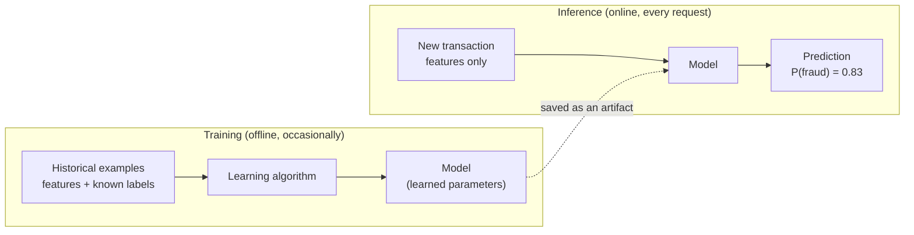
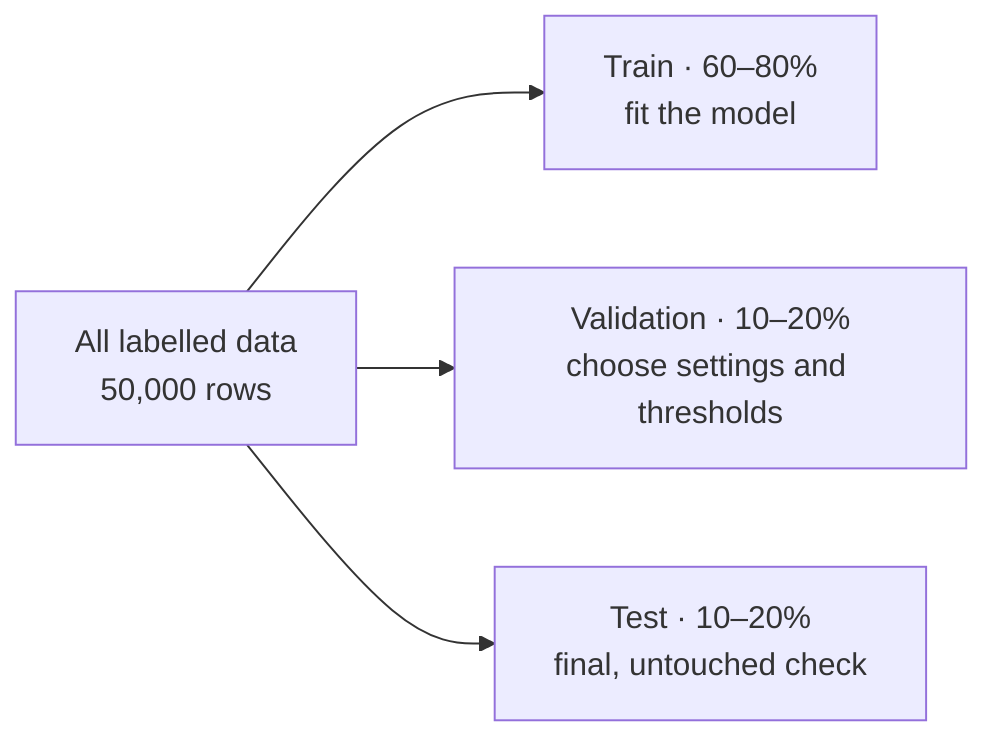
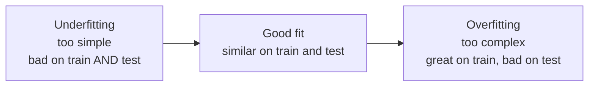
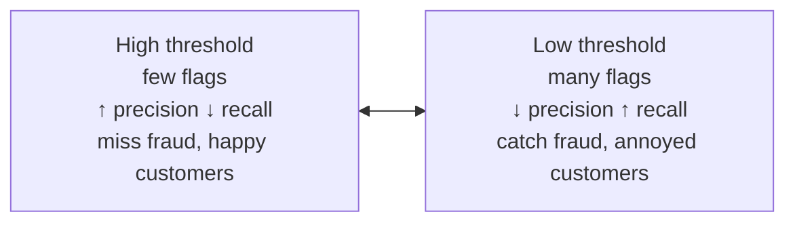

# Lesson 0.4: Machine learning in one hour

> ⏱ ~60 min · 🎚 Level: Core · 🧰 Needs: [Lesson 0.2](02-python-for-production.md)

[Course home](../../README.md) › [Module 0](README.md) › Lesson 0.4

## 📨 The situation

> **From: Omar (Risk Analyst)**
> Sam told leadership the fraud model is "98.6% accurate" and everyone was thrilled.
> But my team still reviews fraud cases by hand, and I'm not seeing fewer of them. Can you check what that number actually means before we bet the quarter on it?

## 🎯 By the end you can

- **Define** features, labels, training and inference, and **explain** what a model actually learns.
- **Split** data into train, validation and test sets, and **say** why stratification matters for rare events.
- **Recognise** overfitting from a train/test gap.
- **Demonstrate** the accuracy paradox on Kestrel's data and **read** a confusion matrix.
- **Compute** precision and recall, and **explain** how the decision threshold trades one for the other.
- **Spot** a leaky feature before it reaches production.

## 🤔 Predict first

1. 1.41% of Kestrel's transactions are fraud. What accuracy does a "model" get if it *always* answers "not fraud"?
2. A model scores 100% on the data it was trained on. Good news or bad news?
3. A column called `chargeback_filed` predicts fraud extremely well. Should you use it?

---

## 1. What machine learning actually is

Traditional software: **you write the rules.**

```python
if amount > 1000 and country_mismatch:
    flag_as_fraud()
```

Machine learning: **you provide examples, and an algorithm finds the rules.**



Vocabulary you'll use every day:

| Term | Meaning | Kestrel example |
|---|---|---|
| **Example / row** | One observation | One card transaction |
| **Feature** | An input the model can use | `amount`, `hour`, `country_mismatch`, `merchant_category` |
| **Label / target** | The answer you want to predict | `is_fraud` (0 or 1) |
| **Training** | Adjusting parameters to fit labelled examples | `model.fit(X_train, y_train)` |
| **Inference / prediction** | Using the trained model on new data | `model.predict_proba(new_txn)` |
| **Artifact** | The saved, trained model file | Module 1 versions and ships it |

This lesson only covers **supervised learning** (learning from labelled examples), which is what the fraud model is. LLMs are trained with a related idea, next-token prediction (Lesson 0.5).

### The fraud data

Generate it once (Lab 0 does this automatically):

```bash
python3 datasets/fraud/generate.py
# wrote 50,000 rows to datasets/fraud/transactions.csv  (scenario=baseline, fraud rate=1.41%)
```

Each row is a transaction with readable features (see [the data dictionary](../../datasets/fraud/README.md)). The labels come from a hidden function plus randomness, so no model can be perfect, just like real fraud.

---

## 2. Your first model: logistic regression

**Logistic regression** is the "hello world" of classification and is still widely used in risk scoring because it's fast, stable and explainable.

It computes a weighted sum of the features, then squashes it into a probability between 0 and 1 with the **sigmoid** function:

```
z = w₀ + w₁·amount + w₂·country_mismatch + w₃·device_is_new + …
P(fraud) = 1 / (1 + e^(−z))
```

Training finds the weights `w` that make the predicted probabilities match the labels as closely as possible (it minimises a **loss** called log-loss). A positive weight means "this feature pushes towards fraud".

**Analogy:** an experienced analyst who has a mental checklist with points per red flag ("+2 for a new device, +3 for a foreign country, −1 for groceries") and a sense of how many points mean "probably fraud". Training is how the analyst learns the points from past cases.

In the lab (`first_model.py`), the model is a **pipeline**: preprocessing and model in one object.

```python
def build_model() -> Pipeline:
    preprocess = ColumnTransformer([
        ("num", StandardScaler(), NUMERIC_FEATURES),                       # put numbers on a similar scale
        ("cat", OneHotEncoder(handle_unknown="ignore"), CATEGORICAL_FEATURES),  # "crypto_exchange" → 0/1 columns
    ])
    return Pipeline([("preprocess", preprocess), ("clf", LogisticRegression(max_iter=1000))])
```

> 💡 **Production tip:** Shipping preprocessing **inside** the model artifact means the serving code can't forget a step or apply a slightly different one. A mismatch between how features are computed in training and in serving is called **training/serving skew**, one of the most common ML production bugs (Lesson 1.1).

---

## 3. Train, validation, test: don't grade your own homework

If you evaluate a model on the same data it learned from, you measure **memory**, not **skill**. So you split the data:



| Set | Used for | Rule |
|---|---|---|
| **Train** | Fitting parameters | The model sees it |
| **Validation** | Comparing models, tuning settings, picking a threshold | You look at it often |
| **Test** | One final, honest estimate | Look at it **rarely**; never tune on it |

Lab 0 keeps it simple with an 80/20 train/test split. From Module 2 on you'll add a validation set and **time-based** splits (train on the past, test on the future), which is how a fraud model is actually used.

### Stratification: keep the rare class in every split

With only 1.41% fraud, a random 20% test set *could* end up with 100 frauds or 180, and every metric would wobble. `stratify=y` keeps the fraud rate the same in train and test:

```python
X_tr, X_te, y_tr, y_te = train_test_split(X, y, test_size=0.2, random_state=42, stratify=y)
```

Result on Kestrel's data: **40,000 training rows; 10,000 test rows containing 141 frauds.**

---

## 4. Overfitting: memorising instead of learning

A model **overfits** when it learns the noise and quirks of its training data instead of patterns that generalise. The symptom is a big gap between training performance and test performance.

The lab trains **decision trees** (models that ask a sequence of yes/no questions) of increasing depth. An unlimited tree can keep splitting until every training example sits in its own leaf.

```bash
uv run train-first-model --overfitting
```

```
Overfitting demo (decision trees):
 max_depth  train recall  test recall  train prec.  test prec.
         3         0.18%        0.00%      100.00%       0.00%
         6         5.13%        0.00%      100.00%       0.00%
 unlimited       100.00%        7.09%      100.00%       5.52%
```

The unlimited tree catches **100%** of training frauds and only **7%** of test frauds. It memorised. (The shallow trees have the opposite problem, **underfitting**: too simple to separate such a rare class at all.)



> ⚠️ **Common mistake:** reporting training metrics as model quality. Any number not computed on held-out data is marketing, not evaluation.

---

## 5. The accuracy paradox

Here's the answer to Omar. Run:

```bash
uv run train-first-model
```

```
model                        accuracy  precision   recall         caught false alarms
-------------------------------------------------------------------------------------
always 'not fraud'             98.59%      0.00%    0.00%      0 / 141        0
logistic regression @0.50      98.59%     50.00%    0.71%      1 / 141        1
```

**Accuracy** = correct predictions / all predictions. When 98.59% of transactions are legitimate, the laziest possible model, one that *never* flags anything, is 98.59% accurate. Sam's model has the same accuracy and catches **one fraud out of 141**. "98.6% accurate" was true and meaningless.

### The confusion matrix

Every binary prediction lands in one of four boxes:

|  | Predicted: fraud | Predicted: not fraud |
|---|---|---|
| **Actually fraud** | ✅ True positive (TP): fraud caught | ❌ **False negative (FN)**: fraud missed, money lost |
| **Actually not fraud** | ❌ **False positive (FP)**: false alarm, customer annoyed | ✅ True negative (TN) |

From the boxes come the two metrics that matter for rare events:

- **Recall** = TP / (TP + FN): *of all real frauds, how many did we catch?* (Omar's losses)
- **Precision** = TP / (TP + FP): *of everything we flagged, how much was really fraud?* (Omar's team's workload and customer friction)

For the model at 0.5: recall = 1 / 141 = **0.71%**; precision = 1 / (1 + 1) = **50%**.

---

## 6. Thresholds: the business decision hidden in `predict()`

`model.predict()` silently uses a threshold of **0.5**: flag if P(fraud) ≥ 0.5. With rare events, a reasonable model rarely gives any single transaction more than 50%, so it almost never flags anything. The model outputs a **score**; turning the score into a decision is a separate, **business** choice.

```python
def predict_with_threshold(model, X, threshold: float):
    return (model.predict_proba(X)[:, 1] >= threshold).astype(int)
```

Same trained model, different thresholds (Kestrel test set, 141 frauds):

| Threshold | Precision | Recall | Frauds caught | False alarms |
|---|---|---|---|---|
| 0.50 | 50.0% | 0.7% | 1 | 1 |
| 0.20 | 33.3% | 5.0% | 7 | 14 |
| 0.10 | 17.3% | 16.3% | 23 | 110 |
| 0.05 | 10.3% | 28.4% | 40 | 348 |
| 0.02 | 4.9% | 61.7% | 87 | 1,677 |



There is no "correct" threshold in this table. It depends on what a missed fraud costs versus what a false alarm costs (an analyst's time, a blocked customer at a supermarket checkout). Module 4 picks the threshold by **minimising expected cost**, with Omar's numbers.

> 🔎 **Under the hood:** Why is recall still modest even at low thresholds? The hidden fraud pattern includes non-linear effects (for example the *ratio* of amount to the customer's average, and night-time hours), and a plain logistic regression on raw features can only draw straight boundaries. Better features and models (gradient-boosted trees) improve this in Module 2. The *lesson* doesn't change: always look past accuracy.

---

## 7. Data leakage: the feature that's too good to be true

The dataset has a column `chargeback_filed`. Try the lab's first "Break it" experiment: add it as a feature and retrain. On Kestrel's data:

| Features | Precision | Recall | Frauds caught |
|---|---|---|---|
| Legitimate features only (@0.5) | 50.0% | 0.7% | 1 / 141 |
| **+ `chargeback_filed`** (@0.5) | 74.0% | 76.6% | 108 / 141 |

Amazing, and useless. A chargeback is filed **days or weeks after** the transaction, usually *because* it was fraud. At the moment the model must decide (the card is being swiped), that column doesn't exist yet. The model learned to read the answer key.

**Leakage** is any information in training that won't be available at prediction time. It produces models that look brilliant offline and fail in production. The question to ask about every feature: ***"Would I know this value at the exact moment I need the prediction?"*** Lesson 2.2 teaches systematic leakage detection.

> ⚠️ **Common mistake:** IDs and timestamps as features. `transaction_id` is unique per row, so a flexible model can memorise IDs, and timestamps can encode "this period had a fraud wave". The lab excludes them explicitly (`EXCLUDED` in `first_model.py`), with a comment explaining why, so the next person doesn't "helpfully" add them back.

---

## 🧪 Try it

From `modules/00-foundations/lab`:

1. `uv run train-first-model --threshold 0.1` and confirm the 0.10 row of the table above (`23 / 141` caught, `110` false alarms).
2. Pick your own threshold: `uv run train-first-model --threshold 0.03`. **Before running, predict** whether precision goes up or down compared with 0.05. (Expect lower precision and higher recall.)
3. Do the leakage experiment (Lab "Break it" #1) and match the table in section 7, then **undo it** with `git checkout -- src/`.
4. Open `tests/test_first_model.py` and read `test_accuracy_paradox`. Notice it asserts *both* "accuracy > 95%" *and* "recall == 0". That pair is the paradox, frozen into a test so nobody forgets it.

## 🏭 In the real world

Fraud, credit default, medical diagnosis, content moderation and churn are all **imbalanced** problems, so practitioners report precision, recall and PR-AUC instead of accuracy, and choose thresholds from business costs. Interpretable models such as logistic regression and scorecards remain common in regulated risk settings because each weight can be explained to auditors (Lesson 5.6). Leakage is a famous cause of models that "work" in development and fail in production, which is why reviewers ask about feature timing first.

## ✅ Check yourself

<details><summary>Q1. A model is 99% accurate on a dataset with 1% positives. What can you conclude?</summary>

Almost nothing. A constant "negative" prediction also scores 99%. You need the confusion matrix, or at least precision and recall on the positive class, ideally compared with a baseline.

</details>

<details><summary>Q2. Define precision and recall in Omar's language.</summary>

**Recall**: of all the fraud that really happened, the share we caught (missed fraud = money lost). **Precision**: of all the transactions we flagged, the share that really were fraud (low precision = wasted analyst time and annoyed customers).

</details>

<details><summary>Q3. Lowering the threshold from 0.5 to 0.1: what happens to recall, precision and the number of flags?</summary>

More transactions are flagged, so **recall goes up** (or stays the same) and **precision usually goes down**. On Kestrel's data: 1 → 23 frauds caught, 1 → 110 false alarms.

</details>

<details><summary>Q4. Train recall 100%, test recall 7%. Name the problem and two remedies.</summary>

**Overfitting.** Remedies: limit model complexity (max depth, minimum samples per leaf, regularisation), get more data, use ensembles designed to generalise (random forests, gradient boosting with early stopping), and choose settings with a validation set.

</details>

<details><summary>Q5. Why must a fraud model never use <code>chargeback_filed</code>?</summary>

It's only known **after** the label (fraud is confirmed and the customer disputes). At scoring time it doesn't exist. Training on it is **data leakage**: great offline metrics, useless in production.

</details>

<details><summary>Q6. Why do we stratify the train/test split here?</summary>

With ~1.4% positives, a random split can give a test set with noticeably more or fewer frauds, making metrics noisy and comparisons unfair. Stratifying keeps the class ratio identical in each split.

</details>

## 💬 Explain it back

Write Omar a reply (five sentences maximum) explaining what "98.6% accurate" really meant, what numbers he should ask for instead, and which decision is his to make (hint: the threshold).

## 🔑 Key takeaways

- ML learns rules from **labelled examples**; the trained model is an **artifact** you'll ship.
- Evaluate on **held-out** data; a train/test gap means **overfitting**.
- With rare events, **accuracy lies**. Use the **confusion matrix**, **precision** and **recall**, and always compare with a dumb baseline.
- The **threshold** turns scores into decisions, and choosing it is a **business** decision.
- **Leakage**: if you wouldn't know a feature at prediction time, it doesn't belong in the model.
- Put preprocessing **inside** the model pipeline to avoid training/serving skew.

## 📚 Go deeper (free)

| | Resource | Why read it | Time |
|---|---|---|---|
| ⭐ | [Google Machine Learning Crash Course](https://developers.google.com/machine-learning/crash-course) | Excellent free fundamentals; do the *Logistic regression* and *Classification* modules now | 2–4 h |
| 🔍 | [scikit-learn: Getting started](https://scikit-learn.org/stable/getting_started.html) | Estimators, pipelines and evaluation in the library you'll use | 30 min |
| 🔍 | [scikit-learn: Common pitfalls and recommended practices](https://scikit-learn.org/stable/common_pitfalls.html) | Preprocessing leakage and inconsistent preprocessing, with examples | 20 min |
| 🔍 | [Kaggle Learn: Intro to Machine Learning](https://www.kaggle.com/learn/intro-to-machine-learning) | Short, interactive notebooks; the follow-up course covers leakage | 3 h |
| 🔍 | [3Blue1Brown: Neural networks](https://www.3blue1brown.com/topics/neural-networks) | Visual intuition for how models learn by gradient descent | 1 h |

---
⬅️ [Lesson 0.3: HTTP and APIs](03-http-and-apis.md) · ➡️ [Lesson 0.5: LLMs in one hour](05-llms-in-one-hour.md)
