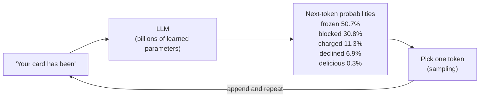
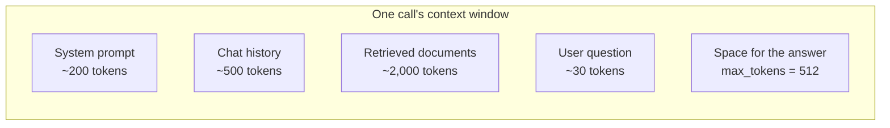
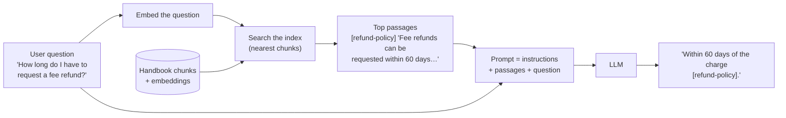
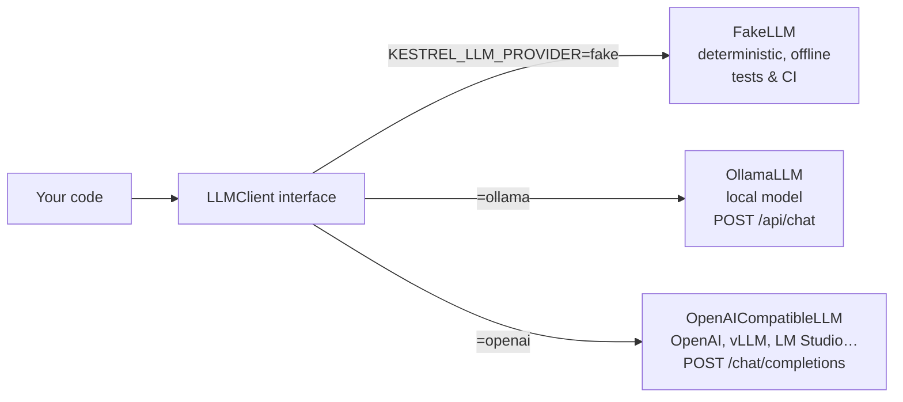

# Lesson 0.5: LLMs in one hour

> ⏱ ~60 min · 🎚 Level: Core · 🧰 Needs: [Lesson 0.3](03-http-and-apis.md)

[Course home](../../README.md) › [Module 0](README.md) › Lesson 0.5

## 📨 The situation

> **From: Lena (Head of Customer Support)**
> I tried a public chatbot for our refund questions. It answered beautifully, and invented a "90-day refund window" we don't have. 😬
> Sam says our docs-assistant "uses RAG, so it won't do that". What's RAG, why would it help, and why did the other one make things up?

## 🎯 By the end you can

- **Explain** tokens, next-token prediction and context windows, and **estimate** token counts and costs.
- **Describe** what temperature and top-p do to the output.
- **Explain** embeddings and cosine similarity, and **contrast** lexical with semantic matching using real numbers.
- **Explain** why LLMs hallucinate and how **RAG** reduces (but doesn't eliminate) it.
- **Call** an LLM through the course's provider-agnostic interface: fake, local (Ollama) or API.

## 🤔 Predict first

1. Does an LLM "look up" facts in a database when it answers?
2. If you set temperature to 0, is the output guaranteed to be correct?
3. Which costs more in a typical RAG call: the user's question, the retrieved documents, or the answer?

---

## 1. Tokens: the unit of everything

LLMs don't read characters or words. They read **tokens**: chunks of text from a fixed vocabulary (typically tens of thousands to a couple of hundred thousand entries), learned so that common strings get one token and rare strings get split into pieces.

```
"Kestrel Pay refunds card fees"  →  ["K", "est", "rel", " Pay", " ref", "unds", " card", " fees"]   (illustrative)
```

Exact splits depend on the model's tokenizer, but a useful rule of thumb for English is **~4 characters ≈ 1 token**, or **~0.75 words per token**. Other languages, code and numbers often need more tokens per word.

Tokens matter because **everything is measured in them**:

| What | Measured in tokens | Why you care |
|---|---|---|
| Price | $ per 1M input tokens and per 1M output tokens | Your bill (section 7) |
| Context window | Max tokens of input + output in one call | How many documents fit |
| Latency | Output is generated one token at a time | Long answers are slow answers |
| Rate limits | Tokens per minute | Those `429`s from Lesson 0.3 |

The lab's estimator uses the rule of thumb. It's good for back-of-envelope maths, never for billing:

```python
def estimate_tokens(text: str) -> int:
    """Rough rule of thumb for English: ~4 characters per token."""
    return max(1, round(len(text) / 4)) if text else 0
```

---

## 2. Next-token prediction: what an LLM really does

An LLM is a neural network (a **Transformer**) trained on a huge amount of text to do one thing: **given the tokens so far, predict a probability for every possible next token.**



Generating an answer is just this loop: predict, pick, append, repeat, until a stop token or `max_tokens`. That has three huge consequences:

1. **Generation is sequential.** 300 output tokens means 300 steps through the model. That's why output length drives latency, and why streaming exists (section 8).
2. **The model has no database.** Facts are stored implicitly in its parameters, as statistical patterns from training data, and it has a **training cutoff**. It knows nothing about Kestrel Pay's private refund policy.
3. **It always produces something plausible.** The objective is "likely next text", not "true next text". When the right fact isn't in the parameters or the prompt, the most *plausible-sounding* continuation can be false.

How chat models get their manners: after **pre-training** on broad text, models are **post-trained** (fine-tuned on instruction/answer examples and refined with human or automated feedback) to follow instructions, use the chat format and refuse some requests. Lesson 2.7 covers when *you* should fine-tune.

### Messages: how chat is fed to the model

APIs accept a list of **messages** with roles, which the server formats into one token sequence:

```python
messages = [
    Message("system", "You are a concise assistant for Kestrel Pay employees. Answer in at most two sentences."),
    Message("user", "What is a card chargeback?"),
]
```

- **system**: instructions and rules (the "job description").
- **user**: what the person asked.
- **assistant**: the model's previous replies (for multi-turn conversations).

> ⚠️ **Common mistake:** believing the system prompt is a security boundary. It's just more tokens. Users (and documents!) can include text that tries to override it. That's **prompt injection**, and Module 5 spends two lessons on it. (There is already one planted in `datasets/handbook/partner-faq.md`.)

---

## 3. Temperature and top-p: controlling randomness

The model outputs probabilities; **sampling** chooses the token. Take the `"Your card has been"` example with some made-up raw scores (logits) and see what **temperature** does:

| Next token | T = 0.2 (focused) | T = 1.0 (as trained) | T = 1.5 (creative) |
|---|---|---|---|
| frozen | **92.4%** | 50.7% | 42.0% |
| blocked | 7.6% | 30.8% | 30.1% |
| charged | 0.1% | 11.3% | 15.4% |
| declined | 0.0% | 6.9% | 11.1% |
| delicious | 0.0% | 0.3% | 1.5% |

Temperature divides the scores before converting them to probabilities. **Low temperature sharpens** the distribution towards the top choice; **high temperature flattens** it, so unlikely (sometimes absurd) tokens get picked more often. **T = 0** means "always pick the most likely token" (greedy decoding).

**Top-p** (nucleus sampling) is a second filter: keep only the smallest set of tokens whose probabilities add up to *p*, and sample among those. With T = 1.0 and top-p = 0.9: frozen (50.7%) + blocked (30.8%) + charged (11.3%) = 92.8% ≥ 90%, so "declined" and "delicious" are never chosen.

| Use case | Typical setting | Why |
|---|---|---|
| Extraction, classification, RAG answers, tool calls | Temperature 0–0.3 | You want consistency and fidelity to the context |
| Drafting, brainstorming, marketing copy | 0.7–1.0 | Variety is a feature |

> ⚠️ **Common mistake:** "temperature 0 makes it correct" or "temperature 0 makes it fully deterministic". It makes the output *less random*, not *true*: a confidently wrong top token is still wrong. And many hosted APIs don't guarantee bit-identical outputs even at temperature 0 (batching and hardware effects). For tests, use the fake LLM; for quality, use evaluations (Module 4).

---

## 4. Context windows

The **context window** is the maximum number of tokens the model can process in one call, input and output combined. Modern models range from a few thousand to over a million tokens.



Bigger windows aren't free:

- **Cost**: you pay for every input token on every call.
- **Latency**: more input means a longer wait before the first output token (prefill, Lesson 3.2).
- **Quality**: models can miss information buried in the middle of long contexts (*"lost in the middle"*, Lesson 2.5).

So "just paste the whole handbook into every prompt" works for a demo with 14 documents and fails for 140,000. Selecting the *right* few passages is the job of retrieval.

---

## 5. Embeddings: meaning as coordinates

An **embedding** is a list of numbers (a vector) representing a piece of text, produced by a model trained so that **texts with similar meaning get vectors that point in similar directions**.

**Analogy:** a map where every sentence is a city. "Freeze my card" and "block my card" are neighbouring towns; "how many vacation days do I get" is on another continent. Search becomes "find the nearest cities to my question".

We measure "pointing in a similar direction" with **cosine similarity**:

```
cos(θ) = (a · b) / (|a| · |b|)      1 = same direction · 0 = unrelated · −1 = opposite
```

```python
def cosine(a, b) -> float:
    dot = sum(x * y for x, y in zip(a, b))
    na = math.sqrt(sum(x * x for x in a))
    nb = math.sqrt(sum(y * y for y in b))
    return dot / (na * nb) if na and nb else 0.0
```

### Lexical vs semantic: real numbers from the lab

The lab has two embedders. **Hash embeddings** (the default) hash each word into one of 1,024 buckets. They're instant, deterministic and download nothing, but they only "see" **shared words**. **`all-MiniLM-L6-v2`** (an optional extra) is a small trained embedding model that captures **meaning**.

| Pair | Hash (lexical) | MiniLM (semantic) |
|---|---|---|
| "freeze my card" vs "block my card" | 0.333 | 0.672 |
| "freeze my card" vs "how many vacation days do I get" | 0.000 | 0.061 |
| "refund a fee" vs "get my money back for a charge" | **0.000** | **0.719** |

And searching the handbook for *"Can I get my money back for a fee?"*:

| Rank | Hash embeddings | MiniLM |
|---|---|---|
| 1 | ❌ [partner-faq] "How do partners get support?" (matched the word *get*) | ✅ [refund-policy] "Fee refunds can be requested within 60 days of the charge." |
| 2 | ❌ [performance-review-process] … | ✅ [refund-policy] "How to request a refund" |
| 3 | ✅ [refund-policy] "Fee refunds can be requested within 60 days…" | ✅ [refund-policy] "Kestrel Pay customers can request a refund…" |

Lexical matching isn't useless, though: it's excellent for exact identifiers, product codes and rare names ("SEV2", "T+2", "Premium plan") that semantic models can blur. That's why production search **combines both** (hybrid retrieval, Lesson 2.5).

> 💡 **Production tip:** An embedding is only comparable with embeddings from the **same model**. Change the embedding model and you must re-embed the whole corpus. Treat the embedding model's name and version as part of your index's identity.

---

## 6. Hallucination and why RAG exists

A **hallucination** is fluent, confident output that is false or unsupported. Lena's "90-day refund window" is a textbook case: the public chatbot had never seen Kestrel's policy, so it produced a plausible number.

**Retrieval-Augmented Generation (RAG)** fixes the *missing knowledge* part: at question time, retrieve the relevant passages from your own documents and put them in the prompt, with instructions to answer **only** from them and to cite sources.



| Without RAG | With RAG |
|---|---|
| Answers from training data (old, public, generic) | Answers from *your* current documents |
| Can't cite sources | Can cite the exact document |
| Update knowledge = retrain or fine-tune | Update knowledge = re-index a document |
| Can't respect per-user permissions | Can filter retrieval by who is asking (Lesson 5.3) |

**What RAG does *not* guarantee:** if retrieval returns the wrong passage, the model will confidently answer from the wrong passage. If the right passage is missing, the model may still guess. A malicious passage can inject instructions. That's why Modules 2, 4 and 5 cover retrieval quality, faithfulness evaluation and guardrails. RAG reduces hallucination; it doesn't abolish it.

For the record: RAG was introduced under that name by Lewis et al. in 2020 ([arXiv:2005.11401](https://arxiv.org/abs/2005.11401)).

---

## 7. Cost: back-of-envelope maths

Providers charge **per million tokens**, with **output tokens usually priced several times higher than input tokens**. The formula:

```
cost per call = input_tokens / 1,000,000 × input_price  +  output_tokens / 1,000,000 × output_price
```

The lab's `first-llm-call` uses two **illustrative** price points (not current list prices, which change frequently; always check the provider's pricing page): a *small hosted model* at $0.15 in / $0.60 out per 1M tokens, and a *large hosted model* at $2.50 in / $10.00 out.

| Scenario (per call) | Input tokens | Output tokens | Small model, per 1M calls | Large model, per 1M calls |
|---|---|---|---|---|
| Tiny Q&A (the lab's call) | 28 | 36 | ~$26 | ~$430 |
| **Typical RAG answer** | 2,000 | 300 | **~$480** | **~$8,000** |

Two lessons hide in that table:

1. In RAG, **input tokens (the retrieved context) usually dominate cost**. Retrieving five tight passages instead of fifteen loose ones is a cost optimisation as much as a quality one.
2. **Model choice is a ~15× cost lever.** Routing easy questions to a small model and hard ones to a large model (Lesson 3.3), and caching repeated questions (Lesson 3.5), are standard production moves.

> 💡 **Production tip:** Self-hosting (Ollama, vLLM) replaces per-token prices with **per-hour hardware** costs. It's cheaper only above a certain, steady volume. Lesson 3.3 does that break-even maths properly.

---

## 8. Your first LLM call through one interface

Every lab uses the same small interface, so application code never cares which provider is behind it:

```python
class LLMClient(Protocol):
    async def complete(self, messages: list[Message], *, temperature: float = 0.0,
                       max_tokens: int = 512) -> Completion: ...
    def stream(self, messages: list[Message], *, temperature: float = 0.0,
               max_tokens: int = 512) -> AsyncIterator[str]: ...
```



```bash
uv run first-llm-call                                   # fake
uv run first-llm-call --provider ollama                 # local
uv run first-llm-call --provider ollama --stream        # token by token
```

**Streaming** sends tokens as they're generated. Total time is about the same, but the user sees the first words almost immediately. Two latency numbers matter for every LLM product:

- **Time to first token (TTFT)**: how long until something appears (dominated by reading the input, *prefill*).
- **Total time**: grows with the number of output tokens (*decode*).

You'll measure both properly in Lesson 3.4.

---

## 🧪 Try it

From `modules/00-foundations/lab`:

1. **Fake call and cost:** `uv run first-llm-call` and check the two cost lines (≈ $25.80 and $430.00 per million calls).
2. **Lexical vs semantic:** `uv run embeddings-playground --query "Can I get my money back for a fee?"` and find the result that only matched because of the word "get". If you can spare the download, repeat with `--semantic` (see [lab Step 8](lab/README.md#step-8--search-the-handbook-with-embeddings)).
3. **Your own pair:** `uv run python -c "from kestrel_foundations.embeddings import hash_embed, cosine; print(cosine(hash_embed('lost card'), hash_embed('stolen card')))"`. **Predict** first: above or below 0.5? (Shared words: "card" only.)
4. **Local model** (needs Ollama):
   ```bash
   uv run first-llm-call --provider ollama --prompt "What is Kestrel Pay's fee refund window?"
   ```
   The model has never seen Kestrel's handbook. Does it admit it doesn't know, or does it invent a number? Either way, you've just reproduced Lena's problem. Module 2 fixes it with RAG.
5. **Temperature:** run `uv run first-llm-call --provider ollama --temperature 1.2 --prompt "Name a bird."` three times, then three times with `--temperature 0`. Compare the variety.

## 🏭 In the real world

Production LLM applications are rarely "just a prompt". They combine retrieval (to ground answers in private, current data), an abstraction over providers (to swap models for cost, quality or availability), streaming (for perceived speed), low temperatures for factual tasks, and evaluation suites that measure faithfulness instead of trusting fluent text. Many inference servers expose OpenAI-compatible endpoints precisely so that applications can switch between hosted and self-hosted models with a configuration change.

## ✅ Check yourself

<details><summary>Q1. Why do LLMs hallucinate?</summary>

They are trained to produce **likely** continuations, not **verified** facts, and they have no lookup step. When the needed information isn't in their parameters or prompt (private data, post-cutoff events, rare facts), the most plausible-sounding continuation can be false, and it's delivered with the same fluency as a correct one.

</details>

<details><summary>Q2. In one sentence each: what do temperature and top-p do?</summary>

**Temperature** reshapes the next-token distribution (low = sharper, more predictable; high = flatter, more varied). **Top-p** restricts sampling to the smallest set of tokens whose cumulative probability reaches *p*, cutting off the unlikely tail.

</details>

<details><summary>Q3. Hash embeddings score "refund a fee" vs "get my money back for a charge" at 0.000; MiniLM gives 0.719. Explain.</summary>

Hash embeddings only capture **shared words** (and random collisions); the two phrases share no content words. MiniLM was trained so that **paraphrases** map to nearby vectors, so it captures that both are about getting money back.

</details>

<details><summary>Q4. A RAG call has 2,000 input tokens and 300 output tokens. Which part probably costs more, and what's one way to reduce it?</summary>

With typical prices (output ~4× input per token), input costs ~2,000 units and output ~1,200, so **input** usually dominates. Retrieve fewer, more relevant chunks; shorten the system prompt; cache repeated questions; or use a cheaper model for easy questions.

</details>

<details><summary>Q5. Does RAG eliminate hallucinations?</summary>

No. It grounds the model in retrieved text, but wrong or missing retrieval, contradictory documents, or a model ignoring the context can still produce unsupported answers. You measure **faithfulness** and **answer correctness** (Lesson 4.3) and add groundedness checks (Lesson 5.5).

</details>

<details><summary>Q6. Why is streaming useful if the total generation time doesn't change?</summary>

It improves **perceived latency**: the user starts reading after the **time to first token** instead of waiting for the whole answer. It also lets clients cancel early, saving tokens.

</details>

## 💬 Explain it back

Answer Lena in five sentences: why the public chatbot invented a 90-day window, what RAG changes, and one thing RAG still can't guarantee.

## 🔑 Key takeaways

- LLMs predict the **next token**, one at a time. Tokens drive **cost, latency, limits and context size**.
- **Temperature/top-p** control randomness, not truth.
- **Embeddings** turn text into vectors; **cosine similarity** measures closeness. Lexical matching sees words; semantic embeddings see meaning. Production combines both.
- LLMs **hallucinate** because they optimise plausibility. **RAG** grounds answers in your documents and enables citations and permissions, but must be evaluated.
- In RAG, **input context usually dominates cost**; model choice is a big cost lever.
- Code against **one LLM interface** (fake, local, API), so providers are a config change.

## 📚 Go deeper (free)

| | Resource | Why read it | Time |
|---|---|---|---|
| ⭐ | [Andrej Karpathy's YouTube channel](https://www.youtube.com/@AndrejKarpathy): *Deep Dive into LLMs like ChatGPT* | The best free end-to-end explanation of how LLMs are built and behave | 3.5 h (worth it) |
| 🔍 | [The Illustrated Transformer (Jay Alammar)](https://jalammar.github.io/illustrated-transformer/) | Visual intuition for the architecture | 45 min |
| 🔍 | [Hugging Face LLM Course](https://huggingface.co/learn/llm-course) | Tokenizers, Transformers, fine-tuning, hands-on and free | 4–10 h |
| 🔍 | [Sentence-Transformers documentation](https://www.sbert.net/) | Embedding models, semantic search, rerankers | 30 min |
| 🔍 | [Lewis et al., Retrieval-Augmented Generation (2020)](https://arxiv.org/abs/2005.11401) | The paper that named RAG | 45 min |
| 🔍 | [Holtzman et al., The Curious Case of Neural Text Degeneration (2019)](https://arxiv.org/abs/1904.09751) | Where top-p (nucleus) sampling comes from | 40 min |
| 🔍 | [Ollama API reference](https://github.com/ollama/ollama/blob/main/docs/api.md) | The exact HTTP API the lab's `OllamaLLM` calls | 15 min |

---
⬅️ [Lesson 0.4: Machine learning in one hour](04-ml-in-one-hour.md) · ➡️ [Lab 0](lab/README.md)
