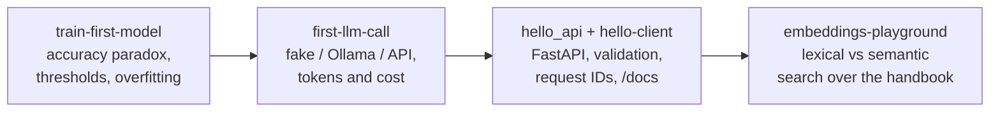

# Module 0 · Foundations

> ⏱ ~6 h (5 lessons × ~1 h + a 2 h lab) · 🎚 Beginner-friendly · 🧰 Needs: basic Python, a laptop

[Course home](../../README.md) › Module 0

## 🧭 Where you are

```mermaid
flowchart LR
    M0["0 · Foundations<br/>📍 YOU ARE HERE"]
    M1["1 · Prototype → Production"]
    M2["2 · Data & Model Pipelines"]
    M3["3 · Serving & Optimization"]
    M4["4 · Evaluation & Monitoring"]
    M5["5 · Security & Governance"]
    M6["6 · Scaling & Operations"]
    C["🏆 Capstone"]
    M0 --> M1 --> M2 --> M3 --> M4 --> M5 --> M6 --> C
    classDef here fill:#ffd166,stroke:#b8860b,stroke-width:3px,color:#000
    class M0 here
```

## 📨 The story so far

> 📨 **From: Maya (Engineering Manager)**
> Welcome to Kestrel Pay! 🎉 Your first week is about foundations: get your machine set up the way our CI and production are, and make sure the basics are solid.
> By Friday I'd like you to be able to explain, in plain words, what our fraud model's numbers mean, what an LLM actually does, and how two services talk over HTTP.
> Diego, Sam, Omar and Lena will each send you a question this week. Answering them *is* the onboarding.

This module is the on-ramp. If you already ship Python services and know ML and LLM basics, skim the lessons, take the [quiz](quiz.md), do the [lab](lab/README.md), and move on.

## 🎯 Module objectives

By the end of Module 0 you can:

1. **Reproduce** a Python environment exactly with uv, Git and Docker, and run models locally with Ollama.
2. **Structure** Python code as a testable project: config from the environment, validation at the edges, async I/O.
3. **Build and call** an HTTP API, and **interpret** status codes, headers and idempotency.
4. **Train and evaluate** a classifier honestly: splits, baselines, precision/recall, thresholds, overfitting, leakage.
5. **Explain** tokens, sampling, embeddings, context windows, hallucination, RAG and LLM cost, and **call** an LLM through a provider-agnostic interface.

## 📖 Lessons

| # | Lesson | You'll learn | ⏱ |
|---|---|---|---|
| 0.1 | [Set up your workbench](01-setup-your-workbench.md) | uv, Git, Docker, Ollama, WSL2; why each exists; verify with the checker | 60 min |
| 0.2 | [Python for production](02-python-for-production.md) | pyproject + lock files, type hints, dataclasses vs Pydantic, settings and secrets, pytest, logging, async | 60 min |
| 0.3 | [HTTP and APIs](03-http-and-apis.md) | Requests and responses, methods, idempotency, status codes (429, 503…), FastAPI, httpx | 50 min |
| 0.4 | [Machine learning in one hour](04-ml-in-one-hour.md) | Features and labels, splits, overfitting, the accuracy paradox, precision/recall, thresholds, leakage | 60 min |
| 0.5 | [LLMs in one hour](05-llms-in-one-hour.md) | Tokens, next-token prediction, temperature/top-p, embeddings, hallucination, RAG, cost | 60 min |
| 🛠 | [Lab 0](lab/README.md) | Your first model, your first LLM call, your first API, your first semantic search | 2 h |
| ✅ | [Module quiz](quiz.md) | 12 questions | 20 min |
| 📄 | [Cheat sheet](cheatsheet.md) | One page to review before Module 1 | 5 min |

**Suggested order:** 0.1 → 0.2 → 0.3 → 0.4 → 0.5 → Lab → Quiz. Each lesson's 🧪 *Try it* section uses the lab code, so keep a terminal open in `modules/00-foundations/lab`.

## 🛠 Lab 0: your first model, your first LLM call, your first API

You'll run each moving part of an AI system once, end to end:

### ✅ Definition of Done

- [ ] `python3 tools/check_setup.py` passes (Ollama optional)
- [ ] `cd modules/00-foundations/lab && uv sync && uv run pytest` shows **33 passed**
- [ ] You can explain why the "98.59% accurate" model is useless, using the confusion matrix
- [ ] You compared two thresholds and can describe the precision/recall trade-off
- [ ] You called the API with `curl`, saw a `422`, and opened `/docs`
- [ ] You ran the embeddings playground and can explain lexical vs semantic similarity
- [ ] You did at least two 💥 *Break it* experiments and one 🚀 *Extend it* exercise
- [ ] Your work is committed to your fork

## 📊 Self-assessment

Rate yourself before and after the module. **Aim for 3+ on everything before starting Module 1.**

| Skill | 1 · Never heard of it | 2 · Heard of it | 3 · Can do it with notes | 4 · Could teach it |
|---|---|---|---|---|
| Reproducible Python env (uv, lock files) | | | | |
| Config and secrets via environment variables | | | | |
| Pydantic validation at boundaries | | | | |
| Writing pytest tests with fakes | | | | |
| async vs blocking I/O | | | | |
| HTTP status codes and idempotency | | | | |
| Building a FastAPI endpoint | | | | |
| Train/test splits and overfitting | | | | |
| Precision, recall and thresholds | | | | |
| Data leakage | | | | |
| Tokens, sampling and context windows | | | | |
| Embeddings and cosine similarity | | | | |
| What RAG solves and doesn't | | | | |

## 🎤 Interview corner

Module 0 topics show up as warm-up questions in ML and AI engineering interviews. Practise answering each one aloud in two minutes:

1. *"Your fraud model is 99% accurate. Is it good?"* Talk about base rates, the confusion matrix, precision/recall, and who chooses the threshold.
2. *"How would you make sure a model trained in a notebook behaves the same in production?"* Talk about lock files, containers, pipelines that include preprocessing, and training/serving skew.
3. *"When does async help a Python web service, and when doesn't it?"* Talk about I/O-bound vs CPU-bound work and blocking calls inside the event loop.
4. *"Why do LLMs hallucinate, and how do you reduce it in a product?"* Talk about next-token prediction, RAG, low temperature for factual tasks, citations, and evaluation of faithfulness.
5. *"A client retries a POST after a timeout. What can go wrong and how do you design for it?"* Talk about idempotency keys and deduplication.

## 📚 Module resources

The best free resources for this module, in priority order (each lesson has its own list):

1. ⭐ [The Missing Semester of Your CS Education (MIT)](https://missing.csail.mit.edu/): shell, Git, tooling
2. ⭐ [Google Machine Learning Crash Course](https://developers.google.com/machine-learning/crash-course): ML fundamentals
3. ⭐ [FastAPI: Concurrency and async / await](https://fastapi.tiangolo.com/async/): async for web services
4. ⭐ [MDN: An overview of HTTP](https://developer.mozilla.org/en-US/docs/Web/HTTP/Overview): HTTP fundamentals
5. ⭐ [Andrej Karpathy's YouTube channel](https://www.youtube.com/@AndrejKarpathy): *Deep Dive into LLMs like ChatGPT*

---
⬅️ [Course home](../../README.md) · ➡️ [Lesson 0.1: Set up your workbench](01-setup-your-workbench.md)
