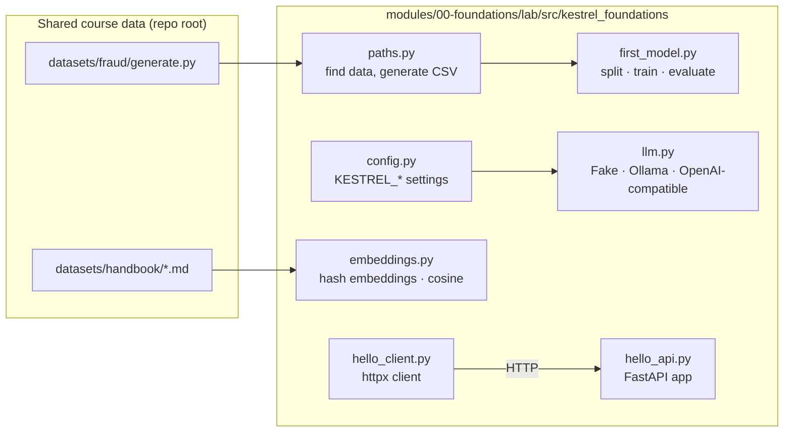

# 🛠 Lab 0: Your first model, your first LLM call, your first API

> ⏱ ~2 h · 🎚 Beginner · 🧰 Needs: [Lesson 0.1](../01-setup-your-workbench.md) done (`python3 tools/check_setup.py` all green)

[Course home](../../../README.md) › [Module 0](../README.md) › Lab 0

> **From: Maya (Engineering Manager)**
> Before you touch Sam's prototypes, I want you to have run each moving part yourself, once, end to end:
> a model trained on our transaction data, a call to an LLM, an API answering over HTTP, and a similarity search over the handbook.
> Nothing fancy. Just make sure you understand every line. Everything after this builds on it.

## 🎯 Goals

By the end of this lab you will have:

1. Trained a fraud model and **seen the accuracy paradox with your own numbers**.
2. Called an LLM through a **provider-agnostic interface** (fake model, local model or API).
3. Run an HTTP API with **validation, a health check and auto-generated docs**, and called it with `curl` and `httpx`.
4. Searched the handbook with **embeddings and cosine similarity**, and seen why word overlap is not meaning.

## 🗺 What's in the box



| File | What it teaches | Lesson |
|---|---|---|
| `paths.py` | Resolving paths from an anchor or env var instead of hard-coding them | 0.2 |
| `config.py` | Settings from environment variables with `pydantic-settings`; `SecretStr` | 0.2 |
| `hello_api.py`, `hello_client.py` | HTTP, validation, status codes, request IDs, OpenAPI | 0.3 |
| `first_model.py`, `train_first_model.py` | Features, splits, pipelines, baselines, thresholds, overfitting | 0.4 |
| `llm.py`, `first_llm_call.py` | One interface for many LLM providers, tokens, streaming, cost | 0.5 |
| `embeddings.py`, `embeddings_playground.py` | Embeddings, cosine similarity, brute-force search | 0.5 |
| `tests/` | How each piece is tested **without network or API keys** | 0.2 |

## 📋 Steps

All commands run from this folder:

```bash
cd modules/00-foundations/lab
```

### Step 1: Install and run the tests

```bash
uv sync
uv run pytest
```

**Expected output** (timing varies):

```
.................................                                        [100%]
33 passed in 3.8s
```

`uv sync` reads `pyproject.toml` and `uv.lock`, creates `.venv/` with Python 3.12 (downloading it if needed) and installs exact versions. If any test fails here, your setup is wrong, not your code: go back to [Lesson 0.1](../01-setup-your-workbench.md).

### Step 2: Train your first model

```bash
uv run train-first-model
```

The first run generates `datasets/fraud/transactions.csv` (50,000 rows) using the shared generator. **Expected output:**

```
Loaded 50,000 transactions from transactions.csv; fraud rate = 1.41%
Train: 40,000 rows · Test: 10,000 rows (141 frauds)

model                        accuracy  precision   recall         caught false alarms
-------------------------------------------------------------------------------------
always 'not fraud'             98.59%      0.00%    0.00%      0 / 141        0
logistic regression @0.50      98.59%     50.00%    0.71%      1 / 141        1
```

Stop and look at it. A model that **never** predicts fraud has 98.59% accuracy. The trained model has exactly the same accuracy and catches **one** fraud out of 141. Accuracy is the wrong question for rare events ([Lesson 0.4](../04-ml-in-one-hour.md)).

### Step 3: Move the threshold

```bash
uv run train-first-model --threshold 0.1
```

**Expected extra line:**

```
logistic regression @0.10      97.72%     17.29%   16.31%     23 / 141      110
```

Same model, different decision rule: it now catches 23 frauds and raises 110 false alarms. Accuracy went **down** while the model became more useful. Who decides whether 110 false alarms is acceptable? Omar (Risk), not you. Module 4 turns this into a cost-based decision.

### Step 4: Watch a model overfit

```bash
uv run train-first-model --overfitting
```

**Expected extra block:**

```
Overfitting demo (decision trees):
 max_depth  train recall  test recall  train prec.  test prec.
         3         0.18%        0.00%      100.00%       0.00%
         6         5.13%        0.00%      100.00%       0.00%
 unlimited       100.00%        7.09%      100.00%       5.52%
```

The unlimited tree catches **100%** of training frauds and **7%** of test frauds. It memorised the training data. Your test set exists to catch exactly this.

### Step 5: Your first LLM call (no network)

```bash
uv run first-llm-call
```

**Expected output:**

```
assistant> [fake-llm:7a3f00ca] You asked: "What is a card chargeback?". A real model would answer here. Set KESTREL_LLM_PROVIDER=ollama to use a local model.

model=fake-llm-v1  prompt_tokens=28  completion_tokens=36  latency=0 ms

What would 1,000,000 calls like this cost? (illustrative prices)
  small hosted model   $     25.80
  large hosted model   $    430.00
```

The fake model doesn't understand anything, and that's the point: it is **deterministic**, so tests built on it never flake. The cost table uses *illustrative* prices to show the maths; real prices change, so check the provider's pricing page.

### Step 6: A real model, locally (optional, needs Ollama)

```bash
ollama pull qwen2.5:1.5b-instruct     # ~1 GB, once
uv run first-llm-call --provider ollama
uv run first-llm-call --provider ollama --stream
KESTREL_LLM_PROVIDER=ollama uv run first-llm-call --prompt "Explain a chargeback to a 10-year-old."
```

**Expected:** a real two-sentence answer, real token counts from Ollama, and (with `--stream`) words appearing one by one followed by `time to first token: … ms`. The first call is slower because Ollama loads the model into memory. Your exact text and timings will differ.

> No Ollama? Skip this step. Everything else in the course works with the fake model.

### Step 7: Run an API and call it

Terminal 1:

```bash
uv run uvicorn kestrel_foundations.hello_api:app --reload --port 8000
```

Terminal 2:

```bash
uv run hello-client
```

**Expected output:**

```
GET /health -> {'status': 'ok'}
POST /echo  -> {'echo': 'hello Kestrel hello Kestrel', 'length': 27, 'request_id': 'lab0-demo-1'}
POST /echo with bad input -> 422
   body.message: String should have at least 1 character
   body.repeat: Input should be less than or equal to 5
```

Then try it with raw `curl`, and open **http://localhost:8000/docs** in your browser to see the interactive documentation FastAPI generated from your code:

```bash
curl -i -X POST localhost:8000/echo -H 'Content-Type: application/json' -d '{"message":"hello Kestrel","repeat":2}'
```

```
HTTP/1.1 200 OK
content-type: application/json
...
{"echo":"hello Kestrel hello Kestrel","length":27,"request_id":"7a76e977-..."}
```

### Step 8: Search the handbook with embeddings

```bash
uv run embeddings-playground
uv run embeddings-playground --query "Can I get my money back for a fee?"
```

**Expected output (second command):**

```
Embedder: hash embeddings (1024 dims)

Pairwise similarity:
  +0.333  'freeze my card'  vs  'block my card'
  +0.000  'freeze my card'  vs  'how many vacation days do I get'
  +0.000  'refund a fee'  vs  'get my money back for a charge'

Searching 95 handbook sentences for: 'Can I get my money back for a fee?'
  +0.169  [partner-faq] How do partners get support?
  +0.114  [performance-review-process] Reviews happen twice a year, in March and September.
  +0.105  [refund-policy] Fee refunds can be requested within 60 days of the charge.
```

The top hit matched the word **"get"**. Hash embeddings only see shared words (plus random hash collisions), so "refund a fee" and "get my money back for a charge" score **0.000**.

**Optional: real semantic embeddings** (downloads PyTorch and a ~90 MB model):

```bash
uv sync --extra semantic
uv run embeddings-playground --semantic --query "Can I get my money back for a fee?"
uv sync          # go back to the light environment afterwards
```

Observed on a laptop with `all-MiniLM-L6-v2`:

```
  +0.672  'freeze my card'  vs  'block my card'
  +0.061  'freeze my card'  vs  'how many vacation days do I get'
  +0.719  'refund a fee'  vs  'get my money back for a charge'

  +0.640  [refund-policy] Fee refunds can be requested within 60 days of the charge.
  +0.569  [refund-policy] How to request a refund
  +0.541  [refund-policy] Kestrel Pay customers can request a refund for card fees and account fees charged by Kestrel Pay.
```

Same query, three correct hits. That gap between *lexical* and *semantic* matching is why Module 2 combines both (hybrid retrieval).

## 💥 Break it

Each experiment teaches something. Predict the result, run it, then undo the change (`git checkout -- .`).

1. **Leak the label.** In `first_model.py`, add `"chargeback_filed"` to `NUMERIC_FEATURES` and run `uv run train-first-model`. Recall jumps dramatically. Why is this model useless in production? *(Hint: when is `chargeback_filed` known?)*
2. **Remove stratification.** Delete `stratify=y` in `split()` and run the tests several times with different `seed` values in `split(df, seed=...)`. How much does the number of frauds in the test set move?
3. **Use `hash()` instead of `hashlib`.** In `embeddings.py`, replace the body of `_bucket` with `h = hash(feature) & ((1 << 64) - 1)` and keep the rest. Run `uv run python -c "from kestrel_foundations.embeddings import hash_embed; print(hash_embed('card')[:5])"` twice. Why did the vector change between runs?
4. **Send garbage to the API.** `curl -X POST localhost:8000/echo -H 'Content-Type: application/json' -d '{"message": 42}'`. What status code do you get, and which line of *your* code ran? (Answer: none of it.)
5. **Point Ollama at the wrong port.** `KESTREL_OLLAMA_BASE_URL=http://localhost:9999 uv run first-llm-call --provider ollama`. Read the exception. In Module 1 you'll turn this crash into a timeout, a retry and a graceful fallback.


## 🚀 Extend it

Try these on your own first. Each has hints and a reference solution.

### Extension 1: Add a `/stats` endpoint with validation

Add `POST /stats` to `hello_api.py`. It takes `{"text": "..."}` (1–10,000 chars) and returns the number of characters, words and *estimated tokens* (reuse `estimate_tokens` from `llm.py`). Add a test.

<details><summary>💡 Hint</summary>

Create a new Pydantic request model with `Field(min_length=1, max_length=10_000)`, import `estimate_tokens`, and copy the shape of `test_echo_repeats_and_propagates_request_id`.

</details>

<details><summary>✅ Solution</summary>

```python
# hello_api.py, inside create_app()
from .llm import estimate_tokens

class StatsRequest(BaseModel):
    text: str = Field(min_length=1, max_length=10_000)

@app.post("/stats")
def stats(body: StatsRequest) -> dict[str, int]:
    return {
        "characters": len(body.text),
        "words": len(body.text.split()),
        "estimated_tokens": estimate_tokens(body.text),
    }

# tests/test_hello_api.py
def test_stats():
    r = client.post("/stats", json={"text": "a" * 400})
    assert r.json() == {"characters": 400, "words": 1, "estimated_tokens": 100}
```

</details>

### Extension 2: Find the threshold that catches at least 50% of fraud

Write `threshold_for_recall(model, X, y, target_recall)` that returns the **highest** threshold whose recall is ≥ the target, and print its precision and false-alarm count.

<details><summary>💡 Hint</summary>

Get `probs = model.predict_proba(X)[:, 1]`, then loop over candidate thresholds from high to low (for example `numpy.linspace(0.99, 0.0, 100)`) and stop at the first one that reaches the target recall. `sklearn.metrics.precision_recall_curve` does this more efficiently; you'll use it in Module 4.

</details>

<details><summary>✅ Solution</summary>

```python
import numpy as np
from kestrel_foundations.first_model import evaluate

def threshold_for_recall(model, X, y, target_recall: float) -> tuple[float, object]:
    probs = model.predict_proba(X)[:, 1]
    for t in np.linspace(0.99, 0.0, 100):
        m = evaluate(y, (probs >= t).astype(int))
        if m.recall >= target_recall:
            return float(t), m
    return 0.0, evaluate(y, np.ones_like(y))
```

On the baseline data, expect a threshold around 0.02, precision around 5% and well over a thousand false alarms. Linear features have limits; Module 2 trains a better model.

</details>

### Extension 3: Make the fake LLM "retrieve"

Change `FakeLLM._answer` so that, if the system message contains a line starting with `CONTEXT:`, the fake answer quotes the first sentence after it. This is how later modules test RAG plumbing without a real model.

<details><summary>💡 Hint</summary>

Find the system message with `next((m.content for m in messages if m.role == "system"), "")`, then use `str.partition("CONTEXT:")` and `split(".")[0]`. Keep it deterministic.

</details>

<details><summary>✅ Solution</summary>

```python
def _answer(self, messages: list[Message]) -> str:
    system = next((m.content for m in messages if m.role == "system"), "")
    _, found, context = system.partition("CONTEXT:")
    if found and context.strip():
        first = context.strip().split(".")[0].strip()
        return f"According to the provided context: {first}."
    ...  # existing behaviour
```

Then add a test asserting the quoted sentence appears in the completion.

</details>

### Extension 4 (stretch): Time to first token vs total time

Run `uv run first-llm-call --provider ollama --stream --prompt "Write 150 words about card fraud."` three times and write down **time to first token** and **total time**. Then run it with a one-word answer prompt. Which number depends on output length, and which mostly on the prompt and model loading? (You will meet this as *prefill vs decode* in Lesson 3.2.)

## ✅ Definition of Done

- [ ] `uv run pytest` shows **33 passed**
- [ ] I ran `train-first-model` and can explain why 98.59% accuracy is meaningless here
- [ ] I compared thresholds 0.5 and 0.1 and can say what trade-off moved
- [ ] I ran the overfitting demo and can explain the train/test gap
- [ ] I called the fake LLM (and Ollama, if installed) and can read the token and cost output
- [ ] I started the API, called it with `curl` and `hello-client`, and opened `/docs`
- [ ] I ran the embeddings playground and can explain why hash embeddings miss "money back" ≈ "refund"
- [ ] I did at least **two** "Break it" experiments and **one** "Extend it" exercise
- [ ] I committed my work to my fork: `git add -A && git commit -m "lab 0 done"`

---
⬅️ [Lesson 0.5: LLMs in one hour](../05-llms-in-one-hour.md) · ➡️ [Module 0 quiz](../quiz.md)
