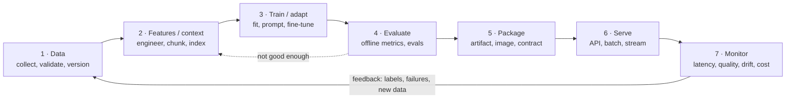
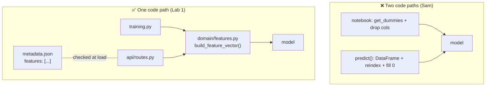

# Lesson 1.1: Prototype vs production and the AI lifecycle

> ⏱ ~45 min · 🎚 Level: Core · 🧰 Needs: [Module 0](../00-foundations/README.md)

[Course home](../../README.md) › [Module 1](README.md) › Lesson 1.1

## 📨 The situation

> **From: Sam (Data Scientist)**
> Hey! Welcome 👋 The fraud model is in `fraud_model_v2_FINAL.ipynb`: 99% accuracy, 0.95 AUC.
> Leadership saw the demo and loved it. I think it just needs "an API around it"?
> I can send you the pickle file. Oh, and the docs assistant runs on my laptop if you want to try it.

"It just needs an API around it" is one of the most expensive sentences in AI engineering. This lesson explains why, and gives you the map you'll use for the rest of the course.

## 🎯 By the end you can

- **Explain** at least six concrete differences between a prototype and a production AI system.
- **Draw** the AI lifecycle from data to monitoring, for both a classic ML model and an LLM application.
- **Define** training/serving skew, name its four most common causes, and **spot** it in real code.
- **List** the handoff artifacts each lifecycle stage must produce, and **explain** why "the pickle file" is not enough.

## 🤔 Predict first

Answer in your head or in a notebook before reading on. Being wrong is fine: guessing first makes the explanation stick.

1. Sam's model has 99% accuracy on a dataset where 1.4% of transactions are fraud. Is that good?
2. If you train a model in a notebook and serve it from an API, the features are computed by… how many pieces of code?
3. Name three things, other than the model file, that someone would need to rebuild Sam's model from scratch six months from now.

---

## 1. What "production" actually means

A **prototype** answers the question *"can this work?"*. A **production system** answers a harder question: *"will this keep working, for real users, when things go wrong, and can we prove it?"*

Think of a home cook and a restaurant kitchen. The home cook can make one excellent dish: they taste as they go, use whatever is in the fridge, and if it fails, they order pizza. A restaurant has to serve that same dish 400 times a night, with ingredients from suppliers who sometimes deliver late, cooked by whoever is on shift, with a health inspector who can walk in at any moment. **The recipe is the same. Everything around it is different.**

| Dimension | Prototype (Sam's notebook) | Production (`fraud-service`) |
|---|---|---|
| **Users** | One person, who knows how it works | Thousands of requests per second from systems that don't care |
| **Inputs** | Clean CSV, hand-picked | Missing fields, wrong types, values never seen before |
| **Failures** | Restart the kernel | Every failure has a cost: blocked payments, missed fraud, pages at 3 a.m. |
| **Latency** | "It finished" | Hard budget, e.g. p99 under 50 ms |
| **Reproducibility** | "Run the cells top to bottom… mostly" | Anyone can rebuild any version from code + data + config |
| **Change** | Edit and re-run | Reviewed, tested, versioned, released gradually, reversible |
| **Ownership** | Sam | A team with on-call, runbooks and SLOs |
| **Security** | API key in a cell | Secrets managed, inputs untrusted, access audited |
| **Observability** | `print()` | Logs, metrics, traces, drift monitoring |
| **Cost** | Free laptop | Real money per request, which someone has to justify |

> 🔎 **Under the hood:** a well-known Google paper, *Hidden Technical Debt in Machine Learning Systems* (2015), has a famous figure where the "ML code" is a tiny box surrounded by much larger boxes: configuration, data collection, feature extraction, data verification, serving infrastructure, monitoring and more. That figure is the reason this course exists. The model is perhaps 5–10% of the work.

### The 99% accuracy trap

Back to question 1. If 1.4% of transactions are fraud, a "model" that **always answers "not fraud"** is right 98.6% of the time. Sam's 99.2% accuracy beats that by less than one percentage point. Accuracy is the wrong metric for imbalanced problems; Module 4 teaches the right ones (precision, recall, PR-AUC). For now, remember this: **a prototype's headline metric is a claim, not a fact.** Production engineering starts by checking the claim.

---

## 2. Two tracks, one discipline

This course runs two systems side by side, because production AI work today comes in two flavours that share most of their engineering:

| | Track A: classic ML (`fraud-service`) | Track B: LLM application (`docs-assistant`) |
|---|---|---|
| **What you build** | A model you train on your own labelled data | A system around a pre-trained model you usually don't train |
| **Main artifact** | Model weights + feature code | Prompts + retrieval index + model choice + guardrails |
| **Typical latency** | 1–50 ms | 0.5–30 s (streaming helps) |
| **Typical cost driver** | CPU, data pipelines | Tokens or GPU hours |
| **Quality signal** | Labels arrive later (chargebacks weeks later) | Often no labels; you need evals and judges |
| **Classic failure** | Training/serving skew, drift | Hallucination, retrieval misses, prompt injection |
| **Same in both** | Versioning, testing, APIs, containers, observability, gradual releases, security, cost | |

The bottom row is the point: **once you can productionize one, most of the skill transfers to the other.** Each module teaches a concept once and applies it to both tracks.

---

## 3. The AI lifecycle

Every production AI system goes around the same loop. It is a *loop*, not a line, because what you learn in production feeds the next version.



Here is what each stage looks like on both tracks, and what typically goes wrong:

| Stage | Track A: fraud | Track B: docs assistant | Classic failure |
|---|---|---|---|
| **1 · Data** | Card transactions + chargeback labels | Handbook pages, PDFs, HTML | Silent schema change upstream |
| **2 · Features / context** | Ratios, counts, one-hot categories | Parsed, chunked, embedded documents | Feature computed differently online vs offline |
| **3 · Train / adapt** | Fit a gradient-boosted classifier | Choose a model, write prompts, maybe LoRA | Unreproducible "best run" |
| **4 · Evaluate** | PR-AUC, recall at a fixed false-positive rate | Golden questions, faithfulness, citation accuracy | Metric doesn't match the business goal |
| **5 · Package** | `model.joblib` + `metadata.json` + image | Prompt version + index version + image | "Which version is in prod?" |
| **6 · Serve** | `POST /v1/score`, p99 < 50 ms | `POST /v1/ask`, streamed tokens | No timeouts, no fallback |
| **7 · Monitor** | Score distribution, fraud caught, drift | Answer quality, refusals, cost per answer | Quality decays and nobody notices |

> 💡 **Production tip:** when someone says "the model is ready", ask *"which stage of the lifecycle is ready?"* Usually it's stage 3 or 4. Stages 5–7 are where most of the engineering, and most incidents, live.

### Where this course covers each stage

| Stage | Module |
|---|---|
| Data, features, context, training | [Module 2](../02-data-and-model-pipelines/README.md) |
| Evaluate | [Module 4](../04-evaluation-and-monitoring/README.md) |
| Package and serve | Module 1 (this one) and [Module 3](../03-serving-and-optimization/README.md) |
| Monitor | [Module 4](../04-evaluation-and-monitoring/README.md) |
| Secure and govern (all stages) | [Module 5](../05-security-and-governance/README.md) |
| Operate at scale (all stages) | [Module 6](../06-scaling-and-operations/README.md) |

---

## 4. Training/serving skew: the silent killer

**Training/serving skew** is any difference between what the model saw during training and what it sees when serving. The model doesn't crash. It just quietly makes worse predictions, and nobody notices until a business metric moves.

An analogy: you learn to drive in a car with the gear shift on the right. On your first day at work, you're given a car with the gear shift on the left. You can still drive, badly, and you'll make mistakes you never made in training.

### The four most common causes

| Cause | What happens | Sam's notebook example |
|---|---|---|
| **1. Two code paths** | Features are computed by one piece of code at training time and another at serving time. They drift apart. | `pd.get_dummies(df)` at training time vs. `pd.get_dummies(row).reindex(…, fill_value=0)` at prediction time |
| **2. Information that doesn't exist yet at serving time** (*leakage*) | Training uses a column that is only known after the event you're predicting. | `chargeback_filed` is filed *weeks after* fraud is confirmed. At scoring time it's always 0. |
| **3. Different data freshness or source** | Training uses a nightly warehouse snapshot; serving uses a live cache with different lag or defaults. | "Transactions in the last 24h" computed from a complete table offline, from a partial stream online |
| **4. Different library versions or defaults** | A tokenizer, scaler or category encoder behaves differently in another version. | Unpinned scikit-learn; unpickling a model with a different version can fail or behave differently |

### A worked example with real numbers

Run Sam's notebook (Lab 1, Step 2) and you get roughly **ROC-AUC 0.95**. Train properly, without the leaky column and with a time-based split (Lab 1, Step 3), and you get about **0.75**.

That drop is not the model getting worse. **0.75 is what the model was always going to do in production.** The 0.95 was an illusion created by two things:

1. **Leakage**: `chargeback_filed` is almost a copy of the label (85% of fraud has a chargeback; 0.5% of legitimate transactions do). The model learned "chargeback → fraud". In production, the chargeback doesn't exist yet, so the model's strongest signal is always zero.
2. **A random split on time-ordered data**: mixing "future" transactions into training makes the test set easier than real life, where you always predict the future from the past.

> ⚠️ **Common mistake:** celebrating a big offline improvement without asking "could this information exist at prediction time?" When a new feature improves a fraud or churn model dramatically, the first hypothesis should be leakage, not genius.

### How production systems prevent skew



1. **One feature function, imported by both training and serving.** In the lab this is `build_feature_vector()` in `src/kestrel_fraud/domain/features.py`. A test (`test_training_and_serving_build_identical_rows`) proves a CSV row and an API payload for the same transaction produce identical vectors.
2. **A feature contract stored with the model.** `metadata.json` records the exact feature names and order. At startup, the service compares them with its own code and refuses to become ready if they differ (`ArtifactIncompatible`).
3. **An explicit deny-list of leaky columns.** `FORBIDDEN_COLUMNS` documents them, and a test fails if the training code even *reads* one.
4. **Log what you serve, train on what you logged.** The strongest fix, used by large companies: log the exact feature values used at serving time and build the next training set from those logs. Then training data *is* serving data. Google's *Rules of Machine Learning* recommends exactly this.
5. **A feature store** (lesson 1.2): one system computes features once and serves the same values to training (offline, point-in-time correct) and serving (online, low latency).

### Skew in LLM applications

LLM apps have their own version of skew:

- The prompt template you evaluated isn't the one deployed (someone "fixed a typo" in production).
- Evaluation ran against yesterday's index; production uses today's, with new documents chunked differently.
- You tested with `temperature=0` and production runs `temperature=0.7`.
- The provider silently updated the model behind the same name.

The fixes are the same ideas: **version everything that shapes the output** (model ID, prompt version, index version, decoding parameters) and record it next to every response.

---

## 5. Handoff artifacts: what each stage must produce

A **handoff artifact** is the thing one stage (or person) gives the next so they can work **without having to ask questions**. In a team, every unanswered question becomes a meeting, a delay or a bug.

Sam's handoff was "I can send you the pickle file." Here is what a complete handoff looks like:

| From → to | Artifact | Answers the question… | In Lab 1 |
|---|---|---|---|
| Data → training | **Data contract / schema** | What columns, types and ranges can I rely on? | `datasets/fraud/README.md`, `ScoreRequest` |
| Data → training | **Dataset version + digest** | Exactly which data was used? | `metadata.json → data.sha256` |
| Features → serving | **Feature spec** | How are features computed, in what order? | `domain/features.py`, `metadata.json → features` |
| Training → serving | **Model artifact** | What do I load? | `model.joblib` |
| Training → serving | **Artifact metadata** | Which code, data, params, metrics, environment produced it? Is the file intact? | `metadata.json` (sha256, git commit, seed, sklearn version) |
| Training → business | **Evaluation report / model card** | How good is it, for whom, where does it fail? | `metadata.json → metrics` (model cards in Module 5) |
| Serving → clients | **API contract** | How do I call it, what can go wrong? | OpenAPI at `/docs` |
| Serving → on-call | **Runbook** | It's 3 a.m. and it's broken: what do I do? | Template in `templates/` (Module 6) |
| LLM track | **Prompt version, index version, model ID, decoding params** | What produced this answer? | Modules 2, 4, 5 |

> 💡 **Production tip:** a good test of a handoff is the *"bus test"*: if the author were unreachable for a month, could someone else rebuild, deploy, debug and roll back this model? If not, the handoff is incomplete.

### What a minimal artifact looks like

This is a trimmed version of what `scripts/train.py` writes in the lab:

```json
{
  "name": "fraud-model",
  "version": "20261110T115648Z-2a36bb33",
  "model_sha256": "4de749d1b2ca66862397a838261ab2f0870ed1095f13450a77617e4127a727c7",
  "features": ["amount_log", "amount_to_avg_ratio_log", "hour", "…"],
  "excluded_columns": ["chargeback_filed", "is_fraud", "transaction_id"],
  "data": {"path": "transactions.csv", "sha256": "2a36bb33…", "rows": 50000, "split": "time-based 80/20"},
  "metrics": {"roc_auc": 0.747, "pr_auc": 0.063, "test_base_rate": 0.0155},
  "code": {"commit": "9c1e2f0…", "dirty": false},
  "environment": {"python": "3.12.7", "sklearn": "1.7.2", "numpy": "2.3.4"},
  "seed": 42
}
```

Every field answers a question someone will ask during an incident. Lesson 1.5 explains the sha256 and the versioning scheme.

---

## 🧪 Try it

Do **Steps 1–3** of [Lab 1](lab/README.md):

1. Review `prototype/sam_notebook.py` and list every problem you can find (aim for 10+).
2. Run it and note its accuracy and AUC.
3. Run `uv run python scripts/train.py` and compare the honest metrics. Open `metadata.json` and answer the four questions in Step 3.

Expected: Sam's notebook reports AUC ≈ 0.95; the proper pipeline reports ROC-AUC ≈ 0.75 and PR-AUC ≈ 0.06 against a base rate of ≈ 0.015.

## 🏭 In the real world

- Google's [*Rules of Machine Learning*](https://developers.google.com/machine-learning/guides/rules-of-ml) devotes a whole section to training/serving skew. Its advice to log the features used at serving time and reuse them for training is one of the most cited practical recommendations in production ML.
- The 2015 paper [*Hidden Technical Debt in Machine Learning Systems*](https://proceedings.neurips.cc/paper/2015/hash/86df7dcfd896fcaf2674f757a2463eba-Abstract.html) introduced terms you'll hear in interviews: *entanglement* (changing anything changes everything), *undeclared consumers*, and *glue code*.
- Google Cloud's [MLOps architecture guide](https://cloud.google.com/architecture/mlops-continuous-delivery-and-automation-pipelines-in-machine-learning) describes maturity levels 0 → 2. Sam's notebook is "level 0": manual, script-driven, no automation. This course takes you to level 2.

## ✅ Check yourself

<details>
<summary>1. A teammate's new churn model improved AUC from 0.71 to 0.93 after adding a feature called <code>account_closed_reason</code>. What's your first hypothesis?</summary>

**Leakage.** A closure reason only exists *after* the customer churned, so it can't be known at prediction time. Ask: "At the moment we make this prediction in production, does this value exist, and does it have the same meaning?" Huge jumps from a single feature are suspicious until proven otherwise.
</details>

<details>
<summary>2. Name the four common causes of training/serving skew.</summary>

1. Two different code paths computing features. 2. Information that isn't available yet at serving time (leakage). 3. Different data sources or freshness between offline and online. 4. Different library versions or default behaviour.
</details>

<details>
<summary>3. Why is a time-based train/test split more honest than a random split for fraud?</summary>

In production you always predict the **future** using a model trained on the **past**. A random split lets the model train on transactions from after some test transactions, which leaks future patterns and makes metrics optimistic. A time-based split simulates deployment.
</details>

<details>
<summary>4. Sam sends you <code>model.pkl</code>. List four questions you can't answer from that file alone.</summary>

Any four of: which data (and version) trained it; which code/commit; which feature list and order it expects; which library versions are needed to load it; what its metrics were and on which test set; which random seed; whether the file is intact (checksum); who approved it; what threshold to use.
</details>

<details>
<summary>5. Give one example of training/serving skew specific to LLM applications.</summary>

Examples: the evaluated prompt differs from the deployed one; evaluation used a different index version than production; different decoding parameters (temperature); the provider updated the model behind the same name; chunking or embedding model changed between eval and serving.
</details>

<details>
<summary>6. Which stages of the lifecycle does "it just needs an API around it" ignore?</summary>

Mostly **packaging, serving reliability and monitoring** (stages 5–7), and usually the reproducibility of stages 1–4 as well. An API around an unversioned, unmonitored model with leaky features is still a prototype, just one that more people depend on.
</details>

## 💬 Explain it back

Explain **training/serving skew** to Omar, the risk analyst, in three sentences, without using the words "feature", "pipeline" or "distribution". If you can't, reread section 4.

## 🔑 Key takeaways

- The model is a small part of a production AI system; the rest is data, packaging, serving, monitoring, security and operations.
- A prototype's headline metric is a **claim**. Check it for leakage, wrong metrics and unrealistic splits before anything else.
- **Training/serving skew** is silent. Prevent it with one shared feature function, a feature contract checked at load time, and logging served features.
- The AI lifecycle is a **loop** (data → features → train → evaluate → package → serve → monitor → data), and it's the same for classic ML and LLM apps.
- Every stage hands off **artifacts with metadata**, not just files. Pass the bus test.

## 📚 Go deeper (free)

| | Resource | Why read it | Time |
|---|---|---|---|
| ⭐ | [Rules of Machine Learning](https://developers.google.com/machine-learning/guides/rules-of-ml), Martin Zinkevich (Google) | Decades of production lessons in 43 rules; read the "Training-Serving Skew" section first | 45 min |
| ⭐ | [Machine Learning in Production](https://mlip-cmu.github.io/book/), Christian Kästner (CMU) | Free book; chapters on the "model vs system" view of ML | 1 h |
| 🔍 | [Hidden Technical Debt in ML Systems](https://proceedings.neurips.cc/paper/2015/hash/86df7dcfd896fcaf2674f757a2463eba-Abstract.html), Sculley et al. (2015) | The classic paper on why ML systems rot | 30 min |
| 🔍 | [MLOps: Continuous delivery and automation pipelines in ML](https://cloud.google.com/architecture/mlops-continuous-delivery-and-automation-pipelines-in-machine-learning), Google Cloud | MLOps maturity levels 0–2 | 30 min |
| 🔍 | [Made With ML](https://madewithml.com/), Goku Mohandas | End-to-end notebook-to-production walkthrough | as needed |
| 🔍 | [What We Learned from a Year of Building with LLMs](https://applied-llms.org/) | The LLM-track equivalent of "Rules of ML" | 1 h |

---
⬅️ [Module 0: LLMs in one hour](../00-foundations/05-llms-in-one-hour.md) · ➡️ [Lesson 1.2: Architecture patterns](02-architecture-patterns.md)
