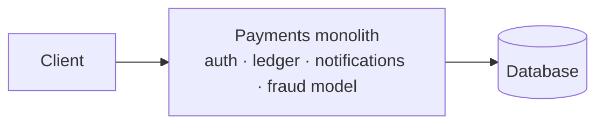
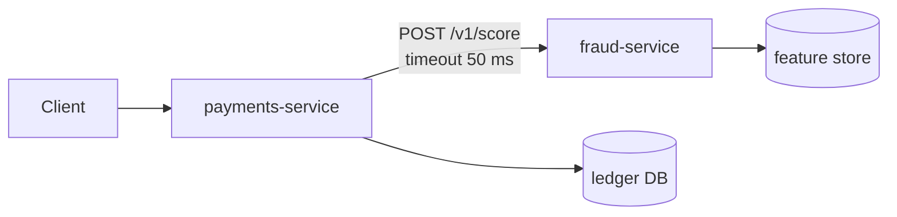
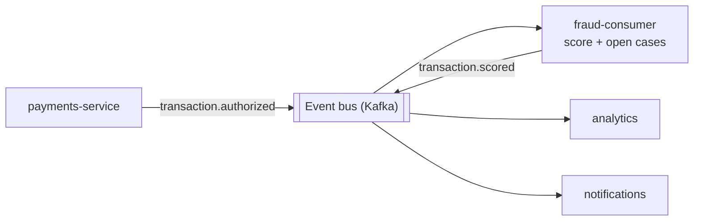
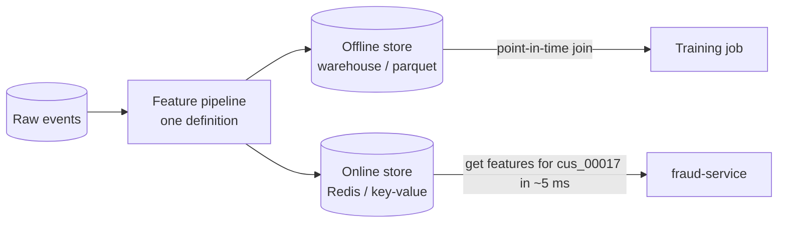
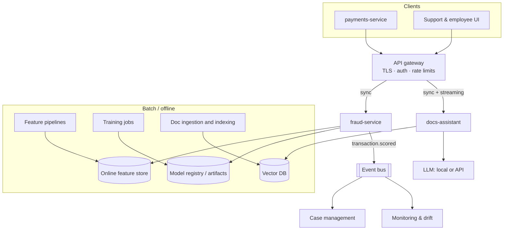

# Lesson 1.2: Architecture patterns for AI systems
<!-- id: l-1-2 -->

> ⏱ ~50 min · 🎚 Level: Core · 🧰 Needs: [Lesson 1.1](01-prototype-vs-production.md)

[Course home](../../README.md) › [Module 1](README.md) › Lesson 1.2

## 📨 The situation

> **From: Diego (SRE / Platform)**
> Before you write any code, two questions for the design review on Thursday:
> 1. Does fraud scoring happen **in real time** during card authorization, or can it run **in batch** overnight?
> 2. Is it **its own service**, part of the payments monolith, or a consumer on the event bus?
> And please don't invent a new database. Tell me which of our building blocks you need.

Architecture decisions are expensive to reverse. This lesson gives you the vocabulary and trade-offs to answer Diego confidently and defend your answer.

## 🎯 By the end you can

- **Choose** between batch, online and streaming inference for a given use case, and justify the choice with latency, freshness and cost.
- **Compare** monolith, microservices and event-driven architectures, and **pick** one for an AI component.
- **Describe** what an API gateway, feature store, vector database and model registry do, and **when you need each**.
- **Build** a latency budget for an online prediction path.

## 🤔 Predict first

1. Netflix-style "Top picks for you" rows: computed when you open the app, or before? <!-- id: p-1-2-1 -->
2. A fraud check must answer within the card network's authorization window. Roughly how much of that window do you think the ML model itself gets: 50%, 10% or 1%? <!-- id: p-1-2-2 -->
3. Is "make the AI a microservice" always the right call? <!-- id: p-1-2-3 -->

---

## 1. Batch, online or streaming inference?

**Inference** means using a trained model to make predictions. There are three ways to do it, and choosing the wrong one is the most common AI architecture mistake.

| | **Batch** (offline) | **Online** (real-time, synchronous) | **Streaming** (near-real-time, asynchronous) |
|---|---|---|---|
| **How** | A scheduled job scores many rows at once and stores results | A request arrives; the model answers in the same request | Events flow through a stream; a consumer scores each one within seconds |
| **Latency to the user** | ~0 (results precomputed), but stale | Must be fast: ms to s | Seconds; the user usually isn't waiting |
| **Freshness** | Hours to a day old | Up to the moment | Seconds old |
| **Throughput / cost** | Cheapest per prediction: vectorised, spot instances, off-peak | Most expensive: provisioned for peak, idle capacity | In between |
| **Complexity** | Low: a script and a table | High: availability, latency, scaling | Highest: stream infra, ordering, exactly-once semantics |
| **Failure impact** | Job retries later; users see yesterday's results | Users see errors or slow pages immediately | Backlog grows; catch-up later |
| **Kestrel example** | Nightly re-scoring of all accounts for risk reviews | `POST /v1/score` during card authorization | Score every transaction from the event bus for case management |
| **Other examples** | Churn scores, email recommendations, re-indexing documents | Search ranking, chat, fraud at checkout | Anomaly detection on logs, live dashboards |

### How to decide

Ask three questions, in this order:

1. **Does the prediction need information that only exists at request time?** (The transaction amount, the user's question.) If yes → online or streaming. If no → batch is probably enough.
2. **Is someone waiting for the answer?** If a person or a blocking system is waiting → online. If not → streaming or batch.
3. **How stale can the answer be?** Hours → batch. Seconds → streaming. Now → online.

For Kestrel:

- **fraud-service**: the amount, merchant and device only exist at authorization time, and the payment is waiting for a decision → **online**.
- **docs-assistant**: the question only exists at request time and a person is waiting → **online**, with *streaming responses* (lesson 1.3) to make the wait feel shorter. Document **ingestion and indexing** is a **batch** job: documents change daily, not per second.

> 💡 **Production tip:** the best architectures are often **hybrid**. Precompute everything you can in batch (customer aggregates, document embeddings, candidate recommendations), then do the smallest possible amount of work online (look up, combine, re-rank). Online inference is expensive; spend it only on what truly needs to be fresh.

### Try the numbers

Lab 1's *Extend it #1* asks you to batch-score 50,000 transactions. Vectorised in one `predict_proba` call it takes about a second. Through the HTTP API, one request at a time at ~3 ms each, it takes ~2.5 minutes, and at 20 ms each over a real network ~17 minutes. Same model, ~1,000× different cost. **Batch is not a lesser form of serving; for many use cases, it's the right one.**

---

## 2. Monolith, microservices or event-driven?

Once you know *when* predictions happen, decide *where the code lives*.

### Monolith

One deployable application contains everything: payments, accounts, notifications and fraud scoring.

- ✅ Simplest to build, test, deploy and debug. A function call is faster and more reliable than a network call.
- ❌ The ML model's heavy dependencies (NumPy, scikit-learn, maybe PyTorch) bloat every deploy. A model update means redeploying payments. A memory leak in the model takes down the ledger. Different scaling needs (CPU-heavy model vs I/O-heavy API) are forced together.

### Microservices

Fraud scoring is its own service with its own API, deploy pipeline and scaling.

- ✅ Independent releases (ship a new model without touching payments), independent scaling (more fraud replicas on Black Friday), failure isolation (if done right), the right language and hardware per service (GPUs only where needed).
- ❌ Every call is now a **network call** that can be slow or fail (lesson 1.3). You need service discovery, auth between services, distributed tracing, API versioning and an on-call rotation that understands it all.

### Event-driven

Services communicate by publishing **events** ("transaction.authorized") to a log or broker (Kafka, Pulsar, RabbitMQ, cloud queues). Consumers react asynchronously; the publisher doesn't know or wait for them.

- ✅ Loose coupling (add consumers without touching producers), natural buffering of traffic spikes, replay (re-score last week's events with a new model), great for streaming inference and audit trails.
- ❌ Eventual consistency (the answer comes *later*), harder debugging, ordering and duplicate delivery issues (consumers must be **idempotent**), and infrastructure to operate.

### The usual answer: combine them

For Kestrel the sensible design is:

1. A **synchronous** `POST /v1/score` microservice for the authorization decision, with a tight timeout and a fallback, because the payment is waiting.
2. The fraud-service **publishes** a `transaction.scored` event, so case management, analytics and model monitoring consume it **asynchronously**, without slowing the payment.

> ⚠️ **Common mistake:** splitting into microservices too early. If you are one team with one model, a **modular monolith** (clean layers and modules inside one deployable) gets you 80% of the benefit at 20% of the cost. Split when you have a concrete reason: different release cadence, different scaling profile, different hardware, different team, or failure isolation. "Microservices are modern" is not a reason.

### Stateless vs stateful services

A **stateless** service keeps nothing in memory between requests that another replica would need. You can run 2 or 200 copies behind a load balancer and kill any of them at any time. Production services should be stateless whenever possible; state goes in databases, caches and object storage.

Lab 1 contains a deliberate counter-example: `/v1/explain/{transaction_id}` reads from an **in-memory** `LRUStore` of recent scores. Run two replicas and the explain request may land on the replica that never scored that transaction and get a 404. The fix is a shared store (Redis) or a self-contained request. You'll see this bite in Module 6 when you scale out.

---

## 3. The building blocks

You don't build production AI from scratch. You assemble well-understood components. Here are the ones every AI engineer must know:

| Building block | What it does | Kestrel use | Common options | Course |
|---|---|---|---|---|
| **API gateway** | Single entry point: TLS, authentication, rate limiting, routing, request size limits | Routes `/fraud/*` and `/assistant/*`, enforces API keys and quotas | Kong, Envoy, NGINX, AWS API Gateway, cloud load balancers | Modules 5, 6 |
| **Feature store** | Computes features once, serves them **offline** (point-in-time-correct training sets) and **online** (low-latency lookups) | `txn_count_24h`, `avg_amount_30d` per customer | Feast (open source), Tecton, cloud feature stores, or Redis + a pipeline | Lab 1 (fake), Module 2 |
| **Vector database** | Stores embeddings and finds the nearest ones fast, with metadata filters | Handbook chunks for the docs-assistant | Qdrant, pgvector, Weaviate, Milvus, FAISS (library), managed services | Module 2 |
| **Model registry** | Catalogue of model versions with metadata, lineage and stages (staging → production) | Which fraud model version is approved for prod | MLflow Model Registry, cloud registries | Modules 1, 2 |
| **Message queue / event stream** | Asynchronous, buffered communication between services | `transaction.scored` events, document-ingestion jobs | Kafka, RabbitMQ, SQS, Pub/Sub, Redis Streams | Modules 2, 6 |
| **Object storage** | Cheap, durable blob storage | Datasets, model artifacts, raw documents | S3, GCS, Azure Blob, MinIO | Modules 2, 6 |
| **Experiment tracker** | Records runs: params, metrics, artifacts | Comparing fraud model runs | MLflow, Weights & Biases | Module 2 |
| **Observability stack** | Logs, metrics, traces, dashboards, alerts | Latency, error rate, score drift | OpenTelemetry, Prometheus, Grafana, Langfuse | Module 4 |
| **Prompt registry** | Versioned, reviewed prompts with rollback | docs-assistant system prompt | MLflow Prompt Registry, Langfuse, Git | Modules 4, 5 |

### A closer look at the feature store

The feature store deserves extra attention because it directly attacks training/serving skew (lesson 1.1).

**Point-in-time correctness** means that when you build a training row for a transaction that happened on 3 March at 14:02, you use the value of `txn_count_24h` *as it was at 14:02 on 3 March*, not today's value. Getting this wrong is a form of leakage, and it's subtle enough that it's the main reason feature stores exist.

In Lab 1, `scripts/fake_feature_store.py` plays the online store, and `adapters/enrichment.py` is the client. Callers may pass the aggregates directly; if they don't, the service fetches them.

---

## 4. A reference architecture for Kestrel

Putting it together, here is where we're heading by Module 6. Don't worry about every box yet; each module fills in a part.

---

## 5. Worked example: a latency budget

Card networks give the issuer a limited time to approve or decline. Suppose Kestrel's payments team allows the fraud check **150 ms end to end at p99** (the 99th percentile, meaning 99 out of 100 requests must be faster; Module 3 explains percentiles in depth). Where does the time go?

| Step | p99 budget | Notes |
|---|---|---|
| Network payments → gateway → fraud-service | 10 ms | Same region, keep-alive connections |
| Gateway (auth, routing) | 5 ms | |
| Request parsing and validation | 2 ms | Pydantic |
| **Feature store lookup** | **40 ms** | The riskiest step: a network call to another system |
| Feature computation | 1 ms | |
| **Model inference** | **5 ms** | Gradient-boosted trees on CPU are fast |
| Logging, metrics, event publish | 2 ms | Must be async / non-blocking |
| Response | 5 ms | |
| **Safety margin** | **80 ms** | For retries, GC pauses, noisy neighbours |
| **Total** | **150 ms** | |

That answers prediction question 2: the model gets roughly **3%** of the budget. The **feature store call** is the dominant risk, which is why Lab 1 wraps it in timeouts, retries, a deadline and a fallback. The margin isn't waste: it's what lets you retry once.

> 💡 **Production tip:** always write a latency budget **before** building. It tells you which calls need timeouts, whether you can afford a retry, whether a bigger model fits, and which component to optimize first. Without one, every team assumes the others are fast.

For the docs-assistant the budget looks completely different: the LLM call dominates (seconds), so the important number is **time to first token** (TTFT) rather than total time. Module 3 builds that budget.

---

## 🧪 Try it

1. In [Lab 1](lab/README.md), do **Step 7** and notice that the fraud-service calls the feature store over HTTP: that's the microservice boundary from section 2, with all its failure modes.
2. Do **Extend it #1 (batch inference)**. Time the vectorised batch run, then estimate how long the same 50,000 rows would take via `POST /v1/score` (measure one request with `time curl …`). Write down the ratio.
3. Draw your own version of the section 4 diagram on paper, from memory. Compare.

## 🏭 In the real world

- Uber's engineering blog posts on **Michelangelo**, their ML platform, describe the same building blocks: a feature store, a model registry and both batch and online serving. Search "Uber Michelangelo" on the Uber engineering blog.
- The open-source [Feast](https://feast.dev/) documentation explains point-in-time joins and online/offline stores with diagrams; its concepts page is a good 20-minute read.
- Martin Fowler's [Microservices](https://martinfowler.com/articles/microservices.html) article (with James Lewis) is the classic definition, and his [MonolithFirst](https://martinfowler.com/bliki/MonolithFirst.html) note argues for starting simple.

## ✅ Check yourself

Q1. Kestrel wants to email every customer a "your spending this month" summary written by an LLM. Batch, online or streaming? Why? <!-- id: c-1-2-1 -->

**Batch.** Nobody is waiting, the data (last month's transactions) is complete in advance, and freshness of hours is fine. Batch lets you use cheaper capacity (off-peak, batched requests, maybe a cheaper model) and retry failures without user impact.

Q2. Give three concrete reasons to extract fraud scoring from the payments monolith, and one reason not to. <!-- id: c-1-2-2 -->

For: independent model releases without redeploying payments; independent scaling and hardware; failure isolation (a model memory leak doesn't crash the ledger); different dependency stacks. Against: a network hop adds latency and new failure modes (timeouts, retries, partial outages) plus operational overhead.

Q3. What is point-in-time correctness and what goes wrong without it? <!-- id: c-1-2-3 -->

When building a training row for an event at time *t*, every feature must use only information available at *t*. Without it, you leak future information (e.g. today's 30-day average into a transaction from March), and offline metrics are better than production performance: a form of training/serving skew.

Q4. Why must event consumers be idempotent? <!-- id: c-1-2-4 -->

Most brokers guarantee **at-least-once** delivery: after a crash or retry, the same event can arrive twice. An idempotent consumer produces the same result if it processes an event once or several times (e.g. "upsert case for transaction X" instead of "create a new case").

Q5. In the 150 ms fraud budget, which single component deserves the most engineering attention, and why? <!-- id: c-1-2-5 -->

The **feature store lookup**: it's a network call to another system, so it has the largest and least predictable latency and can fail. That's why it needs a timeout, bounded retries and a fallback (defaults or rules). The model itself is a small, predictable part of the budget.

Q6. Why is the <code>/v1/explain/{id}</code> endpoint in Lab 1 a scaling problem? <!-- id: c-1-2-6 -->

It depends on **in-memory state** (an LRU of recent scores) in one process. With several replicas, a request may reach a replica that never saw that transaction → 404. Fix: store recent scores in a shared store (Redis/DB) or make the request self-contained.

## 💬 Explain it back
<!-- id: e-1-2 -->

Diego asked two questions at the top of this lesson. Write the answer you would give in the design review: batch/online/streaming, which architecture, which building blocks, and your latency budget, in **under 150 words**.

## 🔑 Key takeaways

- Choose **batch** when nobody is waiting, **online** when someone is, **streaming** when freshness matters but nobody blocks. Hybrid (precompute + light online work) is often best.
- Start with a **modular monolith**; split into services for concrete reasons (release cadence, scaling, hardware, isolation, team ownership).
- Use **events** for everything that doesn't need to block the user; consumers must be **idempotent**.
- Know the building blocks: **gateway, feature store, vector DB, model registry, queue, object storage, tracker, observability, prompt registry**.
- Write a **latency budget** first. The model is rarely the slowest part; network calls are.

## 📚 Go deeper (free)

| | Resource | Why read it | Time |
|---|---|---|---|
| ⭐ | [Machine Learning in Production](https://mlip-cmu.github.io/book/), Kästner (CMU), chapters on deployment and architecture | Model-serving patterns and trade-offs, clearly explained | 1 h |
| ⭐ | [Microservices](https://martinfowler.com/articles/microservices.html), Lewis & Fowler | The canonical definition, with trade-offs | 40 min |
| 🔍 | [MonolithFirst](https://martinfowler.com/bliki/MonolithFirst.html), Fowler | Why to start with a monolith | 10 min |
| 🔍 | [Feast documentation](https://docs.feast.dev/) | Feature store concepts: online/offline stores, point-in-time joins | 30 min |
| 🔍 | [Stanford CS 329S: ML Systems Design](https://stanford-cs329s.github.io/), Chip Huyen | Lecture notes on batch vs online prediction and deployment | 1 h |
| 🔍 | [Patterns for Building LLM-based Systems & Products](https://eugeneyan.com/writing/llm-patterns/), Eugene Yan | The same thinking applied to LLM apps | 45 min |

---
⬅️ [Lesson 1.1: Prototype vs production](01-prototype-vs-production.md) · ➡️ [Lesson 1.3: Reliability primitives](03-reliability-primitives.md)
