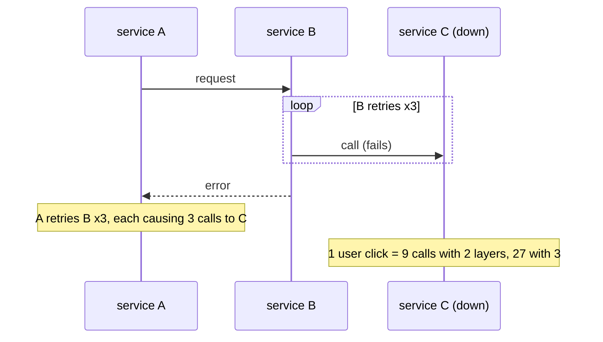
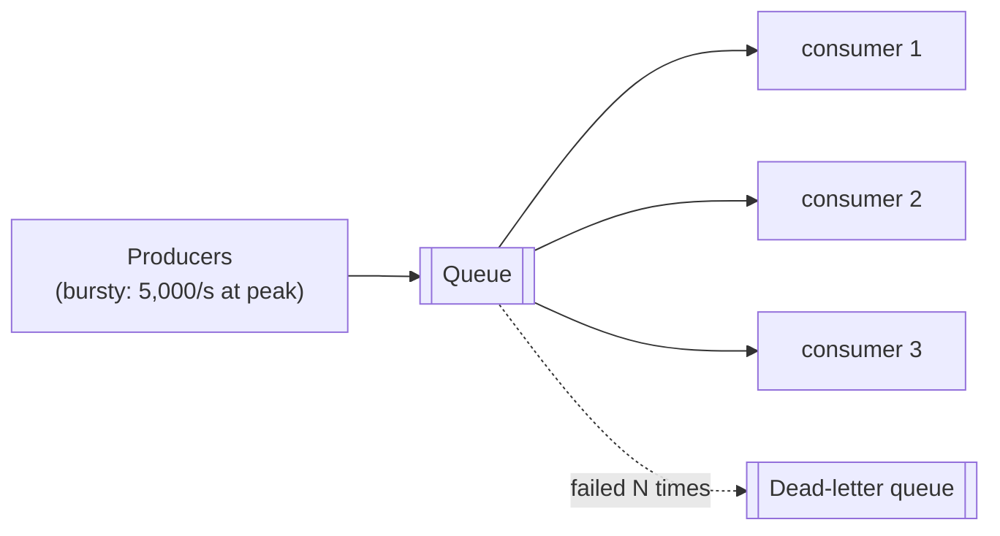
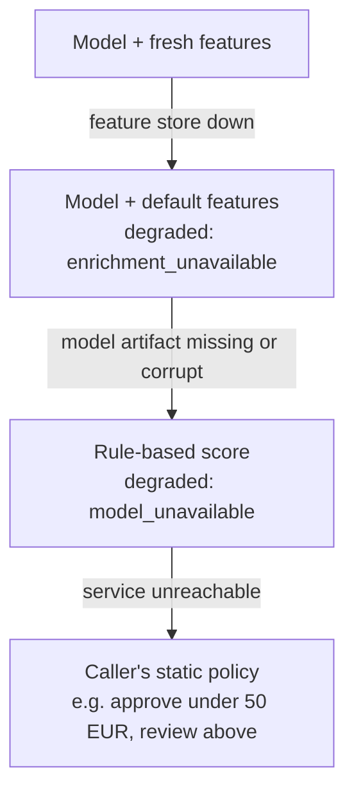

# Lesson 1.3: Reliability primitives
<!-- id: l-1-3 -->

> ⏱ ~60 min · 🎚 Level: Core · 🧰 Needs: [Lesson 1.2](02-architecture-patterns.md)

[Course home](../../README.md) › [Module 1](README.md) › Lesson 1.3

## 📨 The situation

> **From: Omar (Risk Analyst)**
> One rule from the risk side: a fraud check that **blocks payments when it's down** is worse than no fraud check. Customers will switch banks.
>
> **From: Diego (SRE)**
> Context: last quarter a slow address-validation service took down checkout for 40 minutes. Nobody had set a timeout, every thread waited on it, and when it recovered, a wall of retries knocked it over again. I don't want a repeat with fraud scoring.

This lesson is about the small set of patterns that keep a system working when its dependencies don't: **timeouts, retries, backoff, jitter, deadlines, retry budgets, queues and graceful degradation**. It ends with **how services talk** (REST vs gRPC) and **streaming responses** for LLMs.

## 🎯 By the end you can

- **Calculate** how dependency failures compound across a request path.
- **Set** timeouts from a latency budget and **explain** why "no timeout" is a bug.
- **Implement** retries with exponential backoff, full jitter, a deadline and a retry budget, and **say which errors not to retry**.
- **Design** a graceful-degradation ladder for an ML service and an LLM service.
- **Choose** between REST and gRPC, and **explain** how streaming responses (SSE) improve perceived latency.

## 🤔 Predict first

1. A request touches 5 dependencies, each available 99.9% of the time. What's the request's availability? <!-- id: p-1-3-1 -->
2. Three services call each other in a chain, and each retries failed calls 3 times. If the last one is down, how many requests does it receive for one user click? <!-- id: p-1-3-2 -->
3. Should you retry an HTTP 400? A 503? A timeout on `POST /payments`? <!-- id: p-1-3-3 -->

---

## 1. Failure is normal: the maths

If one call succeeds with probability *p*, a request that needs *n* independent calls to all succeed has availability *pⁿ*.

| Dependencies (each 99.9%) | Request availability | Failed requests per million |
|---|---|---|
| 1 | 99.9% | 1,000 |
| 5 | 99.50% | ~5,000 |
| 10 | 99.00% | ~10,000 |
| 30 | 97.0% | ~30,000 |

So the answer to prediction 1 is about **99.5%**: five individually excellent dependencies give you a mediocre service. At scale, *something* is always failing. You can't make dependencies perfect, so you make your service **tolerate** their failures. That's what the primitives below are for.

> 🔎 **Under the hood:** failures aren't only "down". The most dangerous failure is **slow**. A dependency that returns errors in 1 ms is easy to handle; one that takes 30 s to respond ties up your workers, connections and memory, and spreads the outage to *you*. That's what happened to Diego's checkout.

---

## 2. Timeouts: always, everywhere

A **timeout** is the maximum time you'll wait for something before giving up. Many HTTP clients and database drivers ship with *no* timeout or a very long one by default, so a hung dependency can hold your worker forever.

Analogy: you call a restaurant to book a table. If nobody answers after 10 rings, you hang up and call another one. Without a timeout, you'd hold the phone until the restaurant closes.

### Two kinds of timeout

- **Connect timeout**: how long to wait to establish the connection. Should be short (tens to a few hundred ms within a data center): if you can't even connect, the server is gone.
- **Read (response) timeout**: how long to wait for the answer once connected. Derived from the dependency's normal latency.

In Lab 1 (`adapters/enrichment.py`):

```python
self.client = httpx.AsyncClient(
    base_url=base_url,
    timeout=httpx.Timeout(timeout_s, connect=min(timeout_s, 0.2)),  # 300 ms read, 200 ms connect
)
```

### How to choose a value

Start from the **dependency's latency distribution** and **your caller's budget**:

1. Measure the dependency's p99 (say 25 ms for the feature store).
2. Set the per-attempt timeout a bit above it (say 2–3× p99 ≈ 60–80 ms), so normal slow requests succeed but pathological ones are cut.
3. Check it fits your latency budget (lesson 1.2), *including* any retries.

### Deadlines: a timeout for the whole operation

A per-attempt timeout isn't enough when you retry: 3 attempts × 300 ms + backoff can exceed what the caller is willing to wait. A **deadline** is a limit on the *total* time across all attempts. Lab 1's retry loop refuses to start a retry that can't finish before the deadline:

```python
delay = policy.backoff(attempt)
if clock() - start + delay >= policy.deadline_s:
    stats.gave_up_reason = "deadline"
    raise
```

> 💡 **Production tip:** in a chain of services, **propagate the deadline** downstream (gRPC does this natively; with HTTP you pass a header like the remaining time budget). There's no point in service C working for 2 s if service A gave up after 1 s.

---

## 3. Retries: helpful, until they're not

Many failures are **transient**: a pod restarting, a dropped connection, a brief overload. Trying again a moment later often works. But retries multiply load, and badly designed retries cause outages.

### Rule 1: only retry what can succeed next time

| Response | Retry? | Why |
|---|---|---|
| Connection error, timeout | ✅ Yes (if the operation is idempotent) | Probably transient |
| `429 Too Many Requests` | ✅ Yes, respecting `Retry-After` | The server asks you to slow down, not to stop |
| `500`, `502`, `503`, `504` | ✅ Usually | Server-side, often transient |
| `400`, `401`, `403`, `404`, `422` | ❌ Never | Your request is wrong; it will stay wrong |

### Rule 2: only retry idempotent operations (or make them idempotent)

An operation is **idempotent** if doing it twice has the same effect as doing it once. `GET /features/cus_1` is idempotent. `POST /payments` is **not**: if the first attempt actually succeeded but the response was lost to a timeout, a retry charges the customer twice.

The fix is an **idempotency key**: the client generates a unique ID per logical operation and sends it with every attempt (`Idempotency-Key: 4f1c…`). The server stores the result for that key and returns the stored result for repeats. Scoring a transaction is naturally idempotent (same input → same score), which is why our retries are safe.

### Rule 3: back off exponentially, with jitter

If every client retries immediately, a struggling service gets hammered at the worst moment. **Exponential backoff** waits longer after each failure: 50 ms, 100 ms, 200 ms, 400 ms… capped at a maximum.

But if 10,000 clients all failed at the same instant, they'll all retry at *exactly* +50 ms, then +100 ms: synchronized waves called a **thundering herd**. **Jitter** adds randomness so retries spread out. The simplest and generally best variant, **full jitter** (described in the AWS Architecture Blog and Builders' Library), waits a random time between zero and the exponential cap:

```
sleep = random_between(0, min(max_delay, base_delay × 2^(attempt − 1)))
```

From `adapters/retry.py`:

```python
def backoff(self, retry_number: int) -> float:
    """Full jitter. retry_number starts at 1 for the first retry."""
    cap = min(self.max_delay_s, self.base_delay_s * (2 ** (retry_number - 1)))
    return self.rng.uniform(0, cap)
```

### Rule 4: limit the total amount of retrying

Back to prediction 2. If A → B → C and each layer makes up to 3 attempts, then when C is down, one click produces up to 3 × 3 × 3 = **27 requests** to C. That is **retry amplification**, and it's how a small blip becomes a long outage: C recovers, gets 27× its normal traffic, and falls over again.



Three defences:

1. **Retry at one layer only**, usually the one closest to the failure, or the edge.
2. **Cap attempts** (2–3 total is typical) and enforce a **deadline**.
3. Use a **retry budget**: retries may add at most a fixed fraction (e.g. 10%) of extra load. When a dependency is truly down, the budget runs out and you **fail fast** instead of piling on.

Lab 1 implements the budget as a token bucket: each first attempt deposits 0.1 tokens, each retry costs 1 token. With normal traffic and rare failures there are always tokens. During a full outage they run out after a few requests:

```python
@dataclass
class RetryBudget:
    ratio: float = 0.1     # retries may add at most ~10% load
    max_tokens: float = 10.0
    tokens: float = 3.0

    def record_request(self) -> None:
        self.tokens = min(self.max_tokens, self.tokens + self.ratio)

    def try_spend(self) -> bool:
        if self.tokens >= 1.0:
            self.tokens -= 1.0
            return True
        return False
```

> ⚠️ **Common mistake:** adding `@retry(times=5)` around every call "for resilience". Without jitter, deadlines and budgets, retries make outages **longer and bigger**. Retries are a load multiplier; treat them as one.

### Related patterns, in one line each

- **Circuit breaker**: after N consecutive failures, stop calling the dependency for a cool-down period, then let one trial request through. It removes *all* load from a dependency that is clearly down (Lab 1 *Extend it #4*).
- **Bulkhead**: separate resource pools (connections, threads) per dependency, so one slow dependency can't exhaust everything.
- **Load shedding**: when overloaded, reject some requests early (fast 503) rather than serving all of them slowly.
- **Hedged requests**: for read-only calls, send a second request if the first is slower than p95, and take whichever answers first. It cuts tail latency at the cost of some extra load.

---

## 4. Queues: decouple, absorb and protect

A **queue** sits between a producer and a consumer. The producer adds work and moves on; consumers process work at their own pace.



What queues buy you:

- **Smoothing bursts**: a spike of 5,000 documents to index becomes a steady stream the consumers can handle.
- **Decoupling availability**: if consumers are down, work waits instead of failing.
- **Backpressure**: the queue length is a signal: if it grows, scale consumers up or slow producers down.
- **Retries without blocking anyone**: failed items go back on the queue; after *N* failures they go to a **dead-letter queue (DLQ)** for a human to inspect, so one poisoned message can't block everything.

What they cost: the result is **asynchronous** (the user doesn't get it in the same request), and delivery is usually **at-least-once**, so consumers must be **idempotent** (lesson 1.2).

**At Kestrel:** the fraud decision itself must be synchronous (the payment is waiting), but "open a review case for every `review` decision" and "re-index the handbook when a document changes" are perfect queue workloads.

---

## 5. Graceful degradation: a worse answer beats no answer

**Graceful degradation** means that when a component fails, the system keeps providing a reduced but useful service instead of failing entirely. You design a **fallback ladder** in advance, with the business, *before* the incident.

### fraud-service's ladder (implemented in Lab 1)



- Level 1 → 2: `ScoringService` catches `EnrichmentUnavailable` and scores with population defaults (`DEFAULT_TXN_COUNT_24H = 4`, `DEFAULT_AVG_AMOUNT_30D = 30.0`), and the response says so: `"degraded": true, "degraded_reasons": ["enrichment_unavailable"]`.
- Level 2 → 3: if the artifact can't be verified, `FraudScorer` uses `rule_based_score()`: simple, transparent rules any risk analyst can read.
- Level 4 lives in the **caller** (payments): if fraud-service doesn't answer within its timeout, payments applies a static policy agreed with Risk.

> 💡 **Production tip:** **always tell the caller you degraded**, as Lab 1 does with `degraded_reasons`. Silent degradation hides incidents and corrupts monitoring: you'll see "fraud caught dropped" a week later without knowing why.

### Fail open or fail closed?

When the check can't run at all, do you **approve** (fail open) or **decline** (fail closed)? That's a **business decision**, not an engineering one, and it depends on the cost of each error:

- Fail open: customers aren't blocked, but fraud slips through during the outage.
- Fail closed: no fraud gets through, but every legitimate customer is declined.

Omar's rule ("never block payments") means fail open with limits, for example approve below €50 and send larger amounts to review. Write the policy down and test it.

### docs-assistant's ladder (Modules 3–5 build this)

1. Primary LLM → 2. smaller or local fallback model → 3. a cached answer for a semantically similar question → 4. "Here are the 3 most relevant handbook pages" (retrieval only, no generation) → 5. a friendly error with a link to human support.

---

## 6. How services talk: REST vs gRPC

| | **REST (HTTP + JSON)** | **gRPC (HTTP/2 + Protocol Buffers)** |
|---|---|---|
| Payload | Human-readable JSON text | Compact binary protobuf |
| Contract | OpenAPI (often generated from code, as FastAPI does) | `.proto` file is the source of truth; client and server code are generated |
| Streaming | One-way via SSE; two-way needs WebSockets | Client, server and bidirectional streaming built in |
| Browser support | Native | Needs a proxy (gRPC-Web) |
| Debugging | `curl`, browser, any tool | Needs `grpcurl` or similar tooling |
| Performance | Fine for most APIs; JSON parsing costs CPU at high volume | Smaller payloads, multiplexed connections, lower overhead |
| Deadlines | Convention (headers) | Built-in deadline propagation |
| Typical use | Public and partner APIs, web/mobile clients, most internal APIs | High-throughput internal service-to-service calls, model servers (e.g. NVIDIA Triton supports both) |

The same scoring contract in protobuf would look like this:

```protobuf
syntax = "proto3";
package kestrel.fraud.v1;

service FraudScoring {
  rpc Score (ScoreRequest) returns (ScoreResponse);
}

message ScoreRequest {
  string transaction_id = 1;
  string customer_id = 2;
  double amount = 3;
  string merchant_category = 4;
  int32 hour = 5;
  bool is_online = 6;
  // … field numbers are the wire format: never reuse or renumber them
}

message ScoreResponse {
  string transaction_id = 1;
  double score = 2;
  string decision = 3;
  string model_version = 4;
}
```

**Rule of thumb:** use REST by default; it's simpler, debuggable and universal. Reach for gRPC when you've measured that serialization or connection overhead matters (very high request rates between internal services), or when you need streaming with strict contracts. Lab 1 uses REST; Module 3 revisits gRPC contracts for model servers.

---

## 7. Streaming responses: making slow feel fast

An LLM generates text **one token at a time**. A 300-token answer from a model producing 50 tokens/s takes **6 seconds**. If you wait for the whole answer, the user stares at a spinner for 6 s. If you **stream**, the first words appear after the **time to first token (TTFT)**, often a few hundred ms, and the user reads while the rest arrives.

Total time is the same. **Perceived latency** is completely different. That's why every chat product streams.

### Server-Sent Events (SSE)

SSE is the simplest way to stream from server to client over plain HTTP. The response has `Content-Type: text/event-stream` and stays open; the server writes frames separated by a blank line:

```
data: Freezing

data:  the card

event: done
data: [DONE]
```

Lab 1's `/v1/explain/{transaction_id}` streams the LLM's tokens this way:

```python
async def event_stream() -> AsyncIterator[str]:
    async for token in llm.stream(messages, max_tokens=120):
        for line in token.splitlines() or [""]:
            yield f"data: {line}\n"
        yield "\n"
        if await request.is_disconnected():  # stop generating if the client left
            return
    yield "event: done\ndata: [DONE]\n\n"

return StreamingResponse(event_stream(), media_type="text/event-stream")
```

| Option | Direction | Use it for |
|---|---|---|
| **SSE** | Server → client | LLM token streaming (the OpenAI-compatible APIs use it) |
| **WebSockets** | Both ways | Interactive apps, voice, collaborative editing |
| **gRPC streaming** | Both ways | Service-to-service streaming |

### Streaming pitfalls

> ⚠️ **Common mistakes with streaming:**
> - **Proxy buffering**: some reverse proxies (NGINX, some load balancers) buffer the response and deliver it all at the end, silently undoing streaming. Disable buffering for streaming routes.
> - **Not stopping on disconnect**: if the user closes the tab and you keep generating, you pay for tokens nobody reads. Check for disconnects, as above.
> - **Errors mid-stream**: once the `200 OK` header is sent you can't change the status code. Send an explicit error event (`event: error`) and make clients handle it.
> - **Timeouts**: idle-connection timeouts on load balancers can cut long streams. Send periodic data or comments to keep the connection alive if generation pauses.
> - **Measuring the wrong thing**: access logs record when headers were sent, not when the stream ended (see the comment in `api/middleware.py`). Measure TTFT and total stream time separately (Module 4).

---

## 🧪 Try it

In [Lab 1](lab/README.md):

1. **Step 7**: run the flaky feature store at 40% failures and watch `enrichment_retry` log lines with random `sleep_s` values. Then set `--fail-rate 1.0` and find the `budget_exhausted` log line.
2. **Step 8**: `curl -N localhost:8001/v1/explain/txn_r1` and watch tokens arrive. Run it again *without* `-N` (curl buffers output) and notice the difference in perceived speed.
3. **Break it #4 and #5**: remove jitter, then remove the budget, and compare how many requests hit the feature store.
4. Read `tests/test_retry.py`. It tests retries with a **fake clock**, so a test that "waits" several seconds runs instantly. Explain to yourself why that matters for a CI pipeline.

## 🏭 In the real world

- The AWS Builders' Library article [*Timeouts, retries, and backoff with jitter*](https://aws.amazon.com/builders-library/timeouts-retries-and-backoff-with-jitter/) (Marc Brooker) is the reference this lesson's retry design follows, including retrying at a single layer and the dangers of retry amplification.
- Google's [SRE book](https://sre.google/sre-book/table-of-contents/) chapters *Handling Overload* and *Addressing Cascading Failures* describe retry budgets, load shedding and deadline propagation as used at Google scale.
- Martin Fowler's [CircuitBreaker](https://martinfowler.com/bliki/CircuitBreaker.html) note is the standard explanation of that pattern.

## ✅ Check yourself

<details>
<summary>Q1. A request path has 4 dependencies at 99.95% each. Roughly what availability can the request reach without any fault tolerance? <!-- id: c-1-3-1 --></summary>

0.9995⁴ ≈ **99.80%**, about 2,000 failed requests per million. Fault tolerance (timeouts + retries + fallbacks) is how you climb back above the individual dependencies' numbers.
</details>

<details>
<summary>Q2. Why is full jitter better than a fixed exponential backoff when many clients fail at once? <!-- id: c-1-3-2 --></summary>

With a fixed backoff, every client that failed at the same moment retries at the same moments, producing synchronized load spikes (a thundering herd). Full jitter spreads retries uniformly across the backoff window, so the dependency sees a smooth, lower load and can recover.
</details>

<details>
<summary>Q3. Your service calls <code>POST /refunds</code> on another service and gets a timeout. Should you retry? <!-- id: c-1-3-3 --></summary>

Only if the operation is **idempotent**, which a refund normally isn't: the first attempt may have succeeded even though you didn't get the response. Send an **idempotency key** with every attempt so the server can return the stored result for duplicates; then retrying is safe.
</details>

<details>
<summary>Q4. What is the difference between a retry budget and a circuit breaker? <!-- id: c-1-3-4 --></summary>

A **retry budget** limits the *extra* load created by retries to a fraction of normal traffic; first attempts still go through. A **circuit breaker** stops *all* calls to a dependency for a while after repeated failures, then probes. They complement each other.
</details>

<details>
<summary>Q5. The feature store is down. Lab 1 still returns 200 with <code>"degraded": true</code>. Why not return 503? <!-- id: c-1-3-5 --></summary>

Because the business requirement (Omar) is that fraud checks must not block payments. A degraded score (model with default features) is still far better than no score, and the explicit `degraded_reasons` field keeps the degradation visible to callers and monitoring. Returning 503 would push the decision to the caller's much cruder fallback.
</details>

<details>
<summary>Q6. An LLM answer takes 8 s in total, TTFT is 400 ms. Without streaming, what's the perceived wait? With streaming? <!-- id: c-1-3-6 --></summary>

Without streaming: ~8 s of nothing, then the full answer. With streaming: text starts appearing after ~0.4 s. Total time is unchanged; perceived latency drops ~20×, and users can stop reading (and you can stop generating) early.
</details>

## 💬 Explain it back
<!-- id: e-1-3 -->

Diego's checkout outage had two phases: "everything hung" and "it recovered, then fell over again". Explain to a new teammate which primitive was missing in each phase and how Lab 1's enrichment client prevents both. Use no more than five sentences.

## 🔑 Key takeaways

- With many dependencies, failure is constant; **slow** is more dangerous than **down**.
- **Every network call needs a timeout**; multi-attempt operations need a **deadline**.
- Retry only transient errors on idempotent operations, with **exponential backoff + full jitter**, at **one layer**, within a **retry budget**.
- **Queues** absorb bursts and decouple availability; consumers must be idempotent; poison messages go to a DLQ.
- Design a **degradation ladder** with the business in advance, and always flag degraded responses.
- REST by default, **gRPC** for measured high-throughput internal needs. **Stream** LLM output (SSE) and stop generating when the client disconnects.

## 📚 Go deeper (free)

| | Resource | Why read it | Time |
|---|---|---|---|
| ⭐ | [Timeouts, retries, and backoff with jitter](https://aws.amazon.com/builders-library/timeouts-retries-and-backoff-with-jitter/), AWS Builders' Library | The best practical guide to this lesson's core | 25 min |
| ⭐ | [Google SRE book](https://sre.google/sre-book/table-of-contents/): *Handling Overload* and *Addressing Cascading Failures* | Retry budgets, deadlines, load shedding at scale | 1 h |
| 🔍 | [CircuitBreaker](https://martinfowler.com/bliki/CircuitBreaker.html), Martin Fowler | The circuit breaker pattern explained | 15 min |
| 🔍 | [gRPC: Introduction and core concepts](https://grpc.io/docs/what-is-grpc/) | Services, streaming, deadlines | 30 min |
| 🔍 | [Server-sent events (MDN)](https://developer.mozilla.org/en-US/docs/Web/API/Server-sent_events) | The SSE format and browser API | 20 min |
| 🔍 | [Idempotent requests (Stripe API docs)](https://docs.stripe.com/api/idempotent_requests) | How a real payments API implements idempotency keys | 10 min |

---
⬅️ [Lesson 1.2: Architecture patterns](02-architecture-patterns.md) · ➡️ [Lesson 1.4: Building production services](04-production-services.md)
