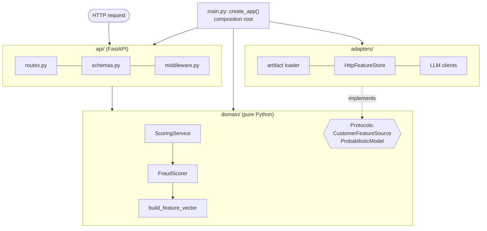
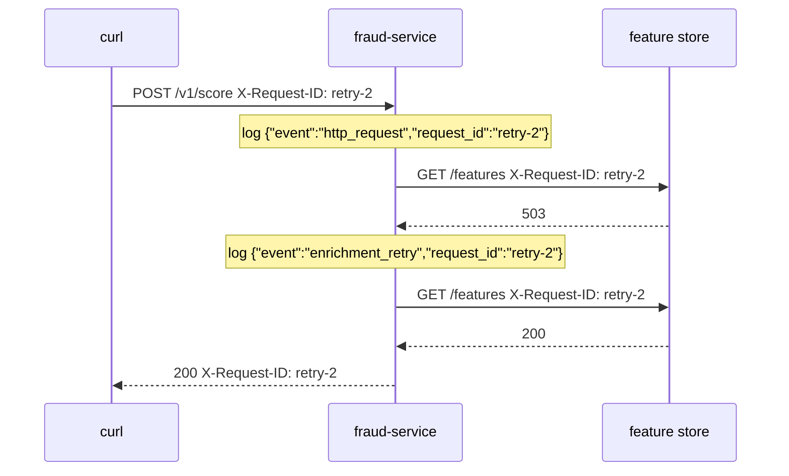

# Lesson 1.4: Building production services

> ⏱ ~60 min · 🎚 Level: Core · 🧰 Needs: [Lesson 1.3](03-reliability-primitives.md), [Lesson 0.2](../00-foundations/02-python-for-production.md)

[Course home](../../README.md) › [Module 1](README.md) › Lesson 1.4

## 📨 The situation

> **From: Priya (Security)**
> I found an API key starting with `sk-live-` in Sam's notebook, which is in a shared drive. Please rotate it, and tell me how the new service keeps secrets out of code, images and logs.
>
> **From: Diego (SRE)**
> And when something goes wrong at 3 a.m., I need to find *all* log lines for *one* request in under a minute. Also: what's the difference between your `/health` and `/ready`? I'll wire them into Kubernetes.

This lesson walks through the inside of a production service: how the code is organized, how it's configured, how secrets are handled, how it uses `async` for slow I/O, how it logs, and how it tells the platform it's healthy. Every section maps to a file in the Lab 1 service.

## 🎯 By the end you can

- **Organize** a service into API, domain and adapter layers, and **explain** the dependency rule.
- **Load** typed, validated configuration from the environment and **keep secrets** out of code, images and logs.
- **Explain** when `async` helps (I/O-bound work) and when it hurts (blocking or CPU-bound work in the event loop).
- **Add** request IDs and structured JSON logs, and **trace** one request across services.
- **Implement** liveness, readiness and startup checks correctly.

## 🤔 Predict first

1. Your FastAPI endpoint is `async def` and calls `requests.get(...)` (a synchronous library) on a slow URL. What happens to *other* requests meanwhile?
2. Should `/health` return 503 when the database is down?
3. Where should the decision threshold (0.30) live: in code, in a config file baked into the image, or in an environment variable?

---

## 1. Layered architecture: API, domain, adapters

Sam's `predict()` mixed everything: HTTP-shaped input, pandas, the model, the threshold and the output string, all in one function using global variables. That makes it impossible to test, to change one part without breaking another, or to swap the model runtime.

A production service separates **three concerns**:

| Layer | Responsibility | Knows about | Must NOT know about | Lab 1 files |
|---|---|---|---|---|
| **API** | Translate HTTP ↔ domain: schemas, status codes, headers | FastAPI, Pydantic, the domain | Model files, other services' URLs, SQL | `api/schemas.py`, `api/routes.py`, `api/middleware.py` |
| **Domain** | Business rules: features, scoring, decision policy, fallback, orchestration | Plain Python, dataclasses, *protocols* (interfaces) | HTTP, FastAPI, httpx, scikit-learn, files | `domain/features.py`, `domain/scoring.py`, `domain/service.py` |
| **Adapters** | Talk to the outside world: model artifacts, other services, LLMs | httpx, joblib, file systems | HTTP request handling, business rules | `adapters/artifacts.py`, `adapters/enrichment.py`, `adapters/llm.py` |



### The dependency rule

**Dependencies point inward.** The API depends on the domain. Adapters implement interfaces the domain defines. The domain depends on nothing outside itself.

How does the domain call the feature store without importing httpx? It declares what it needs as a **protocol** (an interface) and receives an implementation at runtime:

```python
# domain/service.py: the domain says WHAT it needs
class CustomerFeatureSource(Protocol):
    async def get_customer_features(self, customer_id: str) -> dict[str, float]: ...

class ScoringService:
    def __init__(self, scorer: FraudScorer, features: CustomerFeatureSource | None): ...
```

```python
# adapters/enrichment.py: the adapter says HOW (HTTP, timeouts, retries)
class HttpFeatureStore:
    async def get_customer_features(self, customer_id: str) -> dict[str, float]: ...
```

```python
# main.py: the composition root wires them together
feature_store = HttpFeatureStore(settings.enrichment_base_url, ...)
app.state.scoring_service = ScoringService(app.state.scorer, feature_store)
```

This style is often called **hexagonal architecture** or **ports and adapters**. Its payoffs are concrete:

- **Testability**: domain tests need no server, no network and no model file. A three-line fake satisfies the protocol.
- **Swappability**: Module 3 replaces scikit-learn inference with ONNX Runtime. Only an adapter changes; `FraudScorer` only needs "something with `predict_proba`".
- **Readability**: a risk analyst can read `domain/scoring.py` and understand the decision policy without wading through HTTP code.

> ⚠️ **Common mistake:** over-abstracting. Three layers is enough for most services. If you find yourself writing `AbstractScoringServiceFactoryProvider`, stop. A layer must earn its place by isolating something that changes for a different reason.

### The app factory and lifespan

Sam's notebook trained the model at import time. In the service, `create_app()` builds the application, and a **lifespan** function runs once at startup and once at shutdown:

```python
@asynccontextmanager
async def lifespan(app: FastAPI):
    loaded = load_artifact(settings.model_dir, settings.model_version)  # once, not per request
    app.state.scorer = FraudScorer(loaded.model, loaded.version, policy)
    ...
    yield                       # the app serves requests here
    await feature_store.aclose()  # clean shutdown: close connection pools
```

Expensive things (loading the model, creating HTTP connection pools) happen **once**. A factory also lets tests build an app with test settings and fake dependencies: `create_app(settings, enrichment_transport=fake, llm=FakeLLM())`.

---

## 2. Configuration management

The **Twelve-Factor App** methodology says: **store config in the environment**. Config is everything that varies between deploys (dev, staging, prod): URLs, thresholds, log levels, feature flags. Code is what stays the same.

Lab 1 uses `pydantic-settings`, which reads `KESTREL_*` environment variables into a **typed, validated** object:

```python
class Settings(BaseSettings):
    model_config = SettingsConfigDict(env_prefix="KESTREL_", env_file=".env", extra="ignore")

    review_threshold: float = Field(0.30, ge=0.0, le=1.0)
    decline_threshold: float = Field(0.80, ge=0.0, le=1.0)
    enrichment_timeout_s: float = Field(0.3, gt=0)
    openai_api_key: SecretStr | None = None

    @model_validator(mode="after")
    def _thresholds_are_ordered(self):
        if self.review_threshold > self.decline_threshold:
            raise ValueError("review_threshold must be <= decline_threshold")
        return self
```

Why this matters:

- **Fail fast**: `KESTREL_REVIEW_THRESHOLD=abc` or a review threshold above the decline threshold crashes at **startup**, in the deploy pipeline, instead of producing wrong decisions at 3 a.m. (Lab 1 *Break it #3*).
- **One image, many environments**: the same container image runs in staging and production with different env vars. You test the exact artifact you ship.
- **Typed access**: `settings.enrichment_timeout_s` is a float, not a string you have to parse in 12 places.

Answer to prediction 3: a threshold is a **business parameter** that changes independently of code → environment variable (or a config service), with a validated default. Module 4 shows how to *choose* it; Module 5 shows how to release changes to it safely.

> 💡 **Production tip:** keep a committed `.env.example` listing every setting with safe defaults and comments (Lab 1 has one), and **never** commit `.env`. The example documents the config surface; the real file stays local.

---

## 3. Secrets: separate, hidden, rotatable

A **secret** is config that grants access: API keys, database passwords, signing keys. Secrets need everything config needs, plus three extra rules:

1. **Never in code or Git.** Git history is forever: deleting the line in a later commit doesn't remove it. If a secret was committed, consider it leaked and **rotate** it (Priya's request).
2. **Never in the image.** Anyone who can pull the image can read every layer (`docker history`, `docker save`). Lab 1's `.dockerignore` excludes `.env` for this reason.
3. **Never in logs or error messages.** Lab 1 types the key as `SecretStr`, so printing the settings shows `**********`:

```python
>>> Settings(openai_api_key="sk-test-123")
Settings(..., openai_api_key=SecretStr('**********'), ...)
>>> settings.openai_api_key.get_secret_value()   # explicit, greppable, reviewable
'sk-test-123'
```

Where secrets come from, from least to most mature:

| Approach | Example | Notes |
|---|---|---|
| Local `.env` file (git-ignored) | Your laptop | Fine for development only |
| Environment variables injected by the platform | Kubernetes `Secret` → `envFrom` (see `k8s/secret.example.yaml`) | Kubernetes Secrets are base64-*encoded*, not encrypted, unless you configure encryption at rest |
| Mounted files | Secret volume at `/var/run/secrets/...` | Can be rotated without restarting, if the app re-reads |
| **Secret manager** | HashiCorp Vault, AWS Secrets Manager, GCP Secret Manager, Azure Key Vault | Central audit, access policies, automatic rotation; the production standard |

> ⚠️ **Common mistake:** "it's a private repo, so it's fine". Private repos get forked, cloned to laptops, mirrored to CI logs and shared with contractors. Use a secret scanner (for example gitleaks or GitHub secret scanning) in CI to catch mistakes before merge.

---

## 4. Async for I/O-bound work

### The waiter analogy

A synchronous worker is a waiter who takes one table's order, walks to the kitchen, **stands there until the food is ready**, brings it, and only then serves the next table. An async worker takes an order, hands it to the kitchen, and **serves other tables while the food cooks**. The kitchen (the network, the LLM) is equally fast in both cases; the waiter just doesn't waste time standing around.

AI services spend most of their time **waiting**: on LLM APIs (seconds), vector databases, feature stores, other services. That is **I/O-bound** work, and it's exactly where `async` shines.

### The numbers

Suppose each docs-assistant request waits 2 s for the LLM and uses 5 ms of CPU.

| Worker model | Concurrent requests per worker | Throughput per worker |
|---|---|---|
| Synchronous (one request at a time) | 1 | ~0.5 requests/s |
| Async (event loop) | Hundreds (limited by memory and the LLM's capacity) | ~100+ requests/s |

### Doing independent calls in parallel

`async` also lets one request do independent I/O **concurrently**:

```python
import asyncio

# Sequential: 300 + 200 + 250 = ~750 ms
features = await feature_store.get_customer_features(cid)
history = await history_client.recent(cid)
device = await device_client.reputation(device_id)

# Concurrent: max(300, 200, 250) = ~300 ms
features, history, device = await asyncio.gather(
    feature_store.get_customer_features(cid),
    history_client.recent(cid),
    device_client.reputation(device_id),
)
```

The docs-assistant uses the same trick to query keyword search and vector search at the same time (Module 2).

### The trap: blocking the event loop

An event loop runs on **one thread**. If anything inside an `async def` blocks that thread, *every* request handled by that worker freezes. Answer to prediction 1: calling `requests.get(...)` (synchronous) inside `async def` blocks the loop for the whole duration of the call, so all other requests wait too.

| Inside `async def`… | Problem | Fix |
|---|---|---|
| `requests.get(...)`, sync DB drivers | Blocks the loop on network I/O | Use async clients (`httpx.AsyncClient`, async drivers) |
| `time.sleep(1)` | Blocks the loop | `await asyncio.sleep(1)` |
| Heavy CPU work (large model inference, big pandas jobs) | Holds the loop while computing | `await run_in_threadpool(fn, ...)` (Starlette) or `asyncio.to_thread`; for heavy CPU, a process pool or a dedicated inference server (Module 3) |

Lab 1's scorer calls `predict_proba` directly because, for this small model, it takes well under a millisecond. The comment in `domain/scoring.py` marks the spot where a heavy model would move to a thread pool.

> 💡 **Production tip:** FastAPI runs plain `def` endpoints in a thread pool automatically. If an endpoint only uses synchronous libraries, declare it with `def`, not `async def`. Use `async def` only when everything inside is non-blocking.

> 🔎 **Under the hood:** concurrency also needs **limits**. An async service can accept 1,000 concurrent LLM calls, but your LLM provider may allow 50. Use an `asyncio.Semaphore` or the client's connection-pool limits to cap in-flight calls; otherwise you just convert latency into 429 errors.

---

## 5. Request IDs and structured logs

### Structured logging

Compare these two log lines for the same event:

```
WARNING retry 1 for feature store after 503, sleeping 0.031s (customer cus_00017)
```

```json
{"event": "enrichment_retry", "attempt": 1, "sleep_s": 0.031, "error": "HTTP 503",
 "request_id": "retry-2", "service": "fraud-service", "level": "warning",
 "timestamp": "2026-11-10T11:57:25.913247Z"}
```

The first is for humans reading one line. The second is for **machines searching millions of lines**: you can filter `event == "enrichment_retry"`, group by `error`, count per minute, or pull every line where `request_id == "retry-2"`. Log platforms (Loki, Elasticsearch, Cloud Logging, Datadog) index JSON fields directly.

Lab 1 configures `structlog` to print one JSON object per line (`logging.py`). Rules of thumb:

- Use a **stable event name** (`model_loaded`, `enrichment_failed`) plus fields, not sentences with values baked in.
- Include **who/what/how long**: request ID, service, version, duration, outcome.
- Choose levels deliberately: `info` for normal events, `warning` for handled problems (a retry), `error` for failures needing attention.
- **Never log secrets or raw personal data**: card numbers, full prompts with customer data, tokens. (Module 5 adds automatic PII redaction.)

### Request IDs: following one request through the system

A **request ID** (also called a correlation ID) is a unique string attached to one request and carried everywhere it goes. Lab 1's middleware:

1. Reads `X-Request-ID` from the incoming request (so a gateway's ID is preserved) **if it looks valid**, otherwise generates one. Never trust header contents blindly: the regex rejects newlines and junk that could inject fake log lines.
2. Binds it to every log line via `structlog.contextvars`.
3. Stores it in a `ContextVar` so the enrichment adapter can **forward it** to the feature store.
4. Returns it in the response header and the body, so a customer or a support agent can quote it.



That's how Diego finds every log line for one request in under a minute, across services. Module 4 upgrades this to **distributed tracing** with OpenTelemetry (W3C `traceparent` headers, spans with timings), but the idea is the same.

---

## 6. Health, readiness and startup checks

The platform (Docker, Kubernetes, a load balancer) needs to ask your service two different questions:

| Check | Question | If it fails, the platform… | Should check | Must NOT check | Lab 1 |
|---|---|---|---|---|---|
| **Liveness** | "Is this process stuck or dead?" | **Restarts** the container | That the process can answer HTTP | Dependencies (DB, feature store, LLM API) | `GET /health` → always 200 if alive |
| **Readiness** | "Should I send this instance traffic right now?" | **Stops routing** traffic to it (no restart) | That it can do useful work: model loaded and verified, warm-up done | Things that would make *every* replica unready at once for a shared outage, unless that's intended | `GET /ready` → 200 only if artifact loaded and checksum verified |
| **Startup** | "Has it finished starting?" | Waits; liveness isn't checked until this passes | Same as liveness, with a long allowance | | `startupProbe` in `k8s/deployment.yaml` |

Answer to prediction 2: **no**. If `/health` failed whenever a dependency was down, Kubernetes would restart **every** healthy replica during a dependency outage. They'd come back, fail again, and restart again: a total outage caused by your own health check. Restarting can't fix someone else's database.

Lab 1 combines readiness with graceful degradation: a tampered artifact means `/health` 200 (alive), `/ready` 503 (don't route to me), and if a request arrives anyway, `/v1/score` falls back to rules with `degraded_reasons: ["model_unavailable"]`.

> 💡 **Production tip:** readiness for a shared dependency is a judgement call. If the feature store is down for *all* replicas, marking all of them unready leaves zero instances serving, which defeats graceful degradation. Lab 1 deliberately ties readiness only to the **local** model artifact, and handles the shared feature store with timeouts and fallbacks.

### Graceful shutdown

When Kubernetes replaces a pod, it sends **SIGTERM**, waits (`terminationGracePeriodSeconds`, 30 s in Lab 1's manifest), then kills it. A good service stops accepting new requests, finishes in-flight ones and closes connections: uvicorn handles the first two, and the lifespan's shutdown block closes the HTTP client. The Dockerfile uses the exec form of `CMD` so uvicorn is PID 1 and actually receives the signal (lesson 1.5).

---

## 7. Putting it together: one request through Lab 1

1. `RequestIdMiddleware` assigns `request_id`, binds it to logs.
2. FastAPI validates the body against `ScoreRequest` → 422 if invalid (`hour: 25`, unknown field, negative amount).
3. `routes.score` converts it to a domain `Transaction` and calls `ScoringService.score`.
4. If customer aggregates are missing, the service calls the `CustomerFeatureSource` port → `HttpFeatureStore` (timeout, retries, jitter, deadline, budget, forwarded request ID) → on failure, defaults + `degraded_reasons`.
5. `FraudScorer` builds the feature vector with the **same function used in training**, calls the model (or rules), applies `DecisionPolicy`.
6. The route stores the result for `/v1/explain`, returns `ScoreResponse` with the request ID; the middleware logs method, path, status and duration as JSON.

---

## 🧪 Try it

In [Lab 1](lab/README.md):

1. **Steps 4–6**: run the tests, start the service, send a request with your own `X-Request-ID`, and find its log line.
2. Start the service with an **invalid** threshold combination (*Break it #3*) and read the startup error.
3. Open `src/kestrel_fraud/domain/` and confirm there is **no** `import fastapi`, `import httpx` or `import sklearn` anywhere: `grep -rE "import (fastapi|httpx|sklearn)" src/kestrel_fraud/domain` should print nothing.
4. Bonus: in `api/routes.py`, temporarily add `time.sleep(2)` inside `score`, then fire 5 requests in parallel (`for i in 1 2 3 4 5; do curl … & done; wait`) and time it. Replace it with `await asyncio.sleep(2)` and repeat. Explain the difference.

## 🏭 In the real world

- [The Twelve-Factor App](https://12factor.net/) is a short, still-relevant methodology for services; factors III (Config), XI (Logs) and IX (Disposability) map directly to this lesson.
- Kubernetes' documentation page on [liveness, readiness and startup probes](https://kubernetes.io/docs/tasks/configure-pod-container/configure-liveness-readiness-startup-probes/) explains each probe type with examples.
- FastAPI's documentation on [concurrency and async/await](https://fastapi.tiangolo.com/async/) explains (with a burger analogy) exactly when to use `async def` vs `def`.

## ✅ Check yourself

<details>
<summary>Q1. A teammate adds <code>import httpx</code> to <code>domain/scoring.py</code> to call a new risk API. What's wrong, and how would you restructure it?</summary>

It breaks the dependency rule: the domain now depends on transport details, becomes harder to test, and mixes business logic with I/O. Instead: define a protocol in the domain (e.g. `RiskSignalSource`), implement it in `adapters/` with httpx (timeouts, retries), and inject it in `main.py`.
</details>

<details>
<summary>Q2. Name three places a secret must never end up, and one tool that helps catch mistakes.</summary>

Source code/Git history, container images (any layer), and logs/error messages (also: notebooks in shared drives, CI output). A secret scanner such as gitleaks or GitHub secret scanning catches commits that contain secrets.
</details>

<details>
<summary>Q3. Your <code>async def ask()</code> endpoint calls a 1.5 s LLM API using the synchronous <code>requests</code> library. Under load, latency for <i>all</i> endpoints, even <code>/health</code>, jumps. Why?</summary>

`requests` blocks the event loop thread for 1.5 s per call, so the worker can't run any other coroutine, including `/health`. Use an async client (`httpx.AsyncClient`), or make the endpoint a plain `def` so FastAPI runs it in a thread pool.
</details>

<details>
<summary>Q4. What's the difference between liveness and readiness, and what does Kubernetes do when each fails?</summary>

Liveness: "is the process alive?" Failure → the container is restarted. Readiness: "should it receive traffic now?" Failure → it's removed from the Service's endpoints (no restart) until it's ready again.
</details>

<details>
<summary>Q5. Why does the request-ID middleware validate the incoming header instead of copying it as-is?</summary>

Headers are untrusted input. A value with newlines or control characters could forge extra log lines (log injection) or break downstream systems; an extremely long value wastes storage. Validate the format and replace invalid values with a generated ID.
</details>

<details>
<summary>Q6. Why is <code>{"event": "enrichment_retry", "attempt": 1, ...}</code> better than <code>"retry 1 after 503"</code>?</summary>

Structured fields can be filtered, aggregated and alerted on without fragile regex parsing (e.g. count `enrichment_retry` per minute, group by `error`, follow a `request_id`). Stable event names also survive wording changes.
</details>

## 💬 Explain it back

Priya and Diego each asked a question at the top. Write a short reply to each (3–4 sentences), referring to specific files in the Lab 1 service.

## 🔑 Key takeaways

- **Layers**: API (HTTP), domain (rules, pure Python), adapters (outside world). Dependencies point inward; the domain defines protocols, adapters implement them, `create_app()` wires them.
- **Config in the environment**, typed and validated at startup; one image for every environment.
- **Secrets**: never in code, images or logs; `SecretStr`; secret managers in production; rotate anything that leaked.
- **Async** wins for I/O-bound AI workloads; never block the event loop; cap concurrency.
- **Structured JSON logs + request IDs** forwarded across services make incidents debuggable.
- **Liveness** = alive (never check dependencies), **readiness** = can serve (model verified), **startup** = still booting.

## 📚 Go deeper (free)

| | Resource | Why read it | Time |
|---|---|---|---|
| ⭐ | [FastAPI tutorial](https://fastapi.tiangolo.com/tutorial/), incl. *Bigger Applications* | The framework used throughout the course | 2 h |
| ⭐ | [The Twelve-Factor App](https://12factor.net/) | Config, logs, disposability: the service basics | 30 min |
| 🔍 | [FastAPI: Concurrency and async/await](https://fastapi.tiangolo.com/async/) | When to use `async def` vs `def` | 20 min |
| 🔍 | [Pydantic Settings docs](https://docs.pydantic.dev/latest/concepts/pydantic_settings/) | Typed config from env vars and files | 20 min |
| 🔍 | [structlog documentation](https://www.structlog.org/) | Structured logging in Python | 30 min |
| 🔍 | [Kubernetes: Configure liveness, readiness and startup probes](https://kubernetes.io/docs/tasks/configure-pod-container/configure-liveness-readiness-startup-probes/) | Official guide to the three probes | 20 min |
| 🔍 | [OWASP Secrets Management Cheat Sheet](https://cheatsheetseries.owasp.org/cheatsheets/Secrets_Management_Cheat_Sheet.html) | How mature teams store and rotate secrets | 30 min |

---
⬅️ [Lesson 1.3: Reliability primitives](03-reliability-primitives.md) · ➡️ [Lesson 1.5: Artifacts, Docker and Kubernetes](05-artifacts-and-containers.md)
