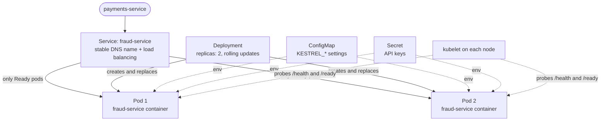

# Lesson 1.5: Artifacts, Docker and Kubernetes

> ⏱ ~60 min · 🎚 Level: Core · 🧰 Needs: [Lesson 1.4](04-production-services.md), [Lesson 0.1](../00-foundations/01-setup-your-workbench.md) (Docker installed)

[Course home](../../README.md) › [Module 1](README.md) › Lesson 1.5

## 📨 The situation

> **From: Maya (Engineering Manager)**
> Quick one from leadership: "which fraud model is running in production, and what data was it trained on?"
> Sam says it's `model_final_v2.pkl`, but there are three files with that name on three laptops.
> Diego also wants a container image by Friday so the platform team can deploy it.

This lesson covers the last mile of the packaging path: **notebook → versioned artifact → API → container image → cluster**. You'll learn how to serialize models safely, version them so anyone can answer Maya's question in seconds, build lean and secure Docker images, and read the Kubernetes objects that will run them.

## 🎯 By the end you can

- **Compare** model serialization formats and **explain** why loading a pickle from an untrusted source is dangerous.
- **Produce** an immutable, versioned artifact with sha256 metadata, and **verify** it before loading.
- **Explain** images, containers, layers and caching, and **write** a multi-stage, non-root Dockerfile.
- **Decide** whether to bake the model into the image or fetch it at startup.
- **Map** Pods, Deployments, Services, ConfigMaps, Secrets, probes and resources to the problems they solve.

## 🤔 Predict first

1. You change one line of Python and rebuild your image. Why might Docker re-download every dependency, and how do you prevent it?
2. A sha256 checksum proves which of these: the file isn't corrupted, the file was made by your training job, the model is good?
3. Your Python image is 1.2 GB. Name two reasons it might be that big.

---

## 1. Serializing models: formats and their risks

**Serialization** turns an in-memory object (a trained model) into bytes on disk so another process can load it later. The format you pick affects security, portability and speed.

| Format | What it stores | Loads in | Security | Typical use |
|---|---|---|---|---|
| **pickle / joblib** | Any Python object, including code references | Python, same library versions | ⚠️ **Loading can execute arbitrary code** | scikit-learn models (Lab 1), quick prototypes |
| **skops** | scikit-learn models without arbitrary code | Python | Safer: explicit allow-list of types | Sharing sklearn models |
| **Native formats** (XGBoost/LightGBM JSON, Keras `.keras`) | Model structure + weights | The library, often across languages | Generally data-only | Gradient boosting, Keras |
| **ONNX** | A computation graph + weights in a standard format | ONNX Runtime (C++, Python, Java, JS…), many accelerators | Data-only | Portable, fast inference (Module 3) |
| **safetensors** | Raw tensors (weights only) | PyTorch, JAX, TF via libraries | Designed to be safe: no code execution | LLM and deep learning weights (Hugging Face default) |
| **GGUF** | Quantized LLM weights + metadata | llama.cpp, Ollama | Data-only | Local LLMs (Module 3) |

### Why pickle is dangerous

A pickle file contains instructions for rebuilding an object, and those instructions can call **any Python function**, for example `os.system`. Loading a malicious `model.pkl` runs the attacker's code with your service's permissions. This isn't theoretical: public model hubs scan uploads for exactly this.

Rules for pickle/joblib in production:

1. **Only load artifacts produced by your own pipeline**, from storage you control.
2. **Verify the checksum before loading** (section 2). Lab 1 computes the sha256 and compares it with the metadata *before* calling `joblib.load`.
3. **Pin library versions**: a model pickled with scikit-learn 1.5 may not unpickle (or may behave differently) with 1.7. The lab records `sklearn.__version__` in metadata and locks dependencies in `uv.lock`.
4. Prefer **data-only formats** (ONNX, safetensors, native JSON) when you can, especially for anything downloaded.

---

## 2. Versioned artifacts and sha256

### What an artifact version must guarantee

An **artifact** is the packaged output of training: the model file plus everything needed to use and trust it. A good artifact version is:

- **Immutable**: once `20261110T115648Z-2a36bb33` exists, it never changes. A new training run creates a new version. Lab 1's training uses `mkdir(exist_ok=False)` so it *can't* overwrite a version.
- **Uniquely named**: the lab uses `<UTC timestamp>-<first 8 hex chars of the data's sha256>`, so the name alone tells you *when* and *on which data*.
- **Self-describing**: `metadata.json` answers who/what/when/how (lesson 1.1's handoff table).
- **Verifiable**: a checksum proves the bytes are exactly what training produced.

```
artifacts/fraud-model/
├── LATEST                          → "20261110T115648Z-2a36bb33"
├── 20261109T090000Z-2a36bb33/
│   ├── model.joblib
│   └── metadata.json
└── 20261110T115648Z-2a36bb33/
    ├── model.joblib
    └── metadata.json
```

### What a sha256 is

**SHA-256** is a cryptographic hash function: it turns any input, of any size, into a fixed 256-bit fingerprint (64 hex characters). Three properties make it useful:

1. **Deterministic**: the same bytes always give the same hash.
2. **Avalanche effect**: changing a single bit changes the hash completely.
3. **Collision resistant**: it's computationally infeasible to find two different inputs with the same hash.

Try it:

```bash
echo "Kestrel" | shasum -a 256    # macOS (Linux: sha256sum)
echo "kestrel" | shasum -a 256    # one letter different → a completely different hash
```

Lab 1 hashes the file in chunks, so even multi-GB model files never have to fit in memory:

```python
def sha256_file(path: Path, chunk_size: int = 1 << 20) -> str:
    digest = hashlib.sha256()
    with path.open("rb") as fh:
        for chunk in iter(lambda: fh.read(chunk_size), b""):
            digest.update(chunk)
    return digest.hexdigest()
```

And it verifies **before** deserializing:

```python
expected = metadata.get("model_sha256")
actual = sha256_file(path / MODEL_FILENAME)
if expected != actual:
    raise ArtifactIntegrityError(...)
...
model = joblib.load(path / MODEL_FILENAME)   # only after the check
```

### What a checksum does and doesn't prove

Back to prediction 2:

| Claim | Does the sha256 check prove it? |
|---|---|
| The file isn't corrupted or truncated (bad copy, partial upload, disk error) | ✅ Yes |
| The file is the same one recorded in this metadata | ✅ Yes |
| The file was produced by *your* training job | ❌ No: anyone who can rewrite both `model.joblib` and `metadata.json` can make them match |
| The model is good | ❌ No: that's evaluation (Module 4) |

Proving **who** produced an artifact needs a **signature**: the training pipeline signs the hash with a private key, and the service verifies it with the public key. Tools such as Sigstore's cosign do this for container images and files. Module 5 covers supply-chain security.

### The LATEST pointer and atomic updates

The service loads `latest` by reading the `LATEST` file. Training updates it **atomically**: write a temporary file, then rename it over the old one. On POSIX systems a rename is atomic, so a service starting at that exact moment reads either the old version or the new one, never a half-written file.

```python
tmp = out_dir / ".LATEST.tmp"
tmp.write_text(version + "\n")
tmp.replace(out_dir / "LATEST")
```

> 💡 **Production tip:** in production, "latest" is usually the wrong thing to deploy. Pin an **explicit version** in config (`KESTREL_MODEL_VERSION=20261110T115648Z-2a36bb33`) so a deploy is reproducible and a rollback is a config change. A **model registry** (MLflow, Module 2) manages these versions plus stages such as *staging* and *production*, with approval history.

---

## 3. The packaging path

```mermaid
flowchart LR
    NB["📓 Notebook<br/>exploration"] -->|"extract functions,<br/>fix seeds"| SCRIPT["🐍 Training script<br/>scripts/train.py"]
    SCRIPT -->|"run with pinned data + code"| ART["📦 Artifact<br/>model.joblib + metadata.json"]
    ART -->|"load + verify at startup"| API["🌐 Service<br/>FastAPI + domain"]
    API -->|"docker build"| IMG["🐳 Image<br/>kestrel/fraud-service:0.1.0"]
    IMG -->|"docker push"| REG[("Image registry")]
    REG -->|"kubectl / CD"| K8S["☸️ Cluster<br/>Deployment + Service"]
```



Each arrow removes a source of "works on my machine":

| Step | Removes |
|---|---|
| Notebook → script | Hidden state, out-of-order cells, manual steps |
| Script → artifact | "Which model is this?" |
| Artifact → service | Ad-hoc `predict()` functions, two feature code paths |
| Service → image | Different Python, OS libraries, dependency versions per machine |
| Image → registry → cluster | Manual deploys, snowflake servers |

---

## 4. Docker fundamentals

### Images and containers

- An **image** is a read-only template: a filesystem (OS libraries, Python, your packages, your code, the model) plus metadata (which command to run, which port, which user).
- A **container** is a running instance of an image, with its own process space, network and a thin writable layer on top.

Analogy: the image is a recipe card plus all the ingredients sealed in a box; a container is one dish cooked from it. You can cook many identical dishes from one box.

### Layers and caching

Each instruction in a Dockerfile (`FROM`, `COPY`, `RUN`) creates a **layer**. Docker caches layers and reuses them as long as the instruction and its inputs haven't changed. **Once one layer changes, every layer after it is rebuilt.**

That's the answer to prediction 1. This ordering is slow:

```dockerfile
COPY . .                         # any code change invalidates this layer…
RUN pip install -r requirements.txt   # …so dependencies reinstall on every build
```

This ordering (used in Lab 1) is fast:

```dockerfile
COPY pyproject.toml uv.lock ./                               # changes rarely
RUN uv sync --frozen --no-dev --no-install-project           # cached until deps change
COPY src ./src                                               # changes often
RUN uv sync --frozen --no-dev --no-editable                  # seconds
```

**Order instructions from least to most frequently changing.**

### Multi-stage builds

Building often needs tools you don't want at runtime (compilers, package managers, caches). A **multi-stage** build uses one stage to build and copies only the result into a clean final stage:

```dockerfile
FROM python:3.12-slim AS builder
COPY --from=ghcr.io/astral-sh/uv:0.8.0 /uv /bin/uv
# … resolve and install dependencies into /app/.venv …

FROM python:3.12-slim AS runtime
RUN groupadd --system --gid 10001 app && \
    useradd --system --uid 10001 --gid app --no-create-home app
COPY --from=builder --chown=app:app /app/.venv /app/.venv
COPY --chown=app:app artifacts/fraud-model/ /app/artifacts/fraud-model/
USER app
HEALTHCHECK CMD python -c "import urllib.request; urllib.request.urlopen('http://127.0.0.1:8001/health', timeout=2)"
CMD ["uvicorn", "kestrel_fraud.main:create_app", "--factory", "--host", "0.0.0.0", "--port", "8001"]
```

### The production Dockerfile checklist

| Practice | Why | In Lab 1 |
|---|---|---|
| Small, pinned base image (`python:3.12-slim`, ideally pinned by digest) | Fewer packages = fewer vulnerabilities; reproducible builds | ✅ slim (digest pinning left as an exercise) |
| Pin tool versions (`uv:0.8.0`) and use a lockfile (`uv.lock`, `--frozen`) | The same image every time | ✅ |
| Dependencies before code | Fast, cached rebuilds | ✅ |
| Multi-stage | No build tools or caches in the final image | ✅ |
| **Non-root user** | A compromised app isn't root in the container | ✅ `USER app` (uid 10001) |
| `.dockerignore` | Keeps `.env`, `.venv`, tests and data out of the build context | ✅ |
| No secrets in any layer | Layers are readable by anyone who can pull the image | ✅ secrets come from env at runtime |
| Exec-form `CMD ["uvicorn", …]` | The app is PID 1 and receives SIGTERM for graceful shutdown | ✅ |
| `HEALTHCHECK` | Docker (and docker compose) can detect a hung container | ✅ (Kubernetes uses its own probes) |
| One process per container | Simple lifecycle, logs and scaling | ✅ |

> ⚠️ **Common mistake:** switching to `alpine` to "make the image smaller". Alpine uses musl instead of glibc, so many scientific Python wheels (NumPy, SciPy, scikit-learn) aren't available prebuilt and must compile from source: slower builds, sometimes bigger images and subtle bugs. For Python ML, `slim` is the usual sweet spot.

### Why is the image ~440 MB?

Prediction 3. Run `docker images kestrel/fraud-service:0.1.0`: about 440 MB. Most of it is NumPy, SciPy and scikit-learn with their compiled math libraries, plus the Python base. To shrink it: export the model to ONNX and serve it with `onnxruntime` instead of scikit-learn (Module 3), or use a distroless base. For GPU images with PyTorch and CUDA, multi-GB images are normal, which is one reason image pull time matters for autoscaling (Module 6).

### Bake the model in, or fetch it at startup?

| | **Bake into the image** (Lab 1) | **Fetch from a registry/object storage at startup** |
|---|---|---|
| What a tag means | Code + model, exactly | Code only; model chosen by config |
| Reproducibility & rollback | Excellent: roll back the image tag | Good, if the model version is pinned in config |
| Release a new model | Rebuild and redeploy the image | Change config and restart; no rebuild |
| Startup | Fast, no network dependency | Slower; depends on storage availability (needs retries and readiness) |
| Image size | Grows with the model (bad for multi-GB LLM weights) | Small image |
| Best for | Small models (MBs), strict audit requirements | Large models, frequent model updates, many models per service |

Many teams start by baking (simple, auditable) and move to fetching from a model registry as models grow or release cadence increases. Large LLM weights are almost always fetched or mounted from a volume.

---

## 5. From image to registry

An **image registry** stores and distributes images (Docker Hub, GitHub Container Registry, AWS ECR, GCP Artifact Registry). A deploy pipeline pushes `kestrel/fraud-service:0.1.0`, and the cluster pulls it.

> 💡 **Production tip:** tags are **mutable** (anyone can push a new image as `0.1.0` or, worse, `latest`). An image **digest** (`kestrel/fraud-service@sha256:9f2c…`) is immutable: the same sha256 idea from section 2, applied to the whole image. Production deploys should reference immutable tags or digests, never `latest`.

---

## 6. Kubernetes in one page

You'll deploy to Kubernetes in Module 6. For now, you need to read a manifest and know which object solves which problem. **Kubernetes** is a system that keeps a cluster of machines in a **desired state** that you declare in YAML: "run 2 copies of this image, with this config, and route traffic only to the healthy ones". Controllers continuously compare reality with the declaration and fix differences.



| Object | Problem it solves | Lab 1 manifest |
|---|---|---|
| **Pod** | The smallest unit: one or more containers sharing network and storage. Pods are disposable. | Created by the Deployment |
| **Deployment** | "Keep *N* identical pods running; replace them gradually on updates" | `replicas: 2`, `RollingUpdate` with `maxUnavailable: 0`, `maxSurge: 1` |
| **Service** | Pods come and go with new IPs; a Service gives a **stable name** and load-balances across **ready** pods | `fraud-service`, port 80 → 8001 |
| **ConfigMap** | Non-secret config as env vars or files (12-factor) | `KESTREL_*` thresholds and timeouts |
| **Secret** | Sensitive config, access-controlled separately | `secret.example.yaml` (example only) |
| **Probes** | Liveness → restart; readiness → route traffic; startup → allow slow boots (lesson 1.4) | `/health`, `/ready`, `startupProbe` |
| **Resources** | `requests`: what the scheduler reserves; `limits`: hard ceilings (exceed memory → OOM-killed) | 250m CPU / 256Mi requested, 512Mi limit |
| **securityContext** | Enforce non-root, no privilege escalation, read-only filesystem | `runAsNonRoot`, `readOnlyRootFilesystem`, drop all capabilities |

### What happens during a rolling update

1. You change the image tag to `0.2.0`.
2. With `maxSurge: 1`, Kubernetes starts a **third** pod with the new image.
3. The new pod passes its **startup** probe, then its **readiness** probe (model loaded and verified).
4. Only then is it added to the Service, and one old pod is terminated (SIGTERM → graceful shutdown).
5. Repeat until all pods run `0.2.0`. With `maxUnavailable: 0`, capacity never drops below 2.

If the new image has a corrupted model, its readiness probe never passes, so **it never receives traffic** and the rollout stalls instead of breaking production. That's lessons 1.4 and 1.5 working together. Module 6 adds **canary releases** with automatic rollback on top.

> 🔎 **Under the hood:** managed Kubernetes (EKS, GKE, AKS) runs the control plane for you; you still own your manifests, images, probes and resource settings. For simple services, managed container platforms (Cloud Run, ECS, Azure Container Apps) offer the same container image → running service path with less to operate. Module 6 compares them.

---

## 🧪 Try it

In [Lab 1](lab/README.md):

1. **Step 3**: train twice and confirm you get two version folders with different `created_at` values. Then run `shasum -a 256 artifacts/fraud-model/*/model.joblib` and compare with each `metadata.json`. You'll find the two model files are **bit-for-bit identical**: same data + same code + same seed + same library versions = the same model. That's reproducibility you can *prove* with a hash. Now change `--seed 7` and train again: the hash changes.
2. **Break it #1**: tamper with the artifact and observe `/health` 200, `/ready` 503, rule-based scoring.
3. **Step 9**: build and run the image. Check `docker exec fraud whoami` → `app`. Edit a comment in `src/`, rebuild, and watch which layers say `CACHED`.
4. Run `docker history kestrel/fraud-service:0.1.0` and find the layer that contains the model artifact. Why is it important that no layer contains `.env`?
5. **Step 10**: annotate each field of `k8s/deployment.yaml` with the problem it solves.

## 🏭 In the real world

- Hugging Face created [safetensors](https://huggingface.co/docs/safetensors/index) specifically because loading pickled PyTorch weights could execute code, and it's now the default format for sharing model weights on the Hub.
- Docker's [best practices guide](https://docs.docker.com/build/building/best-practices/) covers multi-stage builds, layer caching, `.dockerignore` and non-root users, the same checklist as section 4.
- uv's [Docker integration guide](https://docs.astral.sh/uv/guides/integration/docker/) shows the dependency-first, multi-stage pattern Lab 1's Dockerfile follows.

## ✅ Check yourself

<details>
<summary>Q1. Why does Lab 1 compute the sha256 <i>before</i> calling <code>joblib.load</code>, not after?</summary>

Because loading a joblib/pickle file can execute code. If the file was tampered with, loading it first could already have run malicious code. Verifying first means a corrupted or substituted file is rejected before it's ever deserialized.
</details>

<details>
<summary>Q2. An attacker with write access to the artifact bucket replaces <code>model.joblib</code> <i>and</i> updates <code>metadata.json</code> with the new hash. Does the check catch it? What would?</summary>

No: the checksum only proves the file matches the metadata. A **signature** would: the training pipeline signs the hash with a private key the attacker doesn't have, and the service verifies it with the public key (e.g. Sigstore/cosign). Also restrict write access to the bucket.
</details>

<details>
<summary>Q3. Reorder these Dockerfile lines for the best caching: <code>COPY src ./src</code>, <code>COPY pyproject.toml uv.lock ./</code>, <code>RUN uv sync --no-install-project</code>, <code>RUN uv sync</code>.</summary>

1. `COPY pyproject.toml uv.lock ./` 2. `RUN uv sync --no-install-project` (dependencies only, cached until the lockfile changes) 3. `COPY src ./src` 4. `RUN uv sync` (installs the project itself, fast).
</details>

<details>
<summary>Q4. Give two advantages of baking the model into the image and two of fetching it at startup.</summary>

Baking: the image tag identifies code + model exactly (great for audits and rollbacks); no runtime dependency on storage for startup. Fetching: smaller images and faster builds (important for big models); new models can ship without rebuilding the image.
</details>

<details>
<summary>Q5. A new pod's readiness probe never succeeds. What does a Deployment with <code>maxUnavailable: 0</code> do, and why is that good?</summary>

The new pod never joins the Service, so it gets no traffic, and the rollout stalls because old pods aren't removed until new ones are ready. Production keeps running on the old version instead of being broken; you investigate and roll back.
</details>

<details>
<summary>Q6. Why should production manifests avoid <code>image: kestrel/fraud-service:latest</code>?</summary>

`latest` is a mutable tag: it can point to different images over time, so you can't tell what's running, deploys aren't reproducible, and different nodes may pull different images. Use an immutable version tag or a digest (`@sha256:…`).
</details>

## 💬 Explain it back

Answer Maya's leadership question ("which fraud model is running, and what data was it trained on?") as you would after this lesson: which command or file you'd check, and what fields you'd read, in under five sentences.

## 🔑 Key takeaways

- **pickle/joblib can execute code**: only load your own artifacts, verify the checksum first, pin library versions, prefer data-only formats (ONNX, safetensors) when possible.
- A good artifact is **immutable, uniquely versioned, self-describing and verifiable**. sha256 proves integrity, not authorship (that needs signatures) and not quality (that needs evals).
- Docker: **dependencies before code**, **multi-stage**, **slim base**, **non-root**, **no secrets in layers**, **exec-form CMD**, **pinned versions**.
- Bake small models into the image for simplicity; fetch large or frequently updated models from a registry.
- Kubernetes keeps a **declared state**: Deployments manage replicas and rollouts, Services route to **ready** pods, probes and resources protect the cluster and the service.

## 📚 Go deeper (free)

| | Resource | Why read it | Time |
|---|---|---|---|
| ⭐ | [Docker: Get started](https://docs.docker.com/get-started/) | Images, containers, layers, hands-on | 1–2 h |
| ⭐ | [Kubernetes Basics tutorial](https://kubernetes.io/docs/tutorials/kubernetes-basics/) | Interactive intro to Deployments, Services, scaling, updates | 1 h |
| 🔍 | [Docker build best practices](https://docs.docker.com/build/building/best-practices/) | The official checklist | 30 min |
| 🔍 | [Using uv in Docker](https://docs.astral.sh/uv/guides/integration/docker/) | The dependency-caching pattern used in Lab 1 | 20 min |
| 🔍 | [safetensors documentation](https://huggingface.co/docs/safetensors/index) | Why and how to store weights without code execution | 15 min |
| 🔍 | [ONNX](https://onnx.ai/) | The portable model format used in Module 3 | 15 min |
| 🔍 | [Sigstore](https://www.sigstore.dev/) | Signing and verifying artifacts and images | 20 min |

---
⬅️ [Lesson 1.4: Building production services](04-production-services.md) · ➡️ [Lab 1: ship the fraud model](lab/README.md)
