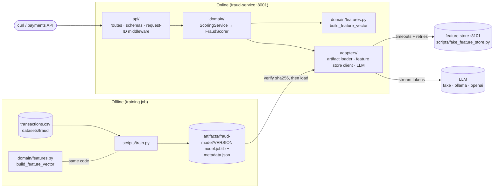

# 🛠 Lab 1: Ship the fraud model as a containerised service

> ⏱ 3–4 hours · Track A (`fraud-service`, port **8001**) · Lessons: [1.1](../01-prototype-vs-production.md) · [1.2](../02-architecture-patterns.md) · [1.3](../03-reliability-primitives.md) · [1.4](../04-production-services.md) · [1.5](../05-artifacts-and-containers.md)

[Course home](../../../README.md) › [Module 1](../README.md) › Lab 1

> **From: Maya**
> Sam's fraud notebook is a hit. Risk wants it scoring live card transactions by the end of the month.
> Diego says nothing goes near production without health checks, logs he can search and a container image.
> Omar says a fraud check that blocks payments when it's down is worse than no fraud check.
> Can you turn the notebook into a real service?

## 🎯 What you'll build

By the end of this lab you will have:

1. Diagnosed **what's wrong** with a real-looking prototype (there are at least 12 problems).
2. Turned training into a **repeatable job** that writes a **versioned artifact** with sha256 metadata.
3. Run a **layered FastAPI service** with liveness/readiness, request IDs and structured JSON logs.
4. Watched **retries with backoff, jitter, a deadline and a retry budget** survive a flaky dependency.
5. Seen **graceful degradation**: the service keeps answering when the model or a dependency is gone.
6. Streamed an **LLM explanation** token by token with Server-Sent Events.
7. Built a **multi-stage, non-root Docker image** and read the **Kubernetes** manifests that will run it.



## 📁 What's in this folder

```
lab/
├── prototype/sam_notebook.py     ← the "before": read it, don't fix it
├── scripts/train.py              ← training job → versioned artifact
├── scripts/fake_feature_store.py ← a deliberately flaky dependency
├── src/kestrel_fraud/
│   ├── api/        schemas.py · routes.py · middleware.py
│   ├── domain/     features.py · scoring.py · service.py
│   ├── adapters/   artifacts.py · retry.py · enrichment.py · faults.py · llm.py · …
│   ├── config.py   typed settings (KESTREL_* env vars)
│   ├── logging.py  structlog JSON logging
│   ├── training.py the training logic used by scripts/train.py
│   └── main.py     create_app(): wires everything together
├── tests/          32 tests, offline, ~5 s
├── Dockerfile      multi-stage, non-root, healthcheck
└── k8s/            preview manifests (deployed in Module 6)
```

---

## Step 0 · Set up (5 min)

```bash
cd modules/01-prototype-to-production/lab
uv sync
python3 ../../../datasets/fraud/generate.py
```

Expected:

```
wrote 50,000 rows to …/datasets/fraud/transactions.csv  (scenario=baseline, fraud rate=1.41%)
```

> 💡 The dataset is **not** committed to Git. It is regenerated from a script with a fixed seed. That's your first reproducibility habit: version the *recipe*, not just the output.

## Step 1 · Code review Sam's prototype (20 min)

Open [`prototype/sam_notebook.py`](prototype/sam_notebook.py). Pretend Sam asked you for a review before it goes live. Write down **every problem** you can find in a file (or on paper). For each one, note *what would actually go wrong in production*.

Aim for at least 10 before you open the answer.

<details>
<summary>✅ Answer: 15 problems and the lesson that fixes each one</summary>

| # | Problem | What goes wrong in production | Fixed in |
|---|---|---|---|
| 1 | `DATA = "../../../../datasets/…"` path relative to the *current directory* | Works only from one folder; breaks in CI, cron and containers | `training.py` resolves paths from the file location or `KESTREL_DATA_DIR` |
| 2 | `API_KEY = "sk-live-…"` hard-coded secret | Leaks through Git history, screenshots and logs forever | 1.4: secrets from env/secret manager, `SecretStr` |
| 3 | Trains on `chargeback_filed` | **Label leakage**: that column only exists *after* fraud is confirmed. Offline AUC 0.95, real-world much worse | 1.1, `FORBIDDEN_COLUMNS` + a test |
| 4 | `train_test_split` with no `random_state` | Different metrics every run; nobody can reproduce a result | 1.5: fixed seeds recorded in metadata |
| 5 | Random split on time-ordered data | The test set contains the "past" and "future" mixed: optimistic metrics | `training.py`: time-based split |
| 6 | Celebrates `accuracy 0.99` with a 1.4% fraud rate | Predicting "never fraud" scores 98.6% accuracy. Accuracy is meaningless here | Module 4 (PR-AUC); metadata records PR-AUC and base rate |
| 7 | `pd.get_dummies` at training; a different code path in `predict()` | **Training/serving skew**: column sets can differ silently | 1.1: one shared `build_feature_vector` |
| 8 | `predict()` silently fills missing columns with 0 (`reindex(fill_value=0)`) | `chargeback_filed` is always 0 at serving time; the model sees a world it never trained on | Same as 7, plus a feature-contract check at load time |
| 9 | `pickle.dump` with no version, no metadata, no hash | Nobody knows which data/code made `model.pkl`; a corrupted or swapped file loads anyway; pickle can execute code | 1.5: versioned artifact + sha256 verified *before* loading |
| 10 | Global state (`model`, `X`) used inside `predict` | Importing the notebook retrains the model; impossible to test in isolation | 1.4: app factory + lifespan |
| 11 | Hard-coded `0.5` threshold, returns `"FRAUD"`/`"OK"` | Business can't tune it; three actions (approve/review/decline) are needed | `DecisionPolicy` + config |
| 12 | No input validation | `hour=37` or a negative amount gives a confident nonsense score | 1.4: Pydantic schemas → 422 |
| 13 | `print` instead of logs | No timestamps, levels or request IDs; impossible to search | 1.4: structlog JSON |
| 14 | No tests | Every change is a gamble | `tests/` |
| 15 | No dependency pinning or environment record | "Works on my machine" with a different scikit-learn version, which can break unpickling | `uv.lock`, metadata `environment` |

Bonus problems: country one-hot encoding at training time but a country never seen in training at serving time, no handling of what happens when the model is missing, no timeout on anything, and the model is trained in the same process that will serve it.
</details>

## Step 2 · Run Sam's prototype and be suspicious (10 min)

```bash
cd prototype && uv run python sam_notebook.py && rm -f model.pkl && cd ..
```

Expected (your numbers will differ slightly; ask yourself *why* they differ between runs):

```
(50000, 16)
accuracy 0.992
auc 0.951…
saved
FRAUD
```

🤔 An AUC of 0.95 on fraud from ten simple features is **too good to be true**. Before Step 3, write down your guess of what the honest AUC will be once the leaky column is removed.

## Step 3 · Train properly and inspect the artifact (15 min)

```bash
uv run python scripts/train.py
```

Expected:

```
✅ wrote artifact …/artifacts/fraud-model/20261110T115648Z-2a36bb33
   sha256   4de749d1…
   metrics  {"roc_auc": 0.747, "pr_auc": 0.063, "brier": 0.015, "test_base_rate": 0.0155, "n_train": 40000, "n_test": 10000}
```

Now open the artifact:

```bash
cat artifacts/fraud-model/LATEST
cat artifacts/fraud-model/$(cat artifacts/fraud-model/LATEST)/metadata.json
```

Answer these from `metadata.json`:

1. Which data file (by **sha256**) was this model trained on?
2. Which git commit (and was the working tree dirty)?
3. In what order must the API send features?
4. What is the PR-AUC compared with the base rate? (A random model's PR-AUC ≈ the base rate.)

> 💡 The honest ROC-AUC (~0.75) is far below Sam's 0.95. **That's not a regression, it's the truth.** Sam's number was inflated by leakage and a random split. Module 4 teaches you to read PR-AUC properly; for now, notice that 0.063 is about **4× better than random** (0.0155) on a very imbalanced problem.

Run the training again. You get a **new version folder** and `LATEST` moves, but the old version stays: versions are immutable. Now compare the two model files:

```bash
shasum -a 256 artifacts/fraud-model/*/model.joblib
```

Both hashes are **identical**. Same data, code, seed and library versions produce a bit-for-bit identical model: reproducibility you can prove. (Try `--seed 7` and watch the hash change.)

## Step 4 · Run the tests (5 min)

```bash
uv run pytest -v
```

Expected: `32 passed`. Skim the test names: they are the service's executable specification. Read at least `tests/test_features.py::test_training_and_serving_build_identical_rows` and `tests/test_retry.py::test_retry_budget_prevents_retry_storms`.

## Step 5 · Run the service (15 min)

```bash
uv run uvicorn kestrel_fraud.main:create_app --factory --port 8001
```

In a second terminal:

```bash
curl -s localhost:8001/health
curl -s localhost:8001/ready
curl -s -X POST localhost:8001/v1/score \
  -H 'content-type: application/json' \
  -d '{"transaction_id":"txn_0001","customer_id":"cus_00017","amount":249.99,
       "merchant_category":"electronics","hour":2,"is_online":true,"country_mismatch":true,
       "card_age_days":12,"device_is_new":true,"distance_from_home_km":912.4,
       "txn_count_24h":6,"avg_amount_30d":41.5}'
```

Expected (score and version will differ):

```json
{"status":"ok"}
{"status":"ready","model_version":"20261110T115648Z-2a36bb33","reason":null}
{"transaction_id":"txn_0001","score":0.55,"decision":"review","source":"model",
 "model_version":"20261110T115648Z-2a36bb33",
 "reasons":["transaction country differs from card country", "…"],
 "degraded":false,"degraded_reasons":[],"request_id":"9f1c…"}
```

Open **http://localhost:8001/docs**. The interactive OpenAPI page was generated from `api/schemas.py`. Try sending `"hour": 25` from the docs page and look at the 422 response.

## Step 6 · Request IDs and structured logs (10 min)

Send a request with your own ID:

```bash
curl -si -X POST localhost:8001/v1/score -H 'content-type: application/json' \
  -H 'X-Request-ID: lab1-step6' \
  -d '{"transaction_id":"txn_0002","customer_id":"cus_1","amount":12.5,"merchant_category":"grocery","hour":11,"is_online":false,"country_mismatch":false,"card_age_days":400,"device_is_new":false,"distance_from_home_km":1.2,"txn_count_24h":3,"avg_amount_30d":30}' | grep -i x-request-id
```

In the service terminal you'll see a JSON line like:

```json
{"method": "POST", "path": "/v1/score", "status": 200, "duration_ms": 3.1, "event": "http_request", "request_id": "lab1-step6", "service": "fraud-service", "level": "info", "timestamp": "…"}
```

Pipe the logs through `jq` to filter (`… | jq 'select(.request_id=="lab1-step6")'`). That one habit is what makes debugging at 3 a.m. possible.

## Step 7 · Survive a flaky dependency (25 min)

Stop the service (Ctrl+C). Start the fake feature store with **40% failures**:

```bash
uv run python scripts/fake_feature_store.py --port 8101 --fail-rate 0.4 --latency-ms 30
```

Restart the service pointing at it:

```bash
KESTREL_ENRICHMENT_BASE_URL=http://127.0.0.1:8101 \
  uv run uvicorn kestrel_fraud.main:create_app --factory --port 8001
```

Now score transactions **without** `txn_count_24h` / `avg_amount_30d`, so the service must fetch them:

```bash
for i in $(seq 1 10); do
  curl -s -X POST localhost:8001/v1/score -H 'content-type: application/json' -H "X-Request-ID: retry-$i" \
    -d '{"transaction_id":"txn_r'$i'","customer_id":"cus_00017","amount":249.99,"merchant_category":"electronics","hour":2,"is_online":true,"country_mismatch":true,"card_age_days":12,"device_is_new":true,"distance_from_home_km":912.4}' \
    | python3 -c 'import sys,json; d=json.load(sys.stdin); print(d["request_id"], d["degraded"], d["degraded_reasons"])'
done
```

Expected: most lines say `False []`. In the service logs you'll see retries with **random** sleep times:

```json
{"attempt": 1, "sleep_s": 0.031, "error": "HTTP 503", "event": "enrichment_retry", "request_id": "retry-2", …}
```

and in the feature-store terminal the **same request ID** arriving more than once: that's request-ID propagation across services.

Now make it worse: restart the feature store with `--fail-rate 1.0`. Every request now comes back `True ['enrichment_unavailable']`, **with status 200**: the payment is still scored, just with less information. After a few requests the log says `"reason": "budget_exhausted"` and the service stops retrying entirely. That's the retry budget protecting a dependency that's already down.

## Step 8 · Stream an explanation (10 min)

```bash
curl -N localhost:8001/v1/explain/txn_r1
```

You'll see Server-Sent Events arriving one word at a time:

```
data: [fake-llm]

data:  Summary

data:  of
…
event: done
data: [DONE]
```

Optional, with Ollama installed: `ollama pull qwen2.5:1.5b-instruct`, restart the service with `KESTREL_LLM_PROVIDER=ollama`, and get a real explanation with no other code change.

## Step 9 · Build and run the container (20 min)

Stop the local service and the fake feature store first (Ctrl+C), so port 8001 is free. Make sure you trained a model in Step 3: the image bakes in `artifacts/fraud-model/`.

```bash
docker build -t kestrel/fraud-service:0.1.0 .
docker run --rm -p 8001:8001 --name fraud kestrel/fraud-service:0.1.0
```

In another terminal:

```bash
curl -s localhost:8001/ready
docker exec fraud whoami                   # → app (not root)
docker ps --filter name=fraud              # STATUS shows "(healthy)" after ~15 s
docker images kestrel/fraud-service:0.1.0  # ≈ 440 MB, mostly numpy/scipy/scikit-learn
```

Change one line in `src/` and rebuild: notice that the dependency layer is **CACHED** and the rebuild takes seconds. That's why the Dockerfile copies `pyproject.toml` + `uv.lock` before `src/`.

## Step 10 · Read the Kubernetes manifests (15 min)

Open [`k8s/deployment.yaml`](k8s/deployment.yaml) and [`k8s/README.md`](k8s/README.md). For each of these fields, write one sentence on what would break without it: `replicas: 2`, `maxUnavailable: 0`, `readinessProbe → /ready`, `livenessProbe → /health`, `resources.limits.memory`, `runAsNonRoot`, `image: …:0.1.0` (not `:latest`).

---

## 💥 Break it (learn by causing failures)

Each experiment takes a few minutes. Predict what will happen **before** you run it.

1. **Tamper with the artifact.** `echo x >> artifacts/fraud-model/$(cat artifacts/fraud-model/LATEST)/model.joblib`, then start the service. What do `/health`, `/ready` and `/v1/score` return? Why is that the right combination? *(Retrain afterwards to fix it.)*
2. **Mismatched feature contract.** In `domain/features.py`, add a new name to `NUMERIC_FEATURES` (and a value in `build_feature_vector`), then start the service without retraining. Which error do you get, and which production incident did it just prevent?
3. **Bad config fails fast.** Start with `KESTREL_REVIEW_THRESHOLD=0.9 KESTREL_DECLINE_THRESHOLD=0.5`. Why is crashing at startup better than starting?
4. **Retry storm without jitter.** In `adapters/retry.py`, temporarily make `backoff` return `cap` (no randomness). Run Step 7 with `--fail-rate 0.6`. Look at the timestamps of retries in the feature-store log. Why do synchronized retries hurt a recovering service?
5. **No budget.** Set `KESTREL_RETRY_BUDGET_RATIO=1.0` and `KESTREL_ENRICHMENT_MAX_ATTEMPTS=6` with `--fail-rate 1.0`. Count requests arriving at the feature store per score request. Multiply by 1,000 requests/second. That's the load you're adding to a service that's already down.
6. **Liveness that checks dependencies (thought experiment).** Imagine `/health` returned 503 when the feature store is down. With 2 replicas and Kubernetes restarting pods on failed liveness, describe what happens during a 10-minute feature-store outage.

## 🚀 Extend it

<details>
<summary><b>1. Batch inference</b>: score a whole CSV offline (⭐ recommended)</summary>

**Goal:** write `scripts/batch_score.py` that reads `datasets/fraud/transactions.csv`, scores every row with the *same* artifact and domain code, and writes `scores.csv` (`transaction_id,score,decision,model_version`).

**Hints:** reuse `load_artifact`, `transaction_from_csv_row`, `build_feature_vector`; call `predict_proba` on a whole NumPy matrix at once instead of row by row (compare the speed!).

**Solution sketch:**

```python
import csv, sys, numpy as np
from pathlib import Path
from kestrel_fraud.adapters.artifacts import load_artifact
from kestrel_fraud.config import Settings
from kestrel_fraud.domain.features import build_feature_vector, transaction_from_csv_row
from kestrel_fraud.domain.scoring import DecisionPolicy

s = Settings()
loaded = load_artifact(s.model_dir, s.model_version)
policy = DecisionPolicy(s.review_threshold, s.decline_threshold)
rows = list(csv.DictReader(open(sys.argv[1])))
X = np.array([build_feature_vector(transaction_from_csv_row(r)) for r in rows])
scores = loaded.model.predict_proba(X)[:, 1]          # one vectorised call
with open("scores.csv", "w", newline="") as fh:
    w = csv.writer(fh); w.writerow(["transaction_id", "score", "decision", "model_version"])
    for r, p in zip(rows, scores):
        w.writerow([r["transaction_id"], round(float(p), 4), policy.decide(p), loaded.version])
```

Batch scoring 50,000 rows this way takes about a second; doing it through the HTTP API one by one would take minutes. That's lesson 1.2's batch vs online trade-off in numbers.
</details>

<details>
<summary><b>2. Honour <code>Retry-After</code> on HTTP 429</b></summary>

**Goal:** when the feature store answers `429 Too Many Requests` with a `Retry-After: 0.2` header, wait at least that long before retrying (but still respect the deadline).

**Hints:** carry the delay inside `RetryableError` (e.g. `RetryableError(msg, retry_after=0.2)`), and in `call_with_retries` use `max(policy.backoff(n), exc.retry_after or 0)`. Add a test with `FaultInjectingTransport(status_code=429)` and a handler that sets the header.
</details>

<details>
<summary><b>3. A <code>/version</code> endpoint</b></summary>

**Goal:** return `{"service_version": ..., "model_version": ..., "model_sha256": ..., "trained_at": ..., "git_commit": ...}` so anyone can check exactly what is running.

**Hint:** keep the whole `LoadedModel.metadata` on `app.state` during `lifespan`. Never return the full metadata blindly: decide which fields are safe to expose publicly.
</details>

<details>
<summary><b>4. A circuit breaker</b> (advanced)</summary>

**Goal:** after 5 consecutive enrichment failures, stop calling the feature store for 10 seconds ("open" circuit), then let one trial request through ("half-open").

**Hints:** a small class with `state`, `failures`, `opened_at`; check it in `HttpFeatureStore.get_customer_features` before calling `call_with_retries`. Compare with the retry budget: the budget limits *extra* load, while the breaker removes *all* load from a dependency that is clearly down. See the "CircuitBreaker" article by Martin Fowler in the lesson 1.3 resources.
</details>

<details>
<summary><b>5. Explain with a real model</b></summary>

Run Ollama, set `KESTREL_LLM_PROVIDER=ollama`, and compare time-to-first-token with the total time of `curl -N` vs `curl` without `-N`. Then improve `EXPLAIN_SYSTEM_PROMPT` so the explanation never invents facts outside the reasons list. (Module 4 shows how to *test* that automatically.)
</details>

## ✅ Definition of Done

- [ ] I listed at least 10 problems in Sam's notebook and can explain the production impact of each
- [ ] `uv run python scripts/train.py` creates a new version folder with `model.joblib` and a complete `metadata.json`
- [ ] I can explain why the honest metrics are lower than Sam's, and why that is good news
- [ ] `uv run pytest` → 32 passed
- [ ] The service answers `/health`, `/ready`, `/v1/score`, `/v1/explain/{id}` and `/docs`
- [ ] I traced one request ID from `curl` through the service logs into the feature-store logs
- [ ] With the feature store at 100% failure, scoring still returns 200 with `degraded: true`
- [ ] With a tampered artifact, `/health` is 200, `/ready` is 503, and scoring falls back to rules
- [ ] `docker build` works, the container runs as `app` and reports `(healthy)`
- [ ] I can explain every field in `k8s/deployment.yaml` that I listed in Step 10
- [ ] I did at least 3 "Break it" experiments and one "Extend it" exercise

➡️ Back to the [Module 1 overview](../README.md) · Take the [Module 1 quiz](../quiz.md)
