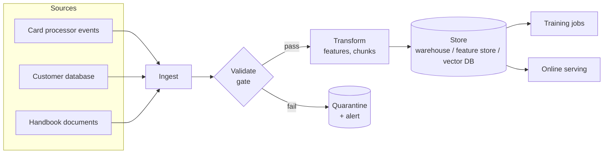
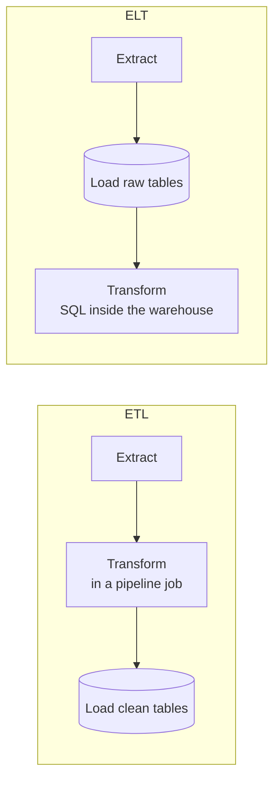
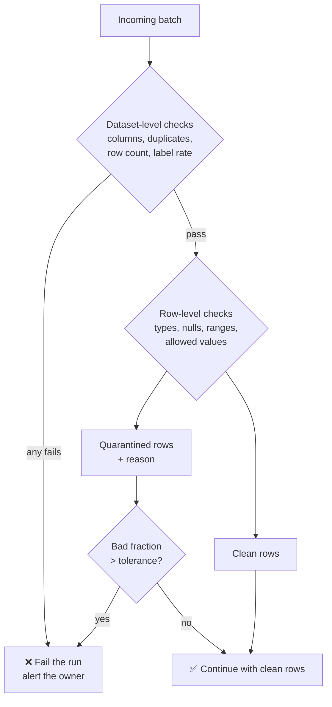

# Lesson 2.1 · Data pipelines and validation gates

> ⏱ ~50 min · 🎚 Level: Core · 🧰 Needs: [Lesson 1.1](../01-prototype-to-production/01-prototype-vs-production.md)

[Course home](../../README.md) › [Module 2](README.md) › Lesson 2.1

## 📨 The situation

> **From: Omar (Risk analyst)**
> Last Tuesday the fraud model flagged almost nothing for six hours. Nobody changed the model. It turns out the card processor started sending `amount` in **cents** instead of euros, so every transaction looked 100× larger than the customer's average. That should have *raised* fraud scores, but the upstream team also renamed `merchant_category` values ("crypto" instead of "crypto_exchange"), and the model treated them all as unknown.
> How did a model receive data this broken without anyone noticing?

## 🎯 By the end you can

- **Explain** what a data pipeline is and name its stages: ingest, validate, transform, store, serve.
- **Choose** between batch and streaming ingestion, and between ETL and ELT, for a given use case.
- **Write** a schema with types, ranges, allowed values and an *availability* field for each column.
- **Distinguish** row-level checks (quarantine) from dataset-level checks (fail the run).
- **Implement** a validation gate that stops a pipeline instead of silently training or serving on bad data.

## 🤔 Predict first

Answer in your head or in a notebook before reading. Being wrong is fine: guessing first makes the answer stick.

1. If 0.05% of rows in a 10-million-row batch have a negative `amount`, should the whole training run stop?
2. If the fraud rate in today's batch is 0.0%, is that good news?
3. Which is more dangerous: a pipeline that crashes on bad data, or one that keeps running?

---

## 1. What a "data pipeline" actually is

A **data pipeline** is the code and infrastructure that moves data from where it is *produced* (apps, payment processors, documents) to where it is *used* (training jobs, feature stores, vector indexes, dashboards), changing it along the way.

Think of it as a **water treatment plant**. Raw water (events, files) comes in from many sources. It is filtered (validation), treated (transformation), stored in tanks (warehouse, lake, vector DB) and piped to houses (models and services). Nobody drinks straight from the river, and nobody should train straight from a raw export.



Every arrow in that diagram is a place where data can silently change shape. Most production ML incidents are not "the model got worse". They are "the data the model saw stopped matching the data it was trained on". Google's *Rules of Machine Learning* puts it bluntly: most gains (and most bugs) come from features and data, not from model architecture.

## 2. Batch vs streaming ingestion

The first design decision is **how often data moves**.

| | **Batch** | **Streaming** |
|---|---|---|
| How | Process a bounded chunk on a schedule (hourly, nightly) | Process each event (or micro-batch) as it arrives |
| Latency | Minutes to hours | Milliseconds to seconds |
| Typical tools | Airflow/Dagster + SQL/Spark, files in object storage | Kafka, Kinesis, Pub/Sub + Flink, Spark Structured Streaming |
| Easy parts | Reprocessing, debugging, consistent snapshots | Fresh features, real-time reactions |
| Hard parts | Staleness | Ordering, late events, exactly-once, state |
| Kestrel example | Nightly retraining set, nightly handbook re-index | `txn_count_24h` must reflect the last few minutes at scoring time |

> 💡 **Production tip:** Most companies run **both**. Training data is built in batch (you need consistent, reproducible snapshots). Some *features* are computed in streaming (you need them fresh at decision time). The hard part is making both paths compute the *same* feature. That is training/serving parity, the subject of [lesson 2.2](02-lineage-versioning-and-leakage.md).

A useful rule of thumb: **use batch unless the business decision needs fresher data than the batch interval.** Fraud *scoring* needs features from the last minutes, so streaming is justified there. Fraud *training* does not: yesterday's labelled transactions are fine. The handbook changes a few times a week, so a nightly re-index (or an index triggered when a document changes) is enough.

> ⚠️ **Common mistake:** choosing streaming because it sounds modern. Streaming systems are much harder to operate: you deal with late and out-of-order events, replays and duplicates, and keeping state per key. Pay that cost only for a feature that truly needs it.

## 3. ETL vs ELT

The second decision is **where transformation happens**.

- **ETL (Extract → Transform → Load):** transform data *before* loading it into the warehouse. This was the classic approach when storage and compute were expensive.
- **ELT (Extract → Load → Transform):** load raw data first, then transform it *inside* the warehouse with SQL (often managed with dbt). This is common today because cloud warehouses are cheap to store in and fast to query.



| Question | Leans ETL | Leans ELT |
|---|---|---|
| Must sensitive fields be removed *before* storage? (PII, card numbers) | ✅ | |
| Do you want to re-run transformations on historical raw data later? | | ✅ |
| Are transformations heavy non-SQL work (PDF parsing, OCR, embeddings)? | ✅ | |
| Do analysts own and iterate on the transformations? | | ✅ |

For ML, the most important property of ELT is that **you keep the raw data**. When you discover a bug in a feature definition six months later, you can recompute the feature for history. With ETL you may have thrown away the raw input.

RAG pipelines are usually ETL-shaped. Parsing, chunking and embedding are not SQL operations, and you often *must* redact or drop content (hidden HTML comments, PII) before it reaches the index. Keep the raw documents in object storage anyway, so you can re-chunk and re-embed when your strategy changes. It will change.

## 4. Schemas: write down what "valid" means

You cannot validate data without a definition of valid. A **schema** is that definition. A minimal ML schema has, for each column:

| Property | Example | Catches |
|---|---|---|
| **Type** | `amount: float` | `"12,50"` strings, mixed types |
| **Nullability** | `card_age_days: not null` | Silent `NaN` in features |
| **Range** | `0 ≤ hour ≤ 23`, `0.01 ≤ amount ≤ 50,000` | Unit changes (cents vs euros), sentinel values like `-1` |
| **Allowed values** | `merchant_category ∈ {grocery, …}` | Renamed categories, typos |
| **Availability** | `chargeback_filed: post_label` | **Leakage** (lesson 2.2) |

The last row is the one most teams forget. **Availability** records *when* a value becomes known relative to the prediction. A column that is only filled in after an investigation must never be a feature, however predictive it looks. Writing this down in the schema turns a subtle modelling bug into a one-line check.

Here is the schema from the lab (`lab/src/pipelines/validate.py`), shortened:

```python
@dataclass(frozen=True)
class Column:
    name: str
    dtype: Literal["int", "float", "str", "category"]
    nullable: bool = False
    min: float | None = None
    max: float | None = None
    allowed: frozenset[str] | None = None
    available: Literal["at_decision", "post_label", "identifier", "label"] = "at_decision"

SCHEMA = (
    Column("transaction_id", "str", available="identifier"),
    Column("amount", "float", min=0.01, max=50_000),
    Column("merchant_category", "category", allowed=frozenset(MERCHANT_CATEGORIES)),
    Column("hour", "int", min=0, max=23),
    Column("chargeback_filed", "int", min=0, max=1, available="post_label"),
    Column("is_fraud", "int", min=0, max=1, available="label"),
    ...
)
```

> 🔎 **Under the hood:** libraries like **Pandera**, **Great Expectations**, **Soda** and TensorFlow Data Validation express the same ideas with more features: statistical expectations, auto-profiling, HTML reports. The lab uses plain pandas on purpose, so you can read every line. Once you understand the concepts, switching tools is a syntax change.

## 5. Two kinds of checks, two different reactions

This distinction is the heart of the lesson.

**Row-level checks** look at one record at a time: is this `amount` negative? Is this `hour` 25? Is this category unknown? A few bad rows are normal in any real system (a buggy client version, a test transaction). The right reaction is usually to **quarantine** them: set them aside in a separate table with the reason, keep going with the clean rows, and alert if there are too many.

**Dataset-level checks** look at the batch as a whole: are columns missing? Are there duplicate IDs (is ingestion replaying events)? Is the fraud rate 0% or 40%? Is the row count a tenth of yesterday's? These mean the *process* is broken, not just a record. The right reaction is to **fail the run**.



The **tolerance** (1% in the lab) is a business decision. Be careful, though: row-level checks alone would **not** have caught Omar's incident, as the worked example shows.

> ⚠️ **Common mistake:** `try: validate(df) except: pass`. A gate that can be swallowed is not a gate. The lab raises `DataValidationError`, and the pipeline lets it crash the run on purpose.

> ⚠️ **Common mistake:** validating only types. In Omar's incident every value was a perfectly valid `float`.

### Worked example: the cents incident in numbers

These are real numbers from the lab's 20,000-transaction baseline after multiplying every `amount` by 100:

| Check | Normal day | Cents day | Gate result |
|---|---|---|---|
| Type check (`amount` is a float) | pass | pass | ✅ passes, useless here |
| Row range check (`amount` ≤ 50,000) | 0 rows fail | **88 rows (0.44%)** fail: only the largest purchases | ✅ passes, below the 1% tolerance! |
| Dataset distribution check (median `amount` in [€10, €100]) | median €29.79 | **median €2,958.50** | ❌ **fails the run** |
| Fraud rate | 1.3% | unknown until labels arrive, days later | too late to help |

The per-row range check sees a €0.40 coffee that became €40 and thinks it is fine. It is in range! Only a **distribution check**, which compares a batch statistic against what you expect, catches the unit change. That is why the lab's schema carries `median_between=(10.0, 100.0)` for `amount`. In [Module 4](../04-evaluation-and-monitoring/README.md) you'll generalise this idea into *drift detection* on live traffic.

> 💡 **Production tip:** derive expected bounds from history (for example, the 1st–99th percentile of the last 30 days' medians) rather than hard-coding them, and review them when the business changes (a new market, a new product).

## 6. Where gates go

Put a gate at **every boundary where data crosses an ownership line**:

1. **At ingestion**, when data enters from another team or vendor: the cents bug is caught here.
2. **Before training**, so a model is never trained on a broken snapshot.
3. **At serving time**, on each request: validate the request body (FastAPI and Pydantic already do this for types; add ranges) and return an error or a safe fallback, rather than scoring garbage.
4. **Before indexing documents** for RAG: a document with no `access` level must never default to "public". The lab's parser *fails closed* on unknown access levels.

> 💡 **Production tip:** turn the schema into a **data contract** agreed with the upstream team. It lives in a shared repo; changes to it go through review; breaking changes require a version bump and a migration window. Most "data incidents" are really "nobody told us they changed the format" incidents.

## 7. The validation gate in the lab

```python
def gate(df: pd.DataFrame, *, max_bad_row_fraction: float = 0.01, **kwargs) -> pd.DataFrame:
    """Return clean rows, or raise DataValidationError and stop the pipeline."""
    report, valid, _ = validate(df, **kwargs)
    if report.bad_row_fraction > max_bad_row_fraction:
        report.dataset_errors.append(f"{report.bad_row_fraction:.2%} of rows failed checks ...")
    if report.dataset_errors:
        raise DataValidationError(report)
    return valid
```

Read `validate()` in the lab and note three design choices:

- It **returns a report**, not just True/False. When a gate fails at 3 a.m., the on-call engineer needs to know *which* check failed and on *how many* rows.
- It **casts** valid rows to the schema types, so code downstream can trust them.
- It checks the **label rate** against bounds. A batch with 0% fraud is not good news; it usually means the labelling job broke.

## 🧪 Try it

From `modules/02-data-and-model-pipelines/lab` (set it up first with `uv sync`, see the [lab README](lab/README.md)):

```bash
uv run python -m pipelines.data                                    # generate 20,000 transactions
uv run python -m pipelines.validate data/raw_baseline_20000_42.csv
```

Expected:

```
rows_in=20000 rows_valid=20000 bad_fraction=0.0000%
✅ gate PASSED
```

Now **simulate the cents incident**. In a Python shell (`uv run python`):

```python
import pandas as pd
from pipelines.validate import gate, validate, DataValidationError
df = pd.read_csv("data/raw_baseline_20000_42.csv")
broken = df.assign(amount=df.amount * 100)
report, valid, quarantined = validate(broken)
print(report.summary())
try:
    gate(broken)
except DataValidationError as e:
    print(e)
```

Expected (approximately):

```
rows_in=20000 rows_valid=19912 bad_fraction=0.4400%
  DATASET ERROR: amount median 2,958.50 outside expected [10.00, 100.00] (unit change? upstream bug?)
  row check failed: amount:above_max (88 rows)
```

Only 0.44% of rows fail the range check, but the median check stops the run. Now try `broken = df.assign(is_fraud=0)` and `broken = df.assign(merchant_category=df.merchant_category.replace("crypto_exchange", "crypto"))`. Which check catches each one? Is it a row-level or a dataset-level failure?

## 🏭 In the real world

Large ML platforms treat data validation as a first-class pipeline step. Google's TFX includes **TensorFlow Data Validation**, which infers a schema from training data and checks every new batch against it, including *skew* between training and serving data. The open-source tools **Great Expectations**, **Pandera** and **Soda** bring the same pattern to pandas, Spark and SQL warehouses. The common lesson from published post-mortems is the same: validate at boundaries, fail loudly, and keep the report.

## ✅ Check yourself

<details>
<summary>Q1. 0.05% of rows in a 10M-row batch have a negative amount. Stop the run?</summary>

Usually **no**: that is 5,000 rows, a row-level issue below a 1% tolerance. Quarantine them with the reason, continue, and alert the data owner if the fraction is unusual. Stop if the fraction exceeds the agreed tolerance or keeps growing.
</details>

<details>
<summary>Q2. Today's batch has a 0.0% fraud rate. Good news?</summary>

No. It almost certainly means the labelling job or a join broke. A label rate outside expected bounds is a **dataset-level** failure, so the run should stop.
</details>

<details>
<summary>Q3. Why does the schema include an "availability" field?</summary>

To record *when* a value is known relative to the prediction. Columns that are known only after the label (like `chargeback_filed`) must never become features. Encoding this in the schema turns leakage prevention into an automatic check.
</details>

<details>
<summary>Q4. Your team needs fresh "transactions in the last 10 minutes" features for scoring, and a nightly training set. Batch or streaming?</summary>

Both. Streaming (or near-real-time) computation for the online feature, batch for the training snapshot, with the **same feature definition** used by both paths to avoid training/serving skew.
</details>

<details>
<summary>Q5. Why might you prefer ELT for tabular ML data but ETL for a RAG document pipeline?</summary>

ELT keeps raw data in the warehouse so features can be recomputed with SQL when definitions change. RAG transformations (parsing, chunking, embedding, redaction) aren't SQL and some content must be removed *before* it reaches the index. You should still keep raw documents in object storage so you can re-process them later.
</details>

## 💬 Explain it back

Explain to Omar, who is not an engineer, in three sentences, why the pipeline should **crash** when 10% of transactions have impossible amounts, but **not** crash when 0.01% do.

## 🔑 Key takeaways

- Most "model" incidents are data incidents. Validate at every boundary where data changes hands.
- Use batch by default and streaming only for decisions that need fresher data than the batch interval.
- A schema should capture type, nullability, range, allowed values **and availability**.
- Row-level problems → quarantine and count; dataset-level problems → fail the run.
- Range checks miss unit changes; **distribution checks** (medians, rates, counts) catch them.
- A gate must be impossible to ignore: raise, alert, and keep a readable report.

## 📚 Go deeper (free)

| | Resource | Why read it | Time |
|---|---|---|---|
| ⭐ | [Rules of Machine Learning](https://developers.google.com/machine-learning/guides/rules-of-ml) (Martin Zinkevich, Google) | Short, battle-tested rules on data, features and pipelines; read rules 1–20 now | 40 min |
| 🔍 | [Data Engineering Zoomcamp](https://github.com/DataTalksClub/data-engineering-zoomcamp) (DataTalks.Club) | Free hands-on course: ingestion, orchestration, warehouses, batch and streaming | weeks |
| 🔍 | [Pandera documentation](https://pandera.readthedocs.io/) | Turn the lab's hand-written checks into declarative schemas | 30 min |
| 🔍 | [Great Expectations documentation](https://docs.greatexpectations.io/) | Expectation suites, data docs and checkpoints for warehouses | 45 min |
| 🔍 | [dbt documentation](https://docs.getdbt.com/) | The standard tool for the "T" in ELT, including data tests | 30 min |
| 🔍 | [Apache Kafka introduction](https://kafka.apache.org/intro) | What a streaming log is and why it underpins most streaming pipelines | 20 min |

---
⬅️ [Module 2 overview](README.md) · ➡️ [Lesson 2.2 · Lineage, versioning and leakage](02-lineage-versioning-and-leakage.md)
