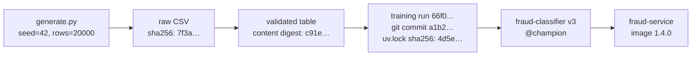
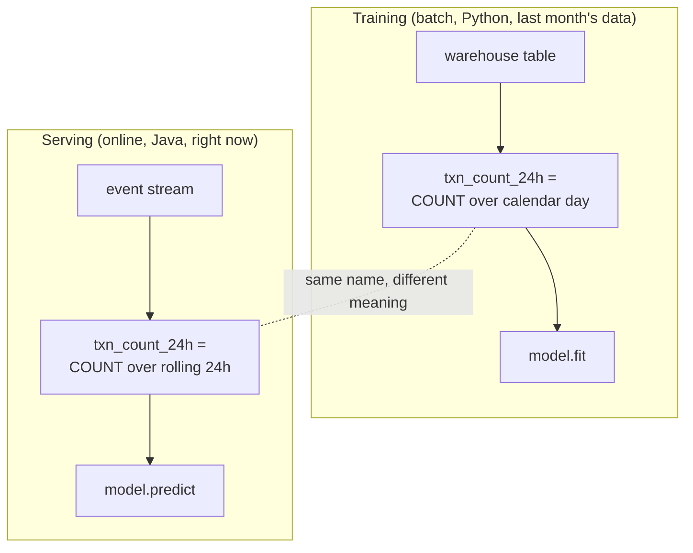

# Lesson 2.2: Lineage, versioning and leakage
<!-- id: l-2-2 -->

> ⏱ ~55 min · 🎚 Level: Core · 🧰 Needs: [Lesson 2.1](01-data-pipelines-and-validation.md)

[Course home](../../README.md) › [Module 2](README.md) › Lesson 2.2

## 📨 The situation

> **From: Sam (Data scientist)**
> Good news, I think? I added a few columns from the disputes table to the fraud model and PR-AUC went from **0.10 to 0.71**. Seven times better! Can we ship it on Monday?
>
> **From: Maya**
> Before anyone ships anything: last quarter's model can't be rebuilt, because nobody knows which CSV it was trained on. Let's fix *that* and double-check Sam's jump.

## 🎯 By the end you can

- **Explain** data lineage and why every model must point at the exact data, code and environment that produced it.
- **Version** data with content digests and immutable snapshots, and **name** tools that do it at scale (DVC, lakeFS, table time travel).
- **Define** training/serving skew, **list** its causes and **prevent** it with shared feature code and feature logging.
- **Recognise** five kinds of leakage: target, temporal, group, preprocessing, and train/test contamination.
- **Detect** leakage with an availability contract, single-feature scores, and the "too good to be true" test.

## 🤔 Predict first

1. Sam's PR-AUC jumped 7× after adding dispute data. Name one innocent and one suspicious explanation. <!-- id: p-2-2-1 -->
2. You have two CSVs with different bytes. Can they contain the same data? <!-- id: p-2-2-2 -->
3. Is a random 80/20 split safe for transaction data? Why or why not? <!-- id: p-2-2-3 -->

---

## 1. Lineage: "where did this come from?"

**Lineage** is the recorded chain of *what produced what*: which raw sources fed which tables, which tables fed which training run, which run produced which model, which model is serving which traffic.

Think of a **pharmacy prescription**. For any pill you can trace the batch, the factory, the ingredients and the date. If a batch is bad, you know exactly which patients to call. Lineage gives a model the same traceability. When a model misbehaves, you can answer "what changed?" in minutes instead of days.



The minimum lineage record for a model, which you'll fill in during [lesson 2.6](06-experiment-tracking-and-reproducibility.md), is:

| Field | Answers |
|---|---|
| **Code version** (git commit + "dirty" flag) | Which training code ran? |
| **Data digest** (hash of the exact training data) | Which rows went in? |
| **Environment lock** (hash of `uv.lock`) | Which library versions? |
| **Parameters and seed** | Which knobs? |
| **Artifact link** | Where is the resulting model? |

The lab logs all of these to MLflow on every run. Open `lab/src/pipelines/train.py` and find the `lineage = {...}` dictionary.

## 2. Versioning data: digests and snapshots

Code has git. Data needs its own versioning, because git is a poor fit for multi-gigabyte files and tables that change in place.

### Content digests

A **digest** (or fingerprint) is a hash of content: change one byte and the digest changes completely. The lab computes two kinds:

```python
def file_sha256(path: Path) -> str: ...           # exact bytes of the file
def dataframe_sha256(df: pd.DataFrame) -> str:     # the *content*, column order independent
    canonical = df.reindex(sorted(df.columns), axis=1)
    row_hashes = pd.util.hash_pandas_object(canonical, index=False).to_numpy()
    return hashlib.sha256(row_hashes.tobytes()).hexdigest()
```

Why two? Two CSV files can have **different bytes but the same data** (quoting style, column order, float formatting), and the same file can produce different data after a validation step drops rows. The file digest identifies *what arrived*; the content digest identifies *what the model actually trained on*.

### Immutable snapshots

A digest only helps if you can get the data back. The rule is: **never overwrite training data in place.** Write each snapshot to a new, dated, immutable location and record its digest.

| Approach | How it works | Good for |
|---|---|---|
| **Partitioned object storage** | `s3://…/transactions/date=2026-11-01/` plus write-once policies | Simple, cheap, universal |
| **DVC** | Git-like commands; data lives in remote storage, small pointer files live in git | Small to medium teams, file-based datasets |
| **lakeFS** | Git-like branches and commits over an object store | Data lakes with many writers |
| **Table time travel** (Delta Lake, Apache Iceberg, warehouse snapshots) | Query a table "as of" a version or timestamp | Warehouse/lakehouse-centric teams |

> 💡 **Production tip:** in the lab, the dataset is generated by a script with a fixed seed, so `(script, rows, seed)` *is* the version: anyone can regenerate the exact bytes. This "data as a deterministic function of code + config" pattern is worth copying whenever you can, for example for synthetic test data or for derived tables built only from versioned inputs.

## 3. Training/serving skew

**Training/serving skew** means the model sees different data in production than it saw in training, for the *same* real-world situation. It's one of the most common reasons a model that "worked offline" disappoints online.



Common causes:

| Cause | Example at Kestrel |
|---|---|
| **Two implementations** of the same feature | SQL in training, Java in serving; one counts the current transaction, the other doesn't |
| **Different time windows** | Calendar day vs rolling 24 hours |
| **Different defaults for missing values** | Training fills `NaN` with the median; serving sends `0` |
| **Stale or delayed data** | Serving reads `avg_amount_30d` from a cache refreshed weekly |
| **Category vocabulary drift** | Training saw `crypto_exchange`; serving receives `crypto` |

How to prevent it:

1. **One feature definition, used in both paths.** Either share the Python code, or use a **feature store** (Feast, Tecton, Vertex AI or SageMaker Feature Store) that computes a feature once and serves it both offline (for training) and online (for scoring).
2. **Log features at serving time** ("log and wait"). Store the exact feature vector the model scored, then join labels when they arrive. Train the *next* model on those logged features. Skew becomes impossible by construction.
3. **Put the preprocessing inside the model artifact.** The lab's model is a scikit-learn `Pipeline` (one-hot encoding + classifier) saved as one object, so serving can't "forget" the encoding.
4. **Compare distributions** of each feature between the training set and a sample of serving requests ([Module 4](../04-evaluation-and-monitoring/README.md)).

## 4. Leakage: when your model cheats

**Data leakage** is when information that *won't be available at prediction time* sneaks into training. The model learns to rely on it, offline scores look great, and production performance collapses, because the cheat sheet isn't there anymore.

The analogy: a student who scores 100% on practice exams because the answer key was stapled to the back. They didn't learn the subject; they learned to read the staple.

### Five kinds of leakage

| Kind | What happens | Kestrel example |
|---|---|---|
| **Target leakage** | A feature is created *after* or *because of* the label | `chargeback_filed` exists only after fraud is reported |
| **Temporal leakage** | Training on the future to predict the past | Random split puts November fraud rings in training and October in test |
| **Group leakage** | The same entity appears in train and test | The same customer's near-identical transactions on both sides |
| **Preprocessing leakage** | Statistics are computed on all data before splitting | Fitting a scaler or target encoder on train+test |
| **Train/test contamination** | Test examples (or near-duplicates) end up in training data | A golden RAG question copied into a fine-tuning set; benchmark data in a pre-training crawl |

### Back to Sam's 7× jump

The lab reproduces it exactly. The honest model has a test PR-AUC of about **0.10** (with a 1.3% base rate, that is roughly 7× better than random, which is respectable for fraud). Adding `chargeback_filed` gives about **0.71**.

Is `chargeback_filed` available when the card is swiped? No. A chargeback is filed days or weeks *after* the transaction, typically *because* it was fraud. The model learned "if a chargeback was filed, it was fraud". That is true, and useless at decision time.

### Detecting leakage

**1. The availability contract (cheapest, most reliable).** Every column in the schema declares when it's known (lesson 2.1). Features must be `at_decision`. The lab's `contract_check` rejects anything else:

```python
def contract_check(features: list[str]) -> list[LeakageFinding]:
    for f in features:
        col = SCHEMA_BY_NAME.get(f)
        if col is None:
            findings.append(LeakageFinding(f, "not declared in schema: unknown availability"))
        elif col.available != "at_decision":
            findings.append(LeakageFinding(f, f"declared available='{col.available}' ..."))
```

**2. Single-feature scores (catches what the contract missed).** Score each feature *on its own* by using it directly as a prediction. Real fraud signals are individually weak. A single feature that separates the classes almost perfectly is suspicious:

```
              feature   auc  suspicious    declared
     chargeback_filed 0.917        True  post_label
    merchant_category 0.670       False at_decision
            is_online 0.632       False at_decision
distance_from_home_km 0.620       False at_decision
               amount 0.588       False at_decision
```

**3. "Too good to be true" and dominance.** If a new feature makes the score jump far beyond what domain experts expect, or one feature dominates feature importance, stop and ask "*when* is this value known?"

**4. The offline–online gap.** If offline metrics are much better than what you measure on live traffic, suspect leakage or skew before anything else.

> ⚠️ **Common mistake:** "the feature is in the same table, so it must be available." Tables are snapshots taken *after* the fact. A row in `transactions_enriched` may contain fields filled in days later. Always ask when each field is *written*, not where it is *stored*.

### Temporal splits

For data that arrives over time, split **by time**: train on the past, validate on the more recent past, test on the most recent period. The lab does 70/15/15 by timestamp:

```python
def temporal_split(df, train=0.70, val=0.15):
    df = df.sort_values("timestamp").reset_index(drop=True)
    a, b = int(len(df) * train), int(len(df) * (train + val))
    return df.iloc[:a], df.iloc[a:b], df.iloc[b:]
```

This mimics production: you always predict the future from the past. A random split lets fraud patterns from the "future" leak into training and inflates scores. For group leakage, add **group-aware** splitting (scikit-learn's `GroupKFold`, or splitting by customer ID) on top.

## 🧪 Try it

From `lab/`:

```bash
# 1. Scan every column for suspicious single-feature power
uv run python -m pipelines.leakage data/raw_baseline_20000_42.csv

# 2. Try to train WITH the leaky feature: the pipeline refuses
uv run python -m pipelines.train --trials 5 \
  --features amount,merchant_category,hour,is_online,country_mismatch,card_age_days,txn_count_24h,avg_amount_30d,device_is_new,distance_from_home_km,chargeback_filed
```

Expected for step 2:

```
pipelines.leakage.LeakageError: Leakage suspected:
  - chargeback_filed: declared available='post_label', not known at decision time
  - chargeback_filed: single-feature ROC-AUC 0.917 ≥ 0.9: too good to be true
```

Now add `--skip-leakage-check` to the same command and compare its `test PR-AUC` with an honest run (`uv run python -m pipelines.train --trials 5`). You'll get roughly **0.7 vs 0.1**. Then run `uv run python -m pipelines.registry`: the leaky model was **promoted to @champion**, because the promotion rule only compares one offline metric. Keep that in mind for lesson 2.6 and [Module 4](../04-evaluation-and-monitoring/README.md).

## 🏭 In the real world

Leakage isn't only an industry problem. Kapoor and Narayanan's survey *Leakage and the Reproducibility Crisis in ML-based Science* found leakage-driven errors across hundreds of published papers in many fields, and proposed a taxonomy close to the table above. In industry, the most common pattern is the one in this lesson: a column added from an "enriched" table that was filled in after the outcome.

## ✅ Check yourself

<details>
<summary>Q1. Name the five fields of a minimum lineage record. <!-- id: c-2-2-1 --></summary>

Code version (commit + dirty flag), data digest, environment lock hash, parameters and seed, and a link to the produced artifact.
</details>

<details>
<summary>Q2. Two CSVs have different SHA-256 hashes. Can they contain the same data? <!-- id: c-2-2-2 --></summary>

Yes. Byte-level differences (quoting, column order, float formatting) change the file hash without changing the content. That's why the lab also computes a content digest over the validated, column-sorted DataFrame.
</details>

<details>
<summary>Q3. Training computes txn_count_24h over the calendar day; serving uses a rolling 24h window. What is this called, and how do you prevent it? <!-- id: c-2-2-3 --></summary>

Training/serving skew. Prevent it with a single shared feature definition (shared code or a feature store), by logging served features and training on them, and by comparing feature distributions between training and serving.
</details>

<details>
<summary>Q4. Why is a random split dangerous for transaction data? <!-- id: c-2-2-4 --></summary>

It mixes past and future, so the model can learn from future patterns (temporal leakage), and the same customers or fraud rings appear on both sides (group leakage). Offline scores get inflated. Split by time, and by group where relevant.
</details>

<details>
<summary>Q5. A feature has single-feature ROC-AUC 0.95. Is it definitely leakage? <!-- id: c-2-2-5 --></summary>

No, but it needs a human check. Ask when the value is written relative to the decision. Some legitimate features are very strong (for example a confirmed stolen-card list). The statistical check is a smoke alarm; the availability contract is the fire inspector.
</details>

<details>
<summary>Q6. You fit a StandardScaler on the full dataset, then split. What's wrong? <!-- id: c-2-2-6 --></summary>

Preprocessing leakage: the scaler's mean and variance include test data, so the test set is no longer truly unseen. Fit preprocessing on training data only, ideally inside a `Pipeline` so it's impossible to get wrong.
</details>

## 💬 Explain it back
<!-- id: e-2-2 -->

Write the reply to Sam: explain, kindly and in under 100 words, why the 0.71 model can't ship and what "available at decision time" means.

## 🔑 Key takeaways

- Every model must point to its **code commit, data digest, environment lock, parameters and artifact**.
- Never overwrite training data in place: snapshot it immutably and record its digest.
- Training/serving skew comes from two implementations of one feature; use one definition and log served features.
- Leakage = information from the future or from the label. Declare **availability** per column and check single-feature scores.
- Split time-ordered data by time (and by group). If a result looks too good, it usually is.

## 📚 Go deeper (free)

| | Resource | Why read it | Time |
|---|---|---|---|
| ⭐ | [Kaggle Learn: Data Leakage](https://www.kaggle.com/code/alexisbcook/data-leakage) | Short, hands-on lesson with a famous credit-card leakage example | 30 min |
| 🔍 | [Leakage and the Reproducibility Crisis in ML-based Science](https://arxiv.org/abs/2207.07048) (Kapoor & Narayanan) | The best taxonomy of leakage types, with real failures | 60 min |
| 🔍 | [Rules of Machine Learning](https://developers.google.com/machine-learning/guides/rules-of-ml): training-serving skew section | Practical rules on skew from Google's experience | 20 min |
| 🔍 | [DVC documentation](https://dvc.org/doc) | Version datasets and pipelines alongside git | 45 min |
| 🔍 | [Feast documentation](https://docs.feast.dev/) | An open-source feature store: one feature definition for training and serving | 45 min |
| 🔍 | [OpenLineage](https://openlineage.io/) | An open standard for collecting lineage across tools | 20 min |

---
⬅️ [Lesson 2.1: Data pipelines and validation gates](01-data-pipelines-and-validation.md) · ➡️ [Lesson 2.3: Deep-learning data paths](03-deep-learning-data-paths.md)
