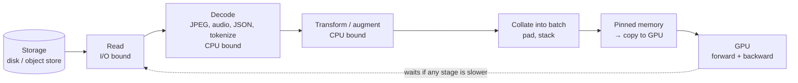
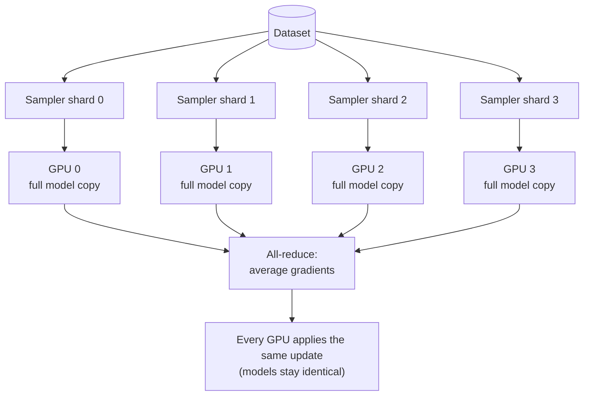

# Lesson 2.3: Deep-learning data paths

> ⏱ ~45 min · 🎚 Level: Core (conceptual, with one runnable demo) · 🧰 Needs: [Lesson 2.2](02-lineage-versioning-and-leakage.md)

[Course home](../../README.md) › [Module 2](README.md) › Lesson 2.3

## 📨 The situation

> **From: Diego (SRE)**
> Heads-up: the ML team rented a GPU box to fine-tune a small embedding model on our support tickets. The bill is €2.10/hour, and `nvidia-smi` shows the GPU at **31% utilisation**. Most of the time it's waiting for data. That means we pay for a Ferrari and drive it in first gear.
> Can you figure out what's starving it before they ask for *more* GPUs?

## 🎯 By the end you can

- **Draw** the deep-learning input pipeline (storage → read → decode → transform → batch → device) and **locate** its usual bottleneck.
- **Configure** loader parallelism (workers, prefetching, pinned memory) with a back-of-the-envelope throughput calculation.
- **Explain** batching for variable-length data (padding, dynamic padding, bucketing) and **quantify** the waste.
- **Apply** data augmentation correctly: online vs offline, train only, label-preserving.
- **Explain** distributed data parallel training: sharded sampling, global batch size, gradient synchronisation, and when you need more than data parallelism.

## 🤔 Predict first

1. A GPU can process 2,000 samples per second. Decoding one sample on the CPU takes 5 ms. How many CPU workers do you need to keep it busy?
2. You batch 32 text sequences whose lengths range from 20 to 500 tokens. Roughly what fraction of the computation is spent on padding?
3. You train on 8 GPUs with a batch of 32 per GPU. What's the effective batch size, and does the learning rate need to change?

---

## 1. Why this lesson exists in a production course

The fraud model trains in seconds on a laptop, so its data path is trivial. But production AI teams regularly train or fine-tune neural networks: embedding models for retrieval, rerankers, small classifiers on text, LoRA adapters on LLMs ([lesson 2.7](07-prompt-rag-or-fine-tune.md)). For those jobs, **the data path, not the model, is often what decides cost and speed.** An idle GPU costs the same as a busy one.

## 2. The input pipeline as a factory line

Training a neural network is a loop: get a batch → forward pass → loss → backward pass → update weights → repeat. The GPU does the forward and backward passes very fast. Everything *before* that happens mostly on the CPU, and it has to keep up.



Think of a factory line where the last station (the GPU) is a super-fast robot. If the stations before it are slow, the robot stands idle. **Total throughput equals the throughput of the slowest stage.** Your job is to find that stage and widen it.

### The two abstractions: Dataset and DataLoader

Every major framework splits the problem the same way. In PyTorch:

- A **Dataset** knows how to return *one* example: `dataset[i] → (input, label)`. It handles reading and decoding.
- A **DataLoader** turns a Dataset into a stream of *batches*. It handles shuffling, batching, parallel workers and prefetching.

```python
# Optional illustration: needs `pip install torch`, which is NOT required for this course's tests.
from torch.utils.data import Dataset, DataLoader

class TicketDataset(Dataset):
    def __init__(self, rows, tokenizer):
        self.rows, self.tok = rows, tokenizer
    def __len__(self):
        return len(self.rows)
    def __getitem__(self, i):                     # ONE example: read + decode + transform
        r = self.rows[i]
        return self.tok(r["text"])["input_ids"], r["label"]

loader = DataLoader(
    TicketDataset(rows, tokenizer),
    batch_size=32,
    shuffle=True,          # new order every epoch
    num_workers=8,         # 8 CPU processes run __getitem__ in parallel
    prefetch_factor=4,     # each worker keeps 4 batches ready ahead of time
    pin_memory=True,       # page-locked RAM: faster, asynchronous copies to the GPU
    collate_fn=pad_batch,  # how to turn a list of examples into one batch (see §3)
    persistent_workers=True,
)
```

### Back-of-the-envelope: how many workers?

Answering the first prediction question:

- The GPU consumes **2,000 samples/s**.
- One worker spends **5 ms** per sample, so it produces **200 samples/s**.
- Workers needed: 2,000 / 200 = **10**, plus some headroom for variance: **12**.

If the machine has only 8 cores, no `num_workers` setting can fix it. You need cheaper decoding (pre-tokenize once, store compact formats), fewer transforms, or GPU-side preprocessing. This simple division solves most "my GPU is underused" mysteries, including Diego's.

> 💡 **Production tip:** **do expensive, deterministic work once, offline.** Tokenizing the same text every epoch is wasted CPU. Pre-tokenize and store the token IDs (Parquet, Arrow or NumPy shards) and keep only *random* work (augmentation, shuffling) in the online loop. Hugging Face `datasets` does exactly this, caching processed data as memory-mapped Arrow files.

> ⚠️ **Common mistake:** millions of tiny files in object storage. Each read pays a network round trip. Pack examples into **shards** of ~100 MB–1 GB (WebDataset tar files, Parquet, TFRecord) and read them sequentially.

### How to know where the bottleneck is

1. Watch GPU utilisation (`nvidia-smi`, or your cloud's GPU metrics). Consistently below ~80% during training means you're probably data-bound.
2. Time the loader alone: iterate over the DataLoader without running the model. If that alone is slower than training steps, the data path is the bottleneck.
3. Use the framework's profiler (the PyTorch Profiler shows time spent waiting for data).

## 3. Batching variable-length data

Images can be resized to one shape. Text and audio come in different lengths, but a batch must be a rectangle. So short sequences get **padded** with a special token, and an *attention mask* tells the model to ignore the padding. The padded positions still cost compute.

```
static padding (pad everything to 512):
[■■■■□□□□□□□□□□□□□□□□□□□□□□□□□□□□]   ■ = real token, □ = padding
[■■■■■■■■■■■□□□□□□□□□□□□□□□□□□□□□]
[■■□□□□□□□□□□□□□□□□□□□□□□□□□□□□□□]

dynamic padding (pad to the longest in this batch):
[■■■■□□□□□□□]
[■■■■■■■■■■■]
[■■□□□□□□□□□]

bucketing (group similar lengths, then dynamic padding):
[■■■■]  [■■■■■■■■■■■]
[■■■□]  [■■■■■■■■■■□]
```

Three strategies, from worst to best:

| Strategy | Idea |
|---|---|
| **Static padding** | Pad every sequence to a fixed maximum (e.g. 512) |
| **Dynamic padding** | Pad to the longest sequence *in each batch* (done in `collate_fn`) |
| **Length bucketing** | Group sequences of similar length into the same batch, then pad dynamically |

The lab includes a NumPy demo with realistic, skewed lengths (most sequences short, a few long). Its real output:

```
10,000 sequences, median length 89 tokens, p95 283, batch size 32, max length 512

static padding to 512                         padding waste  77.7%   tokens processed  5,120,000  (100% of static)
dynamic padding (pad to longest in batch)     padding waste  70.0%   tokens processed  3,794,608  (74% of static)
length bucketing + dynamic padding            padding waste   4.5%   tokens processed  1,193,296  (23% of static)
```

Bucketing processes **less than a quarter** of the tokens for the same data. That is roughly a 4× cheaper epoch, without touching the model. Notice that dynamic padding alone helps less than you might expect: one long sequence in a random batch forces the whole batch to its length. Grouping similar lengths is what removes the waste.

> ⚠️ **Common mistake:** sorting the *whole* dataset by length. The model would then see all short examples first and all long ones last, every epoch, which hurts learning. Bucket within large random windows, then **shuffle the batches** (the demo does exactly that).

> 🔎 **Under the hood:** LLM serving engines take this further with *continuous batching* and *paged* KV caches, so requests of different lengths don't waste memory. You'll meet both in [Module 3](../03-serving-and-optimization/README.md).

## 4. Augmentation: more data from the data you have

**Data augmentation** creates modified copies of training examples that keep the label unchanged, so the model learns invariances instead of memorising.

| Modality | Typical augmentations | Watch out |
|---|---|---|
| Images | Flips, crops, rotation, colour jitter, mixup/cutmix | A horizontal flip is wrong for text in images or for left/right labels |
| Audio | Time/frequency masking (SpecAugment), noise, speed change | Speed changes alter pitch and duration |
| Text | Back-translation, synonym swap, LLM paraphrase, random deletion | Easy to change the meaning, and with it the label |
| Tabular | Rarely augmented; class weighting or resampling instead | Synthetic minority oversampling can leak between splits if done before splitting |

Rules that apply everywhere:

1. **Augment the training set only.** Validation and test must reflect real data, or your metrics lie.
2. **Online beats offline for random transforms.** Apply them on the fly in the Dataset, so each epoch sees a different variant, rather than writing 10 fixed copies to disk.
3. **Augmentations must preserve the label.** Check samples by eye, every time.
4. **Split first, augment second.** Augmented copies of a test example in the training set are train/test contamination ([lesson 2.2](02-lineage-versioning-and-leakage.md)).

For LLM-era projects, the most common "augmentation" is **synthetic data**: using a large model to paraphrase or generate training examples for a smaller one. The same rules apply, plus one more: track which examples are synthetic (lineage again) and **always evaluate on real, human-written data**.

## 5. Distributed training: more than one GPU

When one GPU is too slow, the usual first step is **data parallelism**.



How **Distributed Data Parallel (DDP)** works:

1. Every GPU holds a **full copy of the model**.
2. A **distributed sampler** gives each GPU a *different, non-overlapping* shard of every epoch. Forgetting it means every GPU trains on the same data, wasting N−1 GPUs.
3. Each GPU runs forward and backward on its own mini-batch.
4. An **all-reduce** operation averages gradients across GPUs.
5. Every GPU applies the same averaged update, so the copies stay in sync.

The numbers you must track:

```
global batch = per-device batch × number of devices × gradient-accumulation steps
             = 32 × 8 × 1 = 256
```

That answers the third prediction question: an effective batch of 256, which is 8× what you had on one GPU. A larger batch means fewer optimizer steps per epoch, so you usually **adjust the learning rate** (a common starting heuristic is to scale it linearly with the batch size, plus a warm-up period) and re-check validation curves. **Gradient accumulation** gives you the same effective batch with fewer GPUs: sum gradients over several small batches before each update.

When the **model itself doesn't fit** on one GPU, data parallelism isn't enough:

| Technique | What is split across GPUs | When |
|---|---|---|
| **Data parallel (DDP)** | The data; each GPU has the full model | Model fits on one GPU (most fine-tuning of small models, embeddings, rerankers) |
| **Sharded data parallel (FSDP, DeepSpeed ZeRO)** | Data *and* optimizer states, gradients, parameters | Model plus optimizer state doesn't fit on one GPU |
| **Tensor parallel** | Individual layers (matrix multiplications) | Very large layers; needs fast GPU interconnect |
| **Pipeline parallel** | Groups of layers in sequence | Very deep models across nodes |

> 💡 **Production tip:** before going distributed, check single-GPU efficiency: mixed precision ([lesson 3.6](../03-serving-and-optimization/06-model-compression.md)), the right batch size, a fast data path. Doubling GPUs on a data-starved job doubles the bill and keeps the utilisation problem.

### Reproducibility and fault tolerance

Distributed jobs fail: preemptible instances get reclaimed, nodes crash. Production training jobs therefore:

- **Checkpoint** regularly: model, optimizer state, learning-rate scheduler, *and the data loader position and random seeds*, so resuming doesn't repeat or skip data.
- **Seed** every source of randomness (Python, NumPy, framework, each worker). Bit-for-bit determinism on GPUs may require slower deterministic kernels; decide whether you need it.
- **Log** the data shard list and its digests (lesson 2.2), so a run can be traced back to its exact inputs.

## 🧪 Try it

From `lab/`:

```bash
uv run python scripts/padding_demo.py
```

Then experiment by editing the constants at the top of `scripts/padding_demo.py`:

1. Change `BATCH = 32` to `BATCH = 128`. What happens to dynamic-padding waste, and why? (Bigger random batches are more likely to contain one long sequence.)
2. Change the length distribution's `sigma` from `0.7` to `0.2` (lengths become more uniform). Which strategy gains least from bucketing now?
3. Change `window = BATCH * 50` to `window = BATCH * 2`. How much of the bucketing benefit is lost?

## 🏭 In the real world

Large-scale training write-ups consistently report that input pipelines, checkpointing and failure recovery take as much engineering as the model code. Hugging Face's free *Ultra-Scale Playbook* walks through data, tensor, pipeline and sharded parallelism with measured benchmarks, and is the best free deep dive available.

## ✅ Check yourself

<details>
<summary>Q1. A GPU processes 1,500 samples/s; one CPU worker produces 100 samples/s. Minimum workers?</summary>

15, plus headroom (about 16–18). If the machine has fewer cores, reduce per-sample CPU work (pre-process offline, use cheaper formats) instead.
</details>

<details>
<summary>Q2. Why does bucketing beat dynamic padding alone so clearly in the demo?</summary>

With skewed lengths, almost every random batch of 32 contains at least one long sequence, so dynamic padding still pads most sequences to a long width. Bucketing puts similar lengths together, so each batch's maximum is close to its typical length.
</details>

<details>
<summary>Q3. Name two augmentation mistakes that corrupt your evaluation.</summary>

Augmenting validation or test data; augmenting before splitting, so variants of test examples end up in training. Bonus: augmentations that change the label, like flipping an image of text.
</details>

<details>
<summary>Q4. In DDP, what goes wrong if you forget the distributed sampler?</summary>

Every GPU iterates over the same data in the same order, so you pay for N GPUs but learn as if you had one (with a larger effective batch of duplicates).
</details>

<details>
<summary>Q5. 4 GPUs × batch 16 × 4 gradient-accumulation steps. Global batch?</summary>

16 × 4 × 4 = 256.
</details>

## 💬 Explain it back

Diego asks: "Will doubling the GPUs fix 31% utilisation?" Answer in three sentences, using the factory-line analogy.

## 🔑 Key takeaways

- Throughput is set by the slowest pipeline stage; an idle GPU is usually waiting for data.
- Workers needed ≈ GPU samples/s ÷ per-worker samples/s. Pre-process deterministic work once, offline.
- Variable-length batches waste compute on padding. Bucketing plus dynamic padding can cut it by around 4×.
- Augment training data only, after splitting, and only with label-preserving transforms.
- DDP: full model per GPU, sharded data, averaged gradients. Track global batch size and adjust the learning rate. Shard the model (FSDP/ZeRO) only when it doesn't fit.

## 📚 Go deeper (free)

| | Resource | Why read it | Time |
|---|---|---|---|
| ⭐ | [PyTorch tutorial: Datasets & DataLoaders](https://pytorch.org/tutorials/beginner/basics/data_tutorial.html) | The canonical introduction to the two abstractions | 30 min |
| ⭐ | [The Ultra-Scale Playbook](https://huggingface.co/spaces/nanotron/ultrascale-playbook) (Hugging Face) | Free, benchmark-driven guide to every parallelism strategy | 3–5 h |
| 🔍 | [PyTorch tutorial: Getting Started with Distributed Data Parallel](https://pytorch.org/tutorials/intermediate/ddp_tutorial.html) | DDP in code, including the sampler | 45 min |
| 🔍 | [torch.utils.data documentation](https://pytorch.org/docs/stable/data.html) | Workers, pinned memory, samplers, collate functions in detail | 30 min |
| 🔍 | [Hugging Face Datasets documentation](https://huggingface.co/docs/datasets) | Arrow-backed caching, streaming large datasets, sharding | 40 min |

---
⬅️ [Lesson 2.2: Lineage, versioning and leakage](02-lineage-versioning-and-leakage.md) · ➡️ [Lesson 2.4: Document parsing and chunking](04-document-parsing-and-chunking.md)
