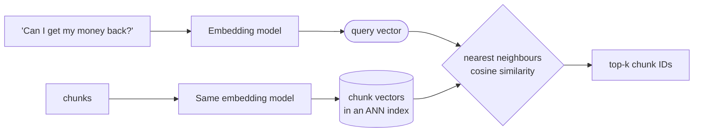
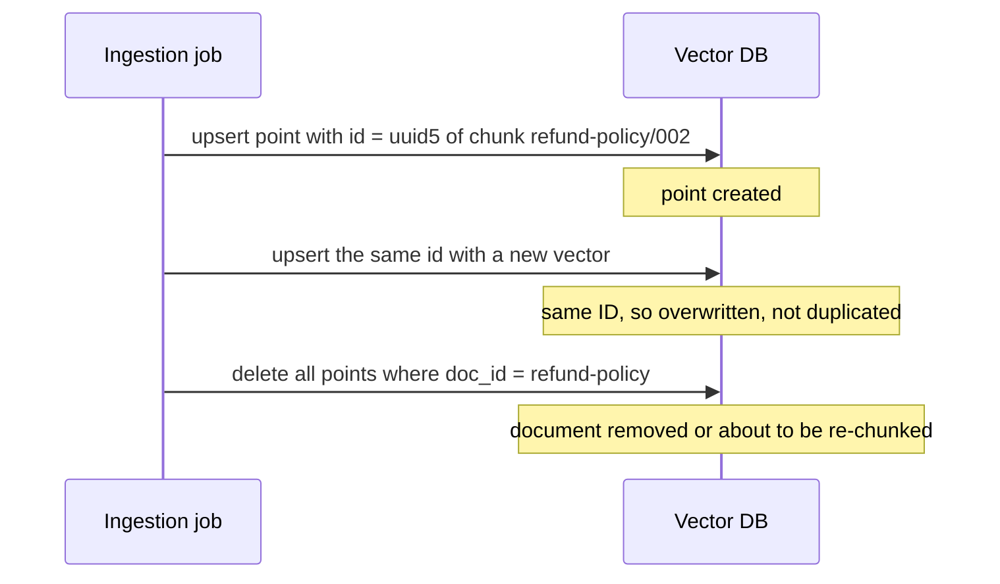
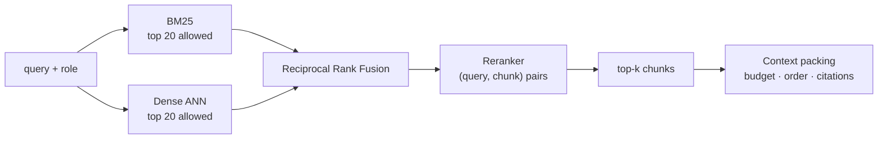
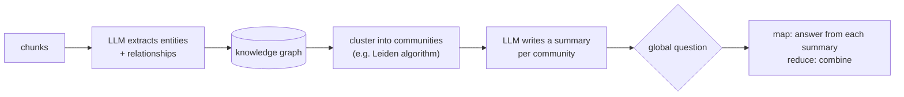

# Lesson 2.5: Vector search and hybrid retrieval

> ⏱ ~60 min · 🎚 Level: Core → Advanced · 🧰 Needs: [Lesson 2.4](04-document-parsing-and-chunking.md)

[Course home](../../README.md) › [Module 2](README.md) › Lesson 2.5

## 📨 The situation

> **From: Lena (Support)**
> After your parsing fixes, answers are much better, but two patterns remain:
> - Customers who type exact things like **"SEV1"**, **"T+2"** or **"CVV"** sometimes get unrelated answers.
> - Customers who *describe* things, like "can I get my money back for a charge?", sometimes get nothing useful because the policy says "refund", not "money back".
>
> **From: Priya (Security)**
> Also: I asked as a *customer* about salary bands and the prototype pulled HR chunks into the prompt. It didn't print them this time, but they were *in the prompt*. That's already a leak.

## 🎯 By the end you can

- **Explain** dense (embedding) search and approximate nearest neighbour (ANN) indexes, and the speed/recall trade-off.
- **Operate** a vector database: collections, idempotent upserts, deletes, payload indexes and **filtered** search.
- **Explain** BM25 and **predict** when keyword search beats vector search, and vice versa.
- **Implement** hybrid retrieval with Reciprocal Rank Fusion and a reranker, and **compute** RRF by hand.
- **Measure** retrieval with recall@k and MRR, and **package** context under a token budget with verifiable citations.
- **Describe** GraphRAG and **decide** when it's worth its cost.

## 🤔 Predict first

1. Which finds "T+2" better: keyword search or embeddings? Which finds "money back" when the doc says "refund"?
2. You retrieve the top 5 chunks, *then* remove those the user may not see. What can go wrong?
3. BM25 gives a chunk a score of 14.2; vector search gives it 0.81. How would you combine them?

---

## 1. Dense retrieval in one page

An **embedding model** maps text to a vector of numbers (for example 384 or 1,024 dimensions) so that texts with similar meaning land close together. Retrieval becomes geometry: embed the question, find the chunk vectors nearest to it.



**Cosine similarity** measures the angle between two vectors: 1 means same direction (very similar), 0 means unrelated. With normalised vectors it equals the dot product, which is why most systems normalise at indexing time.

### Exact vs approximate nearest neighbours

Comparing the query with *every* vector (exact, "flat" search) is perfect but costs O(N): fine for 10,000 chunks, painful for 100 million. **ANN indexes** trade a little recall for a lot of speed:

| Index | Idea | Notes |
|---|---|---|
| **Flat** | Compare with everything | Exact; the baseline to measure others against |
| **HNSW** | Multi-layer "small world" graph; greedy walk toward the query | The default in most vector DBs; fast, memory-hungry; tune `ef` / `M` |
| **IVF** | Cluster vectors; search only the closest clusters | Tune `nprobe`; often combined with compression |
| **PQ** (product quantization) | Compress vectors into short codes | Huge memory savings, some accuracy loss |

> 💡 **Production tip:** ANN quality is measured as **recall against exact search** ("of the true top 10, how many did HNSW return?"). Check it on your own data when you change index parameters. A 0.95 ANN recall looks fine until it's your most important document in the missing 5%.

### Which embedding model?

The lab defaults to a **hash embedder** (`adapters/embeddings.py`). It hashes words into buckets, so it's deterministic and offline, but it understands *no meaning*: "money back" and "refund" share nothing. That is a deliberate teaching foil. Swap in a real model (`all-MiniLM-L6-v2` via the `semantic` extra) and compare. For choosing real models, the **MTEB leaderboard** ranks embedding models on retrieval benchmarks. Benchmarks are a starting point only: always re-run *your* evaluation set, and remember that larger models mean more latency and cost per query.

> ⚠️ **Common mistake:** changing the embedding model without re-embedding the whole corpus. Vectors from different models live in different spaces; mixing them silently breaks search. Store the embedding model name and version with the collection, and treat a model change as a full re-index.

## 2. Operating a vector database

A vector DB stores **points**: an ID, a vector and a **payload** (metadata). The lab uses Qdrant in-memory mode, which has the same API as a real cluster.

### Collections and IDs

```python
self.client.create_collection(collection, vectors_config=VectorParams(size=dim, distance=Distance.COSINE))
```

Every point needs a stable ID. The lab derives it from the chunk ID:

```python
_NAMESPACE = uuid.UUID("6f1c2b1e-0d7a-4c55-9f3e-5a3b2c1d0e9f")
def point_id(chunk_id: str) -> str:
    return str(uuid.uuid5(_NAMESPACE, chunk_id))   # same chunk_id → same UUID, every run
```

### Upserts: idempotent ingestion

An **upsert** inserts a point or overwrites it if the ID exists. With deterministic IDs, re-running ingestion is **idempotent**: running it twice gives the same index as running it once. Without them (random UUIDs), every nightly re-index *adds* a duplicate of every chunk, and after a week each answer cites the same paragraph seven times.



### Metadata filters: the permission boundary

Each lab point carries `{"chunk_id", "doc_id", "access", "section"}`. Search takes a filter:

```python
flt = Filter(must=[FieldCondition(key="access", match=MatchAny(any=allowed_access))])
res = self.client.query_points(self.collection, query=vector.tolist(), limit=k, query_filter=flt)
```

This answers prediction question 2 and Priya's complaint. There are two ways to combine search with permissions:

| | **Post-filtering** | **Filtered search** (pre-filtering) |
|---|---|---|
| How | Retrieve top-k, *then* drop forbidden chunks | The index only considers allowed points |
| Result count | Can drop to **0** if the top-k were all forbidden | Always up to k allowed results |
| Leak risk | Forbidden text may already be in logs, caches or prompts | Forbidden chunks never leave the database |

Use filtered search. Qdrant, pgvector, Weaviate, Milvus and OpenSearch all support it. On large collections, create a **payload index** on the filtered field (the lab does, for `access`) so filtering stays fast. The lab applies the *same* filter to **both** retrievers, BM25 and dense. A permission filter on only one path is a leak through the other.

> ⚠️ **Common mistake:** trusting the role the client *sends*. In this module `/v1/ask` takes `role` from the request body, so anyone can claim to be HR. That's acceptable for learning filters and unacceptable in production. [Lesson 5.3](../05-security-and-governance/03-authentication-and-authorization.md) derives the role from a verified token.

### Choosing a vector store

| Option | Good when |
|---|---|
| **pgvector** (Postgres extension) | You already run Postgres; up to millions of vectors; you want SQL joins and transactions with your other data |
| **Qdrant, Weaviate, Milvus** | Dedicated vector workloads, rich filtering, horizontal scaling |
| **OpenSearch / Elasticsearch** | You also need mature keyword search and want both in one engine |
| **Managed services** | You'd rather pay than operate |
| **FAISS** | A *library*, not a database: superb ANN in-process, but no persistence, filtering or API out of the box |

## 3. Keyword search: BM25

**BM25** ranks chunks by how well their words match the query's words, with three ideas:

1. **Term frequency, with diminishing returns:** a chunk mentioning "refund" 3 times scores higher than once, but not 3× higher (controlled by `k1`).
2. **Inverse document frequency (IDF):** rare words matter more. "CVV" appearing in 2 of 28 chunks is a strong signal; "card" appearing in 20 is weak.
3. **Length normalisation:** long chunks match more words by chance, so they're penalised a little (controlled by `b`).

Keyword search wins on **exact identifiers and rare terms**: "SEV1", "T+2", "CVV", error codes, product names, people's names. Embedding models often blur these. Dense search wins on **paraphrase and meaning**: "money back" ↔ "refund", "lost my phone" ↔ "lock all devices". That answers prediction question 1, and it's why the industry default is to use both.

The lab's tokenizer is intentionally simple: lowercase, drop stopwords, crude plural stripping. It keeps `€`, `%` and `+` so that "T+2" and "€250" survive as tokens. Real search engines add proper stemming, synonyms and language-specific analysers.

## 4. Hybrid retrieval with Reciprocal Rank Fusion



Prediction question 3: you can't add a BM25 score of 14.2 to a cosine of 0.81. The scales are unrelated, and they change from query to query. **Reciprocal Rank Fusion (RRF)** ignores scores entirely and uses **ranks**:

```
RRF(chunk) = Σ over retrievers  1 / (k + rank)        rank starts at 1, k = 60 by convention
```

### Worked example

| Chunk | BM25 rank | Dense rank | RRF score |
|---|---|---|---|
| A | 1 | 4 | 1/61 + 1/64 = 0.016393 + 0.015625 = **0.032018** |
| B | 3 | 1 | 1/63 + 1/61 = 0.015873 + 0.016393 = **0.032266** |
| C | 2 | not retrieved | 1/62 = **0.016129** |

B wins: ranked highly by *both* retrievers, it beats A, and both beat C, which only one retriever found. Agreement is rewarded, and a single retriever's quirk is damped. The constant `k = 60` controls how much top ranks dominate: a smaller `k` makes rank 1 matter more. The lab's implementation is six lines (`domain/fusion.py`) and has a unit test that checks this exact arithmetic.

> 🔎 **Under the hood:** alternatives include *weighted score fusion* (normalise each retriever's scores to 0–1, then take a weighted sum) and learned fusion. RRF is popular because it needs no tuning and is robust when score distributions shift.

## 5. Reranking: a second, more careful look

Retrievers embed the query and each chunk **separately** (a *bi-encoder*), which is what makes searching millions of chunks fast. A **cross-encoder reranker** reads the query and one chunk **together** and outputs a relevance score. It's far more accurate, but you can only afford to run it on a short candidate list (20–50 chunks).

| | Bi-encoder (retrieval) | Cross-encoder (reranking) |
|---|---|---|
| Input | query and chunk separately | (query, chunk) pair |
| Precompute chunk side? | Yes, at indexing | No, runs per query × candidate |
| Speed | Milliseconds over millions | ~tens of ms for 20–50 candidates on CPU |
| Accuracy | Good | Better, especially for ranking the top few |

The lab defines a `Reranker` interface with three implementations: `LexicalOverlapReranker` (default, dependency-free and transparent, but weak), `CrossEncoderReranker` (real model, optional extra) and `NoReranker`. Keep reading for why the default one is a useful lesson.

## 6. Measuring retrieval: recall@k and MRR

You can't improve what you don't measure. The golden set (`datasets/golden/handbook_qa.jsonl`) lists, for each question, the role asking and the expected document(s). We measure at **document level**:

- **recall@k**: the share of questions where an expected document appears in the top *k*.
- **MRR** (mean reciprocal rank): the average of 1/rank of the first correct document. Rank 1 → 1.0, rank 2 → 0.5, rank 4 → 0.25, not found → 0.

Worked MRR example with three questions whose first correct document is at ranks 1, 2 and "not found": MRR = (1 + 0.5 + 0) / 3 = **0.50**.

Real lab output (`uv run python scripts/eval_retrieval.py`, hash embeddings, 27 retrievable questions):

| retriever | recall@1 | recall@3 | recall@5 | MRR |
|---|---|---|---|---|
| bm25 | 0.89 | 1.00 | 1.00 | 0.94 |
| dense (hash) | 0.81 | 0.96 | 1.00 | 0.90 |
| hybrid | **0.96** | 1.00 | 1.00 | **0.98** |
| hybrid + lexical rerank | 0.93 | 1.00 | 1.00 | 0.96 |

How to read it:

1. **Hybrid beats either retriever alone**, even with a meaning-blind dense side. The two make *different* mistakes, and fusion cancels some of them.
2. **The lexical reranker made things slightly worse.** A reranker is not magic: a weak one can undo a good fusion. You only know because you measured. With a real cross-encoder the picture usually flips (try it in the lab's "Extend it" section).
3. **Recall@5 is 1.00 everywhere** because the corpus is tiny (28 chunks). On a real corpus, the differences at k = 5 and k = 10 are where retrievers separate. One question here is worth 0.04, so treat small differences as noise.
4. Run it again after **every** change to parsing, chunking, embeddings or reranking. Retrieval quality is a regression-tested property, like latency ([Module 4](../04-evaluation-and-monitoring/README.md) turns this into a CI gate).

> ⚠️ **Common mistake:** evaluating only the final answer. If answers are wrong, you need to know whether retrieval missed the document or generation misused it. Measure retrieval separately, as above.

## 7. Context packaging: what actually goes into the prompt

Retrieval returns candidates. **Context packaging** decides what the LLM reads:

```python
def pack_context(retrieved, token_budget=900, order="sandwich") -> ContextPack:
    # 1. skip duplicate chunks   2. stop at the token budget   3. reorder
    ...
    if order == "sandwich" and len(used) > 2:
        used = [used[0], *used[2:], used[1]]
```

**1. Token caps.** Every token costs money and latency, and more context is not always better: irrelevant passages distract the model. Set a budget (the lab uses ~900 tokens) and stop adding chunks when it's reached.

**2. Ordering.** The paper *Lost in the Middle* showed that models use information at the **start and end** of a long context better than information in the middle. The lab's `sandwich` order puts the best chunk first and the second-best last.

**3. Citations you can verify.** Each block is labelled with its source:

```
[refund-policy] Refund Policy › Eligibility
- Fee refunds can be requested within 60 days of the charge.
```

The system prompt tells the model to cite `[doc_id]`. Then `extract_citations()` checks every cited ID against the documents **actually provided**:

```python
def extract_citations(text: str, allowed_doc_ids: set[str]) -> tuple[list[str], list[str]]:
    cited = list(dict.fromkeys(_CITATION.findall(text)))
    return [c for c in cited if c in allowed_doc_ids], [c for c in cited if c not in allowed_doc_ids]
```

A citation to a source the model wasn't given is a fabrication, and the API reports it in `notes`. An answer with no valid citation is flagged as ungrounded. And if retrieval returns nothing for the user's role, the service **skips the LLM call entirely** and says "I don't know based on the handbook." That is cheaper, and safer, than letting a model improvise.

## 8. GraphRAG: when chunks aren't enough

Top-k chunk retrieval answers **local** questions well ("What's the refund window?"). It struggles with **global** questions that need the whole corpus: "What are the main themes across our policies?" or "Which processes require director approval?" No single chunk contains that answer.

**GraphRAG** (popularised by Microsoft Research's *From Local to Global* paper) builds a knowledge graph at indexing time:



| | Vector/hybrid RAG | GraphRAG |
|---|---|---|
| Best for | Specific, local facts | Global themes, multi-hop relationships |
| Indexing cost | Embeddings: cheap | LLM extraction over every chunk: **expensive** |
| Freshness | Easy to upsert a changed doc | Graph and summaries need recomputing |
| Debuggability | High: you see the chunks | Lower: summaries of summaries |

Use GraphRAG when your evaluation set shows that global or relationship questions matter and fail with hybrid retrieval, not because it's fashionable. The lab includes a toy version (`scripts/graph_demo.py`) that replaces LLM extraction with a fixed entity list, builds a co-occurrence graph, and finds communities. Real output:

```
'director' appears in: ['expense-policy', 'remote-work-policy']
'director' is connected to: [('salary', 2), ('budget', 1), ('expenses', 1), ('manager', 1), ...]
community 2: ['sev1', 'sev2']
   docs: ['deployment-process', 'incident-response-runbook']
```

"Which processes need director approval?" spans two documents that never mention each other. The graph connects them.

## 🧪 Try it

From `lab/`:

```bash
# 1. Compare retrievers on one query (rerank off to see raw behaviour)
uv run python -m kestrel_docs.search "Can I deploy on Friday?" --role engineer --mode bm25 --no-rerank
uv run python -m kestrel_docs.search "Can I deploy on Friday?" --role engineer --mode dense --no-rerank
uv run python -m kestrel_docs.search "Can I deploy on Friday?" --role engineer --mode hybrid

# 2. Permission filtering: the same question as different roles
uv run python -m kestrel_docs.search "salary band Staff Engineer" --role customer
uv run python -m kestrel_docs.search "salary band Staff Engineer" --role hr

# 3. The whole evaluation
uv run python scripts/eval_retrieval.py

# 4. The toy GraphRAG
uv run python scripts/graph_demo.py --entity sev1
```

For step 2, confirm that **no** result for `customer` has an `hr` chunk, from either retriever. For step 1, look at the `bm25#` and `dense#` columns. You should see BM25 put `deployment-process#001` first, while the hash-based dense retriever ranks it only 4th, below unrelated security and remote-work chunks: the document says "deploy**s**", the query says "deploy", and the hash embedder treats them as unrelated words (BM25's tiny stemmer doesn't). Hybrid still puts it first (`bm25#=1 dense#=4`), because one strong signal plus fusion is enough. That is the robustness argument for hybrid in one example.

Then try a query where the hash embedder fails: `"money back for a charge"` with `--mode dense --no-rerank`. Its top result has nothing to do with refunds, because hashed words carry no meaning. If you install the `semantic` extra (`uv sync --extra semantic`, about 1 GB of downloads) and set `KESTREL_EMBEDDINGS_PROVIDER=sentence-transformers`, the refund policy should move to the top.

## 🏭 In the real world

Hybrid search with reranking is the common production default for enterprise RAG. Mature search engines (OpenSearch, Elasticsearch, Vespa, Weaviate, Qdrant) ship hybrid queries and RRF built in, and the Contextual Retrieval write-up from lesson 2.4 measured the gains from layering BM25, contextual chunks and reranking. Permission-aware retrieval is a standard requirement in enterprise search products, because the cost of one leaked document is far higher than the cost of a slightly worse answer.

## ✅ Check yourself

<details>
<summary>Q1. Compute RRF (k = 60) for a chunk ranked 2nd by BM25 and 2nd by dense, and compare it with one ranked 1st by BM25 only.</summary>

2/62 ≈ 0.03226 vs 1/61 ≈ 0.01639. The chunk both retrievers agree on wins by a wide margin.
</details>

<details>
<summary>Q2. Why is post-filtering by permission dangerous?</summary>

You can end up with zero results when the top-k were all forbidden, and forbidden content has already left the database (into logs, caches or prompts). Filter inside the search, on every retrieval path.
</details>

<details>
<summary>Q3. Your nightly re-index doubles the collection size every night. What's the bug?</summary>

Point IDs aren't deterministic (for example random UUIDs), so upserts insert instead of overwriting. Derive IDs from stable chunk IDs (for example `uuid5(namespace, chunk_id)`).
</details>

<details>
<summary>Q4. Three questions: first correct document at rank 1, at rank 3, and not found. MRR?</summary>

(1 + 1/3 + 0) / 3 ≈ 0.444.
</details>

<details>
<summary>Q5. Adding a reranker lowered recall@1 from 0.96 to 0.93. What do you do?</summary>

Believe the measurement. Check whether it's noise (one question on a tiny set), then try a stronger reranker (a cross-encoder), check the candidate list size, or drop the reranker. Never keep a component because it "should" help.
</details>

<details>
<summary>Q6. When would you choose GraphRAG over hybrid RAG?</summary>

When important questions are global or multi-hop (themes across the corpus, relationships spanning documents) and the evaluation set shows hybrid retrieval failing on them, and you can afford LLM extraction at indexing time plus recomputation when documents change.
</details>

## 💬 Explain it back

Priya asks: "Why isn't it enough to tell the LLM 'don't reveal HR information'?" Answer in three sentences using the words *filter*, *prompt* and *log*.

## 🔑 Key takeaways

- Dense search finds meaning; BM25 finds exact terms. Use both and fuse **ranks** with RRF.
- Deterministic IDs + upserts + deletes keep the vector index consistent with the source.
- Enforce permissions with **filtered search on every retrieval path**, never post-filtering and never via the prompt.
- Measure retrieval separately with recall@k and MRR, and re-run the evaluation after every pipeline change. A reranker must earn its place.
- Package context deliberately: token budget, best-first-and-last ordering, and citations you verify against what was provided.
- GraphRAG answers global questions at a high indexing cost. Use it when your evaluation says you need it.

## 📚 Go deeper (free)

| | Resource | Why read it | Time |
|---|---|---|---|
| ⭐ | [Introducing Contextual Retrieval](https://www.anthropic.com/news/contextual-retrieval) (Anthropic) | Hybrid search + reranking + chunk context, with measured results | 20 min |
| 🔍 | [Qdrant documentation](https://qdrant.tech/documentation/) | Collections, payload filtering, hybrid queries, multitenancy | 60 min |
| 🔍 | [Efficient and robust approximate nearest neighbor search using HNSW graphs](https://arxiv.org/abs/1603.09320) (Malkov & Yashunin) | The algorithm behind most vector DBs | 60 min |
| 🔍 | [FAISS wiki](https://github.com/facebookresearch/faiss/wiki) | Practical guide to flat, IVF, PQ and HNSW indexes | 45 min |
| 🔍 | [Lost in the Middle](https://arxiv.org/abs/2307.03172) (Liu et al.) | Why the order of context matters | 30 min |
| 🔍 | [From Local to Global: A Graph RAG Approach](https://arxiv.org/abs/2404.16130) (Edge et al.) and [GraphRAG docs](https://microsoft.github.io/graphrag/) | The GraphRAG method and its open-source implementation | 60 min |
| 🔍 | [Sentence Transformers documentation](https://www.sbert.net/) | Bi-encoders, cross-encoders, and how to use both | 40 min |
| 🔍 | [MTEB leaderboard](https://huggingface.co/spaces/mteb/leaderboard) | Compare embedding models on retrieval benchmarks | 15 min |
| 🔍 | [pgvector](https://github.com/pgvector/pgvector) | Vector search inside Postgres | 20 min |

---
⬅️ [Lesson 2.4: Document parsing and chunking](04-document-parsing-and-chunking.md) · ➡️ [Lesson 2.6: Experiment tracking and reproducibility](06-experiment-tracking-and-reproducibility.md)
