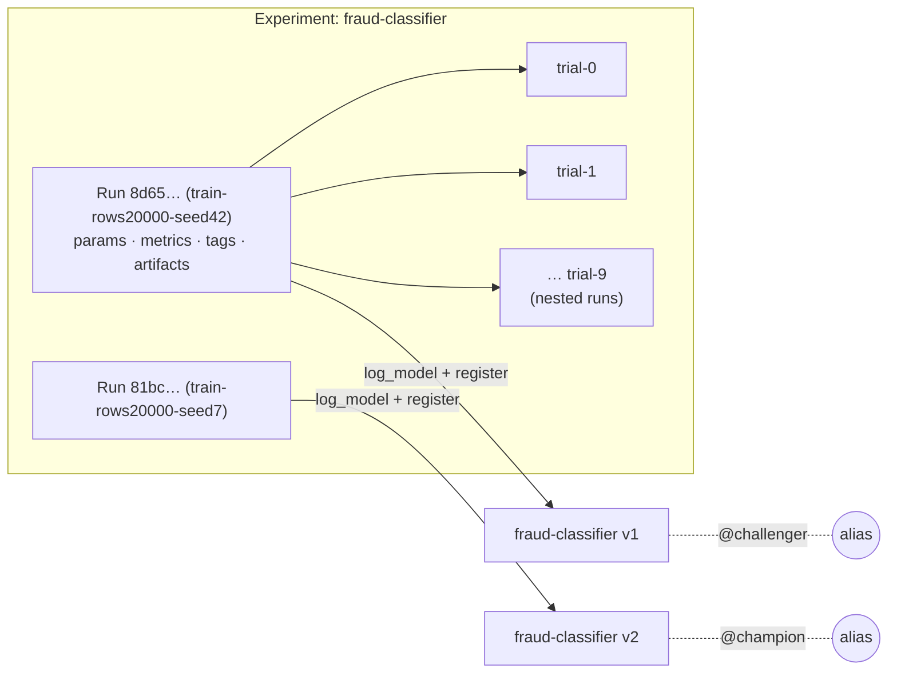

# Lesson 2.6: Experiment tracking and reproducibility

> ⏱ ~50 min · 🎚 Level: Core · 🧰 Needs: [Lesson 2.2](02-lineage-versioning-and-leakage.md)

[Course home](../../README.md) › [Module 2](README.md) › Lesson 2.6

## 📨 The situation

> **From: Omar (Risk)**
> The regulator's model-risk team asked us three questions about the fraud model in production:
> 1. Which data was it trained on?
> 2. Can you retrain it and get the same result?
> 3. Who approved moving it to production, and what did it replace?
>
> Sam's answer to all three was "let me look through my notebooks". That won't fly. We have two weeks.

## 🎯 By the end you can

- **Explain** what experiment tracking records (params, metrics, artifacts, tags) and **use** MLflow runs, nested runs and the UI.
- **Use** a model registry with versions and **aliases** (`@champion`, `@challenger`), and **explain** how aliases replaced the older "stages".
- **Tune** hyperparameters with grid, random and Bayesian search, and **recognise** when you're overfitting the validation set.
- **Apply** a reproducibility checklist (commit, data digest, environment lock, seed, artifact link) and **rebuild** a model from it.
- **Load** models safely, and **explain** why pickle files are a security risk.

## 🤔 Predict first

1. You run a hyperparameter search with 30 trials instead of 10, and the best *validation* score goes up. Will the *test* score go up too?
2. Your serving code loads `models:/fraud-classifier/7`. What's the operational problem with pinning a version number in code?
3. Name four things you'd need to retrain a model and get exactly the same result.

---

## 1. Why notebooks aren't enough

A notebook is a great lab bench and a terrible archive. Cells run out of order, data paths point at someone's laptop, and the "final" result was overwritten twelve times. Within a week, nobody, including its author, can say exactly how the deployed model was produced.

**Experiment tracking** is a lab notebook that writes itself. Every training run automatically records:

| What | Examples | Answers |
|---|---|---|
| **Parameters** | `learning_rate=0.105`, `max_depth=2`, `rows=20000`, `seed=42` | "What knobs?" |
| **Metrics** | `best_val_pr_auc=0.102`, `test_pr_auc=0.099` | "How good?" |
| **Artifacts** | The model, `lineage.json`, plots, the environment spec | "What came out?" |
| **Tags** | `git_commit`, `validated_data_sha256`, `uv_lock_sha256` | "From exactly what?" |



The lab uses **MLflow** (open source, runs locally, no account). **Weights & Biases** is a popular hosted alternative with richer dashboards and a free tier for individuals; the concepts are the same.

## 2. MLflow in the lab

The core of `lab/src/pipelines/train.py`:

```python
with mlflow.start_run(run_name=f"train-rows{rows}-seed{seed}") as parent:
    study.optimize(objective, n_trials=trials)               # each trial is a nested run
    model = build_model(features, study.best_params, seed).fit(fit_df[features], fit_df[LABEL])
    test_pr_auc, test_roc_auc = _score(model, test_df, features)

    mlflow.log_params({**study.best_params, "rows": rows, "seed": seed, "trials": trials, ...})
    mlflow.log_metrics({"best_val_pr_auc": study.best_value, "test_pr_auc": test_pr_auc, ...})
    mlflow.set_tags({...lineage: data digests, git commit, uv.lock hash...})
    mlflow.log_artifact("lineage.json")
    info = mlflow.sklearn.log_model(model, name="model", registered_model_name=MODEL_NAME, ...)
```

Three details are worth copying into any project:

1. **Tracking URI is explicit.** The lab uses `sqlite:///mlflow.db`. In a team you point it at a shared MLflow server, so everyone's runs land in one place.
2. **Nested runs** for the hyperparameter trials keep the experiment list readable: one parent run per training job, children for the trials.
3. **Lineage goes into tags,** so you can *search* for it: "show me every run trained on data digest `c91e…`".

> 💡 **Production tip:** log the **command** that started the run (or the pipeline task name and config), not just its results. "Which code and data?" is half of reproducibility; "which invocation?" is the other half.

## 3. The model registry: versions and aliases

Tracking stores *everything you tried*. A **model registry** stores the models you *might deploy*, with versions and a promotion workflow.

Every `log_model(..., registered_model_name="fraud-classifier")` creates a new **version** (1, 2, 3…). Versions are immutable. Which version serves traffic is a separate, *movable* pointer.

### Stages vs aliases

Older MLflow versions used fixed **stages** (`None → Staging → Production → Archived`). Since MLflow 2.9 those are deprecated in favour of **aliases**: named, movable pointers you define yourself, plus free-form tags.

| | Stages (legacy) | Aliases (current) |
|---|---|---|
| Names | Fixed set of 4 | Anything: `champion`, `challenger`, `shadow`, `eu-prod` |
| Per model | One version per stage | One version per alias, any number of aliases |
| Load | `models:/fraud-classifier/Production` | `models:/fraud-classifier@champion` |

The lab sets `@challenger` on every new version and moves `@champion` to it if it beats the current champion:

```python
client.set_registered_model_alias(MODEL_NAME, "challenger", version)
champion = _champion_score(client)
promoted = champion is None or test_pr_auc > champion
if promoted:
    client.set_registered_model_alias(MODEL_NAME, "champion", version)
```

And serving code loads by alias, never by number (`lab/src/pipelines/registry.py`):

```python
mlflow.sklearn.load_model(f"models:/{MODEL_NAME}@champion")
```

That answers prediction question 2: with a pinned version number in code, every promotion or rollback needs a code change and a redeploy. With an alias, **promotion and rollback are registry operations**: move the pointer, and the service picks it up on its next reload. Combine that with the audit log of who moved the alias and when, and you've answered Omar's third question.

> ⚠️ **Common mistake (and the lab's deliberate flaw):** an automatic promotion rule based on **one offline metric**. In lesson 2.2's "Break it", the *leaky* model (PR-AUC 0.71) was promoted to `@champion` automatically. Worse, comparing runs with different `--seed` values compares models scored on **different test sets**, because the seed also changes the generated data. A real promotion gate checks: same evaluation set, leakage checks passed, several metrics including fairness and calibration, latency, and a human approval for high-risk models. [Module 4](../04-evaluation-and-monitoring/README.md) builds that gate.

## 4. Hyperparameter tuning

**Hyperparameters** are settings you choose before training (learning rate, tree depth, number of trees), as opposed to **parameters** the model learns. Tuning searches for good values.

| Method | How | When |
|---|---|---|
| **Grid search** | Try every combination of a fixed list | 1–2 hyperparameters; cost explodes beyond that |
| **Random search** | Sample combinations at random | Surprisingly strong baseline; better than grid with many dimensions |
| **Bayesian optimisation** (e.g. TPE in Optuna) | Use past trials to propose promising ones | Expensive trials; you want more from fewer runs |
| **Early stopping / pruning** (Hyperband, ASHA, Optuna pruners) | Kill clearly bad trials early | Long trials such as neural networks |

The lab uses **Optuna** with the TPE sampler, seeded so the search itself is reproducible:

```python
def objective(trial):
    params = {
        "learning_rate": trial.suggest_float("learning_rate", 0.02, 0.3, log=True),   # log scale!
        "max_depth": trial.suggest_int("max_depth", 2, 8),
        "max_iter": trial.suggest_int("max_iter", 50, 300, step=50),
        "l2_regularization": trial.suggest_float("l2_regularization", 1e-3, 10.0, log=True),
    }
    ...
    return pr_auc_on_validation

study = optuna.create_study(direction="maximize", sampler=optuna.samplers.TPESampler(seed=seed))
```

> 💡 **Production tip:** search learning rates and regularisation strengths on a **log scale**. The difference between 0.001 and 0.01 matters as much as between 0.01 and 0.1.

### Overfitting the validation set

Here's a real result from the lab (same data, same seed, different number of trials):

| trials | best **validation** PR-AUC | **test** PR-AUC |
|---|---|---|
| 10 | 0.102 | **0.099** |
| 30 | **0.128** | 0.082 |

More trials found a configuration that scored better on validation **and worse on unseen test data**. This answers prediction question 1. Every trial is a peek at the validation set; with enough peeks, you find settings that fit its noise. The validation set has only about 3,000 rows and about 40 fraud cases, so each case moves PR-AUC noticeably.

Defences:

- Keep a **test set you look at once**, at the end (the lab: 70/15/15 temporal split, tuning on validation only).
- Use **cross-validation** (time-series aware for temporal data) when data is small.
- Prefer **simpler** configurations when scores are within noise.
- Put **confidence intervals** on metrics (bootstrap the test set) before claiming a win. [Lesson 4.1](../04-evaluation-and-monitoring/01-offline-vs-online-and-classification-metrics.md) shows how.

## 5. The reproducibility checklist

To rebuild a model **exactly**, you need all of these:

| ✔ | Item | How the lab captures it |
|---|---|---|
| ☐ | **Code commit** (and "was the tree dirty?") | `git_commit`, `git_dirty` tags |
| ☐ | **Data digest** (raw and validated) | `raw_file_sha256`, `validated_data_sha256` tags; `lineage.json` |
| ☐ | **Data recipe** (how to get the data back) | generator script + rows + seed in `lineage.json` |
| ☐ | **Environment lock** | `uv_lock_sha256` tag; MLflow also stores the exported requirements with the model |
| ☐ | **Seeds** | `seed` param, used for the data, the model and the Optuna sampler |
| ☐ | **Configuration / command** | params logged; command in the lab README |
| ☐ | **Artifact link** | registered model version → run ID → artifact location |
| ☐ | **Hardware notes** (for GPU training) | Not needed here; for neural networks, GPU type and library versions can change results |

Proof that it works: running `uv run python -m pipelines.train --trials 15` twice in the lab produced the **same best parameters and the same test PR-AUC (0.085) to the last digit**. Same code, same data, same environment, same seeds, same result.

> 🔎 **Under the hood:** "same result" can be harder on GPUs, where some operations are non-deterministic for speed. Frameworks offer deterministic modes at some cost. Decide up front whether you need bit-exact reproducibility (some regulated settings do) or "statistically the same" (most teams).

The lab includes a fill-in template: [`lab/REPRODUCIBILITY.md`](lab/REPRODUCIBILITY.md).

## 6. Loading models safely

Python's `pickle` (and `joblib`, which uses it) can **execute arbitrary code when loading**. A model file from an untrusted source is effectively a program. Recent MLflow versions save scikit-learn models with **skops**, which refuses to load types you haven't explicitly trusted. That's why the lab passes:

```python
TRUSTED_TYPES = ["sklearn.ensemble._hist_gradient_boosting.predictor.TreePredictor"]
mlflow.sklearn.log_model(model, ..., skops_trusted_types=TRUSTED_TYPES)
```

Treat model artifacts like code: load only from your registry, verify digests (Module 1 stored a sha256 next to every artifact), and never `pickle.load` a file someone emailed you. For neural network weights, the **safetensors** format stores only tensors, with no executable code.

## 🧪 Try it

From `lab/`:

```bash
uv run python -m pipelines.train              # 10 Optuna trials (default)
uv run python -m pipelines.train --trials 30  # more tuning: compare validation vs test
uv run python -m pipelines.registry           # versions and aliases
uv run python -m pipelines.registry --score   # load @champion and score 5 rows
uv run mlflow ui --backend-store-uri sqlite:///mlflow.db   # open http://127.0.0.1:5000
```

Expected from the first command (exact values on this dataset and seed):

```
registered fraud-classifier v1  test PR-AUC=0.099  ROC-AUC=0.839
best params: {'learning_rate': 0.1048..., 'max_depth': 2, 'max_iter': 100, 'l2_regularization': 0.0292...}
promoted to @champion ✅
```

In the MLflow UI:

1. Open the `fraud-classifier` experiment and expand a parent run to see its nested trials.
2. Select two parent runs and click **Compare**. Is `best_val_pr_auc` higher for the 30-trial run? Is `test_pr_auc`?
3. Open a run's **Artifacts** tab: find `lineage.json` and the `model` folder (its `MLmodel` file, requirements, input example and signature).
4. Open **Models → fraud-classifier**: which version holds `@champion`? Was that the right decision?

Then fill in [`lab/REPRODUCIBILITY.md`](lab/REPRODUCIBILITY.md) for your champion run.

## 🏭 In the real world

Model-risk-management guidance in banking (for example the US Federal Reserve's SR 11-7) expects documented development, validation, version control and change approval for models that drive decisions. An experiment tracker plus a registry with an audit trail is how ML teams meet that without drowning in spreadsheets. Outside regulated industries the motivation is simpler: when a model misbehaves at 3 a.m., "what changed?" must be answerable in minutes.

## ✅ Check yourself

<details>
<summary>Q1. What's the difference between a hyperparameter and a parameter?</summary>

Hyperparameters are chosen before training (learning rate, depth, regularisation); parameters are learned during training (tree splits, weights).
</details>

<details>
<summary>Q2. Why load models by alias instead of version number?</summary>

Promotion and rollback become registry operations (move the alias) with an audit trail, instead of code changes and redeploys.
</details>

<details>
<summary>Q3. More tuning trials raised validation PR-AUC from 0.102 to 0.128 but lowered test PR-AUC from 0.099 to 0.082. Explain.</summary>

Overfitting the validation set: many trials found settings that fit the noise of a small validation set. The untouched test set reveals it. Use a held-out test set, cross-validation, confidence intervals, and prefer simpler models when scores are within noise.
</details>

<details>
<summary>Q4. List the items of the reproducibility checklist.</summary>

Code commit (+ dirty flag), data digest, data recipe/location, environment lock, seeds, configuration/command, artifact link, and hardware notes for GPU work.
</details>

<details>
<summary>Q5. Model v2 was trained with --seed 7 and "beat" v1 (seed 42). Why is that comparison invalid?</summary>

In this lab the seed also generates the data, so the two models were evaluated on different test sets. Compare candidates on the same, fixed evaluation set.
</details>

<details>
<summary>Q6. Why is loading a pickle file from an untrusted source dangerous?</summary>

Unpickling can execute arbitrary code. Use safer formats (skops for scikit-learn, safetensors for tensors), load only from your own registry, and verify digests.
</details>

## 💬 Explain it back

Draft the answer to the regulator's three questions for your `@champion` model, using only what you can find in MLflow (no notebooks).

## 🔑 Key takeaways

- Track every run: params, metrics, artifacts, and **lineage tags** you can search.
- The registry holds immutable versions; **aliases** (`@champion`) are the movable pointers serving code loads.
- Bayesian search finds good settings with fewer trials, but every trial peeks at validation. Keep an untouched test set.
- Reproducibility = commit + data digest + environment lock + seeds + config + artifact link. Prove it by retraining once.
- Automatic promotion on one metric is dangerous. Model files are code; load them safely.

## 📚 Go deeper (free)

| | Resource | Why read it | Time |
|---|---|---|---|
| ⭐ | [MLOps Zoomcamp, module 2: experiment tracking](https://github.com/DataTalksClub/mlops-zoomcamp) (DataTalks.Club) | Hands-on MLflow tracking and registry, free | 3 h |
| 🔍 | [MLflow documentation](https://mlflow.org/docs/latest/index.html) | Tracking, model registry, aliases | 60 min |
| 🔍 | [Optuna documentation](https://optuna.readthedocs.io/) | Samplers, pruners, visualisation | 45 min |
| 🔍 | [Deep Learning Tuning Playbook](https://github.com/google-research/tuning_playbook) (Google Research) | A systematic, practical approach to tuning | 90 min |
| 🔍 | [Weights & Biases documentation](https://docs.wandb.ai/) | The hosted alternative to MLflow tracking | 30 min |
| 🔍 | [Made With ML](https://madewithml.com/) (Goku Mohandas) | Experiment tracking and reproducibility inside a full MLOps course | weeks |

---
⬅️ [Lesson 2.5: Vector search and hybrid retrieval](05-vector-search-and-hybrid-retrieval.md) · ➡️ [Lesson 2.7: Prompt, RAG or fine-tune?](07-prompt-rag-or-fine-tune.md)
