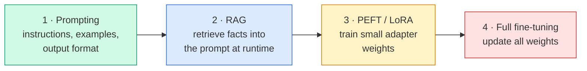
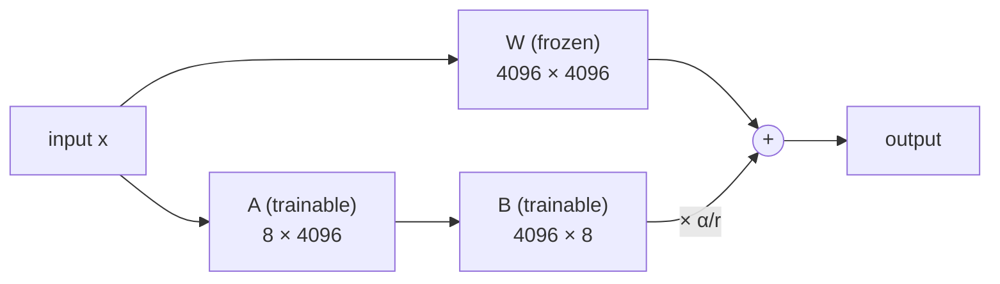
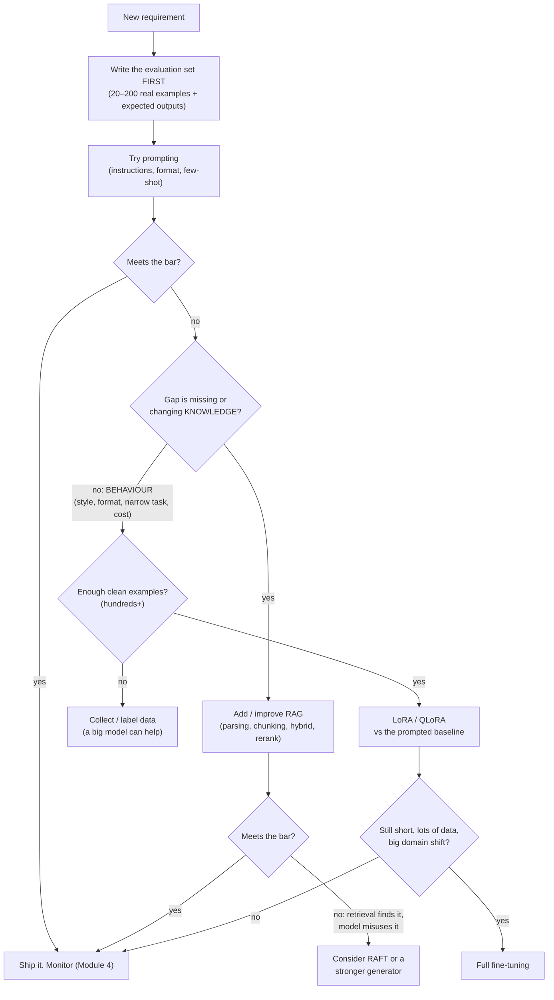

# Lesson 2.7 · Prompt, RAG or fine-tune?

> ⏱ ~45 min · 🎚 Level: Core · 🧰 Needs: [Lesson 2.5](05-vector-search-and-hybrid-retrieval.md), [Lesson 0.5](../00-foundations/05-llms-in-one-hour.md)

[Course home](../../README.md) › [Module 2](README.md) › Lesson 2.7

## 📨 The situation

> **From: Lena (Support)**
> Three requests from my team, and a vendor says "just fine-tune a model on all our docs" for all of them:
> 1. The assistant should answer from our policies, which change every few weeks.
> 2. It should sound like Kestrel: warm, short, no jargon, always offering a next step.
> 3. We get 40,000 tickets a month, and we want each one auto-tagged with one of 25 categories. The big API model does it well, but it costs too much at that volume.
>
> **From: Maya**
> Fine-tuning has a cost: data, training, evaluation, hosting, and doing it all again when things change. Give me a recommendation for each, with reasons.

## 🎯 By the end you can

- **Distinguish** *knowledge* problems from *behaviour* problems, and **map** each to the right technique.
- **Explain** prompting, RAG, PEFT (LoRA, QLoRA) and full fine-tuning: what each changes, what it costs, and how it fails.
- **Compute** LoRA's trainable-parameter and memory savings for a given model.
- **Apply** a decision framework to a real request and **defend** the choice with an evaluation plan.
- **Recognise** combinations (RAG + fine-tuned style, RAFT, fine-tuned retrievers) and when they pay off.

## 🤔 Predict first

1. Can fine-tuning reliably teach a model *new facts*, such as this month's refund policy?
2. A LoRA adapter for an 8-billion-parameter model is roughly how big: 40 MB, 4 GB or 16 GB?
3. Which should you try first for any LLM task, and why?

---

## 1. The four levers

You can change an LLM system's behaviour at four levels, from cheapest to most expensive:



| | **Prompting** | **RAG** | **PEFT (LoRA/QLoRA)** | **Full fine-tuning** |
|---|---|---|---|---|
| What changes | The input | The input, with retrieved facts | Small added weight matrices | Every weight |
| Best for | Format, tone, task instructions | **Knowledge**: facts that change, need citations or permissions | **Behaviour**: style, format, domain language, narrow tasks; making a small model match a big one | Large domain shifts, new languages, maximum quality on a narrow task with lots of data |
| Data needed | 0–20 examples | Your documents | Hundreds to tens of thousands of examples | Tens of thousands or more |
| Time to change | Minutes | Re-index: minutes to hours | Hours to retrain + evaluate | Days |
| Update when facts change | Edit the prompt | Re-index the changed doc | Retrain | Retrain |
| Citations and permissions | No | **Yes** | No | No |
| Main failure mode | Long, brittle prompts | Bad retrieval → wrong or missing context | Overfits small data; forgets general skills | Expensive; catastrophic forgetting |

### Knowledge vs behaviour: the key question

The most useful single question is: **is the gap in what the model *knows*, or in how it *behaves*?**

- **Knowledge** (facts, numbers, policies, product details): use **RAG**. Facts change; RAG updates by re-indexing, cites its sources, and respects permissions per user (lesson 2.5). Studies comparing knowledge-injection methods (for example *Fine-Tuning or Retrieval?* by Ovadia et al.) found retrieval considerably more reliable than fine-tuning for adding new facts. Fine-tuning tends to teach the *style* of the facts more reliably than the facts themselves, which can increase confident wrong answers.
- **Behaviour** (tone, format, following a schema, a narrow classification task, domain jargon): try **prompting** first, and **fine-tune** when prompting can't get there, is too long or slow, or is too expensive at volume.

That answers prediction question 1: fine-tuning *can* change what a model says about your policies, but it's an unreliable, hard-to-update, uncitable way to do it.

## 2. Prompting: always the baseline

Prompting includes clear instructions, a role, an output format (JSON schema, structured outputs), **few-shot examples**, and "think step by step" when reasoning helps. It's the first thing to try because:

- it's **free to iterate**: minutes per experiment, no training data;
- it gives you a **baseline** any later fine-tune must beat on the same evaluation set;
- most "the model can't do X" complaints turn out to be "we never told it clearly".

Its limits: very long prompts cost tokens on *every* call (at 40,000 tickets a month, a 2,000-token prompt adds up), and some behaviours can't be described in words well enough.

## 3. RAG: knowledge at runtime

You built this in lessons 2.4–2.5. Recap of why it fits Lena's request 1:

- Policies change every few weeks → **re-index the changed document**; no retraining.
- Customers need trustworthy answers → **citations** you can verify.
- Different users may see different documents → **permission-filtered retrieval**.
- When the answer isn't there → the system can **say so** instead of improvising.

## 4. PEFT and LoRA: cheap behaviour changes

**Fine-tuning** continues training a pre-trained model on your examples. Full fine-tuning updates every weight. For an 8-billion-parameter model that means storing gradients and optimizer state for 8 billion numbers.

**Parameter-efficient fine-tuning (PEFT)** freezes the original weights and trains a small number of new ones. The most popular method is **LoRA** (Low-Rank Adaptation).

### How LoRA works

For a weight matrix `W` (say 4096 × 4096 ≈ 16.8 M numbers), LoRA learns a *low-rank* update:

```
W' = W + (α / r) · B · A        where  B is 4096 × r,  A is r × 4096,  and r is small (e.g. 8)
```

With r = 8, `B` and `A` together have 2 × 4096 × 8 = **65,536** numbers: 0.4% of `W`. The bet behind LoRA is that the *change* needed to adapt a model to a task is low-rank, even if the model itself isn't. In practice it works remarkably well for style, format and narrow tasks.



Practical consequences:

- **Memory:** no gradients or optimizer state for the frozen weights.
- **Storage and serving:** an adapter is tens of megabytes. One base model can serve many adapters (one per customer or task), swapped per request. Serving engines like vLLM support this directly.
- **QLoRA** loads the frozen base model in **4-bit** precision and trains LoRA adapters on top, which lets an 8B model be fine-tuned on a single consumer GPU.

The lab's calculator (real output, for a typical 8B decoder model with LoRA rank 8 on all attention and MLP projections):

```
model parameters        ≈  8.03 B
LoRA rank 8   adapters  ≈  21.0 M trainable (0.26% of the model)

method               weights  training state    ≈ total (no activations)
full fine-tune        16.1 GB         112.4 GB                   128.5 GB
LoRA (bf16 base)      16.1 GB           0.3 GB                    16.4 GB
QLoRA (4-bit base)     4.0 GB           0.3 GB                     4.4 GB

adapter file on disk (bf16) ≈ 42 MB, vs ≈ 16 GB for a full copy of the model
```

That answers prediction question 2: roughly **40 MB**. Full fine-tuning needs a multi-GPU node; QLoRA fits on one 24 GB GPU, with room left for activations.

> ⚠️ **Common mistake:** fine-tuning on a few hundred noisy examples and judging by eye. Fine-tuning *amplifies* whatever is in the data, including mistakes and inconsistent labels. Curate the data, hold out a test set, compare against the prompted baseline on the same evaluation set, and check that general abilities didn't regress.

> 💡 **Production tip:** a fine-tuned model is a **new model artifact**. It needs everything from lesson 2.6: tracked data digest, base-model version, adapter version, an evaluation report and a registry alias. When the base model is upgraded, your adapter doesn't transfer automatically; you must retrain and re-evaluate.

## 5. Full fine-tuning

Updating all weights gives the most capacity to change the model and the most ways to break it. It makes sense when you have lots of high-quality data and a large shift from the base model's domain (a new language, a specialised modality, a domain with its own vocabulary), or when you're distilling a large model into a small one for a high-volume task. For most product teams, LoRA gets most of the benefit at a fraction of the cost.

## 6. Combinations that work well

The levers combine; they aren't exclusive:

| Combination | Example |
|---|---|
| **RAG + prompting** | The default for knowledge assistants (lab 2) |
| **RAG + LoRA for style/format** | Facts from retrieval, Kestrel's tone and answer structure from a small adapter |
| **RAFT** (Retrieval-Augmented Fine-Tuning) | Fine-tune the generator on (question, retrieved documents *including distractors*, cited answer) so it gets better at *using* retrieved context and ignoring irrelevant chunks |
| **Fine-tuned retriever or reranker** | Fine-tune a small embedding model or cross-encoder on your own (question, relevant chunk) pairs. Often the highest-impact fine-tune in a RAG system, and cheap |
| **Distillation** | Use a large model to label data, fine-tune a small one to imitate it, and serve the small one cheaply (Lena's request 3) |

## 7. The decision framework



Notice the first box. **Without an evaluation set you can't make this decision**; you can only argue about it. Every arrow above is "try it, measure it on the same set".

### Applying it to Lena's three requests

| Request | Diagnosis | Recommendation | Why not the alternatives? |
|---|---|---|---|
| 1. Answer from changing policies | Knowledge, changing, needs citations and permissions | **RAG** (already built) | Fine-tuning would need retraining every few weeks, can't cite, and can't apply per-user permissions |
| 2. Sound like Kestrel | Behaviour (tone, structure) | **Prompting** with a style guide and 3–5 example answers. Consider a **LoRA** adapter later only if the prompt gets long, inconsistent, or expensive at volume | Fine-tuning first means paying for data and training before knowing whether a prompt is enough |
| 3. Tag 40k tickets/month cheaply | Behaviour: a narrow classification task at high volume | Measure the big model with prompting → if good, **distil**: label ~5–10k tickets with it, have humans review a sample, fine-tune a small model (LoRA on a small LLM, or a classic classifier on embeddings) | Paying big-model prices per ticket forever; RAG doesn't help classification much |

And `fraud-service`? It's tabular data with labels. Gradient-boosted trees (lesson 2.6) beat LLMs there on accuracy, cost and latency. **Not every AI problem is an LLM problem.**

## 🧪 Try it

From `lab/`:

```bash
uv run python scripts/lora_math.py                     # an ~8B model, rank 8
uv run python scripts/lora_math.py --rank 64           # how does rank change adapter size?
uv run python scripts/lora_math.py --hidden 2048 --layers 16 --mlp 8192 --kv-dim 512   # a ~1B model
```

Then do the **decision exercise** (no code). For each request, write the diagnosis (knowledge or behaviour), your first approach, how you'd evaluate it, and what result would make you escalate to the next lever:

1. Diego wants the assistant to answer on-call questions using the incident runbook *and* produce a Slack-ready incident summary in a fixed template.
2. Omar wants a model that reads free-text dispute descriptions and flags likely "friendly fraud" (customers disputing purchases they made).
3. Priya wants the assistant to refuse to discuss internal security tooling with customers.

<details>
<summary>Suggested answers</summary>

1. Runbook facts → **RAG** (engineer role). The template → **prompting** with the template and an example. Evaluate with 20 realistic on-call questions; check facts are cited and the template is always followed. LoRA only if format adherence stays poor.
2. A narrow classification over text → start by **prompting** a capable model on ~200 labelled historical disputes as an evaluation set. If it's good but volume is high, **distil** into a small fine-tuned classifier. Consider combining text with tabular signals in a classic model. Watch for label leakage (lesson 2.2): dispute outcomes are known only later.
3. This is **not** a fine-tuning or prompt-only problem: it's **access control** (don't retrieve internal docs for customers: lesson 2.5 filters) plus guardrails ([Module 5](../05-security-and-governance/README.md)). A prompt instruction is a helpful extra, never the control.
</details>

## 🏭 In the real world

Public guidance from model providers converges on the same order: start with prompt engineering and an evaluation set, add retrieval when the gap is knowledge, and fine-tune when the gap is behaviour or cost at scale. OpenAI's "Optimizing LLM accuracy" guide frames it as two axes, *context optimisation* (what the model knows: RAG) and *LLM optimisation* (how the model acts: fine-tuning). Hugging Face's PEFT library has made LoRA and QLoRA the default way teams fine-tune open-weight models.

## ✅ Check yourself

<details>
<summary>Q1. What's the single most useful question when choosing between RAG and fine-tuning?</summary>

Is the gap in the model's **knowledge** (facts, which change) → RAG, or in its **behaviour** (style, format, narrow task) → prompting, then fine-tuning?
</details>

<details>
<summary>Q2. Why is RAG better than fine-tuning for a frequently changing policy?</summary>

Updates are a re-index instead of a retrain; answers can cite sources; per-user permissions can be enforced at retrieval; and retrieval injects facts more reliably than fine-tuning does.
</details>

<details>
<summary>Q3. A weight matrix is 4096 × 1024. How many LoRA parameters at rank 16?</summary>

r × (d_out + d_in) = 16 × (4096 + 1024) = 81,920.
</details>

<details>
<summary>Q4. What does QLoRA change compared with LoRA, and why does it matter?</summary>

It stores the frozen base model in 4-bit precision instead of 16-bit, cutting base-weight memory by about 4×, so large models can be fine-tuned on a single GPU. Adapters are still trained in higher precision.
</details>

<details>
<summary>Q5. Name two things you must have before starting any fine-tune.</summary>

An evaluation set with a prompted (and/or RAG) baseline score to beat, and a clean, representative, versioned training set (plus a held-out test split). Also a plan for re-training when the base model changes.
</details>

<details>
<summary>Q6. What is RAFT and when would you use it?</summary>

Retrieval-Augmented Fine-Tuning: fine-tune the generator on questions with retrieved documents, including distractors, and cited answers, so it learns to use relevant context and ignore irrelevant chunks. Use it when retrieval finds the right documents but the model still answers poorly from them.
</details>

## 💬 Explain it back

Write Maya the three-line recommendation for Lena's requests, one line each, with the reason and the evaluation you'd run first.

## 🔑 Key takeaways

- Write the evaluation set first; every choice is "try, measure on the same set, escalate only if needed".
- Knowledge → RAG. Behaviour → prompting first, then PEFT/LoRA. Full fine-tuning is rarely the first answer.
- LoRA trains ~0.1–1% of the parameters; adapters are megabytes; QLoRA fits an 8B model on one GPU.
- A fine-tuned model is a new artifact to version, evaluate, register and retrain when the base model changes.
- Combinations are normal: RAG + style adapter, RAFT, fine-tuned retrievers, distillation. And not every problem is an LLM problem.

## 📚 Go deeper (free)

| | Resource | Why read it | Time |
|---|---|---|---|
| ⭐ | [OpenAI guide: Optimizing LLM accuracy](https://platform.openai.com/docs/guides/optimizing-llm-accuracy) | The clearest framing of prompting vs RAG vs fine-tuning | 30 min |
| 🔍 | [LoRA: Low-Rank Adaptation of Large Language Models](https://arxiv.org/abs/2106.09685) (Hu et al.) | The original LoRA paper | 45 min |
| 🔍 | [QLoRA: Efficient Finetuning of Quantized LLMs](https://arxiv.org/abs/2305.14314) (Dettmers et al.) | 4-bit base models + LoRA | 45 min |
| 🔍 | [Hugging Face PEFT documentation](https://huggingface.co/docs/peft) | Hands-on LoRA, QLoRA and other PEFT methods | 60 min |
| 🔍 | [RAFT: Adapting Language Model to Domain Specific RAG](https://arxiv.org/abs/2403.10131) (Zhang et al.) | Fine-tuning a generator to use retrieved context better | 40 min |
| 🔍 | [Fine-Tuning or Retrieval? Comparing Knowledge Injection in LLMs](https://arxiv.org/abs/2312.05934) (Ovadia et al.) | Evidence that RAG injects new facts more reliably | 30 min |
| 🔍 | [Anthropic's interactive prompt engineering tutorial](https://github.com/anthropics/prompt-eng-interactive-tutorial) | A free, hands-on prompting course | 3 h |

---
⬅️ [Lesson 2.6 · Experiment tracking and reproducibility](06-experiment-tracking-and-reproducibility.md) · ➡️ [Lab 2](lab/README.md) · [Module quiz](quiz.md) · [Module 3 · Serving and Optimization](../03-serving-and-optimization/README.md)
