# Lab 2: Two pipelines you can trust
<!-- id: lab-2 -->

> ⏱ 4–5 h · 🧰 Needs: Python 3.11+, [uv](https://docs.astral.sh/uv/). No API keys, no GPU, no Docker.

[Course home](../../../README.md) › [Module 2](../README.md) › Lab 2

## 🎯 Goals

By the end of this lab you will have:

- **Part A (Track A, `fraud-service`):** a training pipeline that refuses bad data, refuses leaky features, tunes hyperparameters, tracks everything in MLflow, and registers a model you can load by alias and rebuild from scratch.
- **Part B (Track B, `docs-assistant`):** a RAG service that parses Markdown and HTML, strips hidden injections, chunks by headings, indexes into Qdrant with access metadata, retrieves with BM25 + vectors + RRF + reranking, and answers with verifiable citations on `POST /v1/ask`.

## 🗺 Architecture

```mermaid
flowchart TB
    subgraph A ["Part A · fraud pipelines (src/pipelines)"]
        GEN["data.py<br/>datasets/fraud/generate.py"] --> VAL{"validate.py<br/>gate"}
        VAL -- fail --> STOP1["DataValidationError"]
        VAL -- pass --> LEAK{"leakage.py<br/>contract + single-feature AUC"}
        LEAK -- fail --> STOP2["LeakageError"]
        LEAK -- pass --> SPLIT["temporal split 70/15/15"] --> OPT["Optuna (nested MLflow runs)"] --> FIT["refit + test score"]
        FIT --> MLF[("MLflow<br/>sqlite:///mlflow.db")]
        MLF --> REG["registry: fraud-classifier<br/>@challenger / @champion"]
    end
    subgraph B ["Part B · docs-assistant (src/kestrel_docs)"]
        HB[("datasets/handbook")] --> PARSE["documents.py<br/>front matter · HTML clean · strip comments"]
        PARSE --> CHUNK["chunking.py<br/>headings → recursive → overlap"]
        CHUNK --> EMB["adapters/embeddings.py<br/>hash | sentence-transformers"]
        EMB --> QD[("adapters/vector_store.py<br/>Qdrant :memory:")]
        CHUNK --> BM["lexical.py<br/>BM25"]
        Q["POST /v1/ask<br/>question + role"] --> RET["retrieval.py<br/>filtered BM25 + dense → RRF → rerank"]
        QD --> RET
        BM --> RET
        RET --> CTX["context.py<br/>budget · sandwich order · [doc_id]"]
        CTX --> LLM["adapters/llm.py<br/>fake | ollama | openai"]
        LLM --> ANS["answer.py<br/>verify citations"]
    end
```



```
lab/
├── pyproject.toml            dependencies (uv)
├── REPRODUCIBILITY.md        checklist you fill in (Part A, step 8)
├── src/pipelines/            Part A: data, validate, leakage, digest, train, registry
├── src/kestrel_docs/         Part B: config, adapters/, domain/, api/, main.py, ingest.py, search.py
├── scripts/                  eval_retrieval.py, graph_demo.py, padding_demo.py, lora_math.py
└── tests/                    33 tests, all offline
```

## Part 0 · Setup

### Step 0 · Set up
<!-- id: lab-2-step-0 -->

```bash
cd modules/02-data-and-model-pipelines/lab
uv sync
uv run pytest
```

Expected (the first run downloads dependencies, about 1–2 minutes; the tests take about 10 seconds):

```
.................................                                        [100%]
33 passed
```

> 💡 MLflow prints INFO lines and, depending on the version, hints. They are harmless. Set `MLFLOW_DISABLE_AGENT_HINT=1` to hide one of them.

---

## Part A · Data and model pipelines

### Step 1 · Ingest
<!-- id: lab-2-step-1 -->

```bash
uv run python -m pipelines.data
```

```
.../lab/data/raw_baseline_20000_42.csv  rows=20,000  fraud_rate=1.34%
```

The file is git-ignored. Anyone with the repo can regenerate the exact same bytes from `(rows=20000, seed=42)`.

### Step 2 · Validate (📖 lesson 2.1)
<!-- id: lab-2-step-2 -->

```bash
uv run python -m pipelines.validate data/raw_baseline_20000_42.csv
```

```
rows_in=20000 rows_valid=20000 bad_fraction=0.0000%
✅ gate PASSED
```

Read `src/pipelines/validate.py`. Find the schema, the row-level checks, the dataset-level checks (duplicates, row count, label rate, **median**), and the `gate()` function.

### Step 3 · Scan for leakage (📖 lesson 2.2)
<!-- id: lab-2-step-3 -->

```bash
uv run python -m pipelines.leakage data/raw_baseline_20000_42.csv
```

```
              feature   auc  suspicious    declared
     chargeback_filed 0.917        True  post_label
    merchant_category 0.670       False at_decision
            is_online 0.632       False at_decision
...
```

### Step 4 · Train with tracking (📖 lesson 2.6)
<!-- id: lab-2-step-4 -->

```bash
uv run python -m pipelines.train
```

```
registered fraud-classifier v1  test PR-AUC=0.099  ROC-AUC=0.839
best params: {'learning_rate': 0.1048..., 'max_depth': 2, 'max_iter': 100, 'l2_regularization': 0.0292...}
promoted to @champion ✅
```

A PR-AUC of 0.099 might look low. The base rate is about 1.3%, so a random model scores about 0.013: this model is about 7× better than random. Fraud is hard. [Lesson 4.1](../../04-evaluation-and-monitoring/01-offline-vs-online-and-classification-metrics.md) explains why PR-AUC is the right metric here.

### Step 5 · Explore in the MLflow UI
<!-- id: lab-2-step-5 -->

```bash
uv run mlflow ui --backend-store-uri sqlite:///mlflow.db
```

Open <http://127.0.0.1:5000>. Find: the parent run and its 10 nested `trial-*` runs, the `validated_data_sha256` and `git_commit` tags, `lineage.json` in Artifacts, and the registered model with its aliases. Stop the UI with Ctrl+C.

### Step 6 · Tune harder and compare
<!-- id: lab-2-step-6 -->

```bash
uv run python -m pipelines.train --trials 30
```

```
registered fraud-classifier v2  test PR-AUC=0.082  ROC-AUC=0.798
kept as @challenger (did not beat champion)
```

Compare v1 and v2 in the UI: `best_val_pr_auc` went **up** (0.102 → 0.128) while `test_pr_auc` went **down**. That's overfitting the validation set (lesson 2.6).

### Step 7 · Load by alias
<!-- id: lab-2-step-7 -->

```bash
uv run python -m pipelines.registry --score
```

```
v1   aliases=champion               test_pr_auc=0.099 run=8d6545ba
v2   aliases=challenger             test_pr_auc=0.082 run=...
[0.0... 0.0... 0.0... 0.0... 0.0...]
```

### Step 8 · Prove reproducibility
<!-- id: lab-2-step-8 -->

Run `uv run python -m pipelines.train` again. The new version should have **exactly** the same best params and test PR-AUC as v1. Then fill in [`REPRODUCIBILITY.md`](REPRODUCIBILITY.md) for your champion.

---

## Part B · docs-assistant RAG

### Step 9 · Inspect ingestion (📖 lesson 2.4)
<!-- id: lab-2-step-9 -->

```bash
uv run python -m kestrel_docs.ingest
uv run python -m kestrel_docs.ingest --show security-faq
```

```
...
partner-faq                  public          507      1  removed 1 hidden HTML comment(s): possible prompt-injection vector
...
14 documents → 28 chunks (size=600, overlap=100)
```

Check that the `security-faq` chunks contain no navigation ("Home | Help") or footer text.

### Step 10 · Search without the LLM (📖 lesson 2.5)
<!-- id: lab-2-step-10 -->

```bash
uv run python -m kestrel_docs.search "Can I deploy on Friday?" --role engineer --mode bm25 --no-rerank
uv run python -m kestrel_docs.search "Can I deploy on Friday?" --role engineer --mode dense --no-rerank
uv run python -m kestrel_docs.search "Can I deploy on Friday?" --role engineer
uv run python -m kestrel_docs.search "salary band Staff Engineer" --role customer
uv run python -m kestrel_docs.search "salary band Staff Engineer" --role hr
```

For the hybrid query you should see `deployment-process#001` first with `bm25#=1 dense#=4`. For `customer`, no result has access `hr`.

### Step 11 · Measure retrieval
<!-- id: lab-2-step-11 -->

```bash
uv run python scripts/eval_retrieval.py
```

Expected (approximately; hash embeddings, 27 questions):

| retriever | recall@1 | recall@3 | recall@5 | MRR |
|---|---|---|---|---|
| bm25 | 0.89 | 1.00 | 1.00 | 0.94 |
| dense | 0.81 | 0.96 | 1.00 | 0.90 |
| hybrid | 0.96 | 1.00 | 1.00 | 0.98 |
| hybrid + rerank | 0.93 | 1.00 | 1.00 | 0.96 |

### Step 12 · Run the service
<!-- id: lab-2-step-12 -->

```bash
uv run uvicorn kestrel_docs.main:create_app --factory --port 8000
```

In a second terminal:

```bash
curl -s localhost:8000/readyz
curl -s -X POST localhost:8000/v1/ask -H 'content-type: application/json' \
  -d '{"question": "Can I deploy to production on a Friday afternoon?", "role": "engineer"}'
curl -s -X POST localhost:8000/v1/ask -H 'content-type: application/json' \
  -d '{"question": "What is the salary band for a Staff Engineer?", "role": "customer"}'
```

Expected:

```json
{"status":"ready","documents":14,"chunks":28}
{"answer":"Deploy freeze: no production deploys on Fridays after 15:00 CET or during the last 3 business days of the month (payments peak), except fixes for SEV1/SEV2. [deployment-process]",
 "citations":[{"doc_id":"deployment-process","title":"Deployment Process"}], "chunks":[...], "model":"fake-extractive-v1", ...}
{"answer":"I don't know based on the handbook.", ... }
```

You can also open <http://localhost:8000/docs> for the interactive API page.

> 🧠 **About the fake LLM.** `fake-extractive-v1` just returns the source sentence that best overlaps the question, or refuses. It's deterministic, so tests are stable, but it isn't smart: on the golden set it refuses several answerable questions. To use a real model for free:
> ```bash
> ollama pull qwen2.5:1.5b-instruct
> KESTREL_LLM_PROVIDER=ollama uv run uvicorn kestrel_docs.main:create_app --factory --port 8000
> ```

### Step 13 · GraphRAG in miniature
<!-- id: lab-2-step-13 -->

```bash
uv run python scripts/graph_demo.py --entity director
```

---

## 💥 Break it

Each experiment teaches one failure mode. Undo your change afterwards (`git checkout -- <file>`).

1. **The cents incident.** In `uv run python`:
   ```python
   import pandas as pd; from pipelines.validate import gate
   df = pd.read_csv("data/raw_baseline_20000_42.csv"); gate(df.assign(amount=df.amount * 100))
   ```
   Which check fails? Now delete `median_between=(10.0, 100.0)` from the schema and retry. Does anything stop it?
2. **Crown a cheater.** Train with the leaky feature, bypassing the check:
   ```bash
   uv run python -m pipelines.train --skip-leakage-check --features amount,merchant_category,hour,is_online,country_mismatch,card_age_days,txn_count_24h,avg_amount_30d,device_is_new,distance_from_home_km,chargeback_filed
   uv run python -m pipelines.registry
   ```
   Test PR-AUC is about 0.71, and the leaky model is now `@champion`. Write down two rules a promotion gate should have to prevent this.
3. **Duplicate everything.** In `adapters/vector_store.py`, change `point_id` to return `str(uuid.uuid4())`. Run `uv run pytest -k idempotent`. Why does it fail?
4. **Leak through one door.** In `domain/retrieval.py`, pass `None` instead of `access` to `self.index.store.search(...)`. Run `uv run pytest -k role_filter`. Fixing BM25 alone isn't enough: *every* retrieval path needs the filter.
5. **Let the injection in.** In `domain/documents.py`, comment out the `_HTML_COMMENT.sub` line in `parse_markdown`, then `uv run python -m kestrel_docs.ingest --show partner-faq`. The attacker's instructions are now in your index.
6. **Tiny chunks.** `KESTREL_CHUNK_SIZE=120 KESTREL_CHUNK_OVERLAP=20 uv run python scripts/eval_retrieval.py`. Which retriever suffers most?

## 🚀 Extend it

<details>
<summary><b>E1. Add a distribution check for <code>txn_count_24h</code></b> (easy)</summary>

**Goal:** fail the gate if the median `txn_count_24h` leaves [1, 15].

**Hint:** one argument in the schema.

**Solution:** in `SCHEMA`, change the column to
`Column("txn_count_24h", "int", min=0, max=500, median_between=(1, 15))`.
Test: `gate(df.assign(txn_count_24h=df.txn_count_24h * 10))` must raise.
</details>

<details>
<summary><b>E2. A safer promotion rule</b> (medium)</summary>

**Goal:** never promote a run that skipped the leakage check, or that was evaluated on different data than the champion.

**Hint:** log `leakage_check` and `validated_data_sha256` as tags (the digest already is), and compare them before moving `@champion`.

**Solution sketch** (in `train.py`):
```python
mlflow.set_tag("leakage_check", "skipped" if skip_leakage_check else "passed")
...
def _champion_run(client):
    try:
        mv = client.get_model_version_by_alias(MODEL_NAME, "champion")
        return client.get_run(mv.run_id)
    except Exception:
        return None

champ = _champion_run(client)
same_data = champ is None or champ.data.tags.get("validated_data_sha256") == lineage["validated_data_sha256"]
promoted = (not skip_leakage_check) and same_data and (champ is None or test_pr_auc > champ.data.metrics["test_pr_auc"])
```
Bonus: require the improvement to exceed a bootstrap confidence interval ([lesson 4.1](../../04-evaluation-and-monitoring/01-offline-vs-online-and-classification-metrics.md)).
</details>

<details>
<summary><b>E3. Keep Markdown tables whole</b> (medium)</summary>

**Goal:** a table (consecutive lines starting with `|`) should never be split across chunks, so a row is never separated from its header.

**Hint:** in `recursive_split`, treat a table block as one unsplittable piece if it fits within `size`; if it doesn't fit, split by rows and **repeat the header row** in each piece.

**Solution sketch:**
```python
def _protect_tables(text: str) -> list[str]:
    blocks, current, in_table = [], [], False
    for line in text.splitlines(keepends=True):
        is_row = line.lstrip().startswith("|")
        if is_row != in_table and current:
            blocks.append("".join(current)); current = []
        current.append(line); in_table = is_row
    if current:
        blocks.append("".join(current))
    return blocks
```
Use it in `chunk_document` before `recursive_split`, and send table blocks that fit in `size` straight to `merge_pieces`. Add a test with `pricing-and-fees`.
</details>

<details>
<summary><b>E4. Weighted score fusion vs RRF</b> (medium)</summary>

**Goal:** implement min-max normalised weighted fusion and compare it with RRF in `eval_retrieval.py`.

**Solution:**
```python
def weighted_fusion(results: list[list[tuple[str, float]]], weights: list[float]) -> list[tuple[str, float]]:
    scores: dict[str, float] = {}
    for res, w in zip(results, weights):
        if not res:
            continue
        lo, hi = min(s for _, s in res), max(s for _, s in res)
        for cid, s in res:
            norm = (s - lo) / (hi - lo) if hi > lo else 1.0
            scores[cid] = scores.get(cid, 0.0) + w * norm
    return sorted(scores.items(), key=lambda kv: (-kv[1], kv[0]))
```
Try weights `[0.5, 0.5]`, `[0.7, 0.3]` and `[0.3, 0.7]`. Is any of them better than RRF on this set? Is the difference larger than one question (0.04)?
</details>

<details>
<summary><b>E5. Real embeddings and a real reranker</b> (easy, ~1 GB download)</summary>

```bash
uv sync --extra semantic
KESTREL_EMBEDDINGS_PROVIDER=sentence-transformers uv run python scripts/eval_retrieval.py
KESTREL_EMBEDDINGS_PROVIDER=sentence-transformers KESTREL_RERANKER=cross-encoder uv run python scripts/eval_retrieval.py
uv run python -m kestrel_docs.search "money back for a charge" --mode dense --no-rerank   # with the env var set
```
Record the table. Does dense now beat BM25? Does the cross-encoder help where the lexical reranker hurt?
</details>

<details>
<summary><b>E6. Handle edited documents</b> (medium)</summary>

**Goal:** when a document shrinks from 5 chunks to 3, the 2 stale chunks must disappear.

**Hint:** `QdrantStore.delete_doc(doc_id)` exists. Write a `reindex_document(index, doc)` function that deletes by `doc_id`, re-chunks, re-embeds, upserts, and rebuilds BM25.

**Test idea:** index a document, replace its text with something shorter, re-index, and assert `store.count()` dropped and no chunk ID above the new maximum remains.
</details>

<details>
<summary><b>E7. Group-aware split</b> (hard)</summary>

**Goal:** make sure no `customer_id` appears in both train and test.

**Hint:** after the temporal split, drop from validation and test any customer seen in training (or split customers first, then time). Compare test PR-AUC with the plain temporal split. On this synthetic data the gap is small, because the generator gives customers no persistent behaviour. Explain why real data would differ.
</details>

## ✅ Definition of Done

- [ ] `uv run pytest` → 33 passed.
- [ ] You saw the gate fail on the cents incident and can explain why the **median** check, not the range check, caught it.
- [ ] You ran the leakage scan, saw `LeakageError`, and did "Break it" #2.
- [ ] You have at least two registered versions, and loaded `@champion` by alias.
- [ ] You retrained with the same seed and got the same result, and filled in `REPRODUCIBILITY.md`.
- [ ] You ran `eval_retrieval.py` and can explain each row of the table.
- [ ] You called `/v1/ask` as `customer` and as `hr` for the same question and saw different chunks.
- [ ] You completed at least two "Extend it" exercises.

---
⬅️ [Lesson 2.7](../07-prompt-rag-or-fine-tune.md) · [Module 2 overview](../README.md) · ➡️ [Module quiz](../quiz.md)
