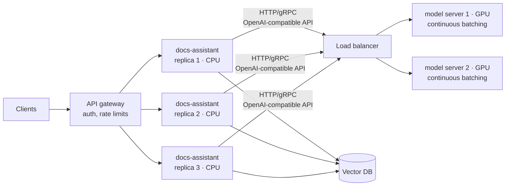
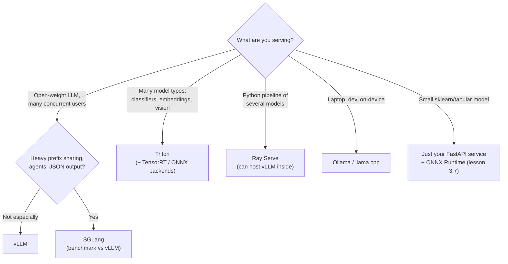
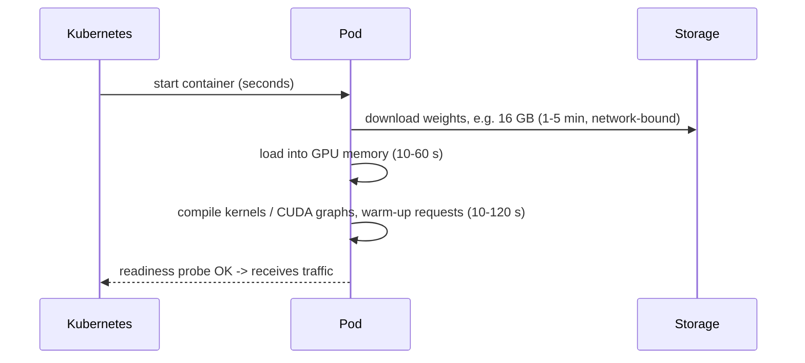

# Lesson 3.1: Serving architecture

> ⏱ ~45 min · 🎚 Level: Core · 🧰 Needs: Module 1 (services and containers)

[Course home](../../README.md) › [Module 3](README.md) › Lesson 3.1

## 📨 The situation

> **From: Diego (SRE)**
> Right now the docs-assistant loads the model *inside* the FastAPI process. Every time we deploy a typo fix in the API we reload 3 GB of weights, and when we scale the API to 6 replicas we pay for 6 copies of the model. Sam wants to try a bigger model next month. Before we buy anything: what should our serving architecture look like?

## 🎯 By the end you can

- **Explain** why production systems split the *application service* from the *inference service*.
- **Describe** what a model server does that a plain web framework does not.
- **Compare** Triton, TorchServe, Ray Serve, vLLM and SGLang, and **choose** one for a given workload.
- **Design** the request path from client to GPU, including where batching, caching and retries live.
- **Recognise** model-server-specific operational concerns: cold starts, warm-up, readiness and weight loading.

## 🤔 Predict first

1. Your API needs 6 CPU replicas to handle JSON parsing, auth and retrieval. How many copies of the model should it load?
2. Two requests arrive 3 ms apart for the same 8-billion-parameter model. Should they be processed one after another or together?
3. Why might a model server take 2–5 minutes to become "ready" even though the container started in 2 seconds?

Keep your answers. You'll check them at the end.

---

## 1. Two kinds of service, two kinds of scaling

In Module 1 you built a layered FastAPI service: API → domain → adapters. For the fraud model that was fine; scoring a gradient-boosted tree takes microseconds and a few MB of RAM. LLMs change the economics completely:

| | Application service (`docs-assistant`) | Inference service (model server) |
|---|---|---|
| Work | Auth, validation, retrieval, prompt building, business rules | Run the model forward pass |
| Hardware | CPU, cheap | GPU (or big CPU / NPU), expensive |
| Memory | 100s of MB | 5–200 GB of weights + KV cache |
| Startup | Seconds | Minutes (download + load weights + warm-up) |
| Deploy cadence | Many times a day | When the model changes |
| Scales with | Requests/s | Tokens/s, concurrency, context length |
| Batching | Not needed | Essential (lesson 3.5) |

When they live in the same process, every row of this table becomes a conflict: you can't scale one without the other, you can't deploy one without restarting the other, and you can't batch across API replicas because each holds its own private copy of the model.

**The fix is a dedicated inference service.** The app calls the model over the network, exactly like it calls a database.



**Analogy:** a restaurant doesn't put a full kitchen at every table. Waiters (app replicas) take orders, check the bill and talk to customers; the kitchen (model server) is centralised and expensive, and cooks several orders at once (batching).

> 💡 **Production tip:** You already built this split in the lab code. `adapters/llm.py` hides the model behind an interface, so the domain layer doesn't care whether the model is a fake, Ollama on your laptop, or a vLLM cluster. That separation makes moving from "model in process" to "model as a service" a configuration change.

## 2. What a model server actually does

You *could* wrap `model.generate()` in FastAPI. People do, and it works for a demo. A model server adds the things that matter at scale:

| Capability | Why it matters | Covered in |
|---|---|---|
| **Request batching** across all callers | Turns a memory-bound GPU into a throughput machine | 3.2, 3.5 |
| **KV-cache management** (paging, prefix reuse) | Fits more concurrent requests into GPU memory | 3.2, 3.7 |
| **Optimised kernels** (FlashAttention, fused ops, quantized matmuls) | 2–10× faster forward passes than naive code | 3.6, 3.7 |
| **Streaming** token by token | Low perceived latency (TTFT) | 3.4 |
| **Multi-GPU parallelism** (tensor/pipeline parallel) | Models bigger than one GPU's memory | 3.3 |
| **Model repository & versioning** | Load/unload versions, A/B, rollback | 3.7, Module 4 |
| **Metrics** (queue depth, tokens/s, cache usage) | Autoscaling and alerting signals | 3.5, Module 4 |
| **Standard APIs** (OpenAI-compatible, KServe v2, gRPC) | Swap engines without changing clients | 3.7 |

> ⚠️ **Common mistake:** Building your own batching scheduler in a Python web app. It is surprisingly hard to get right (fairness, memory limits, cancellation, streaming) and the open-source engines already do it far better. Your job is to **choose, configure and measure** an engine, not to write one.

## 3. The landscape: five serving frameworks you should know

### vLLM: the default choice for LLM serving

- Built around **PagedAttention**, which manages the KV cache in fixed-size blocks like virtual-memory pages, so memory isn't wasted on fragmentation (lesson 3.2).
- **Continuous batching**, automatic **prefix caching**, many quantization formats, tensor parallelism, speculative decoding.
- Ships an **OpenAI-compatible HTTP server**: `vllm serve <model>` and any OpenAI client works against it.
- Exposes Prometheus metrics (running and waiting requests, KV-cache usage, TTFT histograms).
- Use it for: serving open-weight LLMs (Llama, Qwen, Mistral, Gemma, DeepSeek…) on NVIDIA or AMD GPUs and other accelerators.

### SGLang: a fast LLM engine with a focus on structured and multi-call workloads

- **RadixAttention**: stores KV caches in a radix tree, so requests sharing any prefix (system prompts, few-shot examples, multi-turn chats, agent loops) reuse computation automatically.
- Fast **constrained decoding** (JSON schemas, regex), useful when outputs must be machine-readable.
- Also OpenAI-compatible. Performance relative to vLLM depends on workload and version, so **benchmark both on your traffic**.

### NVIDIA Triton Inference Server: the multi-framework workhorse

- Serves **many model types at once**: TensorRT, ONNX, PyTorch, TensorFlow, Python backends, plus an LLM path through TensorRT-LLM.
- **Dynamic batching** with configurable max batch size and max queue delay, which is ideal for fixed-shape models (embeddings, rerankers, classifiers like our fraud model).
- **Ensembles**: chain preprocessing → model → postprocessing inside the server.
- HTTP and gRPC using the KServe v2 inference protocol.
- Use it for: a platform that serves a *zoo* of models (vision, tabular, embeddings, LLMs) with one operational tool.

### Ray Serve: Python-native model composition

- Part of the Ray ecosystem; you write deployments as Python classes and compose them (router → embedder → reranker → LLM) as a graph.
- Autoscaling per deployment, fractional GPUs, multi-model multiplexing, and it can host vLLM inside.
- Use it for: complex Python pipelines and teams already on Ray (Module 6 covers Ray for orchestration).

### TorchServe: know it, but check its status before adopting

- PyTorch's model server (handlers, model archives, management API). You'll meet it in existing systems.
- ⚠️ Its GitHub repository is marked as **limited maintenance**. For new projects, prefer an actively developed option and check the repo status yourself before you decide.

### And for laptops and edge devices

- **llama.cpp** (C/C++, GGUF quantized models, runs on CPU and Apple Silicon) and **Ollama** (a friendly wrapper and model manager on top of llama.cpp-style runtimes). This is what you use in this course to run real models for free. They're great for development and on-device use, but not the throughput champions for multi-tenant serving.

### Decision guide



> 💡 **Production tip:** Note the last box. **Not everything needs a model server.** Our fraud model scores in ~0.01 ms with ONNX Runtime. Putting a network hop in front of it would *add* latency. Dedicated inference services pay off when the model is big, GPU-bound, or shared by many callers.

## 4. The OpenAI-compatible API as a contract

Most LLM engines (vLLM, SGLang, llama.cpp server, Ollama's `/v1` endpoint, plus many hosted providers) accept the same request shape:

```http
POST /v1/chat/completions
{"model": "Qwen/Qwen2.5-1.5B-Instruct",
 "messages": [{"role": "system", "content": "..."}, {"role": "user", "content": "..."}],
 "temperature": 0, "max_tokens": 256, "stream": true}
```

That makes it the de facto **contract** between your app and the model layer. In the lab, `OpenAICompatibleLLM` speaks it, so switching from "fake" to "vLLM on a GPU box" is one environment variable:

```bash
KESTREL_LLM_PROVIDER=openai KESTREL_OPENAI_BASE_URL=http://gpu-host:8080/v1 uv run uvicorn ...
```

> ⚠️ **Common mistake:** Assuming "OpenAI-compatible" means *identical*. Engines differ on supported parameters (logprobs, tool calling, `response_format`), error codes and usage reporting. Write a contract test (one request per feature you rely on) and run it against every engine you deploy.

## 5. Operating a model server: what's different

### Cold starts are measured in minutes

A model server's startup has stages, and only the first is fast:



The numbers are approximate and depend heavily on storage, network and engine. Consequences:

- **Readiness ≠ liveness.** The pod is *alive* long before it is *ready*. Your readiness probe must only pass after weights are loaded and a warm-up request succeeded (you built `/ready` in Module 1 for exactly this).
- **Autoscaling must anticipate**, because a scale-up decision today serves traffic minutes later (lesson 3.5).
- **Cache weights close to the GPU**: node-local disk, a pre-populated volume, or baked into the image (lesson 3.7 discusses the trade-off).

### Memory is the real capacity limit

On a GPU, memory is split between **weights** (fixed) and **KV cache** (grows with concurrent requests × context length). Lesson 3.2 shows how to calculate it. Most engines pre-allocate a fraction of GPU memory for the KV cache at startup (in vLLM, `--gpu-memory-utilization`), which is why "GPU memory 95% used" on a dashboard is normal and not an alarm.

### Isolation and noisy neighbours

One user sending 100k-token prompts can fill the KV cache and slow everyone else down. Defences live in **both** layers:

- App service: per-tenant rate limits, max input length, `max_tokens` caps.
- Model server: max sequences per batch, max model length, request priorities where supported.

## 🧪 Try it

1. Open `lab/src/kestrel_serving/adapters/llm.py`. Find the three classes that implement the same `complete` / `stream` interface.
2. Run the tests: `cd lab && uv run pytest tests/test_service.py -q`. **Expected:** all pass, using the fake provider with no network.
3. Read `build_llm()`. Which environment variable would you set to point the service at a vLLM server on `gpu-01:8080`?

<details><summary>Answer</summary>

`KESTREL_LLM_PROVIDER=openai` and `KESTREL_OPENAI_BASE_URL=http://gpu-01:8080/v1` (plus `KESTREL_OPENAI_MODEL` matching the model name the server loaded).
</details>

4. Optional, with Ollama installed: `ollama pull qwen2.5:1.5b-instruct`, then start the service with `KESTREL_LLM_PROVIDER=ollama` and ask a question. Compare `timings_ms.llm_ms` with the fake provider's number.

## 🏭 In the real world

- Large platforms usually run a **central model gateway**: one internal API that every product team calls. It holds provider keys, enforces quotas, logs usage per team, and routes to self-hosted engines or external APIs (lesson 3.3).
- The vLLM project documents production deployments with Kubernetes, and the KServe project standardises model serving on Kubernetes with an "InferenceService" resource. Both are worth skimming once you reach Module 6.

## ✅ Check yourself

<details><summary>Q1. Name three reasons to separate the inference service from the application service.</summary>

Any three of: independent scaling (CPU vs GPU), independent deploys (no weight reload for an API change), one shared model for many app replicas (memory and cost), batching across all callers, different startup and readiness behaviour, and a different hardware and runtime stack.
</details>

<details><summary>Q2. Your team serves a fraud classifier, an embedding model, a reranker and an image model. Which server is the natural fit and why?</summary>

Triton Inference Server: it serves multiple frameworks and model types from one model repository, with dynamic batching for fixed-shape inputs and HTTP/gRPC endpoints. Ray Serve is a reasonable alternative if the team is Python/Ray-centric and wants to compose them in code.
</details>

<details><summary>Q3. Why is "the container started" not the same as "ready for traffic" for an LLM server?</summary>

After the process starts it must download weights (GBs), load them into GPU memory, and often compile kernels or CUDA graphs and run warm-up requests. Sending traffic before that leads to timeouts or very slow first requests, so the readiness probe must reflect "model loaded and warm".
</details>

<details><summary>Q4. A teammate says "let's put the fraud model behind Triton for consistency". What would you check before agreeing?</summary>

Latency budget and overhead: the model scores in microseconds in-process, while a network hop plus serialisation adds roughly 0.5–2 ms. If consistency of operations matters more than that latency and the model is shared by several services, it can be justified. Otherwise in-process ONNX Runtime is simpler and faster. Measure both.
</details>

<details><summary>Q5. What does "OpenAI-compatible" buy you, and what does it not guarantee?</summary>

It buys a common request/response contract, so the same client can talk to many engines and providers and swapping is configuration, not code. It doesn't guarantee identical support for every parameter (tool calling, logprobs, structured output), identical error semantics or identical token accounting. Contract-test the features you rely on.
</details>

## 💬 Explain it back

Explain to Maya, in under 90 seconds and with no jargon, why "just add more API replicas" is an expensive way to scale the docs-assistant once it uses a large model, and what you'd do instead.

## 🔑 Key takeaways

- Split **application** (CPU, fast deploys, business logic) from **inference** (GPU, batching, slow startup).
- A model server is valuable for **batching, KV-cache management, kernels, streaming and metrics**, not just "an HTTP wrapper".
- **vLLM** is the default for open LLMs, **SGLang** is strong for prefix-heavy and structured workloads, **Triton** suits multi-model platforms, **Ray Serve** suits Python composition. TorchServe is in limited maintenance.
- Treat the **OpenAI-compatible API** as your contract, and contract-test it.
- Small models (like the fraud model) often belong **in-process**: not everything needs a model server.

## 📚 Go deeper (free)

| | Resource | Why read it | Time |
|---|---|---|---|
| ⭐ | [vLLM documentation](https://docs.vllm.ai/) | Quickstart, the OpenAI-compatible server, metrics, deployment | 45 min |
| 🔍 | [SGLang (GitHub + docs links)](https://github.com/sgl-project/sglang) | RadixAttention, structured outputs, server arguments | 30 min |
| 🔍 | [NVIDIA Triton Inference Server (GitHub)](https://github.com/triton-inference-server/server) | Model repository, dynamic batching, ensembles | 30 min |
| 🔍 | [Ray Serve documentation](https://docs.ray.io/en/latest/serve/index.html) | Composing models, autoscaling deployments | 30 min |
| 🔍 | [KServe](https://kserve.github.io/website/) | Kubernetes-native model serving and the v2 inference protocol | 20 min |
| 🔍 | [Ollama](https://ollama.com/) and [llama.cpp](https://github.com/ggml-org/llama.cpp) | Running quantized models locally | 15 min |

---
⬅️ [Module 3 overview](README.md) · ➡️ [Lesson 3.2: How LLM inference really works](02-how-llm-inference-works.md)
