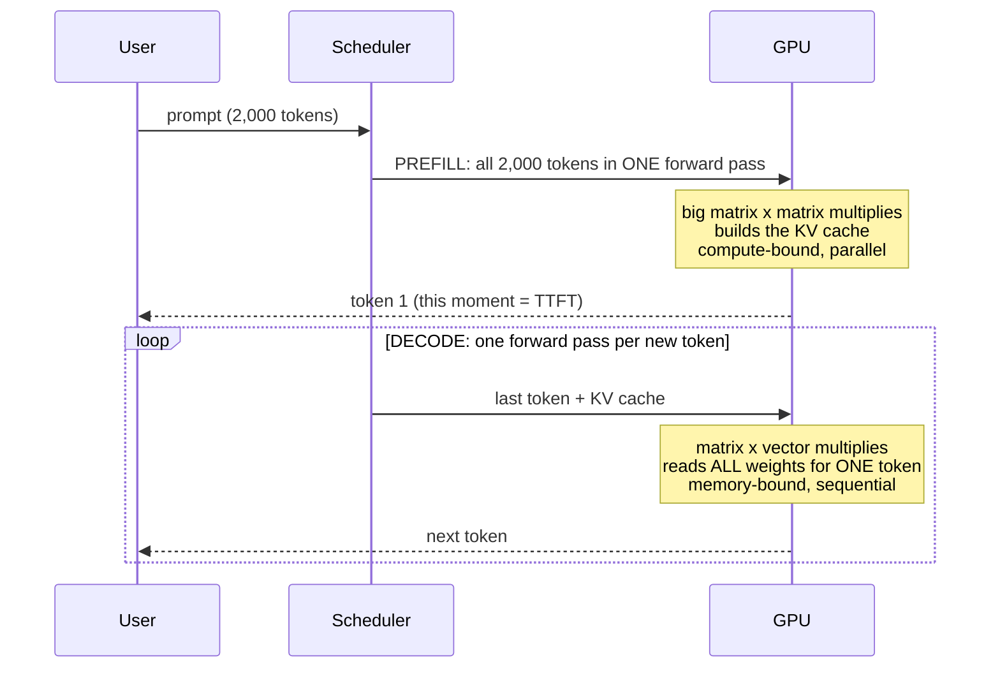
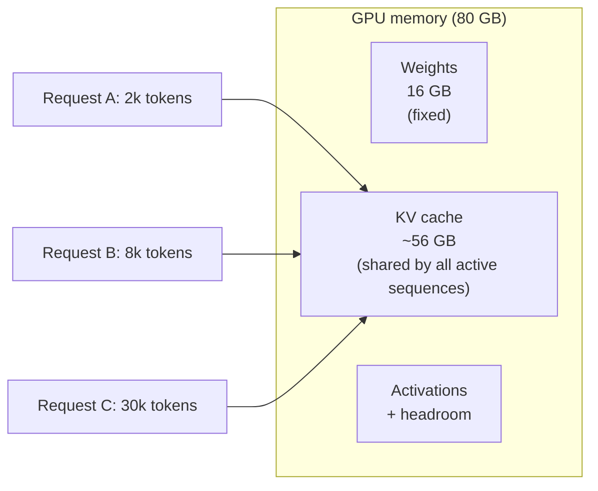

# Lesson 3.2: How LLM inference really works

> ⏱ ~60 min · 🎚 Level: Core (the most important lesson of this module) · 🧰 Needs: [Lesson 0.5](../00-foundations/05-llms-in-one-hour.md), Lesson 3.1

[Course home](../../README.md) › [Module 3](README.md) › Lesson 3.2

## 📨 The situation

> **From: Sam (Data Scientist)**
> I don't get it. The GPU dashboard says 30% utilization, yet the assistant takes 6 seconds per answer and starts queueing at only a few users. Shouldn't a GPU that's 70% idle be able to take more? Also, why does a 2,000-token prompt only add 0.1 s but a 200-token answer adds 6 s?

Every optimisation in this module (batching, caching, quantization, speculative decoding) follows from the answer to Sam's questions. Take your time here.

## 🎯 By the end you can

- **Explain** the two phases of LLM inference, **prefill** and **decode**, and why they behave so differently.
- **Calculate** arithmetic intensity and decide whether a workload is **memory-bound** or **compute-bound**.
- **Estimate** a lower bound on time per token from model size and memory bandwidth.
- **Calculate** KV-cache memory per token and per request, and from it the maximum concurrency of a GPU.
- **Predict** end-to-end latency from TTFT, time per output token and answer length.

## 🤔 Predict first

1. An 8B-parameter model in 16-bit precision is about 16 GB. To generate **one** token, how much data must the GPU read from its memory?
2. If you generate tokens for 32 users at once instead of 1, roughly how much more memory traffic does each decode step need: 32×, 2×, or about the same?
3. Which costs more GPU time per token: reading the prompt, or writing the answer?

---

## 1. Two phases: prefill and decode

An LLM generates text **one token at a time**; each new token depends on all previous ones. But the *prompt* is known upfront. That creates two very different phases:



| | Prefill | Decode |
|---|---|---|
| Input per forward pass | All prompt tokens at once | 1 new token per sequence |
| Math | Matrix × matrix | Matrix × vector |
| Bottleneck | **Compute** (FLOPs) | **Memory bandwidth** (bytes moved) |
| Produces | KV cache + first token | One token per step |
| Determines | **TTFT**, time to first token | **TPOT**, time per output token |
| Parallelism | Across tokens of the prompt | Only across sequences in the batch |

That table answers half of Sam's question already: 2,000 prompt tokens are processed *in parallel* in one pass, while 200 answer tokens need **200 sequential passes**.

## 2. Memory-bound vs compute-bound: arithmetic intensity

A GPU has two speed limits:

- **Compute:** how many floating-point operations per second it can do (FLOP/s).
- **Memory bandwidth:** how many bytes per second it can move from its main memory (HBM) to the compute units.

**Arithmetic intensity** is the ratio of work to data:

$$\text{arithmetic intensity} = \frac{\text{FLOPs performed}}{\text{bytes moved from memory}}$$

Every GPU has a **ridge point** = peak FLOP/s ÷ peak bytes/s. Below it you're **memory-bound** (compute units wait for data); above it you're **compute-bound**.

| GPU (approximate datasheet numbers, dense BF16) | Peak compute | Memory bandwidth | Ridge point |
|---|---|---|---|
| NVIDIA A100 80GB (SXM) | ~312 TFLOP/s | ~2.0 TB/s | ~156 FLOPs/byte |
| NVIDIA H100 (SXM) | ~989 TFLOP/s | ~3.35 TB/s | ~295 FLOPs/byte |

Now compute the intensity of a decode step for one weight matrix of size *d × d* in 16-bit (2 bytes per number), with a batch of *B* sequences:

- FLOPs: each of the *d²* weights is used in one multiply and one add per sequence → **2·B·d²**
- Bytes: the weights dominate → about **2·d²** (activations are tiny when B ≪ d)

$$\text{intensity} \approx \frac{2 B d^2}{2 d^2} = B$$

**The arithmetic intensity of decode is roughly the batch size.** At B = 1 it is ~1 FLOP/byte, more than 100× below the ridge point. The GPU's compute units are almost idle and the GPU spends its time *reading weights*. That's Sam's "30% utilization" mystery: the bottleneck isn't the part the dashboard counts.

**Analogy:** a chef (compute) can chop 300 vegetables per second, but the delivery van (memory) brings one crate of vegetables per second, and each crate is used for just one dish. Chopping faster doesn't help. What helps is cooking **many dishes from the same crate** (batching).

> 🔎 **Under the hood:** Prefill with a 2,000-token prompt is a matrix × matrix multiply with ~2,000 rows, so its intensity is in the thousands, well above the ridge point. That's why prefill is compute-bound and fast *per token*.

## 3. The speed limit of decode

If every decode step must read all the weights once, then:

$$\text{time per token} \;\geq\; \frac{\text{model size in bytes}}{\text{memory bandwidth}}$$

Worked example, 8B parameters in BF16 (2 bytes each) = **16 GB**:

| Hardware (approximate bandwidth) | Lower bound per token | Upper bound tokens/s (1 user) |
|---|---|---|
| H100, ~3.35 TB/s | 16 / 3,350 = **~4.8 ms** | ~210 |
| A100, ~2.0 TB/s | **~8 ms** | ~125 |
| Laptop with ~100 GB/s unified memory | **~160 ms** | ~6 |
| Same laptop, model quantized to 4-bit (~4.5 GB) | **~45 ms** | ~22 |

Real systems reach perhaps 50–80% of these bounds, so treat them as ceilings. Two big consequences:

1. **Quantization speeds up decode** mostly because it makes the model *smaller to read* (lesson 3.6). That's why 4-bit models feel fast on laptops.
2. **Batching is nearly free during decode.** Reading the weights once and using them for 32 sequences costs about the same time as for 1. Throughput scales almost linearly with batch size until you hit the ridge point or run out of memory. This is the engine behind lesson 3.5.

That second fact is exactly what the lab simulator encodes in `CostModel`:

```python
# lab/src/kestrel_serving/sim/model.py
def decode_step_ms(self, batch_size: int) -> float:
    return self.decode_base_ms + self.decode_ms_per_seq * batch_size
    #      ^ read all weights once     ^ small per-sequence extra (KV cache, sampling)
```

With the defaults (25 ms + 0.6 ms per sequence), a batch of 1 produces 1 token per 25.6 ms (~39 tokens/s), and a batch of 32 produces 32 tokens per 44.2 ms (~724 tokens/s). That's **18× the throughput from the same hardware.**

> ⚠️ **Common mistake:** Using GPU utilization (the `nvidia-smi` percentage) as a capacity signal. It reports whether *a kernel was running*, not how much of the compute was used. A memory-bound decode loop can show high "utilization" while using a small fraction of the FLOPs, or low numbers with a starving queue. Use **queue depth, KV-cache usage and token throughput** instead (lesson 3.5).

## 4. Prefill cost and TTFT

Prefill FLOPs are roughly:

$$\text{FLOPs}_{\text{prefill}} \approx 2 \times N_{\text{params}} \times N_{\text{prompt tokens}}$$

(plus an attention term that grows with the square of the context, which matters for very long prompts).

For our 8B model and a 2,000-token RAG prompt: 2 × 8×10⁹ × 2,000 = **3.2×10¹³ FLOPs = 32 TFLOP**. At a realistic ~40% of an H100's peak (~400 TFLOP/s) that's **~80 ms**, so prefill adds tens of milliseconds while every answer token costs ~5–10 ms. That's the other half of Sam's answer.

Time to first token (TTFT) is therefore:

$$\text{TTFT} = \text{queue wait} + \text{prefill time} + \text{one decode step}$$

> 💡 **Production tip:** Long RAG prompts mostly hurt TTFT and **memory** (the KV cache, next section), not decode speed. Sending 20 chunks "just in case" is a cost and latency decision: measure what retrieval depth actually improves answer quality (Module 4).

## 5. The KV cache: the memory you didn't budget for

During attention, each token's **keys (K)** and **values (V)** are needed by every later token. Recomputing them at every step would be quadratic, so engines **cache** them. That cache lives in GPU memory and grows with every token of every active sequence.

$$\text{KV bytes per token} = 2 \times n_{\text{layers}} \times n_{\text{kv heads}} \times d_{\text{head}} \times \text{bytes per element}$$

The leading 2 is for K and V.

**Worked example: a Llama-3.1-8B-style model** (32 layers, 32 query heads but only **8 KV heads** thanks to grouped-query attention (GQA), head dimension 128, BF16 = 2 bytes):

$$2 \times 32 \times 8 \times 128 \times 2 = 131{,}072 \text{ bytes} = \mathbf{128\ KiB\ per\ token}$$

| Context per sequence | KV cache per sequence |
|---|---|
| 2,000 tokens (RAG prompt + answer) | ~250 MiB |
| 8,192 tokens | **1 GiB** |
| 128k tokens | 16 GiB |

Without GQA (32 KV heads) every number would be **4× larger**, which is why modern models use GQA.

**How many users fit on one GPU?** Take an 80 GB GPU (approximate figures):

```
80 GB total
- 16 GB  weights (8B in BF16)
-  ~8 GB activations, CUDA graphs, fragmentation, headroom
= ~56 GB for KV cache  ->  56 GiB / 128 KiB ≈ 450,000 tokens of KV cache
```

| Average tokens per active sequence | Max concurrent sequences |
|---|---|
| 2,000 | ~225 |
| 8,000 | ~56 |
| 32,000 | ~14 |

So **context length directly divides your concurrency**, and through batching (section 3) your throughput. This is the second reason `max_tokens` and prompt size are cost levers.



### PagedAttention: why memory layout matters

Early servers reserved one contiguous chunk of KV memory per request, sized for the *maximum* possible length. Most requests never reach it, so most of the memory sat empty and fragmented. The vLLM paper (Kwon et al., 2023) measured that existing systems wasted roughly **60–80%** of KV-cache memory this way. **PagedAttention** stores the KV cache in small fixed-size blocks allocated on demand, like an operating system's virtual-memory pages, so waste drops to a few percent and many more sequences fit in a batch. Higher batch means higher throughput (section 3).

Blocks also enable **prefix caching**: if 1,000 requests share the same 800-token system prompt, the engine computes its KV blocks once and reuses them. That cuts both prefill time (TTFT) and memory.

> 💡 **Production tip:** To benefit from prefix caching, put the **stable parts first** in your prompt (system prompt, instructions, few-shot examples) and the variable parts (retrieved chunks, user question) **last**. Reordering a prompt can cut TTFT noticeably at zero cost.

## 6. Putting it together: a latency model you can use

$$\text{end-to-end latency} \approx \text{queue} + \text{TTFT} + \text{TPOT} \times (N_{\text{out}} - 1)$$

Worked example for the docs-assistant on a busy GPU: queue 0 ms, TTFT 150 ms, TPOT 30 ms (batched, so slower per token than the 1-user ceiling), answer 200 tokens:

$$0 + 0.15 + 0.030 \times 199 \approx \mathbf{6.1\ s}$$

The answer length dominates. Levers, in order of how much they usually buy:

| Lever | Affects | Lesson |
|---|---|---|
| Shorter answers / sensible `max_tokens` | TPOT × N_out, KV memory | 3.2 |
| Streaming | *Perceived* latency (TTFT) | 3.4 |
| Caching | Skips the whole thing on hits | 3.5 |
| Continuous batching | Throughput, queue wait | 3.5 |
| Quantization | TPOT (fewer bytes to read), memory | 3.6 |
| Speculative decoding | TPOT (more tokens per weight read) | 3.7 |
| Smaller / distilled model | Everything | 3.6 |

This also explains API pricing: providers typically charge **several times more per output token than per input token**, because output tokens are the expensive, sequential, memory-bound ones.

## 🧪 Try it

1. Run the single-request sanity test, which checks the latency formula in the simulator:
   ```bash
   cd lab && uv run pytest tests/test_simulator.py::test_single_request_cost_is_prefill_plus_decode -q
   ```
   Read the test: 1,000 prompt tokens at 0.1 ms → 100 ms prefill; 10 output tokens × 21 ms decode steps.
2. Use the simulator as a calculator. A GPU with 2.5× the memory bandwidth roughly divides `decode_base_ms` by 2.5:
   ```bash
   uv run python scripts/simulate_batching.py --rps 1.5 --decode-base-ms 10
   ```
   **Expected:** every policy's throughput rises, and *no batching* still can't keep up at 1.5 req/s. Faster hardware doesn't fix a bad scheduler.
3. Make prefill expensive (very long prompts) and watch TTFT:
   ```bash
   uv run python scripts/simulate_batching.py --rps 1.5 --prefill-ms-per-token 1.0
   ```
   **Expected:** now *even continuous batching* reports `NO (queue grows)`, with a TTFT p50 of ~20 s. Do the arithmetic: 600 prompt tokens × 1 ms = 600 ms of prefill per request, and at 1.5 req/s that's **0.9 s of prefill per second of wall time**. The GPU spends 90% of its time on prompts, and every running sequence stalls while a prefill step runs. Real engines mitigate this with **chunked prefill** (splitting long prefills into pieces interleaved with decode steps) and, at large scale, by running prefill and decode on **separate GPU pools** ("disaggregated serving"). Shorter prompts (better retrieval) and prefix caching attack the cause directly.

## 🏭 In the real world

- Engines expose these concepts directly as configuration: maximum model length, maximum concurrent sequences, the fraction of GPU memory reserved for the KV cache, prefix caching on or off, and chunked prefill. Now you know what each knob trades.
- Public benchmarks report **TTFT, TPOT (or inter-token latency) and throughput separately** for the reasons above. One "latency" number for an LLM is almost meaningless.

## ✅ Check yourself

<details><summary>Q1. Why is decode memory-bound but prefill compute-bound?</summary>

Decode processes one new token per sequence, so each weight read from memory is used for only ~B multiply-adds (B = batch size). The arithmetic intensity is about B FLOPs per byte, far below the GPU's ridge point. Prefill processes all prompt tokens together, so each weight is reused across thousands of tokens and the intensity is high.
</details>

<details><summary>Q2. A 70B model in 8-bit is ~70 GB. On a GPU with ~3.35 TB/s, what's the best possible single-stream decode speed?</summary>

70 GB / 3,350 GB/s ≈ 21 ms per token, so at most ~48 tokens/s, and realistically less. (A model this size is usually split across several GPUs with tensor parallelism, which aggregates their bandwidth.)
</details>

<details><summary>Q3. Compute the KV cache per token for a model with 40 layers, 8 KV heads, head dimension 128, in FP16. How much for a 4,000-token conversation?</summary>

2 × 40 × 8 × 128 × 2 bytes = 163,840 bytes = 160 KiB per token. For 4,000 tokens that's 640,000 KiB ≈ 625 MiB.
</details>

<details><summary>Q4. Sam doubles the number of retrieved chunks (prompt 1,500 → 3,000 tokens). Which metrics change, and which barely move?</summary>

TTFT increases (twice the prefill), KV memory per request roughly doubles (fewer concurrent requests fit, so throughput under load can drop), and input-token cost doubles. TPOT for an individual request barely changes, though a busier GPU may slow it slightly.
</details>

<details><summary>Q5. Why does the same GPU produce far more total tokens/s at batch 32 than at batch 1, while each user gets tokens slightly slower?</summary>

One read of the weights serves 32 sequences instead of 1, so total throughput rises almost 32× while the step time grows only a little (the per-sequence KV and compute work). Each user waits for a slightly longer step, so TPOT per user increases a bit. That's the classic throughput vs latency trade-off.
</details>

<details><summary>Q6. Why does putting the system prompt first help, even with the same total tokens?</summary>

Prefix caching reuses KV blocks for identical **prefixes**. If every request starts with the same system prompt and instructions, those blocks are computed once and shared. If variable content comes first, no two prompts share a prefix and nothing can be reused.
</details>

## 💬 Explain it back

Answer Sam's original message in 5 sentences or fewer: why the GPU looks "70% idle", and why the answer length matters more than the prompt length.

## 🔑 Key takeaways

- **Prefill** (prompt, parallel, compute-bound) sets **TTFT**. **Decode** (answer, sequential, memory-bound) sets **TPOT**.
- Decode arithmetic intensity ≈ **batch size**, so batching is nearly free throughput until you hit the ridge point or run out of memory.
- **Time per token ≥ model bytes ÷ memory bandwidth.** Smaller weights (quantization) mean faster decode.
- **KV cache = 2 × layers × KV heads × head dim × bytes per element**, per token. Context length divides concurrency.
- End-to-end latency ≈ **queue + TTFT + TPOT × output tokens**, and output tokens usually dominate.

## 📚 Go deeper (free)

| | Resource | Why read it | Time |
|---|---|---|---|
| ⭐ | [How to Scale Your Model (Google DeepMind), especially the inference chapter](https://jax-ml.github.io/scaling-book/) | The clearest rigorous treatment of rooflines, KV cache and inference arithmetic | 2 h |
| ⭐ | [Making Deep Learning Go Brrrr From First Principles (Horace He)](https://horace.io/brrr_intro.html) | Compute vs memory vs overhead, with intuition | 30 min |
| 🔍 | [Transformer Inference Arithmetic (kipply)](https://kipp.ly/transformer-inference-arithmetic/) | Back-of-envelope formulas for latency and memory | 30 min |
| 🔍 | [Efficient Memory Management for LLM Serving with PagedAttention (Kwon et al., 2023)](https://arxiv.org/abs/2309.06180) | The vLLM paper: KV-cache paging and its impact on throughput | 45 min |
| 🔍 | [LLM Inference Performance Engineering: Best Practices (Databricks blog)](https://www.databricks.com/blog/llm-inference-performance-engineering-best-practices) | TTFT, TPOT, batching and hardware in practice | 25 min |

---
⬅️ [Lesson 3.1: Serving architecture](01-serving-architecture.md) · ➡️ [Lesson 3.3: Topologies and unit economics](03-topologies-and-unit-economics.md)
