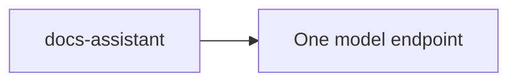
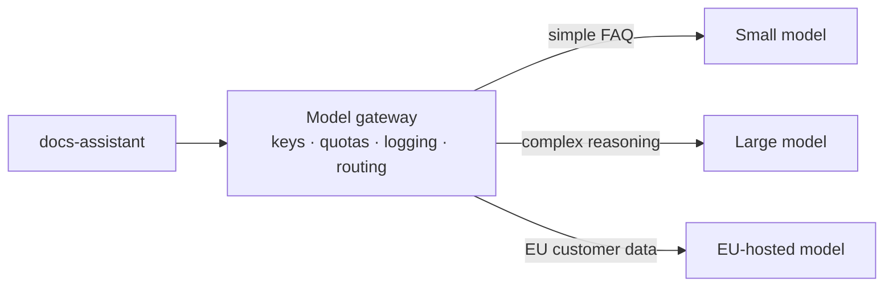
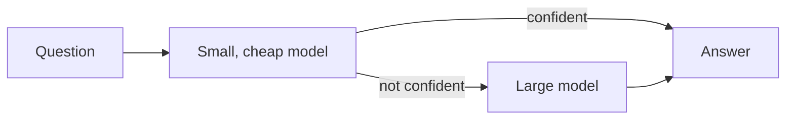
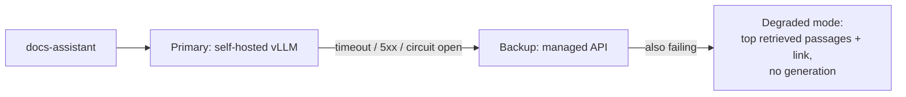
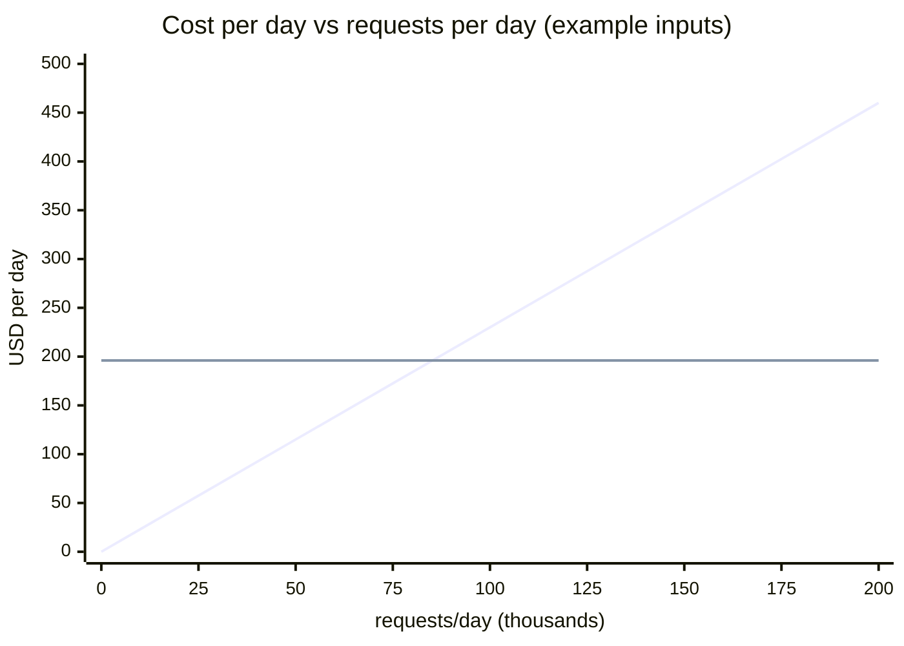

# Lesson 3.3: Topologies and unit economics

> ⏱ ~50 min · 🎚 Level: Core · 🧰 Needs: Lessons 3.1–3.2

[Course home](../../README.md) › [Module 3](README.md) › Lesson 3.3

## 📨 The situation

> **From: Maya (Engineering Manager)**
> Finance forwarded me two proposals. One says "self-host an open model, APIs are a rip-off". The other says "GPUs are a money pit, just use the API". Both have spreadsheets. I need *our* answer by Friday: one page, real numbers, and what would make us change our minds. Also, last Tuesday the API provider returned 429s for 20 minutes and the assistant was down. That can't happen again.

## 🎯 By the end you can

- **Draw** the four common serving topologies (single model, gateway/router, cascade, fallback chain) and say when each fits.
- **Design** a fallback path that survives a provider outage or rate limiting.
- **Compare** managed APIs and self-hosting across cost, rate limits, data residency, latency, control and operational burden.
- **Calculate** cost per request, GPU count and the break-even volume with the lab's cost calculator.
- **Write** a cost recommendation that states its assumptions and the conditions that would reverse it.

## 🤔 Predict first

1. An API costs a fixed price per token; a GPU costs a fixed price per hour. Which one gets cheaper *per request* as traffic grows?
2. If a small model can answer 70% of questions correctly and a large one 95%, is "small first, large if unsure" always cheaper?
3. Name one reason to self-host that has nothing to do with cost.

---

## 1. Four serving topologies

### 1.1 Single model



Simple, easy to evaluate and debug. It's the right starting point. Its weaknesses: a single point of failure, and the same (expensive) model answers both "hi" and a 3-page policy question.

### 1.2 Gateway / router



A **model gateway** is an internal service (or a library such as LiteLLM) that every team calls instead of calling providers directly. It centralises:

- **Credentials and quotas:** no API keys scattered across services; per-team budgets.
- **Observability:** one place to log tokens, cost, latency and errors per team and feature (Module 4).
- **Routing:** by task type, tenant, region, cost tier or a learned router.
- **Policy:** PII redaction and guardrails can be enforced once (Module 5).

### 1.3 Cascade



Try the cheap model first and escalate only when needed. The research name for this family is **LLM cascades** (see FrugalGPT in Go deeper). Fraud systems have used cascades for decades: **cheap rules → ML model → human review**, with each stage only seeing what the previous one couldn't decide.

**The economics of a cascade:**

$$\text{cost per request} = c_{\text{small}} + p_{\text{escalate}} \times c_{\text{large}}$$

It beats "always large" only if:

$$p_{\text{escalate}} < 1 - \frac{c_{\text{small}}}{c_{\text{large}}}$$

Example: the small model costs 1/10 of the large one, so cascading saves money while fewer than **90%** of requests escalate. Saving 50% requires an escalation rate below 40%.

> ⚠️ **Common mistake:** Using the small model's *self-reported* confidence ("I'm 95% sure") as the escalation signal. LLMs are poorly calibrated at this. Better signals: the model explicitly abstains ("I don't know", which our system prompt asks for), a validator fails (citation missing, JSON invalid, answer not grounded in the retrieved text), token log-probabilities where available, or a small trained classifier. Measure the cascade's **end-to-end quality** on your golden set (Module 4), not just its cost.

Also remember **latency**: escalated requests pay *both* models' TTFT. If 30% escalate, your p95 latency is probably set by the escalated path.

### 1.4 Fallback chain



A fallback chain answers Maya's outage problem. It combines the reliability primitives from Module 1:

- **Timeouts** on every call, set from your latency budget, not left at library defaults.
- **Retries with backoff and jitter** only for retryable errors (429, 503, timeouts). On a 429, **honour `Retry-After`** when the provider sends it.
- A **circuit breaker**: after N consecutive failures, stop calling the primary for a cool-down period and go straight to the backup, so you don't add latency to every request during an outage.
- **Graceful degradation**: when every model fails, still return something useful. For the docs-assistant, that's the best-matching handbook passages with links. For the fraud service, it's the rules-only score with a flag.

> 💡 **Production tip:** A fallback model is only a fallback if it's **tested**. Run your golden set against the backup path regularly (prompts tuned for one model often degrade on another), and run a scheduled "fail the primary" drill. A fallback that's never exercised is a hope, not a plan.

## 2. Managed API vs self-hosting: the full comparison

Cost is one row out of eight:

| Dimension | Managed API | Self-hosted (vLLM/SGLang on your GPUs) |
|---|---|---|
| **Cost structure** | Variable: pay per token, zero when idle | Fixed: pay per GPU-hour, busy or not |
| **Rate limits** | Provider quotas: requests/min (RPM), tokens/min (TPM), sometimes concurrency; 429s under bursts | Your capacity is the limit; you size it |
| **Data residency & privacy** | Data leaves your network; check region, retention, training-use terms, and contracts (DPA) | Data stays in your VPC/region; you own retention |
| **Model choice** | Frontier proprietary models, often the most capable | Open-weight models only; you can fine-tune them freely |
| **Latency control** | Shared infrastructure; variance you can't tune | You tune batch size, hardware, placement (e.g. same region as the app) |
| **Time to start** | Minutes | Days to weeks (infra, autoscaling, monitoring) |
| **Operational burden** | Provider runs it | You run it: GPUs, drivers, upgrades, on-call |
| **Vendor risk** | Deprecations, price changes, outages | Hardware availability, skills in the team |

### Rate limits deserve their own plan

Providers typically limit **requests per minute (RPM)** and **tokens per minute (TPM)**, and the limits depend on your account tier. Monday 9 a.m. traffic for the docs-assistant can easily be 10× the hourly average, so:

1. **Know your limits** and compute your peak TPM: peak requests/min × (input + output tokens per request).
2. **Smooth on your side**: a client-side token bucket that shapes traffic below the limit beats retrying after 429s.
3. **Prioritise**: when you're near the limit, interactive requests go first and batch jobs (re-indexing, evals) wait.
4. **Spread risk**: a second provider or region, or a self-hosted baseline, behind the gateway.

### Data residency is often the deciding factor

For a fintech like Kestrel Pay, Priya (Security) will ask: *where is the prompt processed? Is it stored? For how long? Can it be used for training? Which jurisdiction?* Many providers offer regional processing and zero-retention options, but these are **contractual and configuration questions to verify**, not assumptions. When the answers don't satisfy compliance, self-hosting (or a provider's dedicated deployment in your region) stops being a cost question at all. Module 5 covers this in depth.

## 3. Unit economics: the arithmetic

### 3.1 API cost per request

$$c_{\text{api}} = \frac{T_{\text{in}} \cdot p_{\text{in}} + T_{\text{out}} \cdot p_{\text{out}}}{10^6}$$

where *p* is the price per million tokens. For the docs-assistant with RAG (example prices, **not quotes**): T_in = 1,500, T_out = 200, p_in = $1.00, p_out = $4.00:

$$c_{\text{api}} = \frac{1500 \times 1 + 200 \times 4}{10^6} = \$0.0023 \text{ per request}$$

Notice that **input tokens are 65% of the bill** despite being cheaper per token, because RAG prompts are long. Trimming retrieved context is a cost lever, not just a latency one.

### 3.2 Self-hosted cost

A GPU costs the same per hour whether it's busy or not, so what matters is **how many GPUs you need for your peak**:

$$\text{GPUs} = \max\left(n_{\min},\ \left\lceil \frac{\text{peak weighted tokens/s}}{\text{measured tokens/s per GPU} \times \text{utilization}} \right\rceil\right)$$

- **Measured tokens/s per GPU**: from *your* load test of *your* model on *your* engine at your target latency (not a marketing number).
- **Utilization** (e.g. 0.6): you can't run at 100% without breaking latency (lesson 3.4 shows the queueing curve).
- **Peak-to-average** (e.g. 2×): you size for Monday 9 a.m., not the daily average.
- **Weighted tokens**: input tokens are much cheaper to process than output tokens (prefill vs decode, lesson 3.2). The lab counts one input token as 0.1 of an output token, which is a rough simplification you should calibrate with your own measurements.
- **n_min** (e.g. 2): one GPU means one failure takes you down.

Then add the cost people forget: **operations**. Someone has to upgrade drivers, tune the engine, watch dashboards and get paged. Even a fraction of an engineer's time dwarfs a small GPU bill.

### 3.3 Break-even

API cost is a straight line through zero. Self-hosted cost is a **staircase** (whole GPUs) that starts high (minimum GPUs + ops). With *n* GPUs, the lines cross at:

$$V^*_n = \frac{n \cdot C_{\text{GPU-day}} + C_{\text{ops-day}}}{c_{\text{api}}}$$

and that crossing is valid only if *n* GPUs can actually serve V*ₙ requests/day. That's exactly what `break_even_requests_per_day()` in `lab/src/kestrel_serving/economics.py` walks through.



*The rising line is the API; the flat line is 2 self-hosted GPUs plus ops ($196/day). They cross at ~85,000 requests/day.*

### 3.4 Worked example (run it yourself)

```bash
cd lab && uv run python scripts/cost_calculator.py
```

| requests/day | API $/day | GPUs | self-hosted $/day | cheaper |
|---|---|---|---|---|
| 10,000 | 23.00 | 2 | 196.00 | API |
| 100,000 | 230.00 | 2 | 196.00 | self-host |
| 1,000,000 | 2,300.00 | 10 | 580.00 | self-host |

`Break-even: ~85,217 requests/day`. Inputs: $1/$4 per 1M tokens, $2/GPU-hour, 1,500 measured output tokens/s per GPU, 60% utilization, 2× peak, minimum 2 GPUs, $3,000/month ops. **All are example values.**

Now change *one* assumption: compare against a **cheap small-model API** ($0.15/$0.60):

```bash
uv run python scripts/cost_calculator.py --api-in 0.15 --api-out 0.60
```

`Break-even: never`. Per token, the API is cheaper than your GPUs at 60% utilization. Providers run their GPUs at very high utilization across thousands of customers, and that's hard to beat with a few GPUs of your own.

> ⚠️ **Common mistake:** Comparing the price of a *frontier* API model with the cost of self-hosting a *small* open model. That's comparing two different products. First establish, with your golden set, **which models are good enough** for the task. Then compare the cost of options of equal quality.

### 3.5 What moves the answer

| If this changes… | …break-even moves | Why |
|---|---|---|
| Your measured tokens/s per GPU doubles (better engine, quantization, batching) | Down | Fewer GPUs per request |
| Utilization drops (spiky traffic, overprovisioning) | Up | You pay for idle GPUs |
| API prices drop (they historically trend down) | Up | The line gets flatter |
| You need ≥ 2 regions for residency | Up | The fixed cost doubles |
| Data can't leave your VPC | Irrelevant | Cost is no longer the question |
| Prompt caching discounts on the API | Up | The API gets cheaper for repeated prefixes |

**A common, sensible pattern:** start on an API (fast to ship, variable cost), measure real traffic and quality for a few months, then move the high-volume, well-understood path to self-hosting if the numbers say so. Keep the API as a **burst and fallback** tier behind the gateway.

## 4. Writing the one-pager for Maya

A good cost recommendation has five parts:

1. **Recommendation:** "Stay on the API for the docs-assistant; revisit at 60k requests/day."
2. **Numbers:** current volume, cost per request, cost per month, break-even.
3. **Assumptions** with sources: prices (date checked), measured tokens/s (link to load-test results), utilization, ops cost.
4. **Non-cost factors:** rate limits, residency, latency SLO, quality on the golden set.
5. **Triggers to revisit:** volume threshold, a price change of X%, a compliance requirement, a model quality change.

## 🧪 Try it

1. Run the calculator with defaults, then answer: *with $3,000/month of ops cost removed (`--ops-month 0`), where does break-even move?*
   <details><summary>Answer</summary>

   Fixed cost drops from $196/day to $96/day, so break-even drops to about 96 / 0.0023 ≈ **41,700 requests/day**. Ops cost is often the biggest single input for small deployments.
   </details>
2. Run with `--min-gpus 1`. Why is that cheaper on paper, and why would Diego object?
3. Read `tests/test_economics.py::test_break_even_is_where_costs_meet`: it checks that the API and self-hosted costs are equal at the computed break-even. Add a test that break-even *decreases* when `output_tokens_per_s_per_gpu` doubles.

## 🏭 In the real world

- Many organisations put a gateway (open-source options include LiteLLM; cloud providers offer managed equivalents) in front of all LLM traffic within months of their first production use case, mostly for cost attribution and key management.
- Hosted providers increasingly discount **cached input tokens** (repeated prompt prefixes). If your system prompt is long and stable, that changes the API side of your calculation, so check your provider's current pricing page.

## ✅ Check yourself

<details><summary>Q1. Give one situation where a cascade costs MORE than always using the large model.</summary>

When the escalation rate is high: with a small model at 1/10 of the large model's cost, an escalation rate above 90% makes the cascade more expensive (you pay for both). It's also "more expensive" in latency for escalated requests at any rate.
</details>

<details><summary>Q2. Your provider returns 429 with <code>Retry-After: 20</code>. What should the client do, and what should the system do?</summary>

The client should not retry immediately. Honour Retry-After (or back off with jitter), and if the request is interactive, fail over to the backup model instead of making the user wait 20 s. The system should shape traffic below the limit (token bucket), prioritise interactive over batch traffic, and track how often limits are hit, so you can request a higher tier or add capacity.
</details>

<details><summary>Q3. Why does the self-hosted cost curve look like a staircase, not a line?</summary>

You pay for whole GPUs per hour regardless of load. Cost stays flat until the current GPUs can't serve the peak, then jumps by one GPU's cost. A minimum number of GPUs (for availability) plus ops cost sets a high floor.
</details>

<details><summary>Q4. The calculator says self-hosting is cheaper at your volume. Name three things you'd verify before recommending it.</summary>

Any three: an open model reaches the required quality on the golden set; tokens/s was measured on your workload at the target latency SLO; realistic utilization and peak-to-average; ops cost and on-call capacity; residency and security requirements; GPU availability in your region; and the latest API prices, including cached-input discounts.
</details>

<details><summary>Q5. Why are input tokens a large share of a RAG application's API bill?</summary>

Because RAG prompts include several retrieved chunks plus instructions, often 1,000–3,000 tokens, while answers are often 100–300 tokens. Even at a lower per-token price, input volume dominates. Better retrieval (fewer, more relevant chunks) cuts cost directly.
</details>

## 💬 Explain it back

Write the five-part one-pager for Maya using your own calculator run. Keep it under 200 words.

## 🔑 Key takeaways

- Topologies: **single model** (start here), **gateway/router** (keys, quotas, routing, logging), **cascade** (cheap first, escalate), **fallback chain** (survive outages).
- Cascades pay off only if escalation is rare enough: **p_escalate < 1 − c_small / c_large**. Escalation signals must be validated.
- API = **variable** cost, self-hosting = **fixed** cost. Break-even depends on volume, measured throughput, **utilization**, minimum GPUs and **ops cost**.
- Cost is one dimension: **rate limits, data residency, model quality, latency control and operational burden** often decide.
- State assumptions and the **triggers to revisit**: prices and models change every few months.

## 📚 Go deeper (free)

| | Resource | Why read it | Time |
|---|---|---|---|
| ⭐ | [FrugalGPT: How to Use LLMs While Reducing Cost and Improving Performance (Chen et al., 2023)](https://arxiv.org/abs/2305.05176) | Cascades, routing and prompt adaptation, with measurements | 40 min |
| ⭐ | [LiteLLM documentation](https://docs.litellm.ai/) | A concrete gateway/router: fallbacks, budgets, rate-limit handling | 30 min |
| 🔍 | [Artificial Analysis](https://artificialanalysis.ai/) | Independent comparisons of API price, speed and quality across providers | 15 min |
| 🔍 | [What We Learned from a Year of Building with LLMs](https://applied-llms.org/) | Practitioner lessons on cost, model choice and when to self-host | 45 min |
| 🔍 | [AWS Builders' Library: Timeouts, retries and backoff with jitter](https://aws.amazon.com/builders-library/timeouts-retries-and-backoff-with-jitter/) | The reliability primitives behind fallback chains | 20 min |

---
⬅️ [Lesson 3.2: How LLM inference really works](02-how-llm-inference-works.md) · ➡️ [Lesson 3.4: Measure first](04-measure-first-profiling-and-load-testing.md)
