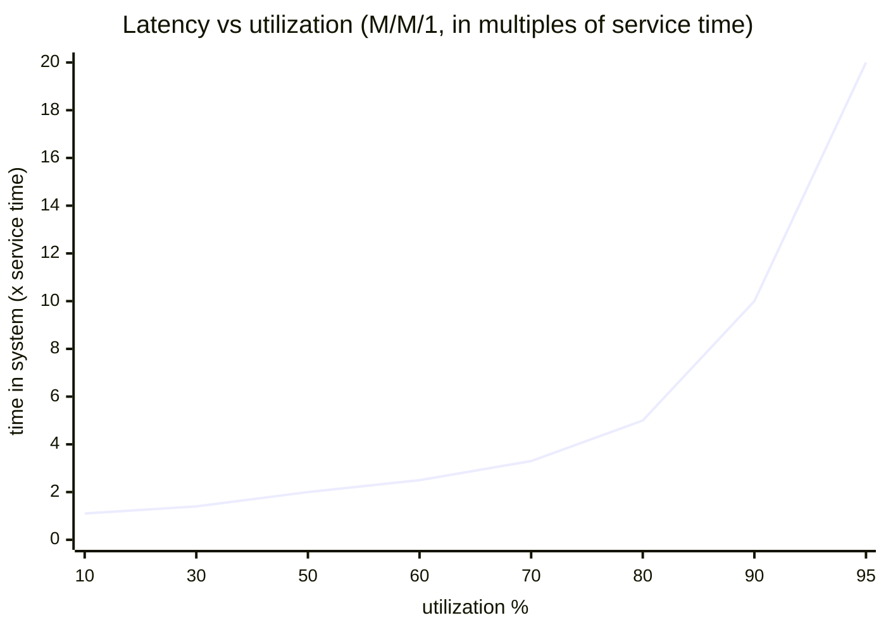

# Lesson 3.4: Measure first: profiling and load testing

> ⏱ ~55 min · 🎚 Level: Core · 🧰 Needs: Lessons 3.1–3.2

[Course home](../../README.md) › [Module 3](README.md) › Lesson 3.4

## 📨 The situation

> **From: Diego (SRE)**
> Three people have told me the assistant is "slow" and two have already started "optimising": one rewrote retrieval in Rust, the other wants to buy GPUs. Nobody can tell me the current p95, the throughput at which it falls over, or where the time goes. Rule of this team: **no optimisation without a baseline.**

## 🎯 By the end you can

- **Define** and **compute** p50/p95/p99 latency, TTFT, TPOT, throughput, error rate and goodput, and say why the mean is misleading.
- **Apply** Little's law and basic queueing intuition to predict where latency explodes.
- **Design** a load test: workload, warm-up, duration, closed vs open loop, and what to record.
- **Find** where time goes with request-level timings and a sampling profiler.
- **Identify** the saturation point of a service from a load-test table.

## 🤔 Predict first

1. 98 requests take 100 ms and 2 take 5 s. What are the mean and the p99? Which one would a user complain about?
2. A service handles 8 requests/s at most. 16 users each send a request as soon as their last one returns. What will the average latency be?
3. Is a GPU at 90% utilization "nicely efficient" or "about to fall over"?

---

## 1. The numbers that matter

### Percentiles, not averages

The **p95** is the latency that 95% of requests beat; 5% are slower. **p50** is the median. Here is the lab's implementation; there's no magic:

```python
# lab/src/kestrel_serving/stats.py
def percentile(values, p):
    ordered = sorted(values)
    rank = (len(ordered) - 1) * p / 100        # fractional position
    lo, hi = math.floor(rank), math.ceil(rank)
    if lo == hi:
        return float(ordered[lo])
    weight = rank - lo
    return float(ordered[lo] * (1 - weight) + ordered[hi] * weight)   # linear interpolation
```

Why not the mean? From `tests/test_stats.py::test_mean_hides_the_tail`: 98 requests at 100 ms + 2 at 5,000 ms gives **mean = 198 ms** (looks fine), **p50 = 100 ms**, **p99 = 5,000 ms**. Two users out of a hundred waited five seconds, and the mean hides them.

**Why the tail matters more than it seems:** if a page or an agent makes many calls, the *slowest* one sets the user's wait. With 100 independent calls each having a 1% chance of hitting p99, the probability that *at least one* is slow is:

$$1 - 0.99^{100} \approx 63\%$$

That's the central argument of the classic paper *The Tail at Scale* (Dean & Barroso). For agentic workflows (Module 6), where one task makes 10–50 LLM calls, tail latency **is** the user experience.

### LLM-specific latency metrics

| Metric | Definition | Users feel it as |
|---|---|---|
| **TTFT**, time to first token | request sent → first token received | "Is it working?" |
| **TPOT** (also inter-token latency), time per output token | average gap between tokens after the first | Reading speed of the stream |
| **E2E latency** | request sent → last token | Total wait (non-streaming UIs, agents) |
| **Throughput** | completed requests/s, or output tokens/s for the whole system | Capacity, cost |
| **Error rate** | failed / total (timeouts, 5xx, 429) | "It's broken" |
| **Goodput** | requests/s that **met the SLO** (e.g. TTFT < 1 s *and* no error) | The capacity that counts |

> 💡 **Production tip:** Goodput is the honest throughput number. A server that does 20 req/s with half of them over your SLO has a goodput of 10, and pushing more load usually *lowers* goodput.

Reading speed is roughly 4–6 words/s, about 5–8 tokens/s, so a stream faster than ~20 tokens/s per user rarely feels better for chat. That's useful when you trade per-user speed for system throughput (lesson 3.2, batching).

## 2. Queueing: why latency explodes before 100% utilization

### Little's law

For any stable system:

$$L = \lambda \times W$$

**L** = average number of requests in the system, **λ** = throughput (arrivals per second), **W** = average time in the system. It's almost too simple to be useful, yet it explains the lab immediately: 16 concurrent users (L = 16) against a server that completes 8.4 req/s (λ) must see:

$$W = \frac{L}{\lambda} = \frac{16}{8.4} \approx 1.9 \text{ s}$$

The measured p50 in the lab is ~1.8 s. Adding users beyond capacity doesn't add throughput; **it only adds waiting**.

### Utilization and the hockey stick

The simplest queueing model (one server, random arrivals and service times, called M/M/1) gives average time in the system:

$$W = \frac{1}{\mu - \lambda} = \frac{1/\mu}{1 - \rho}, \qquad \rho = \lambda / \mu$$

where μ is the service rate and ρ the utilization. In multiples of the bare service time 1/μ:

| Utilization ρ | Average time in system |
|---|---|
| 50% | 2× service time |
| 80% | 5× |
| 90% | 10× |
| 95% | 20× |
| 99% | 100× |

Real servers with batching don't follow M/M/1 exactly, but the **shape** holds everywhere: latency is flat, then bends sharply near saturation. That's why the cost model in lesson 3.3 uses a utilization target of 0.6, and why "90% busy" means "about to fall over", not "efficient".



## 3. Load testing done right

### Closed loop vs open loop

| | Closed loop | Open loop |
|---|---|---|
| How load is generated | N virtual users; each waits for its response before sending the next | Requests arrive at a fixed rate (e.g. 10/s) regardless of responses |
| Models | A fixed pool of clients (workers, agents, a batch job) | The internet: users don't wait for each other |
| When the server slows down | Clients send *fewer* requests, so load drops automatically | Requests keep coming and the queue grows |
| Risk | Under-reports latency under overload (**coordinated omission**) | Can overwhelm the system, which is the point of the test |

The lab's `scripts/loadtest.py` is **closed loop** (simple and safe on a laptop). **Coordinated omission**, a term popularised by Gil Tene, is the trap: when the server stalls, a closed-loop tester stops sending, so the requests that *would* have arrived during the stall and waited are never measured. Your p99 looks better than reality. For realistic tail numbers use an **open-loop** tool (k6's constant-arrival-rate executor, or wrk2) or build arrival-rate pacing into your script.

**Locust** (Python) is the most common free load-testing tool in Python shops: you describe user behaviour as code and get a web UI with live percentiles. **k6** (JavaScript scripts, Go engine) is excellent for CI. Both are free and open source.

### A load-test checklist

1. **Realistic workload.** Use real prompt and answer length distributions (from logs or the golden set) and a realistic repeat rate (repeats change cache hit rates). A load test with one repeated question measures your cache, not your system.
2. **Warm up.** The first requests pay for JIT compilation, connection setup, cache fills and model warm-up. `loadtest.py` sends a few unmeasured requests first.
3. **Steady state.** Run long enough to see the queue settle (at least minutes for real systems, plus several times your p99).
4. **Ramp in steps.** 1, 2, 4, 8, 16, 32 users (or arrival rates) to find the knee.
5. **Watch the client.** A saturated load generator (CPU at 100%, connection limits) produces fake latency. Check its CPU.
6. **Record the environment:** git commit, model and engine version, hardware, config flags, date. A result you can't reproduce is an anecdote.
7. **One change at a time,** then repeat each run ~3× and report the spread.
8. **Measure what the user measures:** from the client side, end to end, including the network.

### Reading a saturation table

From lab step 3 (default fake model: 4 concurrent "GPU slots"):

| concurrency | throughput (req/s) | p50 (ms) | p95 (ms) |
|---|---|---|---|
| 1 | ~2.1 | ~420 | ~830 |
| 4 | ~8.4 | ~420 | ~830 |
| 16 | ~8.4 | ~1,800 | ~2,250 |

- **1 → 4:** throughput ×4, latency flat. Spare capacity: you are *below* the knee.
- **4 → 16:** throughput flat, latency ×4. You are *past* the knee; extra work only queues.
- **Capacity** ≈ 8.4 req/s at a p95 of ~830 ms. That is the number Diego wanted. With an SLO of p95 < 1 s, your goodput limit is around 4 concurrent requests per replica.

> ⚠️ **Common mistake:** Reporting "the service handles 50 req/s" without the latency at that load. Every system "handles" any load if you accept infinite latency. Always state throughput **at** a latency percentile: "8 req/s at p95 < 1 s".

## 4. Profiling: where does the time go?

### Step 1: request-level timings (cheap, always on)

The lab service returns a breakdown with every response, plus a `server-timing` header:

```json
"timings_ms": {"cache_ms": 0.01, "retrieval_ms": 0.6, "llm_ms": 590.2}
```

That one line ends the Rust-rewrite debate: retrieval is **0.1%** of the request. By Amdahl's law, making it infinitely fast saves at most 0.1%. Optimise the biggest bar first.

In Module 4 you'll replace this hand-rolled breakdown with **OpenTelemetry traces**: one span per stage, visualised as a waterfall, sampled across all production traffic.

### Step 2: a performance budget

Turn the SLO into a budget per stage so every team knows its share:

```
p95 end-to-end SLO for a non-streaming answer:  2,500 ms
  gateway + auth ..................   20 ms
  cache lookup ....................    5 ms
  retrieval (embed + search + rerank)  150 ms
  LLM: TTFT .......................  400 ms
  LLM: 200 tokens × ~9 ms .........  1,800 ms
  guardrails + serialisation ......   50 ms
  headroom ........................   75 ms
```

When a stage exceeds its budget, you know whose problem it is.

### Step 3: profilers for when the breakdown isn't enough

- **py-spy** (free, sampling): attaches to a running Python process without code changes. `py-spy top --pid <PID>` shows live hot functions; `py-spy record -o profile.svg --pid <PID>` writes a flame graph. Use it when the *app* (not the model) is slow.
- **Event-loop blocking:** in an `async` service, one CPU-heavy call (a big embedding computation, JSON parsing of a huge document, a synchronous HTTP client) blocks *every* request on that worker. Run with `PYTHONASYNCIODEBUG=1` to log slow callbacks, and move CPU work to a thread or process pool.
- **GPU side:** the engine's own metrics (queue depth, batch size, KV-cache usage), then NVIDIA Nsight Systems or the PyTorch profiler if you're writing model code.

> 🔎 **Under the hood:** Sampling profilers interrupt the program, say, 100 times per second and record the current stack. Functions that appear in many samples are where the time goes. The overhead is low enough for production, unlike tracing profilers that instrument every call.

## 🧪 Try it

1. Run the percentile tests: `cd lab && uv run pytest tests/test_stats.py -q`. **Expected:** all pass, including the comparison with `numpy.percentile`.
2. Do lab steps 2–4: start the service, read `timings_ms`, and run the load test at concurrency 1, 4 and 16. Paste your `results/loadtest.md` table into your notes and mark the knee.
3. Check Little's law on your own numbers: does `concurrency / throughput_rps` ≈ your p50 (in seconds) at c=16?
4. Change the capacity and predict before you measure: restart the service with `KESTREL_FAKE_MAX_CONCURRENCY=8` and rerun c=16.
   <details><summary>What to expect</summary>

   Capacity roughly doubles (~16–17 req/s) and the knee moves to ~8 users. At c=16 latency is roughly 16 / 16.8 ≈ 0.95 s. This is what a second replica or a bigger batch on a real GPU buys you.
   </details>
5. Optional: `uv pip install py-spy`, start the server, run a load test, and in a third terminal run `uv run py-spy top --pid $(pgrep -f "uvicorn kestrel_serving")` (macOS may require `sudo`). Where does the CPU go when the LLM is fake?

## 🏭 In the real world

- Mature teams keep a **performance dashboard per release**: p50/p95/p99, TTFT, throughput at the SLO, cost per 1,000 requests. A regression blocks the release, just like a failing test (Module 4).
- LLM engines ship their own serving benchmarks (vLLM includes one); use them to compare engine versions and flags, and use **your own** workload for go/no-go decisions.

## ✅ Check yourself

<details><summary>Q1. Why is p95 a better SLO metric than the mean?</summary>

The mean is pulled down by the many fast requests and hides the slow tail. p95 states a guarantee about what most users experience and moves when the tail gets worse. Users and SLOs care about the bad experiences, not the average one.
</details>

<details><summary>Q2. Using Little's law: 40 requests are in flight on average and throughput is 10 req/s. What's the average latency?</summary>

W = L / λ = 40 / 10 = 4 seconds.
</details>

<details><summary>Q3. What is coordinated omission, and which kind of load generator suffers from it?</summary>

Closed-loop generators wait for each response before sending the next. When the server stalls, they stop sending, so the requests that would have arrived and queued during the stall are never measured, and tail latency is under-reported. Open-loop (fixed arrival rate) generators avoid it.
</details>

<details><summary>Q4. Throughput stays at 8 req/s from 4 to 16 users while p50 grows from 0.4 s to 1.8 s. What happened, and what are two ways to fix it?</summary>

The service is saturated: capacity is ~8 req/s, and extra users just queue. Fixes: add capacity (more replicas or GPU slots, or bigger batches with continuous batching), reduce work per request (caching, shorter outputs, a smaller or quantized model), or shed and limit load (rate limits, admission control) to protect latency.
</details>

<details><summary>Q5. A teammate wants to optimise retrieval, which takes 0.6 ms of a 590 ms request. What do you tell them?</summary>

Amdahl's law: even eliminating retrieval completely saves 0.1%. Optimise the LLM path (output length, caching, batching, model size) first. Retrieval *quality* may still matter (shorter, better prompts reduce LLM time and cost), but not retrieval latency.
</details>

## 💬 Explain it back

Explain to Lena (non-technical) why adding more users to the assistant at 9 a.m. didn't make it "work harder" but just made everyone wait longer. Use a supermarket checkout analogy.

## 🔑 Key takeaways

- Report **percentiles** (p50/p95/p99), plus **TTFT, TPOT, throughput, error rate and goodput** for LLMs. Never just the mean.
- **Little's law (L = λW)** and the utilization curve explain why latency explodes near saturation. Plan for ~60–70% utilization.
- Load tests need **realistic workloads, warm-up, steps, steady state and recorded environments**. Beware **coordinated omission** in closed-loop tools.
- Always state **throughput at a latency percentile**.
- Profile top-down: **request timings → performance budget → sampling profiler**. Optimise the biggest bar first.

## 📚 Go deeper (free)

| | Resource | Why read it | Time |
|---|---|---|---|
| ⭐ | [The Tail at Scale (Dean & Barroso, CACM 2013)](https://doi.org/10.1145/2408776.2408794) | Why tail latency dominates large systems, and techniques to tame it | 30 min |
| ⭐ | [Locust documentation](https://docs.locust.io/) | The standard Python load-testing tool | 30 min |
| 🔍 | [k6 documentation](https://grafana.com/docs/k6/latest/) | Open-loop (arrival-rate) scenarios and CI-friendly load tests | 30 min |
| 🔍 | [wrk2 (Gil Tene), README on coordinated omission](https://github.com/giltene/wrk2) | The clearest short explanation of coordinated omission | 15 min |
| 🔍 | [py-spy](https://github.com/benfred/py-spy) | Sampling profiler for running Python processes | 15 min |
| 🔍 | [Google SRE Book: Monitoring Distributed Systems](https://sre.google/sre-book/monitoring-distributed-systems/) | The four golden signals: latency, traffic, errors, saturation | 25 min |

---
⬅️ [Lesson 3.3: Topologies and unit economics](03-topologies-and-unit-economics.md) · ➡️ [Lesson 3.5: Caching, batching and autoscaling](05-caching-batching-and-autoscaling.md)
