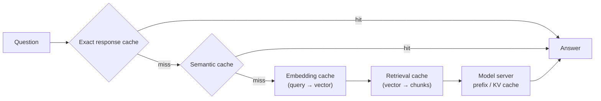
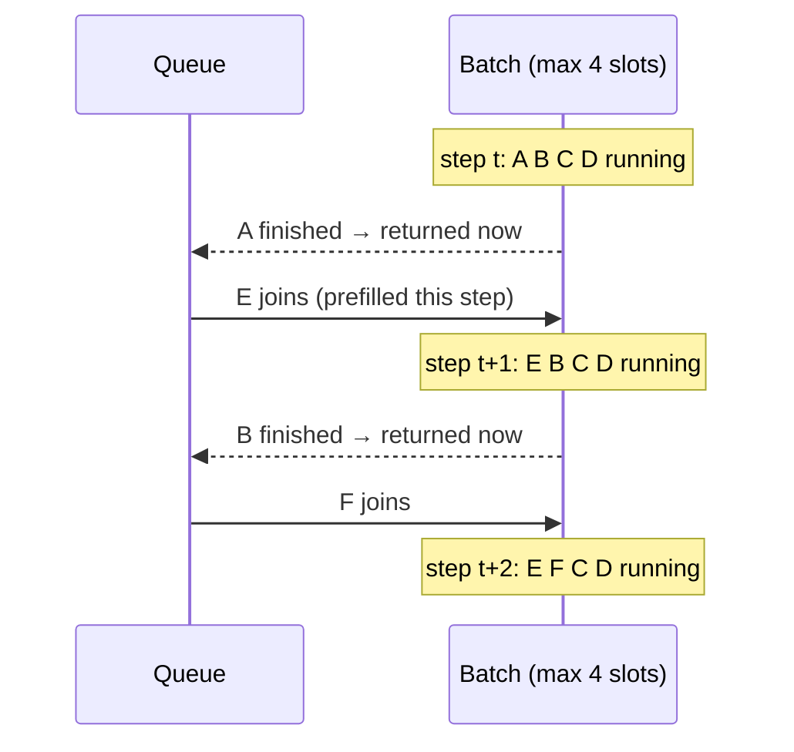

# Lesson 3.5: Caching, batching and autoscaling

> ⏱ ~60 min · 🎚 Level: Core · 🧰 Needs: Lessons 3.2 and 3.4

[Course home](../../README.md) › [Module 3](README.md) › Lesson 3.5

## 📨 The situation

> **From: Lena (Head of Customer Support)**
> I looked at last week's logs: about a third of questions are near-duplicates. "How do I freeze my card", "how to freeze card", "freeze my card pls". Why do we pay the model to answer the same thing 4,000 times?

> **From: Diego (SRE)**
> And when traffic doubles on Monday morning, I want the system to scale itself, *before* customers notice. Which metric should the autoscaler watch? CPU is at 15% when it's on fire.

## 🎯 By the end you can

- **Choose** the right cache layer (exact response, semantic, prefix/KV, embedding, retrieval) for a workload.
- **Design** cache keys and invalidation so a cache never serves a stale, wrong or unauthorised answer.
- **Tune** a semantic cache threshold and **explain** its false-hit risk.
- **Compare** no batching, dynamic batching and continuous batching, and **predict** their throughput and latency.
- **Pick** autoscaling signals for CPU services and GPU model servers, and **plan** for cold starts.

## 🤔 Predict first

1. A semantic cache with a cosine threshold of 0.5 has a much higher hit rate than one at 0.95. What's the catch?
2. A static batch of 32 requests contains one 800-token answer and 31 answers of ~50 tokens. When do the 31 short answers get returned?
3. Why is CPU utilization a bad autoscaling signal for a GPU model server?

---

## 1. The cheapest token is the one you never generate

A cache hit in the lab returns in **~0.02 ms** instead of **~400 ms**, roughly **20,000× faster** and free. There's no other optimisation in this module with that ratio. But caches have one fundamental danger: **serving an answer that is wrong for this request**. Every design decision below is about getting the speed without that risk.

### 1.1 Five layers of caching in an LLM system



| Layer | Key | Saves | Risk of wrong answer | Typical hit rate |
|---|---|---|---|---|
| **Exact response** | hash(normalised question + scope) | Everything | Very low, if keyed correctly | Low–medium |
| **Semantic response** | embedding similarity ≥ threshold | Everything | **Real**: similar ≠ same | Medium–high |
| **Prefix / KV** (inside vLLM/SGLang) | identical token prefix | Prefill compute and TTFT | None: exact by construction | High for shared system prompts |
| **Embedding** | hash(text) | Embedding call | None | High for repeated documents |
| **Retrieval** | hash(query + index version) | Vector search | Low, if the index version is in the key | Medium |

> 💡 **Production tip:** Prefix caching is the **free lunch**: zero correctness risk, no code in your app, just stable prompt prefixes (lesson 3.2). Turn it on (vLLM: `--enable-prefix-caching`, already the default in recent versions; SGLang: RadixAttention is on by default) and order your prompt as *stable instructions → retrieved context → question*.

### 1.2 Cache keys: everything that changes the answer

A response cache is only correct if its key contains **everything** that could make the answer different:

| Must be in the key | Why | In the lab |
|---|---|---|
| Normalised question | The obvious part | `normalize()` strips case, punctuation and whitespace |
| Prompt template version | A new prompt must not serve old answers | `prompt_version` → `cache_scope` |
| Model name and version | A model upgrade changes answers | `model_name` → `cache_scope` |
| **Permission scope** (role, tenant, user) | Otherwise an HR answer is served to a customer | Module 5 adds it |
| Index / data version | A policy update must invalidate old answers | Extend it in Module 4 |
| Generation params (temperature, max_tokens) | They change the output | Fixed at 0 / 512 here |

```python
# lab/src/kestrel_serving/main.py
cache_scope = f"{settings.prompt_version}|{model_name}"
# lab/src/kestrel_serving/adapters/cache.py
def key(question: str, scope: str = "") -> str:
    return hashlib.sha256(f"{scope}|{normalize(question)}".encode()).hexdigest()
```

> ⚠️ **Common mistake:** Caching per question but not per **user scope**. In a multi-tenant assistant, that's a data leak: the cache becomes a side door around access control. Priya will find it in Module 5. Test it: same question, two roles, assert two different cache entries.

### 1.3 Invalidation: TTL plus versioned keys

> "There are only two hard things in Computer Science: cache invalidation and naming things." (attributed to Phil Karlton)

The practical answer for LLM caches:

- **Versioned keys** for planned changes: bump `prompt_version`, the model version or the index version, and old entries become unreachable instantly (and expire later).
- **TTL** (time to live) as a safety net for unplanned staleness: our default is 1 hour. Answers about fees and policies can change, and a 1-hour bound on staleness is a product decision to agree with Lena.
- **LRU eviction** (least recently used) to bound memory. `ExactCache` uses an `OrderedDict` and `move_to_end`.
- **Don't cache** answers that are personal ("what's *my* balance"), time-dependent ("today's rate"), non-deterministic by design (temperature > 0, creative tasks) or failed (errors, refusals caused by outages).

### 1.4 Semantic caching and the false hit

A semantic cache embeds the question and returns a stored answer if a previous question's vector is close enough:

```python
# lab/src/kestrel_serving/adapters/cache.py  (SemanticCache.get)
sims = self._vectors @ query            # cosine similarity (vectors are L2-normalised)
for i in np.argsort(-sims):
    if sims[i] < self.threshold:
        break
    if entry.scope == scope:
        return SemanticHit(entry.value, float(sims[i]), entry.question)
```

The lab measured these similarities with its hash embedder:

| Cached question | New question | Cosine | Same answer? |
|---|---|---|---|
| What is the FX markup on the Plus plan? | Plus plan FX markup? | 0.86 | ✅ yes |
| What is the FX markup on the Plus plan? | What is the FX markup on the **Premium** plan? | 0.57 | ❌ **no** (0.5% vs 0%) |
| How many days do I have to request a refund for a fee? | How many days do I have to open a card dispute? | 0.46 | ❌ no (60 vs 120 days) |

At a threshold of 0.5, a Premium customer gets the Plus answer. That's a **false hit**: fast, confident and wrong. Real embedding models handle paraphrases much better than our hash embedder, but they have the *same* failure mode: questions that differ in one critical word (a plan name, an amount, "not") can sit very close in embedding space.

**How to set the threshold responsibly:**

1. Build a labelled set of question pairs: "same answer" vs "different answer" (include hard negatives like Plus/Premium).
2. Compute similarities and choose the threshold that keeps **hit precision** (the fraction of hits that were correct) above your bar, say 99%.
3. Accept the hit rate that results. If it's too low, improve the embedder, don't lower the threshold.
4. In production, **sample hits for review**, log the matched question next to the new one, and alert when users rephrase immediately after a cached answer (a quality signal).
5. Consider semantic caching only for **low-risk, high-repeat** intents (FAQs). Keep it off for money, permissions and personal data.

## 2. Batching: three policies, one GPU

You learned in lesson 3.2 that decode is memory-bound, so processing many sequences per step is nearly free. The question is **how** to group requests.

### 2.1 Dynamic batching

Wait up to `max_wait_ms` for up to `max_batch` requests, then run them together. This is what Triton calls dynamic batching, and it's **ideal for fixed-shape models**: embeddings, rerankers, classifiers like the fraud model. Every input takes the same time, so nobody waits for anyone. The cost is up to `max_wait_ms` of extra latency per request in exchange for higher throughput. Typical waits are a few milliseconds.

### 2.2 Static batching for generation: the straggler problem

For text generation, a batch runs until its **longest** answer is done:

```
time →           step 1 ... step 50 ............................................ step 800
request A (50 tokens)  ███████████░░░░░░░░░░░░░░░░░░░░░░░░░░░░░░░░░░░░░░░░░░░░░  done, but waits
request B (60 tokens)  █████████████░░░░░░░░░░░░░░░░░░░░░░░░░░░░░░░░░░░░░░░░░░░  done, but waits
request C (800 tokens) ███████████████████████████████████████████████████████████  finally done
new request D          (waiting in the queue, can't join a running batch)
```

The finished sequences become padding: they occupy batch slots and their users wait for C.

### 2.3 Continuous batching (iteration-level scheduling)

Introduced in the **Orca** paper (OSDI 2022) and now standard in vLLM, SGLang, TensorRT-LLM and others: the scheduler **re-forms the batch at every decode step**. Finished sequences leave immediately and their slot goes to a waiting request.



### 2.4 The numbers (lab step 1)

```bash
cd lab && uv run python scripts/simulate_batching.py
```

Same workload, same simulated GPU, three schedulers:

| Offered load | Policy | Throughput (tok/s) | p50 latency | TTFT p50 | Keeps up? |
|---|---|---|---|---|---|
| 1.5 req/s | no batching | 38 | 407 s | 405 s | ❌ queue grows |
| 1.5 req/s | dynamic (32, 100 ms) | 149 | 34 s | 17 s | ✅ (barely) |
| 1.5 req/s | **continuous (32)** | 160 | **2.9 s** | **0.15 s** | ✅ |
| 3.0 req/s | dynamic (32, 100 ms) | 150 | 100 s | 84 s | ❌ queue grows |
| 3.0 req/s | **continuous (32)** | **304** | **4.1 s** | **0.17 s** | ✅ |

What the simulator teaches:

- **Batching at all** is the first 4× (no batching → dynamic).
- **Continuous batching** turns "barely keeps up" into "comfortable": TTFT drops from seconds to ~150 ms because new requests join at the next step instead of waiting for the whole batch.
- At 3 req/s, continuous batching serves **twice the throughput** of dynamic batching on identical hardware. Software scheduling **is** capacity.

> 🔎 **Under the hood:** The simulator simplifies two things real engines do: **chunked prefill** (splitting a long prompt's prefill across several steps so running sequences aren't stalled) and **preemption** (when the KV cache is full, pausing a sequence and recomputing or swapping it later). Read `simulate_continuous()` in `lab/src/kestrel_serving/sim/schedulers.py`; it's under 40 lines.

### 2.5 Request coalescing

Caches only help *after* the first answer is stored. If 50 users ask a brand-new question at the same second (say, right after a status-page incident), 50 identical LLM calls start. **Request coalescing** ("single-flight") lets the first request compute while the other 49 await the same future. See lab extension 2 for an implementation.

## 3. Autoscaling: the right signals

### 3.1 Why CPU and GPU utilization mislead

- An **app service** waiting on the LLM is mostly idle on CPU, because async I/O waits cost nothing. CPU stays at 15% while requests pile up.
- A **GPU model server**'s "utilization" says whether *some* kernel ran, not how close you are to capacity (lesson 3.2), and with continuous batching it can sit near 100% from light load to overload.

### 3.2 Signals that track user pain

| Signal | Where | Why it works |
|---|---|---|
| **Requests waiting** (queue depth) | Model server metrics (vLLM exposes running and waiting request counts) | Directly measures "more demand than capacity" |
| **KV-cache usage %** | Model server metrics | Near 100% means new requests must wait or preempt others |
| **In-flight requests per replica** | App service or gateway | Little's law: concurrency over capacity means queueing |
| **TTFT p95** | Model server or app | User-facing symptom; lags slightly behind queue depth |
| **Requests/s per replica** | Load balancer | Good for CPU services with stable per-request cost |

On Kubernetes, the Horizontal Pod Autoscaler (HPA) can scale on **custom metrics** (via a metrics adapter), and **KEDA** makes it easy to scale on Prometheus queries or queue lengths, including scale-to-zero. Module 6 builds this.

### 3.3 Cold starts change the strategy

A new GPU replica can take **minutes** to become ready (lesson 3.1: pull weights, load to GPU, warm up). An autoscaler that reacts to a queue *now* delivers capacity *minutes later*. So:

- **Keep headroom:** target ~60–70% of measured capacity (lesson 3.4's utilization curve).
- **Scale on leading signals** (queue depth) rather than lagging ones (p95 already blown).
- **Schedule known peaks:** Kestrel's Monday 9 a.m. spike is predictable, so scale up at 8:45.
- **Shorten cold starts:** weights on node-local disk or a shared volume, pre-pulled images, smaller (quantized) models.
- **Scale down slowly** (cool-down windows) to avoid flapping.
- **Shed load gracefully** when you're out of capacity: return a fast "busy, try again" (HTTP 429/503 with `Retry-After`) or fall back to a cheaper path (lesson 3.3) rather than letting every request time out.

> ⚠️ **Common mistake:** Scale-to-zero for an interactive LLM endpoint to save money. The first user after an idle period waits for a multi-minute cold start. Scale-to-zero fits batch and internal tools; customer-facing paths keep a warm minimum.

## 🧪 Try it

1. Lab step 5: enable the exact cache, run the load test with `--repeat-rate 0.5`, and check `/v1/cache/stats`. **Expected:** throughput rises from ~8.4 to ~12 req/s; p95 barely changes, because misses are still slow.
2. Lab step 5, "💥 Break it": reproduce the Plus/Premium false hit at threshold 0.5, then confirm 0.8 avoids it while still catching "Plus plan FX markup?".
3. Run `uv run pytest tests/test_cache.py -v` and read `test_semantic_cache_threshold_controls_false_hits`. It computes the similarity of two *different* questions and shows that thresholds just below and just above it flip a correct miss into a false hit.
4. Run the simulator with `--max-batch 8` at 3 req/s. Which policy breaks first, and why does a small max batch hurt continuous batching too?
   <details><summary>Answer</summary>

   All three fail to keep up at 3 req/s with only 8 slots: continuous batching reaches ~2 req/s of throughput. The batch size caps how many sequences share each weight read (lesson 3.2), so capacity falls. On a real GPU, max batch is bounded by KV-cache memory, which is why the KV-cache size calculation matters.
   </details>

## 🏭 In the real world

- Production LLM gateways commonly offer exact and semantic caching as features. Many teams enable exact caching broadly and semantic caching only for curated FAQ intents.
- Hosted LLM APIs increasingly offer **prompt (prefix) caching** with discounted pricing for cached input tokens: the same idea as vLLM's prefix cache, on the provider's side.

## ✅ Check yourself

<details><summary>Q1. List four things that must be part of a response-cache key for the docs-assistant.</summary>

The normalised question, the prompt template version, the model name and version, the user's permission scope (role/tenant), and the index or data version. Also generation parameters, if they vary.
</details>

<details><summary>Q2. Why is prefix caching risk-free while semantic caching is not?</summary>

Prefix caching reuses intermediate computation (KV tensors) for an identical token prefix; the final output is computed fresh and is exactly what you'd get without the cache. Semantic caching returns a stored *answer* for a *different* question that merely looks similar, so it can be wrong.
</details>

<details><summary>Q3. In static batching, why do short requests suffer?</summary>

The batch runs until its longest sequence finishes and responses return together, so short answers wait for the longest one. Their slots are wasted as padding, and new requests can't join until the batch ends.
</details>

<details><summary>Q4. Diego's autoscaler uses CPU at 70% for the app service and GPU utilization at 80% for vLLM. Propose better signals.</summary>

App service: in-flight requests per replica (or requests/s per replica) and p95 latency. vLLM: waiting requests (queue depth) and KV-cache usage, with TTFT p95 as a secondary SLO-based signal. Add a scheduled scale-up before predictable peaks and keep headroom for cold starts.
</details>

<details><summary>Q5. Your exact cache shows a 35% hit rate but p95 didn't improve. Is the cache broken?</summary>

Not necessarily. p95 is set by the slowest requests, which are cache misses that still go through the full LLM path. Caching improves mean latency, throughput and cost; to move p95 you must speed up the miss path (shorter outputs, batching, faster model) or reduce queueing.
</details>

## 💬 Explain it back

Explain to Lena why "a third of questions are near-duplicates" doesn't mean you can safely cut the LLM bill by a third with a semantic cache. Use the Plus/Premium example.

## 🔑 Key takeaways

- **Five cache layers:** exact, semantic, prefix/KV, embedding, retrieval. Prefix caching is free and safe, so turn it on and order prompts for it.
- A cache key must include **everything that changes the answer**, including **permission scope** and **versions**. Use TTL + versioned keys + LRU.
- **Semantic caches trade correctness for hit rate.** Tune the threshold on labelled pairs for hit precision and keep them off high-risk intents.
- **Continuous batching** (iteration-level scheduling) beats static/dynamic batching for generation: higher throughput and far lower TTFT on the same hardware.
- **Autoscale on queue depth, KV-cache usage and in-flight requests**, not CPU/GPU utilization, and plan around minute-long **cold starts**.

## 📚 Go deeper (free)

| | Resource | Why read it | Time |
|---|---|---|---|
| ⭐ | [How continuous batching enables 23x throughput in LLM inference (Anyscale blog)](https://www.anyscale.com/blog/continuous-batching-llm-inference) | The clearest explanation of static vs continuous batching with benchmarks | 25 min |
| 🔍 | [Orca: A Distributed Serving System for Transformer-Based Generative Models (OSDI 2022)](https://www.usenix.org/conference/osdi22/presentation/yu) | The paper that introduced iteration-level scheduling | 45 min |
| 🔍 | [GPTCache (GitHub)](https://github.com/zilliztech/GPTCache) | A semantic-cache library: see its similarity-evaluation options | 20 min |
| 🔍 | [Kubernetes Horizontal Pod Autoscaling](https://kubernetes.io/docs/tasks/run-application/horizontal-pod-autoscale/) | How HPA works, including custom and external metrics | 25 min |
| 🔍 | [KEDA](https://keda.sh/) | Event- and metric-driven autoscaling for Kubernetes | 15 min |
| 🔍 | [vLLM documentation](https://docs.vllm.ai/) (metrics and automatic prefix caching pages) | The real signals and knobs behind this lesson | 30 min |

---
⬅️ [Lesson 3.4: Measure first](04-measure-first-profiling-and-load-testing.md) · ➡️ [Lesson 3.6: Model compression](06-model-compression.md)
