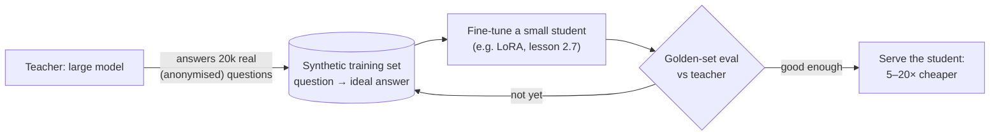
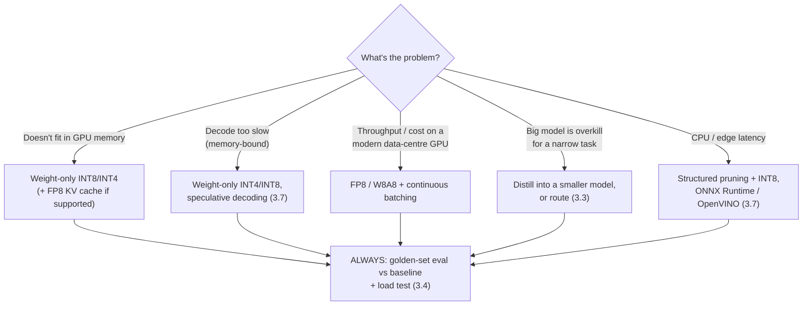

# Lesson 3.6: Model compression
<!-- id: l-3-6 -->

> ⏱ ~60 min · 🎚 Level: Core → Advanced · 🧰 Needs: Lesson 3.2

[Course home](../../README.md) › [Module 3](README.md) › Lesson 3.6

## 📨 The situation

> **From: Sam (Data Scientist)**
> The 8B model gives noticeably better answers than the 1.5B one, but it doesn't fit on the GPU we already have alongside a decent KV cache, and on my laptop it does ~6 tokens/s. Someone on a forum says "just use 4-bit, it's basically free". Is it? And what about pruning or distillation: I keep reading those words.

## 🎯 By the end you can

- **Explain** FP32, FP16, BF16, FP8, INT8 and INT4: their bits, range and precision, and what each is used for.
- **Describe** mixed-precision training and why BF16 replaced FP16 as the default.
- **Implement** symmetric/asymmetric, per-tensor/per-channel quantization and **measure** its error (you'll do it in NumPy).
- **Distinguish** post-training quantization (PTQ) from quantization-aware training (QAT), and weight-only from weight+activation quantization.
- **Compare** structured and unstructured pruning, and **explain** knowledge distillation.
- **Decide** which technique fits a goal (fit in memory, faster decode, cheaper serving) and how to verify quality.

## 🤔 Predict first

1. An 8B model in BF16 is ~16 GB. Roughly how big is it in INT4? <!-- id: p-3-6-1 -->
2. Quantizing to INT4 makes the model 4× smaller. Does that make **prefill** 4× faster, **decode** 4× faster, both, or neither? <!-- id: p-3-6-2 -->
3. Removing 50% of a model's weights (setting them to zero) — does it halve the latency? <!-- id: p-3-6-3 -->

---

## 1. Number formats: what a "bit width" buys

A floating-point number has a **sign**, an **exponent** (range) and a **mantissa** (precision):

| Format | Bits (sign / exponent / mantissa) | Approx. max value | Bytes per param | 8B model size | Typical use |
|---|---|---|---|---|---|
| FP32 | 1 / 8 / 23 | 3.4 × 10³⁸ | 4 | 32 GB | Classic training, master weights |
| FP16 | 1 / 5 / 10 | 65,504 | 2 | 16 GB | Inference; training with loss scaling |
| **BF16** | 1 / 8 / 7 | 3.4 × 10³⁸ | 2 | 16 GB | **Default** for LLM training and inference |
| FP8 (E4M3 / E5M2) | 1 / 4 / 3, 1 / 5 / 2 | 448 / 57,344 | 1 | 8 GB | Newer GPUs (e.g. NVIDIA Hopper and later) |
| INT8 | integer + scale | — | 1 | 8 GB | Quantized inference |
| INT4 | integer + scale | — | 0.5 | ~4–5 GB (with scales) | Quantized inference, laptops |

**BF16 vs FP16, the key insight:** BF16 keeps FP32's **8-bit exponent** (same range) and sacrifices mantissa precision. Neural networks tolerate imprecision well but break on **overflow** (values above 65,504 become infinity in FP16). That's why BF16 became the default: same memory as FP16, without the overflow headaches.

### Mixed precision (training and inference)

**Mixed-precision training** (Micikevicius et al., 2017) does the heavy matrix multiplies in 16-bit (fast tensor cores, half the memory traffic) while keeping a **master copy of the weights in FP32**, so tiny gradient updates aren't rounded away. With FP16 you also need **loss scaling** (multiply the loss so small gradients don't underflow to zero); with BF16's wider range, loss scaling is usually unnecessary.

In PyTorch it's a context manager:

```python
with torch.autocast(device_type="cuda", dtype=torch.bfloat16):
    logits = model(batch)          # matmuls in BF16, sensitive ops (softmax, norms) kept in FP32
```

For **inference**, BF16 (or FP16) weights are the standard baseline. Everything below compresses further from there.

## 2. Quantization from first principles

Quantization maps floating-point values to a small set of integers plus a **scale** (and sometimes a **zero point**).

### Symmetric quantization

$$q = \text{round}\!\left(\frac{w}{s}\right), \quad s = \frac{\max|w|}{q_{\max}}, \quad \hat{w} = q \cdot s$$

For INT8, q_max = 127; for INT4, q_max = 7. The error per weight is at most half a step: |w − ŵ| ≤ s/2 (the lab tests this exact bound).

### Asymmetric quantization

$$q = \text{round}\!\left(\frac{w}{s}\right) + z, \quad s = \frac{\max(w) - \min(w)}{q_{\max} - q_{\min}}, \quad \hat{w} = (q - z) \cdot s$$

The zero point *z* shifts the grid so it covers [min, max] exactly. That's useful when values aren't centred on zero (activations after ReLU, for example).

```python
# lab/src/kestrel_serving/quantization.py
def quantize_symmetric(w, bits=8, per_channel=True):
    qmax = 2 ** (bits - 1) - 1
    max_abs = np.max(np.abs(w), axis=_reduce_axes(w, per_channel), keepdims=True)
    scale = np.maximum(max_abs, 1e-12) / qmax
    q = np.clip(np.round(w / scale), -qmax, qmax).astype(np.int8)
    return Quantized(q, scale, np.zeros_like(scale), bits)
```

### Granularity: the outlier problem

One scale for the whole tensor (**per-tensor**) is stretched by its largest value. If a single weight is 25× larger than the rest, *every* other weight gets a coarse grid. Remedies:

- **Per-channel:** one scale per output row.
- **Group-wise:** one scale per group of, say, 128 consecutive weights. This is common in 4-bit LLM formats.
- **Outlier handling:** keep outlier channels in higher precision (the idea behind LLM.int8()), or mathematically move difficulty from activations into weights (SmoothQuant), or pick scales that protect the most important weights (AWQ).

Lab step 6 measures exactly this on a 1024 × 4096 matrix with 200 outliers:

| Format | Size vs FP32 | Relative error |
|---|---|---|
| FP16 | 0.50× | 0.0002 |
| INT8 symmetric, **per-tensor** | 0.25× | **0.158** |
| INT8 symmetric, **per-channel** | 0.25× | **0.025** |
| INT4 symmetric, per-channel | 0.13× | 0.329 |
| INT4 asymmetric, per-channel | 0.13× | 0.247 |

200 outliers out of 4.2 million weights made per-tensor INT8 **6× worse** than per-channel INT8. And naive INT4 has large errors, which is why real 4-bit methods (GPTQ, AWQ, GGUF "k-quants") are much more sophisticated than round-to-nearest. They use calibration data and error compensation to choose values that preserve the layer's *outputs*, not just its weights.

> 🔎 **Under the hood:** GPTQ quantizes weights one column at a time and adjusts the remaining, not-yet-quantized weights to compensate for the error just introduced, using second-order (Hessian) information from calibration data. That's why it reaches 3–4 bits with little quality loss where round-to-nearest fails.

### PTQ vs QAT

| | Post-training quantization (PTQ) | Quantization-aware training (QAT) |
|---|---|---|
| When | After training, with a small calibration set (hundreds of examples) | During (re)training: forward passes simulate quantization ("fake quant") |
| Cost | Minutes to hours on one GPU | A training run |
| Quality at 8-bit | Usually near-lossless | Near-lossless |
| Quality at 4-bit and below | Good with smart methods (GPTQ, AWQ); some loss | Better: the model learns to be robust to rounding |
| Typical user | Almost everyone serving LLMs | Model producers, edge/mobile deployment |

QAT trains through the non-differentiable `round()` with the **straight-through estimator**: in the backward pass, pretend rounding is the identity function.

### Weight-only vs weight + activation quantization

This answers Predict-first question 2:

- **Weight-only** (e.g. INT4 weights, BF16 activations): weights are dequantized on the fly inside the matmul kernel. **Decode gets faster** because it's memory-bound and you read 4× fewer bytes. **Prefill doesn't get much faster** because it's compute-bound and the math still runs in 16-bit.
- **Weight + activation** (W8A8 in INT8 or FP8): the matmul itself runs on low-precision tensor cores, so **compute-bound phases speed up too**, given hardware support.

| Goal | Good default |
|---|---|
| Fit a bigger model / more KV cache on the same GPU | Weight-only INT8 or INT4 (and possibly FP8 KV cache, if your engine supports it) |
| Faster single-user decode (laptop, edge) | Weight-only INT4 (GGUF via llama.cpp/Ollama) |
| Higher throughput on a modern data-centre GPU | FP8 (weights + activations), where supported |
| Smaller vector index | INT8 embeddings (+ full-precision re-scoring) |

### Quantizing embeddings and vector indexes

The same math applies to your vector database (Module 2). Lab step 6, 5,000 × 384 embeddings:

| Format | Index size | recall@10 vs FP32 |
|---|---|---|
| FP32 | 7.68 MB | 1.000 |
| INT8 | 1.96 MB | 0.985 |
| INT4 | 1.00 MB | 0.837 |
| 1-bit (sign) | 0.24 MB | 0.394 |

Production vector databases combine these: search a compact quantized (even binary) index to get a shortlist, then **re-score** the shortlist with full-precision vectors. That gives most of the memory saving with most of the recall.

> ⚠️ **Common mistake:** "4-bit is basically free." It often is close for chat on large models, but quality loss varies by model size (small models suffer more), task (math, code and long-context reasoning are more sensitive) and method. **Measure on your golden set** (Module 4): answer correctness, citation accuracy and refusal behaviour, quantized vs BF16, before you ship.

## 3. Pruning: removing weights

Pruning sets weights (or whole structures) to zero and removes them.

| | Unstructured pruning | Structured pruning |
|---|---|---|
| What's removed | Individual weights anywhere (e.g. smallest magnitudes) | Whole neurons, attention heads, channels or layers |
| Accuracy at 50% sparsity | Often good (SparseGPT showed large GPT models can be pruned to ~50% in one shot with modest loss) | Larger loss; needs fine-tuning ("healing") |
| Real speed-up | **Only with sparse kernels / hardware**; a dense matmul with zeros is just as slow | **Yes**: the matrices are genuinely smaller |
| Memory saving | Only with sparse storage formats | Yes |

That answers Predict-first question 3: zeroing 50% of weights does **not** halve latency on its own. The middle ground is **semi-structured 2:4 sparsity** (two zeros in every group of four weights), which NVIDIA GPUs since the Ampere generation can accelerate in hardware, with a theoretical maximum of 2× faster matrix math.

For classic ML the same idea is simpler: the fraud model's 150 trees × depth 3 could become 60 trees with feature selection, and you'd measure PR-AUC (Module 4) before and after.

## 4. Knowledge distillation: a small student learns from a big teacher

Train a small **student** model to imitate a large **teacher**. Hinton et al. (2015) showed that the teacher's full probability distribution (its "soft targets", softened with a temperature *T*) carries much more information than the hard label alone: "this transaction is 70% fraud-like" teaches more than "fraud".

$$\mathcal{L} = \alpha \cdot \text{CE}(y, p_{\text{student}}) + (1 - \alpha) \cdot T^2 \cdot \text{KL}\!\left(p^{T}_{\text{teacher}} \,\|\, p^{T}_{\text{student}}\right)$$

Famous result: **DistilBERT** is 40% smaller and 60% faster than BERT while retaining about 97% of its language-understanding performance (per its paper).

For LLM applications, distillation is often **sequence-level and task-specific**:



> ⚠️ **Common mistake:** Distilling from a provider's model without reading its **terms of use**. Some licences restrict using outputs to train competing models. Check with Priya (and legal) first, and prefer open-weight teachers with permissive licences.

## 5. Choosing a technique



And do the cheap things first: shorter prompts, sensible `max_tokens`, caching and batching often beat compression without any quality risk.

## 🧪 Try it

1. Run `cd lab && uv run python scripts/quantize_demo.py` (lab step 6) and fill in your own table.
2. Run `uv run pytest tests/test_quantization.py -v`. Read `test_symmetric_error_is_at_most_half_a_step`: it proves the s/2 error bound on every element.
3. Modify `weights_demo()` to remove the outliers (comment out the two `outliers` lines). Predict first: how much does per-tensor INT8 improve?
   <details><summary>What to expect</summary>

   Without outliers the per-tensor scale is set by ordinary weights (about 4–5 standard deviations), so per-tensor and per-channel INT8 errors become very close, around 1% relative error. The gap you saw was entirely the outliers' fault.
   </details>
4. Optional with Ollama: `ollama pull qwen2.5:1.5b-instruct` is a 4-bit-quantized model by default. Compare its decode speed against the lesson 3.2 bound for your laptop's memory bandwidth.

## 🏭 In the real world

- Open-weight model releases now often ship official quantized variants (FP8, INT4/AWQ, GGUF), and serving engines load them directly.
- Model producers increasingly publish QAT variants for on-device use, because QAT holds quality better at very low bit widths.

## ✅ Check yourself

<details><summary>Q1. Why did BF16 replace FP16 as the default for training large models? <!-- id: c-3-6-1 --></summary>

BF16 has the same 8-bit exponent (dynamic range) as FP32, so values don't overflow above 65,504 as in FP16, and loss scaling is generally not needed. It gives up mantissa precision, which networks tolerate well.
</details>

<details><summary>Q2. A weight row is [0.01, −0.02, 0.015, 1.5]. Why does per-tensor INT8 quantization hurt the small values, and what helps? <!-- id: c-3-6-2 --></summary>

The scale is set by max|w| = 1.5, so each step is 1.5/127 ≈ 0.0118, and values like 0.01 and 0.015 round to 1 step (0.0118) or 0, losing most of their information. Per-channel or group-wise scales, keeping outliers in higher precision, or methods like AWQ/SmoothQuant help.
</details>

<details><summary>Q3. Weight-only INT4 quantization makes decode faster but barely helps prefill. Why? <!-- id: c-3-6-3 --></summary>

Decode is memory-bound: reading 4× fewer bytes per step speeds it up. Prefill is compute-bound and the math still runs in 16-bit after on-the-fly dequantization, so its FLOPs don't shrink.
</details>

<details><summary>Q4. You pruned 60% of weights to zero (unstructured) and latency didn't change. What happened? <!-- id: c-3-6-4 --></summary>

Dense matrix multiplication kernels do the same work regardless of zeros. Unstructured sparsity only speeds things up with sparse kernels or hardware support (e.g. 2:4 semi-structured sparsity on supporting GPUs). Structured pruning (removing whole heads or channels) yields real speed-ups.
</details>

<details><summary>Q5. What do soft targets give a student that hard labels don't? <!-- id: c-3-6-5 --></summary>

The teacher's relative probabilities across all classes (or tokens): which wrong answers are "almost right" and how confident the teacher is. This is richer information per example, so the student learns more from the same data.
</details>

## 💬 Explain it back
<!-- id: e-3-6 -->

Reply to Sam's forum claim ("just use 4-bit, it's basically free") in 4 sentences: what 4-bit buys, what it costs, and how you'd decide.

## 🔑 Key takeaways

- **BF16** is the baseline (FP32 range, half the memory). **Mixed precision** keeps FP32 master weights during training.
- Quantization = integers + **scales** (+ zero points). **Granularity** (per-channel, group-wise) and **outliers** dominate the error.
- **PTQ** is cheap and good at 8-bit, and good at 4-bit with smart methods. **QAT** is best at low bits but costs training. **Weight-only** speeds up decode; **W8A8/FP8** also speeds up compute-bound phases.
- **Unstructured pruning** needs sparse hardware/kernels to be faster; **structured pruning** is really faster but less accurate.
- **Distillation** transfers a big model's behaviour into a cheap one, so check licences.
- **Every compression step needs a quality eval and a load test.** "It's smaller" is not "it's good".

## 📚 Go deeper (free)

| | Resource | Why read it | Time |
|---|---|---|---|
| ⭐ | [A Visual Guide to Quantization (Maarten Grootendorst)](https://newsletter.maartengrootendorst.com/p/a-visual-guide-to-quantization) | Beautifully illustrated tour of formats, PTQ, QAT, GPTQ, GGUF | 45 min |
| ⭐ | [MIT 6.5940: TinyML and Efficient Deep Learning (Song Han)](https://efficientml.ai/) | Full free course: pruning, quantization, distillation, efficient LLMs | Many hours; pick lectures |
| 🔍 | [GPTQ (Frantar et al., 2022)](https://arxiv.org/abs/2210.17323) · [AWQ (Lin et al., 2023)](https://arxiv.org/abs/2306.00978) | The two most-used 4-bit PTQ methods for LLMs | 1 h each |
| 🔍 | [LLM.int8() (Dettmers et al., 2022)](https://arxiv.org/abs/2208.07339) · [SmoothQuant (Xiao et al., 2022)](https://arxiv.org/abs/2211.10438) | Outliers and weight + activation quantization | 1 h each |
| 🔍 | [Mixed Precision Training (Micikevicius et al., 2017)](https://arxiv.org/abs/1710.03740) | Master weights and loss scaling | 30 min |
| 🔍 | [SparseGPT (Frantar & Alistarh, 2023)](https://arxiv.org/abs/2301.00774) | One-shot pruning of large language models | 45 min |
| 🔍 | [Distilling the Knowledge in a Neural Network (Hinton et al., 2015)](https://arxiv.org/abs/1503.02531) · [DistilBERT (Sanh et al., 2019)](https://arxiv.org/abs/1910.01108) | The foundations of distillation | 30 min each |

---
⬅️ [Lesson 3.5: Caching, batching and autoscaling](05-caching-batching-and-autoscaling.md) · ➡️ [Lesson 3.7: Runtimes, kernels and decoding tricks](07-runtimes-kernels-and-decoding-tricks.md)
