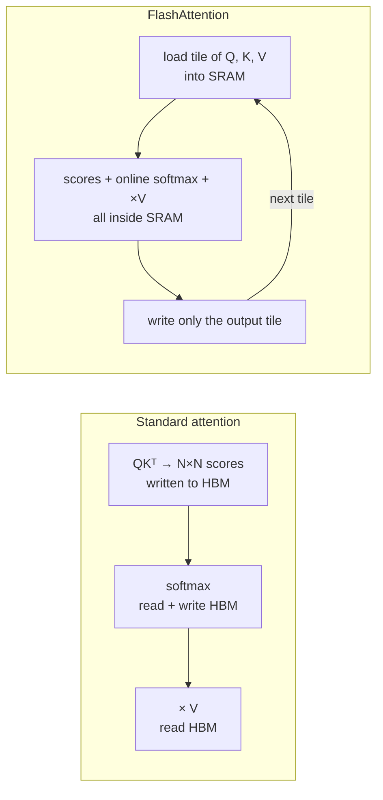
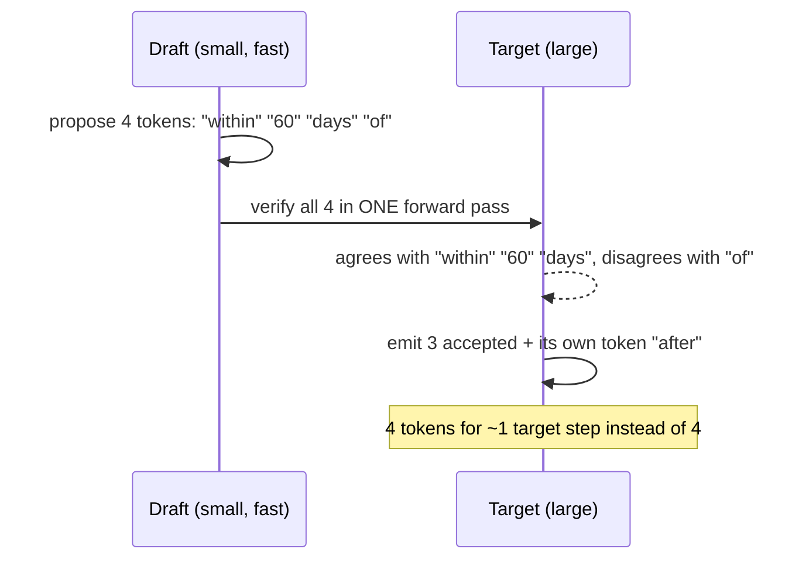
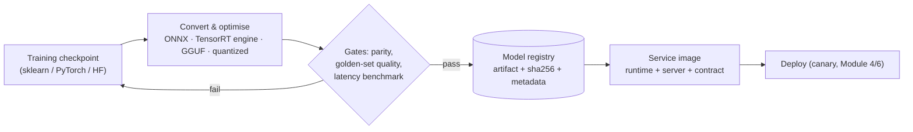

# Lesson 3.7: Runtimes, kernels and decoding tricks
<!-- id: l-3-7 -->

> ⏱ ~60 min · 🎚 Level: Advanced · 🧰 Needs: Lessons 3.2 and 3.6

[Course home](../../README.md) › [Module 3](README.md) › Lesson 3.7

## 📨 The situation

> **From: Omar (Risk Analyst)**
> The card network gives us about 100 ms to approve or decline a payment, and fraud scoring is only one step in that path. Diego says our Python scoring service is "fine", but at peak its p99 spikes. Is there a faster way to run the *same* model without retraining it?

> **From: Diego (SRE)**
> And for the assistant: Sam mentioned "FlashAttention" and "speculative decoding" in standup as if they were magic. Are they things we configure, or things we build?

## 🎯 By the end you can

- **Explain** what an inference runtime does (graph optimisation, fused kernels, hardware-specific code) and **compare** ONNX Runtime, TensorRT and OpenVINO.
- **Export** a scikit-learn model to ONNX, **verify** prediction parity and **benchmark** it (lab step 7).
- **Explain** why FlashAttention is faster yet *exact*, and why the KV cache and PagedAttention matter.
- **Calculate** the expected speed-up of speculative decoding from the acceptance rate and draft length.
- **Package** a model as a versioned artifact → service image, and **design** a backward-compatible gRPC/protobuf contract.

## 🤔 Predict first

1. Converting a model to ONNX changes no weights. How could it make predictions 10× faster? <!-- id: p-3-7-1 -->
2. FlashAttention computes *exactly* the same result as standard attention. Where can the speed come from? <!-- id: p-3-7-2 -->
3. Speculative decoding uses a small model to "guess" tokens. Can it change the output of the big model? <!-- id: p-3-7-3 -->

---

## 1. Runtimes: the same model, executed better

A trained model is a **computation graph** (operations + weights). A **runtime** decides *how* to execute it: which kernels, in what order, with what memory layout, on which hardware. Frameworks like scikit-learn and PyTorch are built for flexibility and training; inference runtimes are built for speed.

What a runtime typically does:

- **Graph optimisation:** constant folding, removing no-op nodes, **operator fusion** (e.g. matmul + bias + activation as one kernel, which saves memory round-trips, the bottleneck you learned about in lesson 3.2).
- **Hardware-specific kernels:** vectorised CPU code (AVX-512, ARM NEON), GPU tensor cores, NPUs.
- **Lower precision** where safe (FP16, INT8, FP8; lesson 3.6).
- **No interpreter overhead:** no Python per call, which matters enormously for small models.

### The main runtimes

| Runtime | Hardware | Input format | Best for |
|---|---|---|---|
| **ONNX Runtime** | CPU, NVIDIA/AMD GPU, plus others via *execution providers* (CUDA, TensorRT, OpenVINO, CoreML, DirectML…) | ONNX | Portable deployment of classic ML and mid-size deep learning models; one artifact, many targets |
| **TensorRT** (+ TensorRT-LLM) | NVIDIA GPUs | ONNX or framework export → compiled **engine** | Maximum performance on NVIDIA; the engine is specific to GPU model and TensorRT version |
| **OpenVINO** | Intel CPUs, integrated GPUs, NPUs | ONNX, PyTorch, TF → OpenVINO IR | Intel servers and edge devices |
| **llama.cpp / GGUF** | CPU, Apple Silicon, consumer GPUs | GGUF | Local and edge LLMs (lesson 3.1) |
| **vLLM / SGLang** | GPUs and other accelerators | Hugging Face checkpoints (+ quantized variants) | LLM serving: they include their own kernels |

**ONNX** (Open Neural Network Exchange) is the interchange format: a versioned set of operators (the **opset**) plus a graph. Converters exist for scikit-learn (`skl2onnx`), PyTorch (`torch.onnx`), XGBoost/LightGBM and more.

> ⚠️ **Common mistake:** Building a TensorRT engine on one GPU type and deploying it on another, or upgrading TensorRT without rebuilding. Engines are tuned for the exact hardware and version. Build them **in CI, per target**, and store them as separate artifacts with that metadata.

## 2. Lab: the fraud model in ONNX Runtime

```bash
cd lab && uv sync --extra onnx && uv run python scripts/onnx_export.py
```

The script trains a gradient-boosted classifier, converts it, checks parity and benchmarks (your numbers will differ):

```
parity: max |p_sklearn - p_onnx| over 4,000 rows = 2.31e-07  ->  OK

| runtime      | input     | p50 ms | p95 ms |
| scikit-learn | 1 row     | 0.100  | 0.115  |
| onnxruntime  | 1 row     | 0.007  | 0.008  |
| scikit-learn | 1000 rows | 0.996  | 1.043  |
| onnxruntime  | 1000 rows | 0.616  | 2.257  |
```

**Reading it:** single-row scoring (an online fraud API scores *one* transaction per request) is **~14× faster**. The model math is tiny; the win is skipping Python and scikit-learn's per-call overhead (input validation, object dispatch). For 1,000-row batches the overhead is amortised and the gap shrinks. *That's Omar's answer*: same model, same predictions (to 7 decimal places), a fraction of the latency.

The three details that make this production-safe:

```python
# 1. One feature-encoding function shared by training and serving (no training/serving skew)
from kestrel_serving.fraud_features import FEATURE_NAMES, encode

# 2. Explicit, typed input; plain probability output instead of a list of dicts
onx = to_onnx(model,
              initial_types=[("features", FloatTensorType([None, len(FEATURE_NAMES)]))],
              options={id(model): {"zipmap": False}},
              target_opset=17)

# 3. Parity check before the artifact is accepted
max_diff = np.max(np.abs(sk_proba - ort_proba))   # must be < 1e-4 (float32 vs float64 rounding)
```

> 💡 **Production tip:** Make the parity check a **CI gate**: export → run both runtimes on a fixed validation set → fail the build if any prediction differs by more than a tolerance, or if the decision at your operating threshold flips for any row. Conversion bugs (unsupported options, dtype changes, categorical handling) are silent otherwise.

## 3. Kernels for LLMs: FlashAttention

Standard attention for a sequence of *N* tokens computes an *N × N* score matrix per head, writes it to GPU main memory (HBM), reads it back for the softmax, writes it again, and reads it again to multiply by V. For N = 8,192 that's 67 million scores **per head per layer**, around 128 MiB in 16-bit, shuttled to and from HBM several times.

**FlashAttention** (Dao et al., 2022) computes the same result **without ever materialising the N × N matrix in HBM**:

- It splits Q, K, V into **tiles** that fit in the GPU's small, very fast on-chip memory (SRAM).
- It computes attention tile by tile, keeping a running maximum and normaliser so the softmax stays exact (the "online softmax" trick).
- Memory traffic drops dramatically, and extra memory grows **linearly** in N instead of quadratically.



**Exact, not approximate.** The speed comes purely from **IO-awareness**, moving fewer bytes, which is the same lesson as decode being memory-bound. The paper reported, for example, ~3× faster GPT-2 training at sequence length 1K. FlashAttention-2 and -3 improved parallelism and targeted newer GPUs.

**Is it something you build?** No. vLLM, SGLang, TensorRT-LLM and PyTorch (`scaled_dot_product_attention`) use FlashAttention-style kernels automatically on supported GPUs. Your job is to know it's there (long contexts are now affordable) and to check your engine and hardware support it.

### KV cache and PagedAttention, revisited

Lesson 3.2 showed that the KV cache can be several GiB per long sequence. Two engine-level techniques turn that into capacity:

- **PagedAttention** (vLLM): fixed-size KV blocks allocated on demand, so there's almost no fragmentation and more sequences fit per batch.
- **Prefix sharing** (vLLM prefix caching, SGLang RadixAttention): identical prefixes share blocks.
- **KV-cache quantization** (e.g. FP8 KV cache, where supported) halves KV memory versus 16-bit, for some quality risk you should evaluate.

## 4. Speculative decoding: more tokens per weight read

Decode is memory-bound: each step reads all the weights to produce **one** token per sequence (lesson 3.2). Speculative decoding produces *several* tokens per expensive step:

1. A cheap **draft** proposes the next *k* tokens (a small model, extra "heads" on the big model, or even n-gram lookup in the prompt).
2. The big **target** model verifies all *k* tokens **in one forward pass**. That pass looks like a small prefill: parallel and cheap per token.
3. Accept the longest prefix of draft tokens the target agrees with, plus one token from the target itself. Discard the rest.



**It doesn't change the output.** With greedy decoding the accepted text is exactly what the target would have produced. With sampling, the accept/reject rule (a form of rejection sampling, from Leviathan et al. and Chen et al.) guarantees the output **distribution** is identical to the target's. It's a pure speed optimisation, not an approximation.

### How much faster?

If each draft token is accepted with probability α (assumed independent) and the draft proposes *k* tokens, the expected number of tokens produced per target forward pass is:

$$E[\text{tokens per step}] = \frac{1 - \alpha^{k+1}}{1 - \alpha}$$

| α (acceptance) | k = 2 | k = 4 | k = 8 |
|---|---|---|---|
| 0.6 | 1.96 | 2.31 | 2.47 |
| 0.8 | 2.44 | 3.36 | 4.33 |
| 0.9 | 2.71 | 4.10 | 6.13 |

But the draft isn't free. If one draft step costs a fraction *c* of a target step:

$$\text{speed-up} \approx \frac{1 - \alpha^{k+1}}{(1 - \alpha)(1 + k c)}$$

Worked example: α = 0.8, k = 4, c = 0.05 → 3.36 / 1.2 ≈ **2.8×** fewer target-step-equivalents per token.

**When it helps and when it doesn't:**

- ✅ **Low batch sizes / latency-sensitive** serving: decode is memory-bound and the GPU has idle compute for the verification.
- ✅ **Predictable text**: high α. RAG answers that **quote the retrieved context** are ideal for *prompt-lookup* drafting, where the draft is copied from n-grams in the prompt and costs almost nothing.
- ❌ **Large batches under heavy load**: the GPU is already closer to compute-bound and verification work competes with other sequences, so gains shrink and can even turn negative.
- ❌ **Low acceptance**: a mismatched draft model (different tokenizer or domain) wastes work.

Engines expose this as configuration (draft model or method, number of speculative tokens). **Benchmark it on your traffic at your real batch sizes** with the lesson 3.4 harness.

## 5. Packaging: from checkpoint to service image



The metadata travelling with the artifact is the **contract** a serving image depends on. The lab writes `artifacts/fraud_model.onnx.json`:

```json
{
  "artifact": "fraud_model.onnx",
  "sha256": "bcda3e6b…",
  "features": ["amount", "hour", "is_online", "...", "cat_utilities"],
  "input_name": "features",
  "output_name": "probabilities",
  "opset": 17,
  "parity_max_abs_diff": 2.3e-07
}
```

At startup the service should **verify the sha256** and that the feature list matches its own encoder, and refuse to become ready otherwise (Module 1's readiness probe).

### Where do the weights live?

| Option | Pros | Cons | Fits |
|---|---|---|---|
| **Baked into the image** | Immutable, reproducible, one artifact to deploy | Huge images for LLMs (GBs → slow pulls and builds) | Small models (fraud: 79 KiB) |
| **Pulled at startup** from object storage / registry | Small image; same image serves many model versions | Slow cold starts; storage becomes a dependency | Mid-size models |
| **Mounted volume / node-local cache** | Fast starts once cached | More infra (pre-loading, cache eviction) | Large LLMs |

Whatever you choose, pin the **exact version and hash** in your deployment config, never "latest".

### gRPC contracts: designing for change

For internal, high-throughput, low-latency calls (fraud scoring inside the payment path), **gRPC + Protocol Buffers** gives a strongly typed, compact, versioned contract (you compared REST and gRPC in lesson 1.3):

```protobuf
syntax = "proto3";
package kestrel.fraud.v1;

service FraudScoring {
  rpc Score (ScoreRequest) returns (ScoreResponse);
}

message ScoreRequest {
  string transaction_id = 1;
  double amount = 2;
  string merchant_category = 3;
  int32  hour = 4;
  bool   is_online = 5;
  // ... remaining features ...
  // NEVER reuse or renumber a field. To remove one: `reserved 9;`
}

message ScoreResponse {
  double fraud_probability = 1;
  string model_version = 2;      // which artifact produced this score (audit!)
  bool   used_fallback = 3;      // true if scored by rules because the model was unavailable
}
```

The rules that keep clients and servers deployable independently:

- **Never change or reuse field numbers**; mark removed ones as `reserved`.
- **Add fields only**, and give new fields safe defaults (proto3 defaults to zero/empty).
- **Version the package** (`kestrel.fraud.v1`) and create `v2` for breaking changes, running both during migration.
- Return **`model_version`** in every response; it's indispensable for audits and debugging (Modules 4–5).

For model servers, the **Open Inference Protocol** (also called the KServe v2 protocol), with endpoints like `POST /v2/models/{name}/infer` over HTTP or gRPC, is implemented by Triton, KServe and others, so clients don't change when you change servers.

## 🧪 Try it

1. Lab step 7: run `scripts/onnx_export.py` and record your parity and latency table.
2. Run `uv run pytest tests/test_onnx.py -v`. **Expected:** passes (it was skipped before you installed the `onnx` extra).
3. Break the contract on purpose: in a Python shell, load the ONNX session and feed a matrix with the columns in a different order. The model *runs* and returns plausible-looking probabilities. Why is that the scariest kind of bug, and which line of the metadata JSON would have caught it at startup?
   <details><summary>Answer</summary>

   Nothing crashes: the model just scores the wrong features, giving silently wrong predictions in production. Checking `features` in the metadata against the service's own `FEATURE_NAMES` at startup (and refusing readiness on mismatch) catches it before any traffic arrives.
   </details>
4. Compute: with α = 0.7, k = 3 and a draft that costs 10% of a target step, what speed-up do you expect?
   <details><summary>Answer</summary>

   E = (1 − 0.7⁴) / (1 − 0.7) = (1 − 0.2401) / 0.3 ≈ 2.53 tokens per step. Cost factor 1 + 3 × 0.1 = 1.3, so the speed-up is ≈ 2.53 / 1.3 ≈ **1.95×**.
   </details>

## 🏭 In the real world

- Payment and ad-tech systems commonly run tree models through optimised runtimes or compiled code paths because their latency budgets are a few milliseconds.
- LLM serving engines advertise speculative decoding, FlashAttention-style kernels and FP8 as configuration options. The engineering work is **choosing, validating and benchmarking**, which is what this module trained you to do.

## ✅ Check yourself

<details><summary>Q1. Why can ONNX Runtime score one fraud transaction ~10× faster than scikit-learn with identical predictions? <!-- id: c-3-7-1 --></summary>

For a tiny model, most time per call is overhead: Python dispatch, input validation and object creation in scikit-learn. ONNX Runtime executes an optimised compiled graph with minimal per-call overhead. The math (and therefore the predictions) are the same, up to float32 rounding.
</details>

<details><summary>Q2. FlashAttention is exact. Where does its speed come from? <!-- id: c-3-7-2 --></summary>

From reducing memory traffic: it tiles the computation into on-chip SRAM and never writes the N × N attention matrix to HBM, using an online softmax to stay exact. Attention at long sequence lengths is memory-bound, so moving fewer bytes means faster execution.
</details>

<details><summary>Q3. Why doesn't speculative decoding change the target model's output distribution? <!-- id: c-3-7-3 --></summary>

The target verifies every draft token and accepts or rejects it with a rule (a form of rejection sampling) designed so the accepted tokens are distributed exactly as if the target had sampled them itself. Rejected tokens are replaced by the target's own sample. With greedy decoding, accepted tokens are exactly the target's argmax tokens.
</details>

<details><summary>Q4. Why might speculative decoding help at batch size 1 but not at batch size 64? <!-- id: c-3-7-4 --></summary>

At batch 1, decode is strongly memory-bound and the GPU has idle compute to verify several tokens at once almost for free. At batch 64, the GPU is closer to compute-bound and verification work competes with the other sequences' work, so the extra tokens per step cost real compute and the net gain shrinks or disappears.
</details>

<details><summary>Q5. Name three rules for evolving a protobuf contract without breaking clients. <!-- id: c-3-7-5 --></summary>

Never reuse or renumber field numbers (reserve removed ones); only add new fields with safe defaults; version the package and introduce a new version (v2) for breaking changes, running both during migration. Also: include the model version in responses for traceability.
</details>

## 💬 Explain it back
<!-- id: e-3-7 -->

Answer Diego's question ("are these things we configure, or things we build?") for FlashAttention, PagedAttention, speculative decoding and ONNX export, one sentence each.

## 🔑 Key takeaways

- **Runtimes** execute the same model faster: graph optimisation, fused kernels, hardware-specific code, no interpreter overhead. ONNX Runtime is portable, TensorRT is NVIDIA-specific and must be built per GPU, OpenVINO targets Intel.
- **Always verify parity** after conversion, and ship the artifact with **sha256 + feature/IO metadata** that the service checks at startup.
- **FlashAttention** is exact and fast because it's IO-aware. **PagedAttention** and **prefix sharing** turn KV memory into capacity.
- **Speculative decoding** is lossless; speed-up ≈ (1 − α^(k+1)) / ((1 − α)(1 + k·c)). It's best at low batch sizes and for predictable or quoting outputs.
- **Contracts** (protobuf, Open Inference Protocol, OpenAI-compatible) let models and clients evolve independently: add fields, never reuse numbers, return `model_version`.

## 📚 Go deeper (free)

| | Resource | Why read it | Time |
|---|---|---|---|
| ⭐ | [ONNX Runtime documentation](https://onnxruntime.ai/docs/) | Execution providers, graph optimisations, performance tuning | 40 min |
| ⭐ | [FlashAttention (Dao et al., 2022)](https://arxiv.org/abs/2205.14135) | IO-aware exact attention; read sections 1–3 | 1 h |
| 🔍 | [Fast Inference from Transformers via Speculative Decoding (Leviathan et al., 2022)](https://arxiv.org/abs/2211.17192) | The speculative decoding algorithm and its analysis | 45 min |
| 🔍 | [Accelerating LLM Decoding with Speculative Sampling (Chen et al., 2023)](https://arxiv.org/abs/2302.01318) | Independent formulation with large-model results | 30 min |
| 🔍 | [sklearn-onnx documentation](https://onnx.ai/sklearn-onnx/) | Converting scikit-learn pipelines, options like `zipmap` | 20 min |
| 🔍 | [NVIDIA TensorRT](https://developer.nvidia.com/tensorrt) and [OpenVINO](https://docs.openvino.ai/) | Vendor runtimes: engines, precision, supported hardware | 30 min |
| 🔍 | [Protocol Buffers: proto3 language guide](https://protobuf.dev/programming-guides/proto3/) | Field numbers, reserved fields, evolution rules | 30 min |

---
⬅️ [Lesson 3.6: Model compression](06-model-compression.md) · ➡️ [Lab 3: Benchmark, cache, quantize and cost out](lab/README.md)
