# Module 3: Serving, Inference and Optimization

> ⏱ ~12 hours (7 lessons × 45–60 min + a 3–4 h lab) · 🎚 Core → Advanced · 🧰 Needs: Modules 0–2 (Module 2 is helpful, not required for the lab)

[Course home](../../README.md) › Module 3

## 🧭 Where you are

```mermaid
flowchart LR
    M0["0 · Foundations"] --> M1["1 · Prototype → Production"] --> M2["2 · Data & Model Pipelines"] --> M3["3 · Serving & Optimization"] --> M4["4 · Evaluation & Monitoring"] --> M5["5 · Security & Governance"] --> M6["6 · Scaling & Operations"] --> C["🏆 Capstone"]
    classDef done fill:#d1fae5,stroke:#059669,color:#064e3b
    classDef current fill:#fde68a,stroke:#d97706,stroke-width:3px,color:#78350f
    class M0,M1,M2 done
    class M3 current
```

## 📨 The story so far

The docs-assistant answers from the handbook with citations (Module 2), and the fraud model is a versioned, containerised service (Module 1). Then Monday morning happened:

> **From: Lena (Head of Customer Support)**
> 9:05 a.m., 300 agents log in, and the assistant takes 20 seconds per answer. By 9:30 it's back to normal. Meanwhile Finance says the LLM bill grew 40% last month while customers grew 8%.

> **From: Maya (Engineering Manager)**
> I need three things by the end of the sprint: **why** it's slow, **what** makes it faster and cheaper (with numbers), and **whether** we should self-host. Diego will review your load tests; Omar also wants the fraud scoring path faster.

This module turns "it's slow and expensive" into a measured diagnosis and a plan. The key idea, which you'll see from every angle: **LLM inference is limited by memory bandwidth, not compute**, and almost every optimisation is a way of getting more useful tokens out of each byte the GPU reads.

## 🎯 Module objectives

By the end of this module you can:

1. **Design** a serving architecture that separates application and inference services, and **choose** a serving framework (vLLM, SGLang, Triton, Ray Serve).
2. **Explain** prefill vs decode, memory-bound vs compute-bound, and **calculate** decode speed limits and KV-cache memory.
3. **Compare** single-model, router, cascade and fallback topologies, and **calculate** API vs self-hosted break-even.
4. **Measure** p50/p95/p99, TTFT, throughput and saturation with a load test, and **find** where the time goes.
5. **Apply** caching (exact, semantic, prefix), continuous batching and autoscaling, and **explain** their risks.
6. **Evaluate** quantization, mixed precision, pruning and distillation trade-offs.
7. **Use** optimised runtimes (ONNX Runtime and others) and **explain** FlashAttention and speculative decoding.

## 📖 Lessons

| # | Lesson | You'll learn | Time |
|---|---|---|---|
| 3.1 | [Serving architecture](01-serving-architecture.md) | Dedicated inference services; vLLM, SGLang, Triton, Ray Serve, TorchServe; cold starts | 45 min |
| 3.2 | [How LLM inference really works](02-how-llm-inference-works.md) ⭐ | Prefill vs decode, arithmetic intensity, decode speed limit, KV-cache maths | 60 min |
| 3.3 | [Topologies and unit economics](03-topologies-and-unit-economics.md) | Router, cascade, fallback; rate limits, data residency; break-even | 50 min |
| 3.4 | [Measure first: profiling and load testing](04-measure-first-profiling-and-load-testing.md) | Percentiles, TTFT/TPOT, Little's law, saturation, coordinated omission, profilers | 55 min |
| 3.5 | [Caching, batching and autoscaling](05-caching-batching-and-autoscaling.md) | Cache layers and keys, semantic false hits, continuous batching, scaling signals | 60 min |
| 3.6 | [Model compression](06-model-compression.md) | FP16/BF16/FP8/INT8/INT4, PTQ vs QAT, pruning, distillation | 60 min |
| 3.7 | [Runtimes, kernels and decoding tricks](07-runtimes-kernels-and-decoding-tricks.md) | ONNX Runtime, TensorRT, OpenVINO, FlashAttention, speculative decoding, gRPC contracts | 60 min |

⭐ = if you only have time for one lesson, read 3.2. Everything else builds on it.

**Suggested rhythm:** lessons 3.1–3.2 → lab steps 0–1 → lessons 3.3–3.5 → lab steps 2–5 and 8 → lessons 3.6–3.7 → lab steps 6–7 → quiz.

## 🛠 Lab 3: Benchmark, cache, quantize and cost out

**[→ Open the lab](lab/README.md)** · ⏱ 3–4 h · CPU only, no API keys

You'll work with a docs-assistant service whose fake LLM reproduces the *cost structure* of a real model, plus an inference simulator:

| Step | You do | You learn |
|---|---|---|
| 1 | Simulate no batching vs dynamic vs continuous batching at 3 load levels | Why continuous batching wins (the "aha") |
| 2–4 | Run the service, read per-stage timings, load-test at 1/4/16 users, stream | Baselines, saturation, Little's law, TTFT |
| 5 | Turn on exact and semantic caches; reproduce a false hit | Cache gains *and* their failure mode |
| 6 | Quantize weights and embeddings by hand | Size vs error; outliers; recall@k |
| 7 | Export the fraud model to ONNX; check parity; benchmark | Runtimes and artifact contracts |
| 8 | Run the API vs self-hosted cost calculator | Break-even and the assumptions behind it |
| 9 | (Optional) Point the same harness at Ollama or vLLM | Real models, same methodology |

### ✅ Definition of Done

- [ ] `uv run pytest -q` passes in `lab/` (and the ONNX test passes with `--extra onnx`)
- [ ] `results/loadtest.md` holds a baseline at 3 concurrency levels; you can point at the saturation point and check it with Little's law
- [ ] You measured TTFT vs total latency with streaming
- [ ] You reproduced a semantic-cache false hit and chose a threshold with a written reason
- [ ] You have your own quantization table (INT8 vs INT4, per-tensor vs per-channel)
- [ ] `artifacts/fraud_model.onnx` + metadata exist and parity is OK
- [ ] You wrote a ≤ 200-word cost note for Maya: recommendation, numbers, assumptions, triggers to revisit

## 📊 Self-assessment

Rate yourself before and after the module: 1 = never heard of it · 2 = can recognise it · 3 = can use it with notes · 4 = could teach it.

| Skill | Before | After |
|---|---|---|
| Explaining why a dedicated inference service exists, and choosing a serving framework | | |
| Explaining prefill vs decode and memory-bound vs compute-bound | | |
| Calculating decode speed limits and KV-cache memory for a model | | |
| Choosing between single model, router, cascade and fallback | | |
| Calculating API vs self-hosted cost and break-even | | |
| Running a load test and reading the saturation point | | |
| Designing cache keys and tuning a semantic cache safely | | |
| Explaining continuous batching and choosing autoscaling signals | | |
| Choosing a quantization approach and verifying quality | | |
| Exporting to ONNX with parity checks; explaining FlashAttention and speculative decoding | | |

If any row is still ≤ 2 after the module, reread that lesson's **Key takeaways** and redo its **Try it** section.

## 🎤 Interview corner

These come up in ML/AI system design interviews. Try answering out loud in 3–5 minutes each, then compare with the lessons.

1. **"Design the serving layer for a chat assistant with 50k daily users."** Discuss app vs inference split, engine choice, streaming, continuous batching, KV-cache sizing, caching layers, autoscaling signals and cold starts. (3.1, 3.2, 3.5)
2. **"Your LLM endpoint's p95 doubled after a release. How do you investigate?"** Cover baseline comparison, TTFT vs TPOT vs queueing, prompt length changes, cache hit rate, batch size and KV-cache usage, then profile. (3.4, 3.2)
3. **"Should we self-host or use an API?"** Cover unit economics with utilization and ops cost, rate limits, residency, quality parity and the triggers to revisit. (3.3)
4. **"How would you cut LLM cost by 50% without hurting quality?"** Order your levers: prompt and output length, caching (exact/prefix), routing/cascade, batching, quantization/distillation, each with a quality gate. (3.3, 3.5, 3.6)
5. **"Explain why LLM decoding is slow, and two techniques that speed it up."** Memory-bound decode, then batching, quantization, speculative decoding, and why each works. (3.2, 3.6, 3.7)

## 📝 After the module

- **[Quiz](quiz.md)**: 14 questions, including spaced review from Modules 1–2.
- **[Cheat sheet](cheatsheet.md)**: the formulas and decision tables on one page.

---
⬅️ [Module 2: Data and Model Pipelines](../02-data-and-model-pipelines/README.md) · ➡️ [Module 4: Evaluation and Monitoring](../04-evaluation-and-monitoring/README.md)
