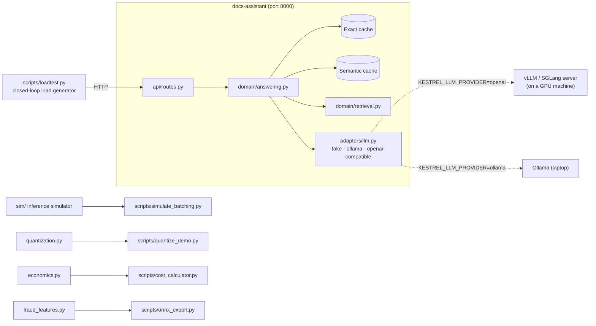

# 🛠 Lab 3: Benchmark, cache, quantize and cost out

[Course home](../../../README.md) › [Module 3](../README.md) › Lab

> ⏱ 3–4 hours · runs on any laptop CPU · no API keys · no GPU

## 📨 The situation

> **From: Lena (Head of Customer Support)**
> The assistant is great, but at 9 a.m. on Monday it took 20 seconds to answer, and Finance says the LLM bill is growing faster than our customer base. Can you make it **faster and cheaper**, and show me numbers, not adjectives?

> **From: Diego (SRE)**
> And before anyone asks for GPUs: I want a load test, a baseline and a cost model on my desk first.

## 🎯 Goals

By the end of this lab you will have:

1. **Seen** why continuous batching wins, using an inference simulator (no GPU needed).
2. **Measured** a baseline of the docs-assistant: p50/p95/p99 latency, throughput, TTFT and the saturation point.
3. **Added** exact and semantic caching, and *caught* a semantic-cache false hit.
4. **Quantized** weights and embeddings by hand and measured the size/accuracy trade-off.
5. **Exported** the fraud model to ONNX, verified parity and benchmarked it.
6. **Costed** API vs self-hosted serving and found the break-even point.

## 🏗 What's in the box



| Path | What it is | Lesson |
|---|---|---|
| `src/kestrel_serving/sim/` | LLM inference simulator: no batching, dynamic, continuous | 3.2, 3.5 |
| `src/kestrel_serving/adapters/llm.py` | One LLM interface, three providers; the fake one simulates prefill/decode latency and limited capacity | 3.1, 3.2 |
| `src/kestrel_serving/adapters/cache.py` | Exact (LRU + TTL) and semantic (cosine threshold) caches | 3.5 |
| `src/kestrel_serving/stats.py` | Percentiles from scratch | 3.4 |
| `scripts/loadtest.py` | Async load generator: p50/p95/p99, throughput, TTFT, hit rate | 3.4 |
| `src/kestrel_serving/quantization.py` | INT8/INT4, symmetric/asymmetric, per-tensor/per-channel | 3.6 |
| `scripts/onnx_export.py` | sklearn → ONNX → ONNX Runtime, parity and benchmark | 3.7 |
| `src/kestrel_serving/economics.py` | API vs GPU cost model and break-even | 3.3 |

> 💡 The fake LLM is not a toy you should ignore. It reproduces the **cost structure** of a real model (prefill per prompt token, decode per output token, a limited number of concurrent "GPU slots"), so every effect you measure here also shows up on real hardware, just with different constants.

---

## Step 0: Install and run the tests

```bash
cd modules/03-serving-and-optimization/lab
uv sync
uv run pytest -q
```

**Expected:**

```
50 passed, 1 skipped in ~5s
```

The skipped test is the ONNX parity test; it runs once you install the optional extra in step 7.

---

## Step 1: The "aha": why batching changes everything (📖 lessons 3.2 and 3.5)

```bash
uv run python scripts/simulate_batching.py
```

The simulator replays 400 requests (RAG-sized prompts of about 600 tokens, long-tailed answers with a median of 80 tokens) through three schedulers at three load levels. **Expected** (exact numbers are deterministic for the default seed):

```
### Offered load: 1.5 requests/s  (400 requests)

| policy                                | throughput_tok_s | latency_p50_ms | latency_p95_ms | ttft_p50_ms | keeps_up         |
| no batching                           | 37.8             | 406744         | 818368         | 404955      | NO (queue grows) |
| dynamic(max_batch=32, max_wait=100ms) | 148.6            | 33550          | 49100          | 16689       | yes              |
| continuous(max_batch=32)              | 160.3            | 2851           | 9689           | 147         | yes              |

### Offered load: 3.0 requests/s  (400 requests)
| no batching                           | 37.8             | 471542         | 943349         | 469264      | NO (queue grows) |
| dynamic(max_batch=32, max_wait=100ms) | 150.0            | 100118         | 154811         | 84448       | NO (queue grows) |
| continuous(max_batch=32)              | 303.9            | 4056           | 13504          | 167         | yes              |
```

(Some columns are trimmed here; you'll see all of them.)

**Read it like an engineer:**

- *No batching* tops out at ~38 tokens/s: every decode step reads all the weights to produce **one** token. At 1.5 req/s the queue grows forever (latency in the hundreds of seconds).
- *Dynamic batching* is ~4× better, but each batch runs until its **longest** answer finishes; short answers wait for long ones, and new requests can't join a running batch.
- *Continuous batching* rebuilds the batch at **every step**: TTFT stays ~150 ms and it is the only policy that keeps up at 3 req/s.
- Same "GPU", same model, same requests. Only the scheduler changed.

**Try:**

```bash
uv run python scripts/simulate_batching.py --rps 3 --max-batch 8      # smaller batches: what breaks?
uv run python scripts/simulate_batching.py --rps 3 --decode-base-ms 10 # a GPU with 2.5x memory bandwidth
```

---

## Step 2: Run the service and read its timings (📖 lesson 3.4)

In terminal 1:

```bash
uv run uvicorn kestrel_serving.main:create_app --factory --port 8000
```

In terminal 2:

```bash
curl -s -X POST localhost:8000/v1/answer \
  -H 'content-type: application/json' \
  -d '{"question": "How long do I have to open a card dispute?"}' | python -m json.tool
```

**Expected** (latency varies slightly):

```json
{
    "answer": "A **dispute** (also called a chargeback request) is how a customer challenges a card transaction ... [card-dispute-process]",
    "citations": ["card-dispute-process", "..."],
    "model": "fake-llm",
    "cache": null,
    "timings_ms": {"cache_ms": 0.01, "retrieval_ms": 0.6, "llm_ms": 590.2},
    "prompt_tokens": 163,
    "completion_tokens": 44
}
```

`timings_ms` is a poor man's profiler: **>99% of the time is the LLM**. That tells you where optimisation effort pays off (and where it doesn't: making retrieval 10× faster saves under 1 ms).

---

## Step 3: Baseline and saturation (📖 lesson 3.4)

With the server still running (default settings: the fake "GPU" serves 4 requests at a time and queues the rest):

```bash
uv run python scripts/loadtest.py --concurrency 1  --requests 120 --label "baseline c=1"
uv run python scripts/loadtest.py --concurrency 4  --requests 120 --label "baseline c=4"
uv run python scripts/loadtest.py --concurrency 16 --requests 120 --label "baseline c=16"
cat results/loadtest.md
```

**Expected** (shape matters, not exact values):

| label | concurrency | throughput_rps | p50_ms | p95_ms | p99_ms |
|---|---|---|---|---|---|
| baseline c=1 | 1 | ~2.1 | ~420 | ~830 | ~1040 |
| baseline c=4 | 4 | ~8.4 | ~420 | ~830 | ~1040 |
| baseline c=16 | 16 | ~8.4 | ~1800 | ~2250 | ~2350 |

**Interpretation:** from 1 → 4 users, throughput grows 4× and latency stays flat: there was spare capacity. From 4 → 16 users, throughput **doesn't move** but latency grows ~4×: you've passed the **saturation point**, and extra requests just wait in a queue. Check it against Little's law: `users / throughput = 16 / 8.4 ≈ 1.9 s`, which is about the measured p50.

---

## Step 4: Streaming and TTFT

```bash
uv run python scripts/loadtest.py --concurrency 4 --requests 120 --stream --label "streaming c=4"
```

**Expected:** `ttft_p50_ms ≈ 85` while the full answer still takes ~400 ms. Streaming doesn't make the model faster; it makes the **wait feel shorter** and lets the UI show progress. For chat UIs, TTFT is the latency that users perceive.

---

## Step 5: Caching, and its failure mode (📖 lesson 3.5)

Stop the server (Ctrl-C) and restart it with the exact cache:

```bash
KESTREL_CACHE_EXACT_ENABLED=true uv run uvicorn kestrel_serving.main:create_app --factory --port 8000
```

```bash
uv run python scripts/loadtest.py --concurrency 16 --requests 120 --repeat-rate 0.5 --label "exact cache, 50% repeats"
curl -s localhost:8000/v1/cache/stats
```

**Expected:** throughput goes from ~8.4 to ~12 rps, a hit rate of ~30–40%, and cache hits that return in **well under 1 ms** instead of ~400 ms. Note that **p95 barely moves**: the slow requests are the misses, and a cache doesn't make misses faster.

Now the semantic cache. Restart with:

```bash
KESTREL_CACHE_SEMANTIC_ENABLED=true KESTREL_CACHE_SEMANTIC_THRESHOLD=0.8 \
  uv run uvicorn kestrel_serving.main:create_app --factory --port 8000
```

```bash
ask() { curl -s -X POST localhost:8000/v1/answer -H 'content-type: application/json' -d "{\"question\": \"$1\"}" | python -c 'import json,sys; d=json.load(sys.stdin); print(d["cache"], "|", d["answer"][:90])'; }
ask "What is the FX markup on the Plus plan?"
ask "Plus plan FX markup?"            # paraphrase: should be a semantic HIT
ask "What is the FX markup on the Premium plan?"   # different question: should MISS
```

**Expected:** `None | ...`, then `semantic | ...`, then `None | ...`.

### 💥 Break it: the false hit

Restart with `KESTREL_CACHE_SEMANTIC_THRESHOLD=0.5` and run the same three `ask` lines. The Premium question now returns `semantic`, which means **a Premium customer just got the Plus plan's answer**. The two questions have a cosine similarity of ~0.57 with our hash embeddings: almost the same words, a different meaning. This is why semantic caching needs a threshold tuned on labelled pairs, a monitored hit precision, and is usually kept off for anything involving money, permissions or personal data. (`tests/test_service.py::test_loose_threshold_serves_the_wrong_plan` captures this bug as a test.)

---

## Step 6: Quantization by hand (📖 lesson 3.6)

```bash
uv run python scripts/quantize_demo.py
```

**Expected:**

| format | size (MB) | vs fp32 | relative error |
|---|---|---|---|
| fp32 | 16.8 | 1.00x | 0 |
| fp16 | 8.4 | 0.50x | 0.00021 |
| int8 symmetric, per-tensor | 4.2 | 0.25x | 0.15791 |
| int8 symmetric, per-channel | 4.2 | 0.25x | 0.02493 |
| int4 symmetric, per-channel | 2.1 | 0.13x | 0.32933 |
| int4 asymmetric, per-channel | 2.1 | 0.13x | 0.24666 |

…and for the embedding index: int8 keeps **recall@10 ≈ 0.985** at ¼ of the size, int4 ≈ 0.84, and 1-bit ≈ 0.39.

**What to notice:** 200 outliers in 4 million weights make per-tensor int8 **6× worse** than per-channel int8. Real LLM quantization methods (GPTQ, AWQ, GGUF k-quants) are mostly clever ways to deal with outliers and choose scales.

---

## Step 7: ONNX export and runtime comparison (📖 lesson 3.7)

```bash
uv sync --extra onnx
uv run python scripts/onnx_export.py
uv run pytest -q          # now 51 passed, nothing skipped
```

**Expected** (your laptop's numbers will differ):

```
parity: max |p_sklearn - p_onnx| over 4,000 rows = 2.31e-07  ->  OK

| runtime      | input     | p50 ms | p95 ms |
| scikit-learn | 1 row     | 0.100  | 0.115  |
| onnxruntime  | 1 row     | 0.007  | 0.008  |
| scikit-learn | 1000 rows | 0.996  | 1.043  |
| onnxruntime  | 1000 rows | 0.616  | 2.257  |
```

Single-row scoring, which is what an online fraud API does, is ~10× faster in ONNX Runtime, mostly because it skips Python and scikit-learn's per-call overhead. Batch throughput differs less. The script also writes `artifacts/fraud_model.onnx.json` with the sha256, feature order and I/O names: that is the **contract** a serving image needs.

---

## Step 8: Cost it out (📖 lesson 3.3)

```bash
uv run python scripts/cost_calculator.py
uv run python scripts/cost_calculator.py --api-in 0.15 --api-out 0.60
```

**Expected (with the example defaults: mid-size API model vs 2 self-hosted GPUs):**

| requests/day | API $/day | GPUs | self-hosted $/day | cheaper |
|---|---|---|---|---|
| 10,000 | 23.00 | 2 | 196.00 | API |
| 100,000 | 230.00 | 2 | 196.00 | self-host |
| 1,000,000 | 2,300.00 | 10 | 580.00 | self-host |

`Break-even: ~85,217 requests/day`. With a cheap small-model API (second command), the answer becomes **"never"**: the API is cheaper per token than your GPUs at 60% utilization. Both answers are correct for their inputs, which is the point. ⚠️ All prices are **example inputs**; replace them with current list prices and *your measured* tokens/s.

---

## Step 9 (optional): Point the same harness at a real model

Everything above works unchanged against a real model:

```bash
# Laptop: Ollama
ollama pull qwen2.5:1.5b-instruct
KESTREL_LLM_PROVIDER=ollama uv run uvicorn kestrel_serving.main:create_app --factory --port 8000
uv run python scripts/loadtest.py --concurrency 4 --requests 40 --label "ollama c=4"
```

```bash
# Any GPU machine (cloud VM, or a free Colab/Kaggle GPU notebook): vLLM's OpenAI-compatible server
pip install vllm
vllm serve Qwen/Qwen2.5-1.5B-Instruct --port 8080
# then on the machine running the lab:
KESTREL_LLM_PROVIDER=openai KESTREL_OPENAI_BASE_URL=http://<gpu-host>:8080/v1 \
  uv run uvicorn kestrel_serving.main:create_app --factory --port 8000
```

Repeat step 3 against vLLM at concurrency 1, 8, 32, 64. Unlike the fake server's hard limit of 4, you'll see throughput keep climbing for a while as continuous batching packs more sequences into each decode step, exactly as the simulator predicted.

---

## 🚀 Extend it

<details>
<summary><b>1. Make the load test a release gate</b>: exit non-zero if p95 exceeds an SLO.</summary>

Add `--slo-p95-ms` to `scripts/loadtest.py` and, after printing the report:

```python
if args.slo_p95_ms and row["p95_ms"] > args.slo_p95_ms:
    raise SystemExit(f"❌ p95 {row['p95_ms']} ms > SLO {args.slo_p95_ms} ms")
```

In CI this turns "it feels slower" into a failing check. Module 4 builds the full eval gate.
</details>

<details>
<summary><b>2. Request coalescing (single-flight)</b>: 50 users ask the same new question at the same moment; only 1 LLM call should happen.</summary>

A cache only helps *after* the first answer is stored. Coalesce concurrent misses with a dict of in-flight futures:

```python
# in AnswerService.__init__
self._inflight: dict[str, asyncio.Future] = {}

async def answer(self, question: str) -> Answer:
    cached = self._lookup(question)
    if cached:
        return cached
    key = ExactCache.key(question, self.cache_scope)
    if key in self._inflight:                      # someone is already computing it
        return await asyncio.shield(self._inflight[key])
    fut = asyncio.get_running_loop().create_future()
    self._inflight[key] = fut
    try:
        result = await self._compute(question)    # the old uncached path
        fut.set_result(result)
        return result
    except Exception as exc:
        fut.set_exception(exc)
        raise
    finally:
        del self._inflight[key]
```

Test it: `asyncio.gather` 20 identical questions and assert `llm.calls == 1`.
</details>

<details>
<summary><b>3. A two-tier cascade</b>: answer with a small model first; escalate only when it says "I don't know".</summary>

Create a `CascadeLLM` adapter that wraps two `LLMClient`s:

```python
class CascadeLLM:
    def __init__(self, small, large):
        self.small, self.large, self.model = small, large, "cascade"
        self.escalations = 0

    async def complete(self, messages, *, temperature=0.0, max_tokens=512):
        first = await self.small.complete(messages, temperature=temperature, max_tokens=max_tokens)
        if "don't know" not in first.text.lower():
            return first
        self.escalations += 1
        return await self.large.complete(messages, temperature=temperature, max_tokens=max_tokens)
```

Track `escalations / calls`: if it exceeds ~30%, the cascade costs more than calling the large model directly. Lesson 3.3 explains why the escalation signal is the hard part.
</details>

<details>
<summary><b>4. Simulator: give short requests priority</b>. What happens to p50 and p95?</summary>

In `simulate_continuous`, replace FIFO admission with "shortest prompt first":

```python
waiting = deque(sorted(waiting, key=lambda r: r.prompt_tokens))
```

placed right before the admission loop. p50 usually improves and the longest requests can **starve** (their p99 grows). Real schedulers add aging or fairness for exactly this reason. Real servers also don't know the output length in advance, which is why output-length-based scheduling is still a research topic.
</details>

<details>
<summary><b>5. Cap <code>max_tokens</code></b> and measure the effect in the simulator.</summary>

`generate_workload(...)` caps outputs at 800 tokens. Change the cap to 200 and rerun step 1. Dynamic batching improves a lot (fewer stragglers); continuous batching improves less. A sensible `max_tokens` is one of the cheapest latency and cost controls you have, and it also bounds the KV-cache memory per request.
</details>

---

## ✅ Definition of Done

- [ ] `uv run pytest -q` passes (and with `--extra onnx`, the ONNX test passes too)
- [ ] You can explain each row of the simulator output in one sentence
- [ ] `results/loadtest.md` contains a baseline at three concurrency levels and you can point at the saturation point
- [ ] You measured TTFT with streaming and explained why it differs from total latency
- [ ] You reproduced a semantic-cache false hit and chose a safe threshold, with a written reason
- [ ] You can state the size and error of int8 vs int4, per-tensor vs per-channel, from your own run
- [ ] `artifacts/fraud_model.onnx` and its metadata JSON exist and parity is OK
- [ ] You wrote a 5-line cost note for Maya: break-even volume, assumptions, and what would change the decision
