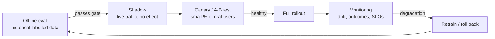
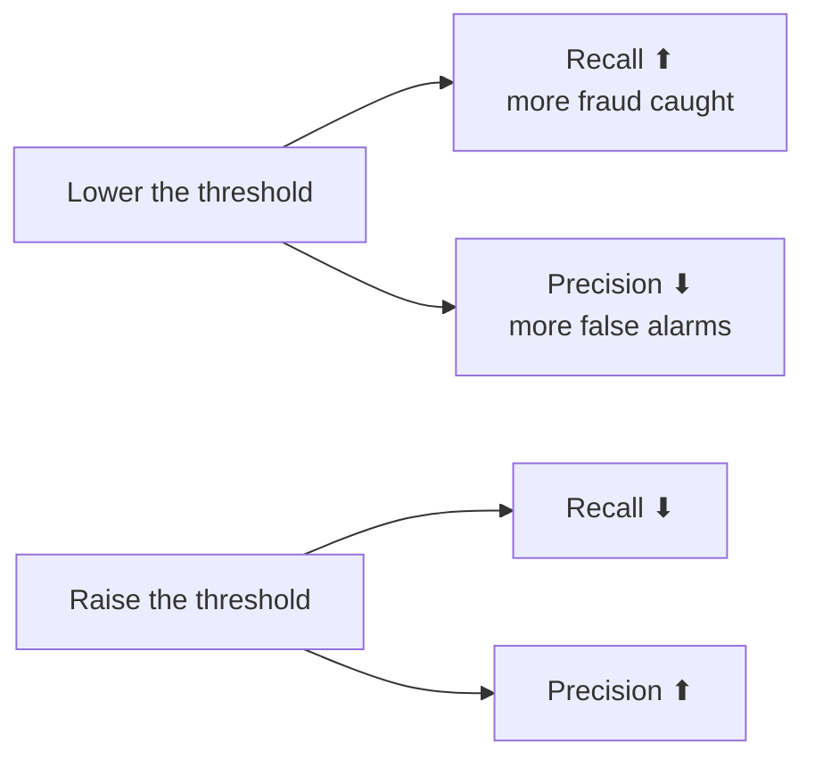

# Lesson 4.1: Offline vs online evaluation and classification metrics
<!-- id: l-4-1 -->

> ⏱ ~50 min · 🎚 Level: Core · 🧰 Needs: [Module 0, lesson 0.4](../00-foundations/04-ml-in-one-hour.md)

[Course home](../../README.md) › [Module 4](README.md) › Lesson 4.1

## 📨 The situation

> **From: Omar (Risk)**
> Sam's notebook says the fraud model is **98.4% accurate**. Leadership wants to switch it on for all card payments next week. Before I sign off: is 98.4% good? And how will we know it still works in March?

## 🎯 By the end you can

- **Distinguish** offline evaluation, online evaluation and monitoring, and say what each can and cannot tell you.
- **Build** a confusion matrix and **compute** precision, recall, F1 and accuracy by hand.
- **Explain** why accuracy is misleading on imbalanced problems like fraud.
- **Choose** between ROC-AUC and PR-AUC, and explain why PR-AUC depends on the base rate.
- **Slice** metrics by segment to find where a model fails.

## 🤔 Predict first

Answer in your head before reading on.

1. 1.6% of Kestrel transactions are fraud. A "model" that *always* says "not fraud" has what accuracy? <!-- id: p-4-1-1 -->
2. Your model has ROC-AUC = 0.74. Is that 74% of fraud caught? <!-- id: p-4-1-2 -->
3. A model scores great on last year's data. Name two reasons it could still disappoint once live. <!-- id: p-4-1-3 -->

---

## 1. Three kinds of evaluation

Evaluation is not one thing. It happens at three moments, and each answers a different question.

| | **Offline evaluation** | **Online evaluation** | **Monitoring** |
|---|---|---|---|
| When | Before release | During release | Forever after |
| Data | Historical, labelled, fixed | Live traffic | Live traffic (labels arrive late, if ever) |
| Question | "Is the new model better than the old one *on known cases*?" | "Is it better *for real users and the business*?" | "Is it *still* good?" |
| Speed | Minutes | Days to weeks | Continuous |
| Typical metrics | Precision, recall, PR-AUC, eval-suite scores | Fraud losses, conversion, thumbs-down rate, A/B deltas | Latency, drift, outcome metrics |
| Risk to users | None | Some (limited by canary or A/B size) | Already exposed |



**Analogy:** offline evaluation is the driving test in an empty car park; online evaluation is the first week on real roads with an instructor; monitoring is the dashboard warning lights for the rest of the car's life. Passing the car-park test is necessary, not sufficient.

### Why offline results don't transfer automatically

- **Distribution shift.** The test set is a photo of the past. Fraudsters adapt; customers change habits (lesson 4.5).
- **Delayed labels.** You learn a transaction was fraud when the customer files a dispute, up to **120 days** later per Kestrel's [dispute policy](../../datasets/handbook/card-dispute-process.md). Online fraud metrics are always a few months behind.
- **Feedback loops.** Once the model blocks a transaction, you never learn whether it *was* fraud. Your future training data is shaped by your current model. A standard mitigation is to let a tiny random sample through (or send it to manual review) to keep unbiased labels.
- **Proxy vs business metric.** Offline you optimise PR-AUC; the business cares about **euros lost and customers annoyed**. Lesson 4.2 connects the two.

> 💡 **Production tip:** write down the *online* success metric (e.g., "fraud losses per €1M processed, measured 90 days after launch") **before** you train. Offline metrics are only useful insofar as they predict it.

---

## 2. The confusion matrix: the source of every metric

A classifier with a threshold turns scores into decisions. Comparing decisions with reality gives four counts. Here is Sam's model on Kestrel's 15,000-transaction test set at the default threshold of 0.5 (from the lab):

|  | **Predicted fraud** | **Predicted legit** |
|---|---|---|
| **Actually fraud** (239) | ✅ **TP = 118** (caught) | ❌ **FN = 121** (missed) |
| **Actually legit** (14,761) | ⚠️ **FP = 2,522** (false alarm) | ✅ **TN = 12,239** |

From these four numbers:

| Metric | Formula | Kestrel @ 0.5 | Plain English |
|---|---|---|---|
| **Accuracy** | (TP+TN) / all | (118+12,239)/15,000 = **0.824** | Share of all decisions that were right |
| **Precision** | TP / (TP+FP) | 118/2,640 = **0.045** | When we flag, how often is it really fraud? |
| **Recall** (sensitivity, TPR) | TP / (TP+FN) | 118/239 = **0.494** | Of all fraud, how much did we catch? |
| **False positive rate** | FP / (FP+TN) | 2,522/14,761 = **0.171** | Of legit customers, how many did we bother? |
| **F1** | 2·P·R / (P+R) | **0.082** | Harmonic mean of precision and recall |

Now answer Omar. The "always legit" model has accuracy 14,761/15,000 = **98.4%**, which is exactly the number in Sam's notebook. **Sam's 98.4% was the accuracy of a model that never catches a single fraud.** With 1.6% positives, accuracy is dominated by the easy majority class and says almost nothing.

> ⚠️ **Common mistake:** reporting accuracy on an imbalanced problem. Always report the base rate next to it. If accuracy ≤ 1 − base rate, the model is no better than a constant.

### Precision vs recall: the fishing-net analogy

A **wide net** (low threshold) catches most fish (high recall) and a lot of old boots (low precision). A **tight net** (high threshold) catches few boots, but many fish escape. You cannot maximise both: moving the threshold trades one for the other.



**Which matters more is a business question:**

| Situation | Favour | Why |
|---|---|---|
| Blocking a card payment in real time | Precision | Every false alarm is a customer stuck at a till |
| Sending to a cheap manual review queue | Recall | Reviews are cheap, missed fraud is expensive |
| Cancer screening (first stage) | Recall | Follow-up tests filter false positives |
| Spam filter for a CEO's inbox | Precision | Losing a real email is worse than seeing spam |

### F1 and F-beta

F1 weights precision and recall equally. If recall matters β times as much, use **F-beta**: `F_β = (1+β²)·P·R / (β²·P + R)`. F2 is common for fraud triage. But notice what both have in common: they ignore TN and they ignore **money**. A €2 fraud and a €2,000 fraud count the same. Lesson 4.2 fixes that with a cost model.

---

## 3. Threshold-free metrics: ROC-AUC and PR-AUC

Precision and recall depend on the threshold. To compare **models** (not policies), you want a metric over *all* thresholds.

### ROC curve and ROC-AUC

Plot **TPR (recall)** against **FPR** for every threshold. The area under it (ROC-AUC) has a beautiful interpretation:

> **ROC-AUC = the probability that a randomly chosen fraud gets a higher score than a randomly chosen legit transaction.**

0.5 = coin flip, 1.0 = perfect ranking. Sam's model: **0.741**. So no, it does *not* mean "74% of fraud caught" (question 2): it is a statement about **ranking**, not about any particular threshold.

### PR curve and PR-AUC (average precision)

Plot **precision** against **recall** for every threshold. The area (computed as *average precision*) tells you how precise the model stays as you push for more recall.

**The key difference:** the "random model" baseline.

| | Random model scores | Sam's model | Ratio |
|---|---|---|---|
| ROC-AUC | 0.50 (always) | 0.741 | 1.5× |
| PR-AUC | **= base rate = 0.016** | 0.077 | **4.8×** |

ROC uses FPR, whose denominator is the 14,761 legit transactions. With that many negatives, 2,500 false alarms look like a small FPR (17%), so ROC curves look flattering on imbalanced data. PR uses precision, which shows the false alarms directly against the fraud you caught. That is why **PR-AUC is the standard for rare-event problems** (fraud, defects, rare diseases). The argument is laid out carefully in Saito & Rehmsmeier (2015) (see Go deeper).

> ⚠️ **Common mistake:** comparing PR-AUC across datasets with different base rates. In the lab's drift report, PR-AUC *rises* from 0.077 to 0.126 under data drift, not because the model improved but because the fraud rate doubled. PR-AUC is only comparable on the same population.

> 🔎 **Under the hood: irreducible error.** The Kestrel data generator labels transactions by flipping a coin weighted by a hidden probability. Even a perfect model that knew the hidden formula would only reach ROC-AUC ≈ 0.80 and PR-AUC ≈ 0.11 on this data. Real fraud has the same property: some fraud looks exactly like legit spending. Always ask "what is the ceiling?" before asking for more model work.

### The code

```python
from sklearn.metrics import (
    average_precision_score, confusion_matrix, f1_score, precision_score,
    recall_score, roc_auc_score,
)

scores = model.predict_proba(X_test)[:, 1]          # probabilities, not labels
decisions = scores >= 0.5                            # a policy, not a model property

print(confusion_matrix(y_test, decisions))           # [[TN FP] [FN TP]]
print("precision", precision_score(y_test, decisions))
print("recall   ", recall_score(y_test, decisions))
print("F1       ", f1_score(y_test, decisions))
print("ROC-AUC  ", roc_auc_score(y_test, scores))    # threshold-free: pass SCORES
print("PR-AUC   ", average_precision_score(y_test, scores))
```

> ⚠️ **Common mistake:** passing hard labels (`decisions`) to `roc_auc_score`. You get the AUC of a single point, a meaningless number. AUC metrics need **scores**.

---

## 4. Getting the offline setup right

Good metrics on a bad test set are worse than no metrics, because they give false confidence. Four rules:

1. **Split by time, not at random.** In production you always predict the future. A random split lets the model peek at next month's patterns. The lab's `time_split()` uses the first 70% of time for training and the last 30% for testing.
2. **Never tune on the test set.** Use a validation set (or cross-validation on training data) for thresholds, hyperparameters and calibration. Touch the test set once, at the end. Every extra look leaks a little.
3. **Exclude leaky features.** `chargeback_filed` is only known after the label exists ([lesson 2.2](../02-data-and-model-pipelines/02-lineage-versioning-and-leakage.md)). A model trained with it scores beautifully offline and is useless live.
4. **Report uncertainty.** 239 fraud cases is not many. One more TP moves recall by 0.4 points. Bootstrap confidence intervals (lab "Extend it" #2) tell you whether a "+1% improvement" is real.

### Slice your metrics

An average hides failures. Compute the same metrics per segment:

| Segment | Transactions | Fraud | ROC-AUC | PR-AUC |
|---|---|---|---|---|
| Domestic (`country_mismatch = 0`) | 14,238 | 190 | 0.707 | 0.034 |
| Cross-border (`country_mismatch = 1`) | 762 | 49 | 0.748 | 0.208 |

The model is far more useful for cross-border transactions (PR-AUC 0.21) than domestic ones (0.03), where most of the fraud volume sits. That is a product decision waiting to happen: maybe launch for cross-border first. In fairness-sensitive applications, slicing by protected groups is mandatory (lesson 5.6).

> 💡 **Production tip:** define your slices up front (country, merchant category, new vs established cards, amount band) and make the eval report print them every time. A regression in one slice is invisible in the global number.

---

## 🧪 Try it

From `modules/04-evaluation-and-monitoring/lab`:

```bash
uv run python -c "
from sklearn.metrics import confusion_matrix, roc_auc_score, average_precision_score
from kestrel_fraud.pipeline import train_or_load
from kestrel_fraud.data import FEATURES, LABEL
model, _, test = train_or_load()
p, y = model.predict_proba(test[FEATURES])[:, 1], test[LABEL]
print(confusion_matrix(y, p >= 0.5))
print('base rate', round(y.mean(), 4), 'ROC-AUC', round(roc_auc_score(y, p), 3), 'PR-AUC', round(average_precision_score(y, p), 3))
"
```

**Expected:**

```
[[12239  2522]
 [  121   118]]
base rate 0.0159 ROC-AUC 0.741 PR-AUC 0.077
```

Now change `0.5` to `0.8` and recompute precision and recall by hand from the new matrix. Which way did each move, and why?

## 🏭 In the real world

Payment companies publish surprisingly little about their fraud metrics, but the public material that exists always talks about **dollar-weighted** outcomes and **false positive rates on good customers**, never about accuracy. Stripe's engineering blog posts on Radar are a readable example of that framing. In regulated credit scoring, the industry-standard metrics are AUC/Gini (Gini = 2·AUC − 1) and stability indices like PSI (lesson 4.5), which tells you how old and how thoroughly tested these ideas are.

## ✅ Check yourself

<details>
<summary>Q1. A model flags 100 transactions; 20 are fraud. There were 80 fraud cases in total. Precision? Recall? <!-- id: c-4-1-1 --></summary>

Precision = 20/100 = **0.20**. Recall = 20/80 = **0.25**. (TP = 20, FP = 80, FN = 60.)
</details>

<details>
<summary>Q2. Why can ROC-AUC look good while the model is useless in practice on rare events? <!-- id: c-4-1-2 --></summary>

ROC's x-axis is the false positive rate, whose denominator is the (huge) number of negatives. Thousands of false alarms are still a small FPR, so the curve looks good while precision, the share of alerts that are real, is tiny. PR curves expose this directly.
</details>

<details>
<summary>Q3. Your new model raises PR-AUC from 0.077 to 0.126, but it was evaluated on a different month. Can you conclude it is better? <!-- id: c-4-1-3 --></summary>

No. PR-AUC depends on the base rate, and if that month had more fraud, PR-AUC rises for any model. Compare both models **on the same test set**.
</details>

<details>
<summary>Q4. Name one thing you can only learn from online evaluation, not offline. <!-- id: c-4-1-4 --></summary>

Any of: real business impact (fraud losses, conversion); user behaviour changes caused by the model (feedback loops, fraudsters adapting); performance on today's distribution; system effects like latency under real load.
</details>

<details>
<summary>Q5. Why split fraud data by time instead of randomly? <!-- id: c-4-1-5 --></summary>

Production always predicts the future from the past. A random split mixes future patterns into training (temporal leakage), inflating offline scores.
</details>

## 💬 Explain it back
<!-- id: e-4-1 -->

Explain to Omar, in three sentences and without the word "AUC", why 98.4% accuracy is not good news, and what two numbers you'd show instead.

## 🔑 Key takeaways

- Offline evaluation compares models on the past; online evaluation measures real impact; monitoring keeps checking. You need all three.
- Every classification metric comes from the confusion matrix. Accuracy is misleading when classes are imbalanced.
- Precision and recall trade off through the threshold; which matters more is a business decision.
- ROC-AUC measures ranking; PR-AUC is more informative for rare events but depends on the base rate.
- Split by time, never tune on the test set, and slice metrics by segment.

## 📚 Go deeper (free)

| | Resource | Why read it | Time |
|---|---|---|---|
| ⭐ | [Google Machine Learning Crash Course](https://developers.google.com/machine-learning/crash-course): Classification module | Interactive explanations of thresholds, the confusion matrix, ROC and AUC | 60 min |
| 🔍 | [scikit-learn user guide: Metrics and scoring](https://scikit-learn.org/stable/modules/model_evaluation.html) | Precise definitions of every metric you'll use, with pitfalls | 30 min |
| 🔍 | [Saito & Rehmsmeier (2015), "The Precision-Recall Plot Is More Informative than the ROC Plot When Evaluating Binary Classifiers on Imbalanced Datasets"](https://doi.org/10.1371/journal.pone.0118432) | The classic argument for PR curves on imbalanced data | 40 min |
| 🔍 | [Rules of Machine Learning (Google)](https://developers.google.com/machine-learning/guides/rules-of-ml) | Rules on training/serving skew, metrics and launches from production experience | 45 min |

---
⬅️ [Module 3](../03-serving-and-optimization/README.md) · ➡️ [Lesson 4.2: Thresholds and calibration](02-thresholds-and-calibration.md)
