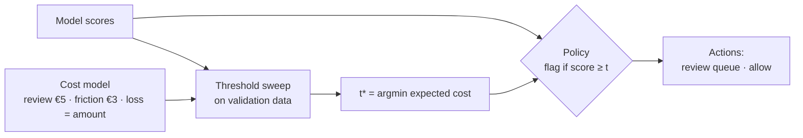
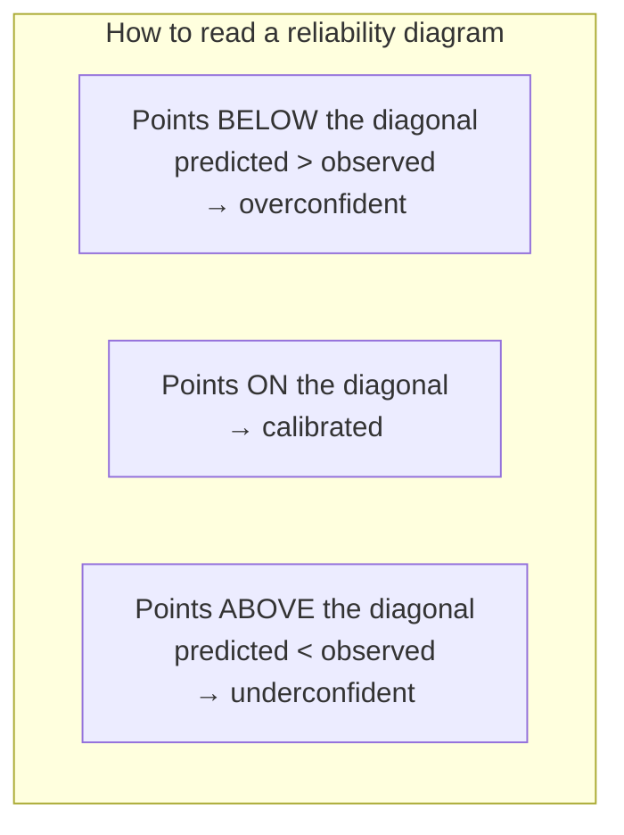

# Lesson 4.2: Thresholds and calibration

> ⏱ ~55 min · 🎚 Level: Core · 🧰 Needs: [lesson 4.1](01-offline-vs-online-and-classification-metrics.md)

[Course home](../../README.md) › [Module 4](README.md) › Lesson 4.2

## 📨 The situation

> **From: Omar (Risk)**
> Two questions about the fraud scores.
> 1. Which threshold do we use? Sam used 0.5 "because that's the default".
> 2. The model says this transaction has a **30%** chance of fraud. Our real fraud rate is under 2%. If the average score is 30%, what does "30%" even mean?
>
> I need numbers I can defend to the CFO in euros.

## 🎯 By the end you can

- **Translate** business costs into a cost model and **choose** the threshold that minimises expected cost.
- **Explain** why 0.5 and max-F1 are arbitrary choices.
- **Define** calibration and **read** a reliability diagram.
- **Compute** the Brier score and expected calibration error (ECE), and compare them with a no-skill baseline.
- **Fix** miscalibration with Platt scaling or isotonic regression, using held-out data.
- **Decide** when calibration matters and when ranking is enough.

## 🤔 Predict first

1. Reviewing an alert costs €5. A missed fraud costs its amount (~€78 on average). Should the threshold be above or below 0.5?
2. A weather forecaster says "70% chance of rain" on 100 days. On how many days should it rain if the forecaster is good?
3. Does calibrating a model change its ROC-AUC?

---

## 1. The threshold is a business decision, not a model property

A model outputs **scores**. A **policy** turns scores into actions: "flag if score ≥ t". The model was trained once; the policy can change every week, because the business changes (review costs rise, a new fraud wave raises losses).

### Step 1: write down the costs

Omar's cost model for one transaction (configurable in the lab's `kestrel_fraud/costs.py`):

| Outcome | What happens | Cost |
|---|---|---|
| Flagged, fraud (TP) | Analyst reviews, fraud stopped | review €5 |
| Flagged, legit (FP) | Analyst reviews, customer annoyed | review €5 + friction €3 |
| Not flagged, fraud (FN) | Chargeback | the transaction amount |
| Not flagged, legit (TN) | Nothing | €0 |

> 💡 **Production tip:** getting these numbers is a conversation with Risk, Operations and Finance, not a modelling task. A rough, agreed number beats a precise number nobody owns. Write them in config, not in code, so they can change without retraining.

### Step 2: sweep thresholds and add up the euros

```python
def expected_cost(y_true, scores, amounts, threshold, costs):
    flagged = scores >= threshold
    review   = costs.review_cost   * flagged.sum()
    friction = costs.friction_cost * (flagged & ~y_true).sum()
    missed   = costs.loss_multiplier * amounts[~flagged & y_true].sum()
    return review + friction + missed
```

Run it for t = 0.01, 0.02 … 0.99 on validation data and pick the cheapest. The lab's result on Kestrel's test set:

| Policy | Threshold | Flagged | Recall | Precision | Cost |
|---|---|---|---|---|---|
| Default | 0.50 | 2,640 | 0.49 | 0.04 | **€28,486** |
| Max F1 | 0.77 | 362 | 0.17 | 0.11 | €18,014 |
| **Min expected cost** | **0.85** | 79 | 0.07 | 0.20 | **€17,271** |
| Flag nothing | — | 0 | 0 | — | €18,771 |

Three lessons:

1. **The default threshold costs €9,700 more than having no model at all.** Thousands of false alarms at €8 each outweigh the fraud they stop.
2. **Max-F1 is not min-cost.** F1 treats every error the same and ignores amounts.
3. **The honest saving is small** (€1,500 per 15,000 transactions). That is a finding, not a failure: it tells Omar the model needs better features before it can carry a big business case. Measuring precisely what a model is worth is the job.



> ⚠️ **Common mistake:** choosing the threshold on the **test** set and then reporting the test cost. That is tuning on the test set; the reported number is optimistic. Choose on validation data (or cross-validation), then report on test once.

### Step 3: decision theory says something surprising

If the score were a **true probability** *p*, you would flag a transaction when the expected loss of letting it through exceeds the expected cost of reviewing it:

```
flag  ⇔  p · amount  >  review + (1 − p) · friction
      ⇔  p  >  (review + friction) / (amount + friction)
```

For an average fraud amount of ~€78: p > (5 + 3)/(78 + 3) ≈ **0.10**. Theory says "flag anything above 10%", yet the sweep picked **0.85**. Who is right?

Both, and the gap is the clue: **the model's scores are not probabilities.** The sweep found the right *cut-off on this particular score scale*; theory works on the *probability scale*. To use the formula (and to make 0.30 actually mean 30%), the scores need to be **calibrated**.

---

## 2. Calibration: do the numbers mean what they say?

> **A model is calibrated if, among all cases where it predicts *p*, the event happens a fraction *p* of the time.**

**Analogy:** a weather forecaster who says "70% chance of rain" should see rain on about 70 of every 100 such days. A forecaster who says 70% and sees rain 20% of the time ranks days fine (rainier days still get higher numbers) but you cannot plan a picnic with those numbers.

Sam's model: mean predicted score **0.30**, observed fraud rate **0.016**. It is wildly overconfident about fraud.

### Why models end up miscalibrated

| Cause | Effect | In this course |
|---|---|---|
| **Class weighting or resampling** (`class_weight="balanced"`, SMOTE, undersampling) | Pushes scores up for the rare class | ✅ Sam's model |
| Boosted trees, SVMs, naive Bayes | Scores pushed towards the extremes or towards the middle | |
| Large neural networks | Often overconfident (Guo et al., 2017) | |
| Distribution shift after training | Calibration silently degrades | Lesson 4.5 |
| LLMs' verbal confidence ("I'm 90% sure") | Not a probability at all | Lesson 4.3 |

> 💡 **Production tip:** resampling and class weights can help a model *learn* the rare class. Just remember they distort probabilities, and recalibrate afterwards.

### The reliability diagram

Sort predictions into bins (e.g., 10 bins with equal numbers of transactions), then plot **mean predicted probability** (x) against **observed fraud rate** (y). A perfectly calibrated model lies on the diagonal.



The lab saves `artifacts/reliability.png`. The uncalibrated curve sits far below the diagonal: when it predicts 0.6, the observed fraud rate is a few percent.

> ⚠️ **Common mistake:** equal-width bins (0–0.1, 0.1–0.2, …) on rare-event data. Almost all calibrated predictions fall into the first bin, and the high bins hold a handful of points with huge noise. Use **quantile** bins (`strategy="quantile"` in scikit-learn).

### Numbers that summarise calibration

**Brier score**: the mean squared error between probability and outcome:

```
Brier = (1/N) · Σ (pᵢ − yᵢ)²          0 = perfect
```

Always compare it with the **no-skill reference**: predicting the base rate *b* for everyone scores *b(1−b)*. With b = 0.0159, that is **0.0157**. Sam's model scores **0.1284**, which is **8× worse than predicting the base rate**, even though it ranks reasonably well (ROC-AUC 0.74). Brier mixes calibration and discrimination, so a good *ranker* can still have a terrible Brier score.

**Expected calibration error (ECE)**: the weighted average gap between predicted and observed rates across bins:

```
ECE = Σ_bins (nᵦ / N) · | mean predicted in bin − observed rate in bin |
```

**Log loss** punishes confident mistakes heavily (predicting 0.99 for a legit transaction costs a lot). It is the loss most models are trained on.

The lab computes all three by hand in `kestrel_fraud/calibration.py`, so you can see there is no magic.

---

## 3. Fixing calibration

Calibration methods learn a **monotone mapping** from the old score to a new probability, using data the model was **not trained on**.

| Method | What it fits | Strengths | Weaknesses |
|---|---|---|---|
| **Platt scaling** (sigmoid) | `p = 1 / (1 + exp(a·s + b))`, two parameters | Very little data needed; smooth | Assumes an S-shaped distortion |
| **Isotonic regression** | A non-decreasing step function | Fixes any monotone distortion | Needs more data (≳1,000 positives is comfortable); can overfit; creates ties |
| **Temperature scaling** | Divide logits by a single T | Standard for neural networks and LLM token probabilities | Only fixes "too sharp / too flat" |

In scikit-learn:

```python
from sklearn.calibration import CalibratedClassifierCV

# cv=3: train 3 copies of the model on 2/3 of TRAIN data, fit the calibrator on
# the remaining 1/3, average. The test set is never touched.
platt    = CalibratedClassifierCV(make_model(), method="sigmoid",  cv=3).fit(X_train, y_train)
isotonic = CalibratedClassifierCV(make_model(), method="isotonic", cv=3).fit(X_train, y_train)
```

Results from the lab:

| Model | Mean score | Brier | ECE | ROC-AUC | PR-AUC |
|---|---|---|---|---|---|
| Uncalibrated (balanced) | 0.3032 | 0.1284 | 0.2873 | 0.741 | 0.077 |
| Platt | 0.0133 | 0.0154 | 0.0034 | 0.749 | 0.075 |
| Isotonic | 0.0133 | 0.0153 | 0.0033 | 0.745 | 0.067 |

The mean score drops to roughly the real fraud rate; Brier and ECE collapse; **ROC-AUC barely moves**. That answers question 3: calibration is monotone, so it keeps the *order* of the scores. The small AUC differences come from the cross-validated refits and from isotonic's ties, not from the calibration idea itself.

Notice too that the calibrated Brier (0.0153) is only slightly better than no-skill (0.0157). Calibration makes the model **honest**; it cannot make it **sharper**. That again says "better features", not "more tuning".

> ⚠️ **Common mistake:** calibrating on the same data the model was trained on. The model is overconfident precisely on its training data, so the calibrator learns the wrong mapping. Use held-out data or `cv=k`.

### Back to thresholds: calibrated probabilities unlock better decisions

With calibrated *p*, you can use the decision-theory rule **per transaction**, taking each transaction's own amount into account:

```python
flag = p * amount > review_cost + (1 - p) * friction_cost
```

In the lab ("Extend it" #1) this flags ~280 transactions and costs **≈ €16,300**, about **€1,000 less than the best single threshold**, because it reviews a €900 electronics purchase at 3% fraud probability while letting a €4 coffee at 20% through. A single threshold cannot do that.

### When does calibration matter?

| You need calibrated probabilities when… | Ranking is enough when… |
|---|---|
| Decisions use expected value (cost rules, pricing, credit limits) | You only review the top-k highest scores each day |
| Scores are shown to humans ("72% risk") | Only the order matters (search, recommendations) |
| You combine several models' outputs | You choose one threshold with a sweep and never interpret the score |
| You compare scores over time or across segments | |

> 💡 **Production tip:** track ECE or Brier **in production** on labelled data as it arrives. Calibration is often the first thing to break under drift (lesson 4.5), long before AUC moves, and recalibrating is much cheaper than retraining.

---

## 🧪 Try it

From the lab folder:

```bash
uv run python scripts/threshold_sweep.py
uv run python scripts/threshold_sweep.py --review-cost 1 --friction-cost 0
uv run python scripts/threshold_sweep.py --review-cost 20
uv run python scripts/calibration.py
```

**Expected:** the min-cost threshold is **0.85** with default costs, moves **down to ≈ 0.41** when reviews are cheap, and **up to ≈ 0.86** when they are expensive. The calibration table matches the one above. Open `artifacts/reliability.png` and find the bin where the uncalibrated model is most overconfident.

Then answer: with cheap reviews, recall jumps to 0.60. Why might Operations still say no? (Hint: look at how many transactions get flagged.)

## 🏭 In the real world

Credit scoring is the oldest production home of these ideas. Lenders convert scores into calibrated default probabilities because regulators and loss forecasts require it, then set cut-offs from expected profit, not from accuracy. Weather services are the other classic example; the Brier score was introduced in 1950 to verify weather forecasts. In LLM systems, the same question shows up as "is the model's confidence meaningful?", and the usual answer is no, unless you measure it.

## ✅ Check yourself

<details>
<summary>Q1. Review costs €10, friction €0, missed fraud costs €200. With calibrated p, above what probability should you flag?</summary>

Flag if p·200 > 10 → p > **0.05**.
</details>

<details>
<summary>Q2. Among 1,000 transactions scored 0.20 by a model, 30 were fraud. Over- or underconfident in that bin?</summary>

Observed rate 3% < predicted 20% → **overconfident** (the point sits below the diagonal).
</details>

<details>
<summary>Q3. Your base rate is 5%. Model A has Brier 0.040, model B 0.050. Is B useful?</summary>

No-skill Brier = 0.05 × 0.95 = 0.0475. B (0.050) is **worse than predicting 5% for everyone**. A beats the baseline.
</details>

<details>
<summary>Q4. Why does isotonic calibration need more data than Platt scaling?</summary>

Isotonic fits a flexible step function (many parameters); with few positives it overfits noise. Platt fits two parameters and is stable with little data.
</details>

<details>
<summary>Q5. A teammate says "we calibrated, so AUC improved from 0.74 to 0.90". What do you suspect?</summary>

Calibration is monotone and preserves ranking, so a big AUC jump points to leakage, most likely calibrating or evaluating on overlapping data or the test set.
</details>

<details>
<summary>Q6. Why did the sweep pick 0.85 when theory suggested ~0.10?</summary>

The sweep worked on uncalibrated scores, which are inflated (mean 0.30 vs 1.6% fraud). 0.85 on that scale corresponds to a much lower true probability. Re-running the sweep on isotonic-calibrated scores picks **≈ 0.06**, the same order of magnitude as the theoretical 0.10 (the exact value differs because fraud amounts vary around the €78 average).
</details>

## 💬 Explain it back

Explain to Omar, with the weather-forecaster analogy, why "the model says 30%" was meaningless before calibration and what it means now. Then tell him which single number you'd put in the CFO deck, and why.

## 🔑 Key takeaways

- Thresholds are policies chosen from **business costs**; 0.5 and max-F1 are arbitrary.
- Choose thresholds on validation data, report on test data.
- Calibration means predicted probabilities match observed frequencies; check it with a reliability diagram, Brier score and ECE, against a no-skill baseline.
- Class weighting and resampling distort probabilities; fix them with Platt or isotonic calibration on held-out data.
- Calibration preserves ranking (AUC) and unlocks per-transaction expected-cost decisions.

## 📚 Go deeper (free)

| | Resource | Why read it | Time |
|---|---|---|---|
| ⭐ | [scikit-learn user guide: Probability calibration](https://scikit-learn.org/stable/modules/calibration.html) | Reliability diagrams, Platt vs isotonic, with runnable examples | 30 min |
| ⭐ | [scikit-learn user guide: Tuning the decision threshold](https://scikit-learn.org/stable/modules/classification_threshold.html) | `TunedThresholdClassifierCV` and cost-sensitive thresholds, done properly | 25 min |
| 🔍 | [Guo et al. (2017), "On Calibration of Modern Neural Networks"](https://arxiv.org/abs/1706.04599) | Why deep nets are overconfident; temperature scaling | 45 min |
| 🔍 | [Google Machine Learning Crash Course](https://developers.google.com/machine-learning/crash-course): thresholds and the confusion matrix | Interactive threshold intuition | 20 min |

---
⬅️ [Lesson 4.1](01-offline-vs-online-and-classification-metrics.md) · ➡️ [Lesson 4.3: Evaluating LLM systems](03-evaluating-llm-systems.md)
