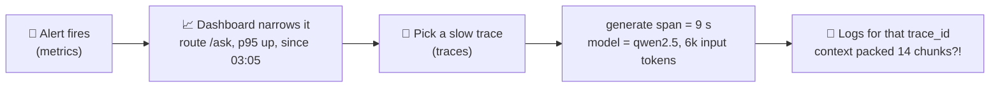
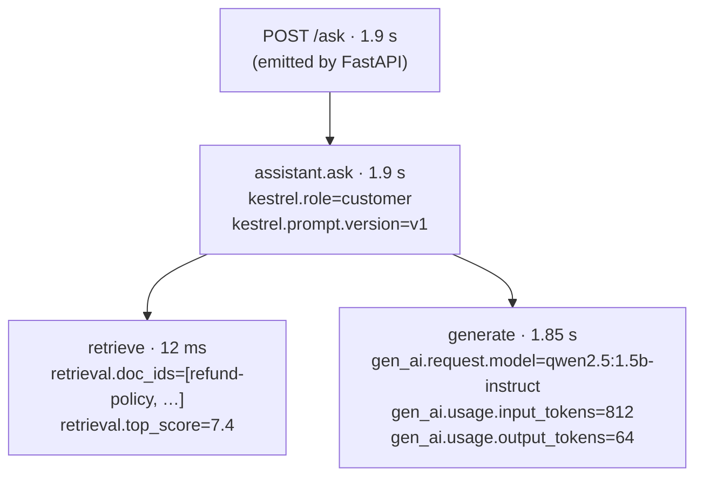
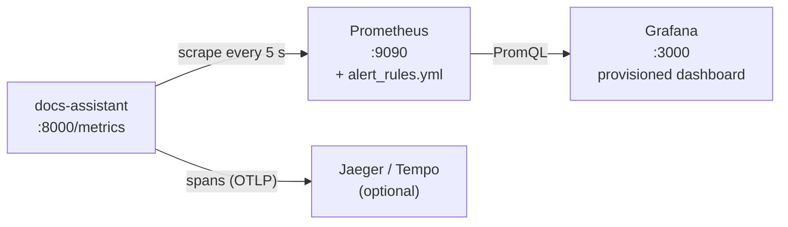

# Lesson 4.4: Observability: tracing and metrics

> ⏱ ~60 min · 🎚 Level: Core · 🧰 Needs: [lesson 1.4](../01-prototype-to-production/04-production-services.md) (structured logging, request IDs)

[Course home](../../README.md) › [Module 4](README.md) › Lesson 4.4

## 📨 The situation

> **From: Diego (SRE)**
> At 03:10 last night the docs-assistant got slow and a few answers were weird. I had logs full of `print("got here")` and no idea whether it was retrieval, the model, or one user hammering us. Before the assistant goes to all employees, I want three things: a dashboard I can glance at, alerts that mean something, and a way to pull up **one** bad request and see exactly what happened inside it.

## 🎯 By the end you can

- **Explain** metrics, logs and traces, and what each is best at.
- **Choose** what to measure for an AI service: the four golden signals plus AI-specific signals.
- **Instrument** a Python service with Prometheus counters, histograms and gauges, and **avoid** the cardinality trap.
- **Write** PromQL for rates, ratios and percentiles.
- **Instrument** a request with OpenTelemetry spans and attributes following the GenAI conventions.
- **Run** Prometheus and Grafana locally and **read** a dashboard.

## 🤔 Predict first

1. You have the p95 latency of each of 10 servers. Can you average them to get the fleet's p95?
2. Why is `user_id` a terrible label for a Prometheus metric?
3. A user says "the answer about refunds was wrong". Which signal (metrics, logs or traces) helps you most, and why?

---

## 1. Three signals, three jobs

**Monitoring** tells you *that* something is wrong. **Observability** is the property that lets you ask *why*, including questions you didn't anticipate, without shipping new code.

| Signal | What it is | Best for | Cost | Example |
|---|---|---|---|---|
| **Metrics** | Numbers aggregated over time | Dashboards, alerts, trends | Very cheap: one time series per label combination | p95 latency of `/ask` over 5 min |
| **Logs** | Timestamped events, ideally structured JSON | Details of discrete events, audits | Medium: grows with traffic | `{"event": "prompt_activated", "version": "v2", "by": "lena"}` |
| **Traces** | The tree of operations inside one request (spans) | Debugging *one* request across components | Medium to high; usually sampled | `POST /ask → retrieve (12 ms) → generate (1.8 s)` |



The trick that makes the three work together: every log line and span carries the same **request ID / trace ID** (you added request IDs in lesson 1.4). Metrics tell you where to look, traces show the path, logs give the details.

---

## 2. What to measure for an AI service

Start with Google SRE's **four golden signals**. They apply to every service:

| Golden signal | For the docs-assistant |
|---|---|
| **Latency** | `/ask` p50/p95/p99, measured separately for successes and errors |
| **Traffic** | Requests per second per route |
| **Errors** | Share of 5xx responses, plus LLM provider errors and timeouts |
| **Saturation** | Queue depth, GPU memory, concurrent requests, provider rate-limit headroom |

Then add **AI-specific signals**. These catch "it's up but it's wrong", the failure mode classic monitoring misses:

| AI signal | Why | Lab metric |
|---|---|---|
| **Outcome feedback** (thumbs down, escalations to a human, re-asks) | The closest live proxy for quality | `kestrel_feedback_total{rating}` |
| **Refusal rate** by reason | Spikes mean empty index, broken retrieval or new topics | `kestrel_refusals_total{reason}` |
| **Retrieval top score** | Dropping scores mean questions the docs don't cover | `kestrel_retrieval_top_score` |
| **Tokens and cost** | Cost incidents are incidents too | `kestrel_llm_tokens_total{type,model}` |
| **Cache hit ratio** | Latency and cost depend on it (Module 3) | `kestrel_cache_lookups_total{result}` |
| **Prompt / model version** | Every change in behaviour must be attributable | `kestrel_answers_total{prompt_version}` |

> 💡 **Production tip:** design the dashboard top-down. **Row 1: what users feel** (thumbs-down rate, error rate, p95 latency). **Row 2: why** (refusals, retrieval score, tokens, cache). **Row 3: internals** (per-component latencies, queue depth). The on-call engineer at 3 a.m. reads row 1 first.

---

## 3. Prometheus metrics in practice

Prometheus **pulls** (scrapes) a `/metrics` endpoint every few seconds and stores time series. Your service just keeps counters in memory.

### The three metric types you need

| Type | Goes | Use for | Example |
|---|---|---|---|
| **Counter** | Only up (resets on restart) | Things that happen: requests, tokens, refusals | `kestrel_requests_total` |
| **Histogram** | Counts observations into buckets | Distributions: latency, scores, sizes | `kestrel_request_latency_seconds` |
| **Gauge** | Up and down | Current state: queue length, active prompt version | `kestrel_prompt_version_info` |

From the lab (`src/kestrel_docs/observability.py`):

```python
from prometheus_client import Counter, Histogram

REQUEST_LATENCY = Histogram(
    "kestrel_request_latency_seconds", "End-to-end HTTP request latency.", ["route"],
    # Buckets must bracket your SLO (p95 < 2 s) with resolution on both sides.
    buckets=(0.005, 0.01, 0.025, 0.05, 0.1, 0.25, 0.5, 1.0, 2.0, 4.0, 8.0),
)
REFUSALS = Counter("kestrel_refusals_total", "Answers that refused.", ["reason"])

# in the request path
REQUEST_LATENCY.labels("/ask").observe(elapsed_seconds)
REFUSALS.labels("no_context").inc()
```

Naming follows Prometheus conventions: a namespace prefix (`kestrel_`), base units (`_seconds`, `_bytes`) and `_total` for counters.

### Why histograms, not averages

**Averages hide the users who suffer.** If 95 requests take 100 ms and 5 take 10 s, the average is 595 ms (looks fine) while 1 in 20 users waits 10 seconds. Use **percentiles** (p50 = typical, p95/p99 = tail).

And question 1: **you cannot average percentiles.** The p95 of a fleet is not the mean of each server's p95. Histograms solve this, because bucket counts *can* be summed across servers and *then* turned into a percentile:

```promql
histogram_quantile(0.95,
  sum by (le) (rate(kestrel_request_latency_seconds_bucket{route="/ask"}[5m])))
```

> ⚠️ **Common mistake: the cardinality explosion.** Every unique combination of label values is a separate time series. Labels like `user_id`, `question`, raw URL paths (`/users/123/orders/456`) or `request_id` create millions of series and can take Prometheus down (question 2). Use **bounded** labels only: route **templates**, status code, model name, prompt version. Per-request detail belongs in traces and logs. That's why the lab's middleware labels with `route.path` (the template), not the raw path.

### PromQL you'll use every day

| Question | PromQL |
|---|---|
| Requests per second by route | `sum by (route) (rate(kestrel_requests_total[1m]))` |
| Error ratio | `sum(rate(kestrel_requests_total{status=~"5.."}[5m])) / sum(rate(kestrel_requests_total[5m]))` |
| p95 latency | `histogram_quantile(0.95, sum by (le) (rate(kestrel_request_latency_seconds_bucket[5m])))` |
| Thumbs-down share | `sum(rate(kestrel_feedback_total{rating="down"}[10m])) / sum(rate(kestrel_feedback_total[10m]))` |
| Tokens per minute | `sum by (type) (rate(kestrel_llm_tokens_total[5m])) * 60` |

`rate()` turns an ever-increasing counter into a per-second rate over a window and handles restarts. Always `rate()` a counter before summing it.

---

## 4. Traces with OpenTelemetry

A **trace** is the full story of one request. It's made of **spans**: named, timed operations with **attributes** (key-value details) and a parent. **OpenTelemetry (OTel)** is the vendor-neutral standard: you instrument once and send the data to Jaeger, Grafana Tempo, Langfuse, Datadog or anything else that speaks OTLP.

The lab's `/ask` request produces this tree:



The code (`src/kestrel_docs/domain/assistant.py`):

```python
from opentelemetry import trace
tracer = trace.get_tracer("kestrel_docs.assistant")

with tracer.start_as_current_span("assistant.ask") as span:
    span.set_attribute("kestrel.prompt.version", prompt.version)
    with tracer.start_as_current_span("retrieve") as rspan:
        retrieved = self.retriever.retrieve(query, role, k=self.top_k)
        rspan.set_attribute("retrieval.doc_ids", [r.chunk.doc_id for r in retrieved])
    with tracer.start_as_current_span("generate") as gspan:
        completion = await self.llm.complete(messages)
        gspan.set_attribute("gen_ai.usage.input_tokens", completion.prompt_tokens)
```

Notice that the **domain code depends only on the OTel API**, not on any vendor. Where spans go is configured once at startup (`configure_tracing()`): `console` (prints JSON, good for learning), `otlp` (to a collector), or `none`.

### Key OTel concepts

| Concept | Meaning |
|---|---|
| **Span attributes** | Searchable details. Use the **GenAI semantic conventions** (`gen_ai.request.model`, `gen_ai.usage.input_tokens`…) so tools understand them without custom mapping |
| **Context propagation** | The trace ID travels in HTTP headers (`traceparent`) so spans from different services join one trace |
| **Exporter** | Where spans go (console, OTLP) |
| **Collector** | A separate process that receives, batches, filters, samples and forwards telemetry: your services stay simple |
| **Sampling** | Keeping a fraction of traces. **Head sampling** decides at the start (cheap, random); **tail sampling** decides after the request ends (keep all errors and slow requests, sample the rest) |

> 💡 **Production tip:** for LLM apps, put the **prompt version, model, token counts, retrieved doc IDs and cache hit** on spans from day one. When Lena says "the refunds answer was wrong", you search traces by attribute, open the span and see which chunks the model was given. That answers question 3: a trace beats metrics (too aggregated) and plain logs (no structure across steps).

> ⚠️ **Common mistake: logging full prompts and answers everywhere.** They contain customer data and sometimes PII. Decide deliberately: redact (lesson 5.4), restrict access, set short retention, and prefer IDs and hashes on spans. Observability data is production data.

LLM-focused tools such as **Langfuse** and **Arize Phoenix** (both open source) build on these ideas, adding prompt/response views, evaluation scores attached to traces, and cost tracking. Many accept OpenTelemetry data directly.

---

## 5. Grafana: dashboards as code

Grafana queries Prometheus and draws panels. In the lab, the data source and dashboard are **provisioned from files** (`observability/grafana/`), so the dashboard is version-controlled and reviewable like any other code. No clicking around in production.



The lab dashboard has nine panels: requests/s, p50/p95/p99 latency, error rate, 👎 rate, refusal rate by reason, cache hit ratio, tokens/min, median retrieval score and answers by prompt version. The last one is how you **see a release**: when `v2` rolls out, its line rises while `v1`'s falls, and you can line that up against the 👎 panel.

---

## 🧪 Try it

From the lab folder:

```bash
uv run uvicorn kestrel_docs.main:create_app --factory --port 8000
```

In a second terminal:

```bash
curl -s -X POST localhost:8000/ask -H 'content-type: application/json' \
  -d '{"question": "Are third-party ATM operator fees refundable?"}'
curl -s localhost:8000/metrics | grep -E '^kestrel_(answers|cache_lookups)_total'
```

**Expected:** a cited answer, and in the **first** terminal JSON spans named `retrieve`, `generate`, `assistant.ask` and `POST /ask`. The metrics show `kestrel_answers_total{prompt_version="v1"} 1.0` and one cache miss. Send the same question again: the cache counter now shows a hit.

With Docker:

```bash
cd observability && docker compose up -d && cd ..
uv run python scripts/traffic.py --minutes 3
```

Open http://localhost:3000, find the *Kestrel docs-assistant (Module 4)* dashboard, then in Prometheus (http://localhost:9090) type the p95 query from section 3 and compare it with the panel.

## 🏭 In the real world

The four golden signals come from Google's SRE book, written from operating very large services. OpenTelemetry is a CNCF project backed by most observability vendors, which is why instrumenting with it avoids lock-in. The GenAI semantic conventions are an active OTel workstream, so check the current spec before standardising attribute names in your company.

## ✅ Check yourself

<details>
<summary>Q1. Which metric type for: (a) total tokens used, (b) current number of in-flight requests, (c) retrieval latency?</summary>

(a) Counter. (b) Gauge. (c) Histogram.
</details>

<details>
<summary>Q2. Why does the lab label latency with <code>route.path</code> instead of <code>request.url.path</code>?</summary>

`route.path` is the template (`/ask`, `/users/{id}`), a bounded set. Raw paths can contain IDs and create unbounded label values, a cardinality explosion.
</details>

<details>
<summary>Q3. Write the PromQL for the share of answers that were refusals over 15 minutes.</summary>

`sum(rate(kestrel_refusals_total[15m])) / sum(rate(kestrel_answers_total[15m]))`
</details>

<details>
<summary>Q4. What is tail sampling, and why is it attractive for LLM apps?</summary>

Deciding which traces to keep *after* they finish, so you can keep every error and every slow or expensive request while sampling the boring ones. LLM latency and cost have long tails, which are exactly the requests you want to inspect.
</details>

<details>
<summary>Q5. The dashboard shows healthy latency and zero errors, yet Lena's team is unhappy. Which panels would you look at?</summary>

The AI-specific ones: thumbs-down rate, refusal rate by reason, retrieval top score, answers by prompt version (did a release coincide?). Golden signals can't see "up but wrong".
</details>

## 💬 Explain it back

Explain to Diego, in under a minute, how he'd go from "p95 alert fired at 03:10" to "this prompt version packs too many chunks into context", naming the signal used at each step.

## 🔑 Key takeaways

- Metrics tell you **that**, traces tell you **where**, logs tell you **what exactly**; link them with a shared ID.
- Measure the four golden signals **and** AI signals (feedback, refusals, retrieval score, tokens, prompt version).
- Use histograms for latency, never average percentiles, and keep labels bounded.
- Instrument with the vendor-neutral OpenTelemetry API, using GenAI semantic conventions for LLM attributes.
- Treat telemetry as production data: redact, restrict, expire.
- Provision dashboards and alerts as code.

## 📚 Go deeper (free)

| | Resource | Why read it | Time |
|---|---|---|---|
| ⭐ | [Google SRE book, "Monitoring Distributed Systems"](https://sre.google/sre-book/monitoring-distributed-systems/) | The four golden signals and what makes a good alert | 30 min |
| ⭐ | [OpenTelemetry documentation](https://opentelemetry.io/docs/) + [GenAI semantic conventions](https://opentelemetry.io/docs/specs/semconv/gen-ai/) | Concepts (traces, spans, collector, sampling) and the LLM attribute standard | 45 min |
| 🔍 | [Prometheus: Histograms and summaries](https://prometheus.io/docs/practices/histograms/) and [Metric naming](https://prometheus.io/docs/practices/naming/) | Bucket choice, percentile errors, naming conventions | 30 min |
| 🔍 | [Grafana documentation](https://grafana.com/docs/grafana/latest/) | Provisioning, panels, alerting | as needed |
| 🔍 | [Langfuse docs](https://langfuse.com/docs) / [Arize Phoenix (GitHub)](https://github.com/Arize-ai/phoenix) | Open-source LLM observability built on traces | 30 min |

---
⬅️ [Lesson 4.3](03-evaluating-llm-systems.md) · ➡️ [Lesson 4.5: Drift and alerting](05-drift-and-alerting.md)
